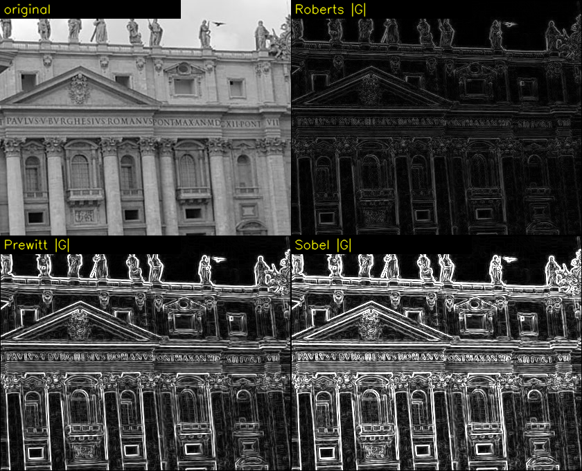
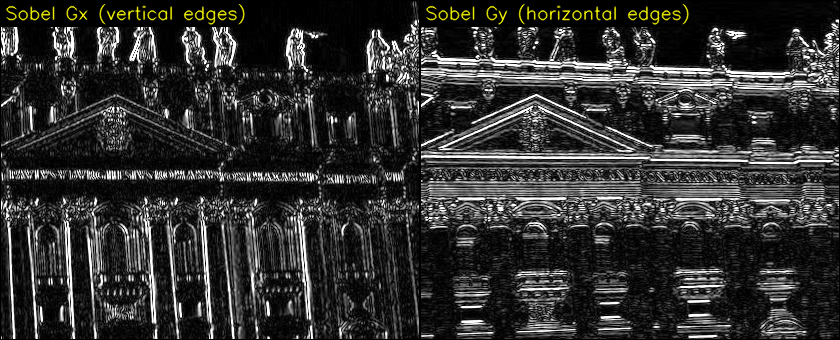

# Part 2. 에지 검출 ①: 1차 미분 — Step 2-1, 2-2

이번에는 **Step 2-1(에지란 무엇인가)**과 **Step 2-2(미분을 디지털로 바꾸기)**를 합니다. 둘 다 코드에 들어가기 전에 필요한 개념이라 묶었어요. 로버츠, 프리윗, 소벨 코드는 다음에 다룹니다. 이번에도 숫자는 전부 실제로 돌려서 확인한 값이에요.

---

## 🔁 Part 1 퀴즈 답

**1번. 1/16 가중치 마스크**

```
원소 합 = (1 + 2 + 1 + 2 + 4 + 2 + 1 + 2 + 1) / 16 = 16/16 = 1
평평한 곳(50)에 적용 → 50 × 1 = 50   (밝기 유지)
```

| 위치 | 1/9 블러 | 1/16 마스크 |
|---|---|---|
| 중심 | 0.111 | **0.250** |
| 상하좌우 (거리 1) | 0.111 | 0.125 |
| 대각선 (거리 √2 ≈ 1.41) | 0.111 | 0.0625 |

1/9 블러는 이웃을 모두 똑같이 대하지만, 이 마스크는 **가까울수록 더 믿어요.** 이게 Part 4에서 볼 가우시안 블러의 작은 버전입니다.

**2번. `mask1`을 두 번 적용하면 잡음은?**
실제로 돌려 보면 190 → (1회) 910 → (2회) **5,680**입니다. 주변 값도 −3,590, −3,500처럼 크게 흔들려요. 샤프닝을 반복하면 잡음이 **폭발적으로** 커집니다.

**3번. `[50, 50, 50, 50, 50]`에 f + (f − 평균)을 적용하면?**
평균도 50이라 디테일 = 50 − 50 = 0이고, 결과는 **그대로 50**입니다. 평평한 곳은 변화가 없으니 강조할 것도 없어요.

---

## Step 2-1. 에지란 무엇인가?

### 2-1-a. 이미지를 지형도로 보기

여기서 **관점을 하나 바꿔 볼게요.** 흑백 이미지를 "**밝기 = 높이**"인 지형으로 상상하는 겁니다.

```
   이미지 (위에서 본 모습)                옆에서 본 모습 (한 행을 잘라서)
   ░ ░ ░ █ █                           높이
   ░ ░ ░ █ █              ──▶          100 |          ┌─────── 고원
   ░ ░ ░ █ █                                |          │
   ░ ░ ░ █ █                             10 | ─────────┘  ← 절벽
                                            +──────────────
                                              어두운 평지 │ 밝은 고원
                                                         └ 이 절벽이 에지
```

- 밝은 곳은 높은 곳(산, 고원), 어두운 곳은 낮은 곳(골짜기, 평지)입니다.
- **에지는 지형이 갑자기 가팔라지는 곳**, 즉 절벽이에요.
- 평평한 곳은 어디를 걸어도 높이가 같으니 에지가 없어요.

🧠 **등산 비유:** 등산로를 걷는다고 할 때, 우리가 신경 쓰는 건 **지금 높이가 몇 미터냐**보다 **지금 길이 얼마나 가파르냐**예요. 에지 검출기는 이미지의 모든 위치에서 "여기 얼마나 가파르지?"를 재는 경사계입니다.

### 실제 이미지에서 확인하기

[chap07/images/edge.jpg](../../chap07/images/edge.jpg)는 성 베드로 대성당의 정면 사진입니다 (420×340). 밝은 기둥과 어두운 창문이 번갈아 있어서 에지가 아주 많아요.

250번째 행의 x = 84~93을 잘라 보면, **밝은 기둥에서 어두운 그림자로 넘어가는 지점**입니다 (실제 화소값, 막대 하나 = 10).

```
 x    밝기
 84   165  ████████████████▌
 85   160  ████████████████
 86   160  ████████████████
 87   164  ████████████████▍        ← 기둥 (밝은 고원)
 88   157  ███████████████▋
 89   109  ██████████▉             ← 내려가는 중
 90    51  █████                    ← 그림자 (골짜기 바닥)
 91    52  █████▏
 92    79  ███████▉
 93    99  █████████▉               ← 다시 올라감
```

눈여겨볼 점이 세 가지 있어요.
1. **x = 88 → 90 사이에서 밝기가 157 → 51로 급락**합니다. 이게 에지예요.
2. 급락이 한 칸 만에 끝나지 않고, 중간에 109를 거쳐 **2칸에 걸쳐** 일어나요. 실제 사진의 경계는 렌즈 흐림 때문에 완벽한 계단이 아닙니다.
3. 기둥 위(x = 84~88)에서도 165, 160, 160, 164, 157로 **조금씩 흔들려요.** 돌 표면의 질감과 카메라 잡음입니다. 이건 에지가 아니라 무시하고 싶은 작은 흔들림이에요.

### 2-1-b. 에지의 네 가지 모양

밝기를 옆에서 본 모양(프로파일)으로 에지를 분류하면:

```
 ① 계단형 (step)      ② 경사형 (ramp)       ③ 선형 (line)         ④ 지붕형 (roof)
     ┌────               ╱────                 ┌┐                    ╱╲
     │                  ╱                      ││                   ╱  ╲
 ────┘              ───╱                   ────┘└────           ───╱    ╲───
 한 칸 만에 급변      여러 칸에 걸쳐 변함      가는 선 (전선, 글자 획)   완만한 선
 (이론적인 에지)      (실제 사진의 에지)       양쪽에 에지 2개
```

실제 사진에서는 ②번 경사형이 가장 흔해요. 위의 157 → 109 → 51이 바로 그 예입니다.

### 2-1-c. 에지 검출기에게 원하는 정보 3가지

| 정보 | 질문 | 지형 비유 |
|---|---|---|
| **위치** | 에지가 어디에 있나? | 절벽이 어디 있나 |
| **세기** (크기) | 얼마나 강한 에지인가? | 절벽이 얼마나 가파른가 |
| **방향** | 어느 쪽으로 밝아지나? | 어느 쪽이 오르막인가 |

이 세 가지를 한꺼번에 알려주는 수학 도구가 **미분**입니다.

---

## Step 2-2. 미분을 디지털로 바꾸기 📐

### 2-2-a. 미분 = 기울기 = 경사계

> **📚 고등학교 미분 복습**
> ```
>            f(x + h) − f(x)
> f'(x) = lim ───────────────
>         h→0        h
> ```
> "x에서 아주 조금(h) 움직였을 때 높이가 얼마나 변하나"를 h로 나눈 값, 즉 **기울기**입니다.
> 기울기가 크면 가파르고, 0이면 평평해요.

**문제:** 디지털 이미지에서는 h를 0에 가깝게 보낼 수 없어요. 화소 사이에는 아무것도 없고, 움직일 수 있는 최소 거리가 **1칸**이거든요.

**해결:** 그냥 h = 1을 씁니다. 그러면 분모가 1이 되어 사라지고 **뺄셈만** 남아요.

```
f'(x) ≈ f(x + 1) − f(x)       "오른쪽 이웃 − 나"
```

이걸 **차분**(difference)이라고 합니다. 연속 세계의 "미분"을 디지털 세계에서는 "이웃끼리 빼기"로 근사하는 거예요.

### 차분의 세 가지 버전

| 이름 | 식 | 1D 마스크 | 원소 합 |
|---|---|---|---|
| 전진 차분 | f(x+1) − f(x) | `[−1, 1]` (나, 오른쪽) | 0 |
| 후진 차분 | f(x) − f(x−1) | `[−1, 1]` (왼쪽, 나) | 0 |
| **중앙 차분** | f(x+1) − f(x−1) | **`[−1, 0, 1]`** | 0 |

**Part 1의 원소 합 규칙과 연결해 보세요.** 세 마스크 모두 **원소 합 = 0**이에요. Step 1-4-g에서 "원소 합이 0이면 평평한 곳은 0이 되고 변화가 있는 곳만 남는다"고 했죠. 그 마스크가 바로 **미분**이었던 겁니다.

> 💡 **중앙 차분 `[−1, 0, 1]`을 회선 레시피로 읽어 보기**
> 왼쪽 이웃 × (−1) + 나 × 0 + 오른쪽 이웃 × (+1) = **오른쪽 − 왼쪽**
> 나 자신은 계산에 안 들어가요 (가중치 0). 내 양옆을 비교해서 내 위치의 기울기를 추정합니다.

**왜 중앙 차분을 주로 쓸까요?** 전진 차분 f(x+1) − f(x)는 사실 x와 x+1 **사이**의 기울기예요. 결과를 x에 적으면 반 칸 어긋납니다. 중앙 차분은 x를 중심으로 **좌우 대칭**이라 결과가 정확히 x에 놓여요. 그리고 대칭인 3칸 마스크라서 3×3 회선 틀에 그대로 넣을 수 있습니다. 로버츠를 뺀 프리윗, 소벨은 전부 중앙 차분을 기반으로 해요.

> 정확히는 중앙 차분이 (f(x+1) − f(x−1)) / **2**여야 해요 (두 칸 거리니까). 하지만 에지 검출에서는 **상대적인 크기**만 중요해서 /2를 생략합니다. 그래서 아래 값들이 전진 차분보다 2배쯤 커 보여요.

---

### 2-2-b. 1차원 실험: 여러 모양에 차분을 적용해 보기 ✍️

여섯 칸짜리 신호에 전진 차분과 중앙 차분을 모두 계산했습니다.

#### 실험 ① 계단 (어두움 → 밝음)

```
x            :    0     1     2     3     4     5
f            :   10    10    10   200   200   200
전진 f(x+1)−f(x):  0     0   190     0     0     -
중앙 f(x+1)−f(x−1): -     0   190   190     0     -
```

평평한 곳은 0이고 **경계에서만 큰 값**이 나와요. 중앙 차분은 경계 **양쪽 두 칸**(x=2, 3)에서 반응합니다. 에지가 2칸 두께로 나온다는 건 기억해 두세요. Part 6 캐니에서 이걸 1칸으로 얇게 만드는 방법을 배웁니다.

#### 실험 ② 경사 (천천히 밝아짐)

```
f            :   10    10    70   130   190   190
전진         :    0    60    60    60     0     -
중앙         :    -    60   120   120    60     -
```

같은 10 → 190 변화라도 **여러 칸에 나눠서 변하면 차분 값이 작아요** (190이 아니라 60씩). 대신 넓게 퍼집니다. 흐릿한 에지는 약하고 두꺼운 에지로 검출된다는 뜻이에요.

#### 실험 ③ 반대 계단 (밝음 → 어두움)

```
f            :  200   200   200    10    10    10
전진         :    0     0  −190     0     0     -
중앙         :    -     0  −190  −190     0     -
```

**값이 음수**가 됐어요. 부호가 **방향**을 알려줍니다.
- **+** : 오른쪽으로 갈수록 밝아짐 (어두움 → 밝음)
- **−** : 오른쪽으로 갈수록 어두워짐 (밝음 → 어두움)

에지가 있는지만 알고 싶으면 부호를 버리고 **절댓값**을 보면 됩니다. Step 1-4-f에서 "에지 검출에서는 `convertScaleAbs`가 맞다"고 한 이유가 이거예요. 샤프닝에서 음수는 "더 어둡게"였지만, 에지에서 음수는 "**반대 방향의 경계**"라서 절댓값을 취해도 에지의 세기는 그대로 남습니다.

#### 실험 ④ 평평함

```
f            :   50    50    50    50    50    50
전진, 중앙    :   전부 0
```

#### 실험 ⑤ 잡음 한 점 ⚠️

```
f            :   10    10    10    40    10    10
전진         :    0     0    30   −30     0     -
중앙         :    -     0    30     0   −30     -
```

물체 경계도 아닌 **잡음 하나에 ±30이라는 가짜 에지 반응**이 생겼어요. 미분은 "변화"에 반응하는데, 잡음도 변화거든요. **미분은 잡음에 약합니다.** 이 약점이 다음 Step에서 프리윗과 소벨이 "미분하면서 동시에 살짝 흐리는" 구조를 갖게 된 이유예요.

#### 실험 ⑥ 실제 이미지 (edge.jpg 250행, 위에서 본 기둥 경계)

```
x            :   84    85    86    87    88    89    90    91    92    93
f            :  165   160   160   164   157   109    51    52    79    99
전진         :   −5     0     4    −7   −48   −58     1    27    20     -
중앙         :    -    −5     4    −3   −55  −106   −57    28    47     -
```

| 구간 | 중앙 차분 값 | 의미 |
|---|---|---|
| x = 85~87 (기둥 위) | −5, 4, −3 | 돌 질감과 잡음. **작은 값** |
| x = 88~90 (기둥 → 그림자) | −55, **−106**, −57 | **진짜 에지.** 크고 음수 (밝음 → 어두움) |
| x = 91~92 (그림자 → 창틀) | 28, 47 | 작은 반대 방향 에지 (어두움 → 밝음) |

진짜 에지(−106)와 잡음(±5)이 **크기로 확실히 구별**돼요. 나중에 "절댓값이 몇 이상이면 에지로 본다"는 **임계값**을 정하면 둘을 가를 수 있습니다 (Part 6 캐니의 핵심).

### 📌 1차원 실험 정리

| 신호 모양 | 차분 결과 | 배운 점 |
|---|---|---|
| 평평함 | 0 | 변화가 없으면 반응 없음 |
| 계단 | 경계에서 큰 값 (중앙 차분은 2칸) | 에지 = 차분이 큰 곳 |
| 경사 | 작고 넓은 값 | 흐릿한 에지는 약하게 검출됨 |
| 반대 계단 | 음수 | **부호 = 방향**, 절댓값 = 세기 |
| 잡음 | ± 가짜 반응 | 미분은 잡음에 약함 |

---

### 2-2-c. 2차원으로 확장: 그래디언트 📐

이미지는 2차원이라 기울기를 **두 방향**으로 잴 수 있어요.

| 기호 | 이름 | 의미 | 3×3 마스크 (중앙 차분) |
|---|---|---|---|
| **Gx** | x방향 편미분 ∂f/∂x | 왼쪽 → 오른쪽으로 갈 때 밝기 변화 | `0 0 0 / −1 0 1 / 0 0 0` |
| **Gy** | y방향 편미분 ∂f/∂y | 위 → 아래로 갈 때 밝기 변화 | `0 −1 0 / 0 0 0 / 0 1 0` |

**두 값을 묶은 벡터 (Gx, Gy)를 그래디언트**라고 합니다. 🧠 **지형에서 "가장 가파른 오르막 방향을 가리키는 화살표"**예요. 화살표의 **길이 = 경사의 세기**, 화살표의 **방향 = 오르막 방향**입니다.

### ⚠️ 이름 함정: "수직 마스크"는 x방향 미분이다

03~05번 코드 주석에 `# 수직 마스크`, `# 수평 마스크`라는 말이 나오는데, 처음 보면 정말 헷갈려요.

```
 Gx 마스크 (x방향 미분)               이 마스크가 반응하는 에지
   −1  0  1                            ░ ░ ░ █ █
   −1  0  1    ← 숫자가 세로로          ░ ░ ░ █ █     ← 경계선이 세로(수직)로 서 있음
   −1  0  1      늘어서 있음            ░ ░ ░ █ █
 "수직 마스크"                         "수직 에지"
```

| 코드 주석의 이름 | 수학 이름 | 계산하는 것 | 찾아내는 에지 |
|---|---|---|---|
| 수직 마스크 | Gx | 가로 방향 밝기 변화 | **세로선** (기둥 테두리) |
| 수평 마스크 | Gy | 세로 방향 밝기 변화 | **가로선** (처마, 창틀 위아래) |

외우는 법: **가로로 미분하면 세로선이 걸린다.** 가로로 걸어가다가 세로로 서 있는 벽에 부딪히는 장면을 떠올리면 돼요.

### 예제 A: 세로 경계 (Part 1의 5×5에서 잡음을 뺀 것)

```
  10  10  10 100 100
  10  10  10 100 100        Gx (안쪽 3×3)     Gy (안쪽 3×3)
  10  10  10 100 100   ──▶   0  90  90         0   0   0
  10  10  10 100 100         0  90  90         0   0   0
  10  10  10 100 100         0  90  90         0   0   0
```

Gx만 반응하고 Gy는 전부 0이에요. 위아래로는 밝기 변화가 전혀 없으니까요. 그래디언트는 (90, 0), 즉 **오른쪽을 가리키는 화살표**입니다.

### 예제 B: 대각선 경계

```
       j=0  j=1  j=2  j=3  j=4
 i=0    10   10   10   10  100
 i=1    10   10   10  100  100
 i=2    10   10  100  100  100        경계선이 ╱ 방향으로 그어져 있음
 i=3    10  100  100  100  100        (왼쪽 위는 어둡고, 오른쪽 아래는 밝음)
 i=4   100  100  100  100  100
```

**중심 (2,2)를 손으로 계산하면:**

```
Gx = 오른쪽 − 왼쪽 = f(2,3) − f(2,1) = 100 − 10 = 90
Gy = 아래  − 위   = f(3,2) − f(1,2) = 100 − 10 = 90
그래디언트 = (90, 90)
```

안쪽 3×3 전체 결과 (실행값):

```
      Gx                Gy              크기 √(Gx²+Gy²)         방향 (도)
  0   90   90       0   90   90       0    127.3  127.3       0   45   45
 90   90    0      90   90    0     127.3  127.3    0        45   45    0
 90    0    0      90    0    0     127.3    0      0        45    0    0
```

이번에는 Gx와 Gy가 **둘 다** 반응해요. 대각선 경계는 가로로 걸어도, 세로로 걸어도 밝기가 변하니까요.

### 크기(세기) 구하기

그래디언트 (Gx, Gy)의 길이는 피타고라스 정리로 구합니다.

```
크기 = √(Gx² + Gy²) = √(90² + 90²) = √(8100 + 8100) = √16200 ≈ 127.3
```

OpenCV에서는 `cv2.magnitude(Gx, Gy)`가 이 계산을 합니다. 03~05번 코드의 `differential()` 함수에 있는 바로 그 줄이에요.

제곱근 계산이 느리다고 보고 **근사식**을 쓰기도 합니다.

| 방법 | 식 | (90, 90)일 때 | (90, 0)일 때 | 쓰는 곳 |
|---|---|---|---|---|
| 정확한 크기 | √(Gx² + Gy²) | 127.3 | 90 | 03~05 `cv2.magnitude` |
| 절댓값 합 | \|Gx\| + \|Gy\| | **180** | 90 | 08 캐니 코드 (`np.fabs(Gx) + np.fabs(Gy)`) |

절댓값 합은 대각선 에지를 **약 1.41배 과대평가**해요 (180 / 127.3). 계산은 빠르지만 정확하지 않습니다.

### 방향 구하기

그래디언트 화살표의 각도는 `atan2(Gy, Gx)`로 구하고, OpenCV에서는 `cv2.phase(Gx, Gy)`가 이 일을 합니다. 실행 결과:

| (Gx, Gy) | 크기 | `cv2.phase` (라디안) | 도 | 화살표 | 의미 |
|---|---|---|---|---|---|
| (90, 0) | 90.00 | 0.0000 | 0° | → | 오른쪽으로 밝아짐 → **세로** 에지 |
| (90, 90) | 127.28 | 0.7852 | 45° | ↘ | 오른쪽 아래로 밝아짐 → **╱** 에지 |
| (0, 90) | 90.00 | 1.5708 | 90° | ↓ | 아래로 밝아짐 → **가로** 에지 |
| (−90, 0) | 90.00 | 3.1416 | 180° | ← | 왼쪽으로 밝아짐 → 세로 에지 (반대 방향) |
| (0, −90) | 90.00 | 4.7124 | 270° | ↑ | 위로 밝아짐 → 가로 에지 (반대 방향) |

⚠️ **이미지 좌표에서는 y축이 아래를 향합니다.** 그래서 수학 시간과 달리 90°가 ↑가 아니라 **↓**예요. 이 차이는 Part 6 캐니의 방향 계산에서 다시 중요해집니다.

> 💡 45°가 정확히 0.7854(π/4)가 아니라 0.7852로 나온 건, `cv2.phase`가 속도를 위해 **근사 계산**(오차 약 0.3°)을 하기 때문이에요.

### 🗝️ 가장 중요한 그림: 그래디언트는 에지에 **수직**이다

```
  예제 B (대각선 경계)

     어두움  ╱  밝음
            ╱
           ╱  ──▶ ↘ 그래디언트 (45°)
          ╱        "이쪽으로 가면 가장 빨리 밝아진다"
         ╱
  에지 선 방향 = ╱ (오른쪽 위 ↗ 또는 왼쪽 아래 ↙)
  그래디언트 방향 = ↘   ← 둘은 90° 직각
```

🧠 **등고선 비유:** 지도에서 등고선(같은 높이를 이은 선)을 따라 걸으면 높이가 변하지 않아요. **가장 가파른 오르막은 항상 등고선과 직각 방향**입니다. 에지 선은 등고선과 같고, 그래디언트는 그 선을 **가로질러 올라가는 방향**이에요.

이 사실은 Part 6 캐니의 "비최대 억제"에서 핵심으로 쓰입니다. 에지를 얇게 깎을 때 **그래디언트 방향으로 양옆 이웃과 비교**하거든요.

---

### 2-2-d. 코드와 연결: `differential()` 미리 보기

03~05번 파일이 공통으로 쓰는 [Common/filters.py](../../Common/filters.py)의 `differential()`은 지금까지 배운 내용을 그대로 코드로 옮긴 것입니다.

```python
def differential(image, data1, data2):
    mask1 = np.array(data1, np.float32).reshape(3, 3)   # Gx 마스크 ("수직 마스크")
    mask2 = np.array(data2, np.float32).reshape(3, 3)   # Gy 마스크 ("수평 마스크")

    dst1 = filter(image, mask1)        # Gx 지도: 화소마다 가로 기울기 (음수 가능, float32)
    dst2 = filter(image, mask2)        # Gy 지도: 화소마다 세로 기울기
    dst = cv2.magnitude(dst1, dst2)    # 에지 세기 지도: √(Gx² + Gy²)

    dst = cv2.convertScaleAbs(dst)     # 세기는 항상 0 이상 → 반올림 + 255에서 자르기
    dst1 = cv2.convertScaleAbs(dst1)   # Gx는 음수 가능 → 절댓값 (부호 = 방향은 버림)
    dst2 = cv2.convertScaleAbs(dst2)
    return dst, dst1, dst2
```

```
image ─┬─ filter(Gx 마스크) ─▶ dst1 (Gx) ─┬─▶ convertScaleAbs ─▶ "세로 에지" 창
       │                                  │
       │                                  ├─ cv2.magnitude ─▶ dst ─▶ "전체 에지" 창
       │                                  │
       └─ filter(Gy 마스크) ─▶ dst2 (Gy) ─┴─▶ convertScaleAbs ─▶ "가로 에지" 창
```

로버츠, 프리윗, 소벨의 차이는 **이 함수에 넣는 `data1`, `data2` 마스크 숫자뿐**입니다. 회선 엔진은 Part 1과 같고, 그 위에 `magnitude`만 하나 더 얹은 구조예요.

---

## 📋 Step 2-1, 2-2 요약

| 개념 | 한 줄 정리 |
|---|---|
| 이미지 = 지형 | 밝기 = 높이, **에지 = 절벽** (가파른 곳) |
| 실제 에지 | 완벽한 계단이 아니라 2~3칸에 걸친 경사 (157 → 109 → 51) |
| 미분 → 차분 | h = 1로 두면 미분이 **이웃끼리 빼기**가 됨. 마스크 원소 합 = 0 |
| 중앙 차분 `[−1, 0, 1]` | 오른쪽 − 왼쪽. 중심 대칭이라 3×3 틀에 맞음 |
| 부호와 절댓값 | 부호 = 밝아지는 방향, 절댓값 = 세기 → 에지에서는 `convertScaleAbs`가 맞음 |
| 약점 | 잡음 한 점에도 ± 가짜 반응 |
| 그래디언트 (Gx, Gy) | 크기 √(Gx² + Gy²) = `cv2.magnitude`, 방향 atan2 = `cv2.phase` |
| 이름 함정 | "수직 마스크" = Gx = **세로선**을 찾음 |
| 핵심 기하 | 그래디언트는 에지 선에 **수직** (등고선을 가로지르는 오르막) |

### ✅ 확인 질문

1. 1D 신호 `[100, 100, 100, 100, 30, 30]`에 중앙 차분 `[−1, 0, 1]`을 적용하면? 어느 위치에서 0이 아닌 값이 나오고, 부호는 무엇이며, 그게 무슨 뜻인가요?
2. 아래처럼 위쪽은 밝고 아래쪽은 어두운 **가로 경계**에서, 가운데 화소의 Gx, Gy, 크기, `cv2.phase` 각도(도)는?
   ```
   200 200 200
   200 200 200
    20  20  20
   ```
3. `|Gx| + |Gy|` 근사가 정확한 크기와 **같아지는** 경우는 언제일까요?

---

다음은 **Step 2-3 ~ 2-5: 로버츠 → 프리윗 → 소벨**입니다. 같은 이미지에 세 마스크를 적용해서 값을 나란히 비교하고, 프리윗과 소벨이 "평균 × 차분" 구조로 잡음(실험 ⑤)을 어떻게 누르는지 보여드릴게요. 마지막에는 `cv2.Sobel` 인자를 하나씩 해부합니다.

**"다음"**이라고 하시면 이어가고, 어려운 부분이 있으면 **"더 쉽게"**라고 해 주세요. 지형도와 그래디언트 화살표를 HTML 인터랙티브로 보여드릴게요.

---

# Part 2 · Step 2-3 ~ 2-5. 로버츠 → 프리윗 → 소벨

Part 2 계산과 비교 이미지 생성이 끝났어요. 결과를 정리해서 Step 2-3~2-5 설명을 씁니다.

로버츠, 프리윗, 소벨은 모두 Step 2-2-d의 `differential()` 틀에 **마스크 숫자만 바꿔 넣은 것**이에요. 그래서 세 개를 한 번에 비교하면서 진행합니다. 이번에도 숫자는 전부 실행해서 확인했고, 실제 이미지 결과는 그림 파일로 저장해 두었어요.

---

## 🔁 지난 확인 질문 답

**1번. `[100, 100, 100, 100, 30, 30]`에 중앙 차분**

```
x     :    0     1     2     3     4     5
f     :  100   100   100   100    30    30
중앙  :    -     0     0   −70   −70     -
```

x = 3, 4에서 **−70**입니다. 음수이므로 "오른쪽으로 갈수록 **어두워지는**" 경계예요.

**2번. 위가 밝고 아래가 어두운 가로 경계**

```
Gx = 오른쪽 − 왼쪽 = 200 − 200 = 0
Gy = 아래 − 위    = 20 − 200   = −180
크기 = √(0² + 180²) = 180
cv2.phase(0, −180) = 270°  → ↑ (위쪽으로 갈수록 밝아짐)
```

**3번. `|Gx| + |Gy|`가 정확한 크기와 같아지는 경우**
Gx 또는 Gy 중 하나가 **0일 때**, 즉 경계가 정확히 세로이거나 가로일 때입니다. 예: (90, 0) → 90 + 0 = 90 = √(90²) ✓. 대각선일수록 오차가 커지고, 45°에서 최대(×1.41)예요.

---

## 🧪 이번 Step에서 쓰는 실험 세트

세 연산자를 같은 조건에서 비교하려고 5×5 시험 이미지 세 개를 준비했습니다.

```
 V: 세로 경계               N: 잡음 한 점 (평평한 10에 40 하나)    D: 대각선 경계 (╱)
 10 10 10 100 100          10 10 10 10 10                      10  10  10  10 100
 10 10 10 100 100          10 10 10 10 10                      10  10  10 100 100
 10 10 10 100 100          10 10 40 10 10                      10  10 100 100 100
 10 10 10 100 100          10 10 10 10 10                      10 100 100 100 100
 10 10 10 100 100          10 10 10 10 10                     100 100 100 100 100
```

- **V**: 진짜 에지에 얼마나 크게 반응하나 → **크면 좋음**
- **N**: 가짜 에지(잡음)에 얼마나 반응하나 → **작으면 좋음**
- **D**: 대각선 에지를 어떻게 처리하나

---

## Step 2-3. 로버츠 (Roberts, 1963): [chap07/03.edge_roberts.py](../../chap07/03.edge_roberts.py)

### 2-3-a. 마스크 모양: 3×3 안에 숨은 2×2

```python
data1 = [-1, 0, 0,          data2 = [ 0, 0, -1,
          0, 1, 0,                    0, 1,  0,
          0, 0, 0]                    0, 0,  0]
```

0이 아닌 칸만 남기면 **원소 2개짜리 대각선 차분**이에요.

```
data1:  −1  ·             data2:   ·  −1
         ·  +1                    +1   ·
   중심 − 왼쪽 위                 중심 − 오른쪽 위
   = ↘ 방향 차분                  = ↙ 방향 차분
```

원래 로버츠 연산자는 2×2 마스크예요. 그런데 이 책의 `filter()` 함수는 마스크 중심이 있어야 해서(홀수 크기), **3×3 틀의 왼쪽 위 구석에 2×2를 끼워 넣은** 겁니다. 오른쪽과 아래 칸은 0이라 계산에 참여하지 않아요.

로버츠는 Step 2-2의 **전진 차분을 대각선으로 돌린 것**입니다. x, y축 방향이 아니라 두 대각선 방향으로 기울기를 재요.

### 2-3-b. 손계산 ✍️

**V (세로 경계)에서 i=2 행, 실행 결과:**

```
                        j=1    j=2    j=3
data1 (↘ 차분)        :    0      0     90     ← j=3: f(2,3) − f(1,2) = 100 − 10 = 90
data2 (↙ 차분)        :    0    −90      0     ← j=2: f(2,2) − f(1,3) = 10 − 100 = −90
크기 √(d1² + d2²)     :    0     90     90
```

두 마스크가 **서로 다른 칸**에서 반응해요. data1은 경계 오른쪽(j=3), data2는 경계 왼쪽(j=2)에서 반응하고, 둘을 합치면 2칸짜리 에지가 됩니다.

**D (대각선 ╱ 경계), 실행 결과:**

```
data1 (↘)          data2 (↙)          크기
  0   0  90         0  0  0            0   0  90
  0  90  90         0  0  0            0  90  90
 90  90   0         0  0  0           90  90   0
```

**data2는 전부 0**이에요. 왜 그럴까요?

```
   ╱ 경계                         data1: ↘ 방향으로 비교 → 경계를 가로지름 → 반응 ✅
  어둠 ╱ 밝음                     data2: ↙ 방향으로 비교 → 경계를 따라 걸음
      ╱                                  (같은 높이의 등고선 위를 걷는 셈) → 0
```

Step 2-2-c에서 "등고선(에지)을 따라 걸으면 높이가 변하지 않는다"고 했죠. data2는 ╱ 경계와 **나란한 방향**으로 비교해서 반응하지 않는 거예요. 그래서 대각선 에지를 빠짐없이 잡으려면 **두 대각선 마스크가 모두 필요**합니다.

**N (잡음 한 점):**

```
크기:   0     0     0
        0  [42.4]   0      ← 잡음 자리: d1 = 30, d2 = 30 → √(30² + 30²) = 42.4
       30     0    30
```

진짜 에지 반응은 **90**, 잡음 반응은 **42.4**예요. 차이가 겨우 2배 정도라서 잡음을 에지로 착각하기 쉽습니다.

### 2-3-c. 로버츠의 장단점

| 장점 | 단점 |
|---|---|
| 계산이 아주 적음 (뺄셈 2번) | 화소 2개만 비교 → **잡음에 매우 약함** |
| 2×2라서 에지 위치가 가늘고 정확함 | 반 칸 어긋남 (중심이 화소가 아니라 화소 사이) |
| | 반응 값이 작아서 결과 이미지가 어두움 |

### 2-3-d. 코드에서 볼 점: `np.abs + np.clip` vs `convertScaleAbs`

03번 파일은 `differential()`을 공용 모듈에서 가져오지 않고 **직접 정의**했어요. 마지막 변환 부분이 [Common/filters.py](../../Common/filters.py) 버전과 다릅니다.

```python
# 03.edge_roberts.py                          # Common/filters.py (04, 05가 사용)
dst = cv2.magnitude(dst1, dst2)               dst = cv2.magnitude(dst1, dst2)
dst1, dst2 = np.abs(dst1), np.abs(dst2)       dst  = cv2.convertScaleAbs(dst)
dst  = np.clip(dst, 0, 255).astype("uint8")   dst1 = cv2.convertScaleAbs(dst1)
dst1 = np.clip(dst1,0, 255).astype("uint8")   dst2 = cv2.convertScaleAbs(dst2)
```

| 단계 | 03 방식 | Common 방식 |
|---|---|---|
| 절댓값 | `np.abs` | `convertScaleAbs` 안에서 |
| 범위 자르기 | `np.clip(0, 255)` | `convertScaleAbs` 안에서 |
| 소수점 | `astype` → **버림** | **반올림** |

결과는 거의 같고 소수점 처리에서 최대 1만 차이 나요. 같은 일을 하는 두 가지 방법이라고 보면 됩니다. Step 1-3-e에서 본 버림 vs 반올림 차이가 여기서 다시 나온 거예요.

---

## Step 2-4. 프리윗 (Prewitt, 1970): [chap07/04.edge_prewitt.py](../../chap07/04.edge_prewitt.py)

### 2-4-a. 마스크 분해: "평균 내고 → 차분하기"

```python
data1 = [-1, 0, 1,     # Gx ("수직 마스크")
         -1, 0, 1,
         -1, 0, 1]
data2 = [-1,-1,-1,     # Gy ("수평 마스크")
          0, 0, 0,
          1, 1, 1]
```

Gx 마스크는 **두 1차원 마스크의 곱**(외적)으로 쪼갤 수 있어요. 실행해서 확인한 결과:

```
  세로 방향 [1]                  가로 방향
            [1]   ×   [−1, 0, 1]   =    −1  0  1
            [1]                         −1  0  1
                                        −1  0  1
  "위·가운데·아래 3줄을 더함"   "오른쪽 − 왼쪽"      프리윗 Gx
   = 세로로 평균 (블러)         = 가로로 미분
```

즉, 프리윗 Gx는 **세로로 3줄을 합쳐서 잡음을 누른 다음, 가로로 중앙 차분**을 하는 마스크입니다. Part 1의 블러와 Part 2의 미분을 **한 마스크에 합친** 셈이에요.

🧠 **비유: 증인 세 명.** 중앙 차분 하나는 증인 한 명의 말만 듣고 "여기 절벽이 있다"고 판단하는 거예요. 프리윗은 **바로 위, 같은 줄, 바로 아래, 세 증인**에게 물어서 합칩니다. 진짜 절벽이면 세 명 모두 "있다"고 말하고, 잡음이면 한 명만 헛것을 본 거라 다른 두 명이 "없다"고 말하겠죠.

### 2-4-b. 손계산 ✍️

**V (세로 경계), 중심 (2,2):**

```
윈도우             마스크 Gx            곱
10  10  100       −1  0  1         −10   0  100     → 행 합 90
10  10  100   ⊙   −1  0  1    =    −10   0  100     → 행 합 90
10  10  100       −1  0  1         −10   0  100     → 행 합 90
                                                  ─────────
                                                  Gx = 270
```

3줄 각각에서 중앙 차분 90이 나오고, 합쳐서 **270**(= 3 × 90)이 됩니다.

**N (잡음 한 점), 실행 결과:**

```
Gx                       크기
 30   0  −30            42.4  30  42.4
 30   0  −30            30     0  30
 30   0  −30            42.4  30  42.4
```

잡음 40(주변보다 30 큼)은 3줄 중 **한 줄에만** 있어서 Gx가 30을 넘지 못해요. 대신 3×3 범위로 넓게 퍼집니다.

| | 진짜 에지 (V) | 잡음 한 점 (N) 최대 | 에지 / 잡음 |
|---|---|---|---|
| 중앙 차분 | 90 | 30 | 3.0 |
| 로버츠 | 90 | 42.4 | 2.1 |
| **프리윗** | **270** | **42.4** | **6.4** |

에지 반응은 3배가 됐는데 잡음 반응은 그대로라서, **에지와 잡음을 훨씬 쉽게 구별**할 수 있게 됐어요.

### 2-4-c. 더 현실적인 실험: 화면 전체에 잡음을 뿌리면? 📐

실제 카메라 잡음은 한 점이 아니라 **모든 화소가 조금씩 흔들리는** 모양입니다. 그래서 200×200 이미지에 세로 경계(10 → 100)를 만들고, 모든 화소에 표준편차 10인 가우시안 잡음을 더해서 측정했어요.

| 연산자 | 깨끗한 에지 반응 | 평평한 곳의 잡음 반응 (평균) | **에지 / 잡음** |
|---|---|---|---|
| 중앙 차분 | 90 | 17.8 | 5.07 |
| 로버츠 | 90 | 17.5 | 5.15 |
| **프리윗** | 270 | 30.5 | **8.85** |

프리윗이 약 **1.75배** 좋아졌어요. 왜 3배가 아니라 1.75배일까요? 수학적으로 설명할 수 있습니다.

```
진짜 에지: 3줄 모두 같은 값(+90)  → 더하면 정확히 3배          → 신호 ×3
랜덤 잡음: 3줄이 제각각 + 또는 −  → 더하면 일부가 서로 상쇄    → 잡음 ×√3 ≈ ×1.73

에지/잡음 비율 개선 = 3 / √3 = √3 ≈ 1.73배

검증: 5.07 × 1.73 = 8.77  ≈  실측 8.85 ✓
```

> 💡 **"같은 방향의 신호는 그대로 쌓이고, 랜덤한 잡음은 서로 상쇄된다."**
> 이건 사진 여러 장을 겹쳐서 잡음을 줄이는 기법(스태킹), 여러 번 측정해서 평균을 내는 실험 등 신호 처리 전반에 통하는 원리예요. 데이터 N개를 더하면 신호는 N배, 잡음은 √N배가 됩니다.

### 2-4-d. 코드

04번 파일의 `differential()`은 [Common/filters.py](../../Common/filters.py)의 함수와 내용이 같아요 (변환에 `convertScaleAbs` 사용). 마스크만 프리윗으로 바꿔서 호출합니다.

---

## Step 2-5. 소벨 (Sobel, 1968): [chap07/05.edge_sobel.py](../../chap07/05.edge_sobel.py)

### 2-5-a. 프리윗과 딱 한 군데가 다르다: 가운데 줄 가중치 2

```
   프리윗 Gx          소벨 Gx
  −1  0  1          −1  0  1
  −1  0  1          −2  0  2     ← 가운데 줄만 2배
  −1  0  1          −1  0  1
```

분해하면 (실행해서 확인):

```
  [1]                        −1  0  1
  [2]  ×  [−1, 0, 1]   =     −2  0  2
  [1]                        −1  0  1
 "가운데 줄을 더 믿는 가중 평균"
```

`[1, 2, 1]`은 Part 1 퀴즈에 나온 1/16 마스크의 한 줄과 같은 모양이에요. **가까운 쪽을 더 믿는 가중 평균**, 즉 **작은 가우시안 블러**입니다. 소벨 = 가우시안 비슷한 블러 + 중앙 차분이에요.

🧠 **증인 비유로 보면:** 프리윗은 세 증인의 말을 똑같이 믿고, 소벨은 **현장 바로 앞에 있던 가운데 증인의 말을 두 배로** 믿습니다.

### 2-5-b. 손계산 ✍️

**V (세로 경계), 중심 (2,2):**

```
행 합:  윗줄 1 × 90  +  가운데 2 × 90  +  아랫줄 1 × 90  =  90 + 180 + 90  =  360
```

**N (잡음 한 점), 실행 결과:**

```
Gx                       크기
 30   0  −30            42.4  60  42.4
 60   0  −60            60     0  60       ← 잡음과 같은 줄은 2배로 반영됨
 30   0  −30            42.4  60  42.4
```

**D (대각선)에서 중심 (2,2):** Gx = 270, Gy = 270, 크기 = 381.8.

### 2-5-c. 그래서 소벨이 프리윗보다 좋은가? 솔직한 측정 결과

같은 조건에서 두 가지를 측정했어요.

**측정 ① 잡음 구별력** (2-4-c와 같은 실험)

| 연산자 | 에지 반응 | 잡음 반응 | 에지 / 잡음 |
|---|---|---|---|
| 프리윗 | 270 | 30.5 | **8.85** |
| 소벨 | 360 | 43.2 | 8.33 |

**잡음 구별력은 오히려 프리윗이 조금 더 좋습니다.** 계산해 보면:

```
소벨: 신호 = 1 + 2 + 1 = 4배,  잡음 = √(1² + 2² + 1²) = √6 ≈ 2.45배
      개선 = 4 / 2.45 = 1.63배   (프리윗은 1.73배)
검증: 5.07 × 1.63 = 8.26  ≈  실측 8.33 ✓
```

**측정 ② 방향 정확도.** 0°부터 90°까지 여러 각도로 부드러운 경계를 만들고, 계산된 그래디언트 방향이 실제 각도와 몇 도나 어긋나는지 쟀어요.

| 연산자 | 평균 방향 오차 | 최대 방향 오차 |
|---|---|---|
| 중앙 차분 | 1.01° | 1.60° |
| 프리윗 | 0.85° | 1.33° |
| **소벨** | **0.38°** | **0.58°** |

**방향 정확도는 소벨이 2배 이상 좋습니다.** 이게 소벨의 진짜 장점이에요.

**왜 그럴까요?** 프리윗은 대각선 이웃(거리 √2 ≈ 1.41)을 상하좌우 이웃(거리 1)과 똑같이 1로 취급해요. 거리가 다른데 같은 대우를 하니까 방향에 따라 반응이 미묘하게 비뚤어집니다. 소벨의 `[1, 2, 1]`은 가까운 쪽에 더 큰 가중치를 줘서, 마스크 모양이 **원에 더 가깝게**(어느 방향이든 공평하게) 반응해요.

> 📌 **정리: 소벨이 표준이 된 이유**
> - 잡음 구별력: 프리윗과 거의 같음 (8.33 vs 8.85)
> - 방향 정확도: 프리윗보다 2배 이상 좋음
> - Part 6 캐니처럼 **그래디언트 방향을 써야 하는** 알고리즘에서는 이 차이가 중요합니다. 그래서 캐니는 소벨을 써요.

### 2-5-d. `cv2.Sobel` 해부와 숨은 함정 ⚠️

05번 파일은 자작 소벨과 OpenCV 소벨을 나란히 보여줍니다.

```python
dst3 = cv2.Sobel(np.float32(image), cv2.CV_32F, 1, 0, 3)  # x방향 미분 - 수직 마스크
dst4 = cv2.Sobel(np.float32(image), cv2.CV_32F, 0, 1, 3)  # y방향 미분 - 수평 마스크
```

| 인자 | 값 | 의미 |
|---|---|---|
| `src` | `np.float32(image)` | 입력 이미지 |
| `ddepth` | `cv2.CV_32F` | 결과 자료형. **음수를 보존**하려고 float32 사용 |
| `dx` | 1 또는 0 | x방향으로 몇 번 미분할지 (1 = Gx) |
| `dy` | 0 또는 1 | y방향으로 몇 번 미분할지 (1 = Gy) |
| 다섯 번째 `3` | ??? | 주석에는 ksize(마스크 크기)라고 되어 있지만... |

**⚠️ 실행해서 확인한 함정: 다섯 번째 위치 인자는 `ksize`가 아니라 `dst`입니다.**

OpenCV 문서의 함수 시그니처를 직접 출력해 보면:

```
Sobel(src, ddepth, dx, dy[, dst[, ksize[, scale[, delta[, borderType]]]]]) -> dst
                          ↑ 다섯 번째는 dst (결과를 담을 배열)
```

그래서 `3`은 마스크 크기로 전달되지 **않아요.** 실험 결과:

| 호출 | `ksize=3`으로 쓴 결과와 같나? | `ksize=5`로 쓴 결과와 같나? |
|---|---|---|
| `cv2.Sobel(f, CV_32F, 1, 0, 3)` | ✅ 같음 | |
| `cv2.Sobel(f, CV_32F, 1, 0, 5)` | ✅ **같음** (!) | ❌ 다름 |

다섯 번째 자리에 무엇을 넣든 **무시되고 기본값 ksize=3**이 쓰입니다.
- 05번에서는 원래 3을 의도했으니 **우연히 결과가 맞아요.**
- **17번(번호판 검출)**의 `cv2.Sobel(gray, cv2.CV_8U, 1, 0, 5)`는 5×5 소벨을 의도했지만 실제로는 3×3으로 계산됩니다. Part 8에서 다시 다룰게요.

**올바른 작성법:** 키워드로 명시하세요.

```python
cv2.Sobel(image, cv2.CV_32F, 1, 0, ksize=3)
```

참고로 `ksize=5`일 때 OpenCV가 실제로 쓰는 마스크는 이렇습니다 (`cv2.getDerivKernels`로 확인):

```
 −1   −2   0    2   1
 −4   −8   0    8   4
 −6  −12   0   12   6       ← [1,4,6,4,1] 세로 블러 × [−1,−2,0,2,1] 가로 미분
 −4   −8   0    8   4          (더 넓게 블러 → 잡음에 더 강하지만 에지는 두꺼워짐)
 −1   −2   0    2   1
```

**자작 소벨과 `cv2.Sobel`은 같을까요?** 테두리 1픽셀을 제외한 안쪽에서 **최대 차이 0.0**, 완전히 같았습니다. 차이는 테두리뿐이에요 (자작은 0, OpenCV는 거울 패딩 — Step 1-2-d).

**`ddepth`를 `cv2.CV_8U`로 하면?** uint8은 음수를 담을 수 없어서 **음수 기울기(밝음 → 어두움)가 전부 0으로 잘려요.** 결과적으로 "어두움 → 밝음" 에지만 남고 반대쪽 에지는 사라집니다. 17번이 바로 이렇게 쓰고 있어요 (Part 8 복선).

---

## Step 2-6. 실제 이미지로 세 연산자 비교 🖼️

edge.jpg에 세 연산자를 모두 적용해서 이미지로 저장했어요. VS Code에서 열어 보세요.

- 2×2 비교 (원본 / 로버츠 / 프리윗 / 소벨): 
- 소벨 Gx vs Gy: 

**수치로 비교하면:**

| | 에지 세기 평균 | 100 이상인 화소 | 255로 포화된 화소 |
|---|---|---|---|
| 로버츠 | 19.2 | 0.5% | 0% |
| 프리윗 | 63.4 | 22.6% | 2.3% |
| 소벨 | 82.1 | 32.8% | 6.0% |

**이미지에서 보이는 것:**

1. **로버츠는 전체적으로 어둡고 선이 가늘어요.** 반응 값이 작기 때문입니다 (최대 증폭 ×1). 기둥 테두리나 창문은 보이지만 희미해요.
2. **프리윗과 소벨은 밝고 선이 굵어요.** ×3, ×4로 증폭되고, 3줄을 합치면서 에지가 두꺼워집니다. 둘은 눈으로 거의 구별이 안 되고, 소벨이 조금 더 밝아요 (포화 6.0%).
3. **소벨 Gx(세로 에지)에는** 기둥의 세로 테두리와 창문 양옆이 또렷하게 나오고, 가로 처마는 거의 사라져요.
4. **소벨 Gy(가로 에지)에는** 처마, 글자 띠(PAVLVS V BVRGHESIVS...)의 위아래 선, 창틀 가로선이 또렷하고, 기둥 세로선은 희미해요.

3, 4번이 Step 2-2-c의 "가로로 미분하면 세로선이 걸린다"를 실제 사진으로 확인한 결과입니다.

> ⚠️ **공정한 비교를 위한 주의점**
> 프리윗과 소벨이 더 밝게 보이는 건 **증폭 배율(×3, ×4) 때문**이지, 에지를 더 잘 찾아서가 아니에요. 각각 3과 4로 나누면 진짜 에지의 밝기는 셋 다 비슷해지고, 남는 차이는 **잡음과 질감이 얼마나 덜 나오느냐**(2-4-c, 2-5-c의 측정)뿐입니다.

---

## 📋 Part 2 정리

| | 로버츠 | 프리윗 | 소벨 |
|---|---|---|---|
| 마스크 | 2×2 대각선 차분 | `[1,1,1]ᵀ × [−1,0,1]` | `[1,2,1]ᵀ × [−1,0,1]` |
| 구조 | 미분만 | 균등 평균 + 미분 | **가중 평균** + 미분 |
| 에지 증폭 | ×1 | ×3 | ×4 |
| 잡음 구별력 (에지/잡음) | 5.15 | **8.85** | 8.33 |
| 방향 오차 (평균) | — | 0.85° | **0.38°** |
| 결과 모습 | 가늘고 어두움 | 굵고 밝음 | 굵고 가장 밝음 |
| 한 줄 평가 | 빠르지만 잡음에 약함 | 잡음에 강함 | 잡음에 강하고 방향이 정확 → **표준** |

```
           Part 1의 회선 엔진
                  │
     ┌────────────┼──────────────┐
     ▼            ▼              ▼
   블러         미분          블러 + 미분 = 프리윗 / 소벨
  (합 = 1)    (합 = 0)       "잡음을 누르면서 경계를 찾는다"
```

**발견한 코드 함정:**
1. `cv2.Sobel(..., 1, 0, 3)`의 다섯 번째 자리는 `dst`라서 `ksize`가 무시됨 → `ksize=`로 명시해야 함 (17번에서 실제 문제)
2. 03번은 `np.abs + clip`(버림), 04, 05번은 `convertScaleAbs`(반올림)로 변환 방식이 다름

### ✅ Part 2 퀴즈

1. 아래 마스크는 무엇을 찾는 마스크일까요? 원소 합은? (힌트: 소벨 마스크를 돌려 보세요)
   ```
    0   1   2
   −1   0   1
   −2  −1   0
   ```
2. 소벨 Gx 결과를 `ddepth=cv2.CV_8U`로 받으면, 원본에서 **밝은 기둥의 왼쪽 테두리와 오른쪽 테두리** 중 어느 쪽만 남을까요? (힌트: 기둥 왼쪽 테두리는 왼쪽에서 오른쪽으로 갈 때 어두움 → 밝음)
3. 프리윗을 `[1,1,1,1,1]ᵀ × [−1,0,1]`(5줄 평균)로 넓히면 잡음 구별력은 이론상 몇 배가 될까요? 대신 무엇을 잃을까요?

---

다음은 **Part 3: 2차 미분, 라플라시안 (06)**입니다. "기울기의 기울기"가 무엇인지, 에지에서 0을 가로지르는 **영교차**가 무엇인지 보고, 라플라시안 마스크 `[0,1,0 / 1,−4,1 / 0,1,0]`을 직접 유도합니다. 그리고 라플라시안이 잡음에 얼마나 약한지 실험으로 확인한 뒤 Part 4(잡음 제거)로 넘어갈 거예요.

**"다음"**이라고 하시면 이어가고, 어려운 부분이 있으면 **"더 쉽게"**라고 해 주세요.
