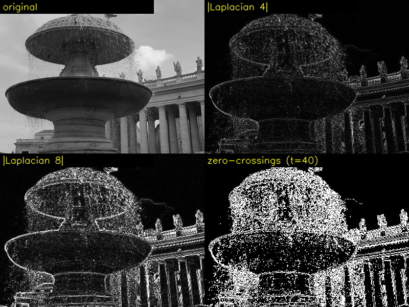
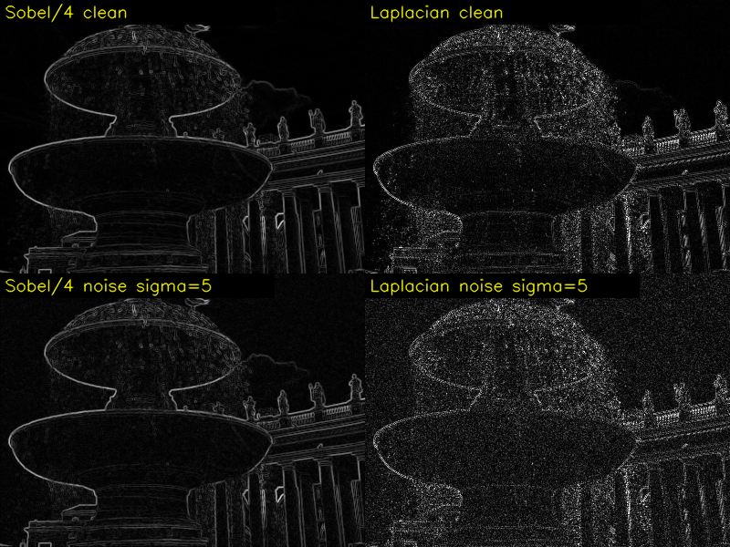

# Part 3. 에지 검출 ②: 2차 미분, 라플라시안 [chap07/06.edge_laplacian.py](../../chap07/06.edge_laplacian.py)

이번 Part는 파일 하나라서 **Step 3-1 ~ 3-4를 한 번에** 진행합니다. 이번에도 숫자는 전부 실행해서 확인했고, 실제 이미지 결과는 그림 파일로 저장했어요.

---

## 🔁 Part 2 퀴즈 답

**1번. 이 마스크는 무엇을 찾을까요?**

```
 0   1   2
−1   0   1        원소 합 = 0 + 1 + 2 − 1 + 0 + 1 − 2 − 1 + 0 = 0  → 미분 마스크
−2  −1   0
```

소벨 Gx를 **45° 돌린** 마스크예요. 양수는 오른쪽 위(↗)에 몰려 있고 음수는 왼쪽 아래(↙)에 있어서, **왼쪽 아래 → 오른쪽 위 방향의 밝기 변화**를 잽니다. 그래디언트는 에지에 수직이니까, 이 마스크가 찾는 에지는 그 방향에 수직인 **╲ 방향 에지**입니다.

**2번. 소벨 Gx를 `CV_8U`로 받으면 기둥의 어느 쪽 테두리가 남을까?**

```
          어두움 │ 밝은 기둥 │ 어두움
                 ↑           ↑
     왼쪽 테두리: 어두움 → 밝음      오른쪽 테두리: 밝음 → 어두움
     Gx > 0 → 남음 ✅               Gx < 0 → 0으로 잘림 ❌
```

**왼쪽 테두리만** 남아요. 기둥 하나에 선이 한 줄만 나오는 거죠. Part 8에서 번호판 코드가 바로 이렇게 동작합니다.

**3번. 5줄 평균 프리윗이면?**

```
신호: ×5,  잡음: ×√5 ≈ 2.24  →  개선 = 5 / √5 = √5 ≈ 2.24배  (3줄일 때는 1.73배)
예상 에지/잡음 비율 ≈ 5.07 × 2.24 ≈ 11.3
```

잃는 것은 **세로 방향의 세밀함**이에요. 5줄을 하나로 뭉치니까 짧은 에지, 모서리, 곡선이 뭉개지고 위치가 흐려집니다. 잡음 억제와 정밀도는 **서로 맞바꾸는 관계**(트레이드오프)예요. 이 주제는 Part 4, 5에서 계속 나옵니다.

---

## Step 3-1. 2차 미분이란? "기울기의 기울기"

### 3-1-a. 🧠 자동차 비유: 위치 → 속도 → 가속도

밝기를 **자동차의 위치**라고 생각해 볼게요.

| 수학 | 자동차 | 이미지 |
|---|---|---|
| f | 위치 | 밝기 |
| f′ (1차 미분) | 속도 = 위치의 변화율 | 밝기가 얼마나 빨리 변하나 (Part 2) |
| f″ (2차 미분) | **가속도** = 속도의 변화율 | 밝기 변화가 빨라지는 중인가, 느려지는 중인가 |

**계단형 에지**는 서 있던 차가 갑자기 출발해서 조금 가다가 다시 멈추는 상황이에요.

```
출발 직전  → 가속 페달 (가속도 +)  → 최고 속도 (가속도 0)  → 브레이크 (가속도 −)  → 정지
              ▲                       ▲                       ▲
           에지 시작                 에지 중심                에지 끝
```

**핵심:** 속도가 가장 빠른 순간(= 1차 미분 최대 = 에지 중심)에 가속도는 **+에서 −로 바뀌면서 0을 지나갑니다.** 이 지점을 **영교차**(zero crossing)라고 해요.

> 📌 **1차 미분의 꼭대기 = 2차 미분의 영교차**
> Part 2에서는 "기울기가 **큰** 곳"을 찾았어요. 2차 미분에서는 "가속도가 **0을 가로지르는** 곳"을 찾습니다. 둘 다 같은 에지 중심을 가리켜요.

### 3-1-b. 📐 2차 차분 공식 유도

1차 차분을 한 번 더 차분하면 됩니다. 반 칸 위치를 써서 유도할게요.

```
f′(x + ½) ≈ f(x + 1) − f(x)          ← x와 x+1 사이의 기울기
f′(x − ½) ≈ f(x) − f(x − 1)          ← x−1과 x 사이의 기울기

f″(x) ≈ f′(x + ½) − f′(x − ½)        ← 기울기의 변화
      = [f(x + 1) − f(x)] − [f(x) − f(x − 1)]
      = f(x + 1) − 2f(x) + f(x − 1)
```

1D 마스크로 쓰면 **`[1, −2, 1]`**입니다. 원소 합은 1 − 2 + 1 = **0**이라서, 평평한 곳에서는 0이 돼요 (Part 1의 원소 합 규칙).

> 💡 **회선 레시피로 읽기:** 왼쪽 + 오른쪽 − 2 × 나 = **"이웃 평균에 비해 내가 얼마나 다른가"** × 2
> 내가 이웃보다 낮으면(골짜기) **+**, 높으면(봉우리) **−**, 이웃 평균과 같으면 **0**이에요.

### 3-1-c. 1차원 실험 ✍️ (실행값)

#### 실험 ① 계단 에지

```
x                 :    0     1     2     3     4     5
f                 :   10    10    10   100   100   100
f′ (전진, 사이 값) :      0     0    90     0     0          ← x=2와 3 사이에 90
f″ = [1, −2, 1]   :    -     0   +90   −90     0     -
                                  ↑      ↑
                                  └──┬───┘
                                  여기서 + → − (영교차) = 에지는 x=2와 3 사이
```

계산 과정:
```
x=2: f(3) − 2·f(2) + f(1) = 100 − 20 + 10  = +90   (가속: 막 올라가기 시작)
x=3: f(4) − 2·f(3) + f(2) = 100 − 200 + 10 = −90   (감속: 올라가기를 멈춤)
```

그래프로 나란히 보면:

```
f   100 |                 ●─────●─────●
        |                ╱
     10 | ●─────●─────●
        +───────────────────────────────
f′   90 |                ▲               ← 꼭대기 하나 (x = 2.5)
      0 | ──────────────╯ ╰─────────────
        +───────────────────────────────
f″  +90 |             ●                  ← 가속
      0 | ──●─────●──────╲──────●─────── ← 영교차 (x = 2.5)
    −90 |                 ●              ← 감속
          x=0   1     2     3     4     5
```

#### 실험 ② 경사 에지 (실제 사진에 가까움)

```
x                 :    0     1     2     3     4     5
f                 :   10    10    40    70   100   100
f″                :    -   +30     0     0   −30     -
                          ↑                  ↑
                     경사 시작(가속)       경사 끝(감속)
                          중간 구간(일정한 속도)은 0
```

경사가 일정한 구간에서는 속도가 일정하니까 가속도가 0이에요. 영교차는 경사 시작(+30)과 끝(−30) **사이 어딘가**, 즉 경사의 가운데에 있습니다.

### 3-1-d. 1차 미분과 2차 미분 비교

| | 1차 미분 (Part 2) | 2차 미분 (Part 3) |
|---|---|---|
| 에지 표시 | 값이 **큰** 곳 (꼭대기) | 값이 **0을 가로지르는** 곳 |
| 계단 에지 반응 | +90, +90 (같은 부호 2칸) | +90, −90 (**부호가 바뀌는 쌍**) |
| 에지 위치 | 꼭대기가 넓어서 애매함 | 영교차는 한 점이라 **정밀함** |
| 방향 정보 | 있음 (Gx, Gy) | 없음 (숫자 하나) |
| 잡음 | 약함 | **더 약함** (Step 3-4) |

---

## Step 3-2. 라플라시안 마스크 유도 📐

### 3-2-a. 2차원으로: x 방향 + y 방향

**라플라시안**(∇²f)은 x방향 2차 미분과 y방향 2차 미분의 **합**이에요.

```
∇²f = ∂²f/∂x²  +  ∂²f/∂y²
```

각각에 3-1-b의 공식을 적용하면:

```
∂²f/∂x² ≈ f(x+1, y) − 2f(x, y) + f(x−1, y)        ← 좌우
∂²f/∂y² ≈ f(x, y+1) − 2f(x, y) + f(x, y−1)        ← 위아래
────────────────────────────────────────────────
∇²f     ≈ 위 + 아래 + 왼쪽 + 오른쪽 − 4 × 중심
```

마스크로 쓰면 (06번 파일의 `data1`):

```
 x방향 [1, −2, 1]      y방향 [1, −2, 1]ᵀ        합 = 4방향 라플라시안
  0   0   0             0   1   0              0   1   0
  1  −2   1      +      0  −2   0       =      1  −4   1
  0   0   0             0   1   0              0   1   0
```

### 3-2-b. 8방향 라플라시안

대각선 이웃 4개까지 넣으면 중심이 −8이 됩니다.

```
  1   1   1                       −1  −1  −1
  1  −8   1     부호를 뒤집으면 →  −1   8  −1     ← 06번 파일의 data2
  1   1   1                       −1  −1  −1
```

⚠️ 06번 파일은 4방향은 `중심 −4`, 8방향은 `중심 +8`로 **부호가 서로 반대**예요. 결과의 +와 −가 뒤집힐 뿐이고, 화면에 띄울 때 `convertScaleAbs`로 절댓값을 취하니까 보이는 모습은 같습니다. 영교차 위치도 같아요.

### 3-2-c. 🔗 Part 1과 연결: 샤프닝 = 원본 − 라플라시안

Step 1-4-b에서 샤프닝 마스크를 "원본 + 디테일 마스크"로 쪼갰던 것 기억나세요?

```
  0 −1  0       0  0  0        0  1  0
 −1  5 −1   =   0  1  0    −   1 −4  1
  0 −1  0       0  0  0        0  1  0
 (샤프닝 mask1)   (원본)        (4방향 라플라시안)
```

그때 "디테일만 뽑는 마스크"라고 부른 게 바로 **라플라시안(의 부호 반대)**이었어요. 원본에서 라플라시안을 빼면, 경계 앞쪽(+, 가속)은 더 어두워지고 경계 뒤쪽(−, 감속)은 더 밝아집니다. 이게 Step 1-4의 언더슈트와 오버슈트였어요.

### 3-2-d. 손계산 ✍️ (5×5 시험 이미지, 실행값)

**V (세로 경계), 중심 (2,2), 4방향:**

```
      10                 위 + 아래 + 왼쪽 + 오른쪽 = 10 + 10 + 10 + 100 = 130
  10 (10) 100            − 4 × 중심              = − 40
      10                                          ─────
                                                   +90
```

| 시험 이미지 | 4방향 결과 (안쪽 3×3) | 8방향 결과 (안쪽 3×3) |
|---|---|---|
| **V** 세로 경계 | `0 +90 −90` (×3행) | `0 −270 +270` (×3행) |
| **D** 대각선 경계 | `0 +180 −180 / +180 −180 0 / −180 0 0` | `−90 −270 +270 / −270 +270 +90 / +270 +90 0` |
| **N** 잡음 한 점 | 중심 **−120**, 상하좌우 +30 | 중심 **+240**, 주변 8칸 −30 |

#### 🖼️ 관찰 ①: 에지마다 + − 쌍이 생긴다

V에서 경계 바로 왼쪽 칸은 +90, 바로 오른쪽 칸은 −90이에요. 1D 실험과 똑같이 **영교차 쌍**이 생깁니다.

#### 🖼️ 관찰 ②: 4방향은 대각선에 과민하고, 8방향은 공평하다

| | 세로 경계 반응 | 대각선 경계 반응 | 비율 |
|---|---|---|---|
| 4방향 | 90 | **180** | 대각선이 2배 |
| 8방향 | 270 | 270 | **같음** |

4방향 마스크는 상하좌우만 보는데, 대각선 경계에서는 그 4개 이웃 중 2개가 경계 건너편에 있어서 반응이 2배가 돼요. 8방향은 대각선 이웃까지 보니까 **경계 방향에 상관없이 반응이 같습니다.** 방향에 공평한 성질을 **등방성**(isotropy)이라고 해요.

#### 🖼️ 관찰 ③: ⚠️ 잡음 반응이 진짜 에지보다 크다!

4방향 기준으로 **잡음(30 차이) 반응은 −120**, **진짜 에지(90 차이) 반응은 90**이에요. 밝기 차이가 3분의 1밖에 안 되는 잡음이 오히려 **더 크게** 반응했습니다. 잡음 자리의 중심 가중치가 −4라서 4배로 증폭되기 때문이에요. Step 3-4에서 자세히 봅니다.

---

## Step 3-3. 코드 해부: [chap07/06.edge_laplacian.py](../../chap07/06.edge_laplacian.py)

```python
mask4 = np.array(data1, np.int16)   # 음수가 있으므로 자료형이 int8인 행렬 선언   ← 12줄
mask8 = np.array(data2, np.int16)                                                 ← 13줄
```

⚠️ **주석이 틀렸어요.** 주석에는 int8이라고 했지만 실제 코드는 `np.int16`입니다. 음수가 있어서 uint8을 못 쓰는 건 맞고, int8(−128~127)로도 −4와 8은 충분히 담을 수 있어요. 결과적으로는 문제없는 **주석 오타**입니다. `cv2.filter2D`가 정수 마스크도 받아 준다는 것도 확인했어요.

```python
dst1 = cv2.filter2D(image, cv2.CV_16S, mask4)          # 15줄
dst2 = cv2.filter2D(image, cv2.CV_16S, mask8)          # 16줄
```

**`ddepth = cv2.CV_16S`(int16)를 쓰는 이유:**

```
라플라시안 결과의 이론적 범위 (8방향, 입력 0~255):
  최대: 중심 255, 이웃 0   → 8 × 255 − 0     = +2040
  최소: 중심 0,  이웃 255 → 0 − 8 × 255     = −2040
  → uint8(0~255)은 음수도 못 담고 크기도 모자람
  → int16(−32,768 ~ 32,767)이면 넉넉함

실제 laplacian.jpg 결과 범위: 4방향 −387 ~ 294, 8방향 −742 ~ 839
```

Part 2에서는 `CV_32F`(float)를 썼죠. 여기서는 마스크와 입력이 모두 정수라 결과도 정수여서 int16으로 충분합니다. 메모리도 float32의 절반이에요.

```python
dst3 = cv2.Laplacian(image, cv2.CV_16S, 1)      # OpenCV 라플라시안 수행 함수    ← 17줄
```

### ⚠️ 실행해서 확인한 함정: Part 2의 `cv2.Sobel`과 똑같은 문제

함수 시그니처를 출력해 보면:

```
Laplacian(src, ddepth[, dst[, ksize[, scale[, delta[, borderType]]]]]) -> dst
                       ↑ 세 번째 자리는 dst
```

세 번째 위치 인자 `1`은 `ksize`가 아니라 **`dst`**로 들어가고 무시됩니다. 실험 결과:

| 호출 | `ksize=1`과 같은 결과? |
|---|---|
| `cv2.Laplacian(img, CV_16S, 1)` | ✅ 같음 |
| `cv2.Laplacian(img, CV_16S, 3)` | ✅ **같음** (무시됨) |
| `cv2.Laplacian(img, CV_16S, 5)` | ✅ **같음** (무시됨) |
| `cv2.Laplacian(img, CV_16S, 9)` | ✅ **같음** (무시됨) |

- **06번에서는** 원래 1을 의도했으니 결과가 우연히 맞아요. `dst1`(직접 만든 4방향 마스크)과 `dst3`(`cv2.Laplacian`)이 **화소 하나까지 완전히 같다**는 것도 확인했습니다. `ksize=1`일 때 OpenCV는 정확히 `[0,1,0 / 1,−4,1 / 0,1,0]`을 써요.
- **07번(Part 5)의** `cv2.Laplacian(gaus, cv2.CV_16S, 9)`는 9×9를 의도했지만 실제로는 1(3×3 4방향)로 계산됩니다.

> 📌 **규칙: OpenCV 함수에서 `ksize`는 항상 `ksize=`로 쓰세요.** 같은 실수가 08, 17번 파일에도 반복돼요.

참고로 `ksize=3`이면 OpenCV는 다른 마스크를 씁니다 (실행해서 확인):

```
  2   0   2
  0  −8   0        ← 대각선만 쓰는 특이한 모양 (가중치 2)
  2   0   2
```

```python
cv2.imshow("filter2D 4-direction", cv2.convertScaleAbs(dst1))   # 20~22줄
```

`convertScaleAbs`는 절댓값을 취하니까 +90과 −90이 **둘 다 밝게** 나와요. 그래서 에지 하나가 **두 줄(이중선)**로 보입니다. 영교차 정보(+와 −의 경계)는 절댓값을 취하는 순간 사라져요.

---

## Step 3-4. 실제 이미지 결과와 잡음 약점 🖼️

### 3-4-a. 실제 이미지 비교

[chap07/images/laplacian.jpg](../../chap07/images/laplacian.jpg)(400×300)는 성 베드로 광장의 분수 사진이에요. 분수 위로 **물방울이 흩날리고** 있어서 미세한 질감이 많습니다.

- 4장 비교 (원본 / |라플라시안 4| / |라플라시안 8| / 영교차): 

**이미지에서 보이는 것:**

1. **|라플라시안 4|는 선이 가늘고 점처럼 자글자글해요.** 분수 테두리와 기둥 윤곽도 보이지만, 그보다 **물방울 구역 전체가 하얀 점으로 덮여** 있어요. 미세한 밝기 변화에 모두 반응한 결과입니다.
2. **|라플라시안 8|은 더 밝고 강하게** 나와요 (중심 8, 증폭이 더 큼). 물방울 점도 더 진해집니다.
3. **영교차 (임계값 40)**: 책에는 없는 실험인데, 직접 코드를 짜서 "옆 화소와 부호가 바뀌고 차이가 40보다 큰 곳"을 흰색으로 표시했어요. 분수 둘레에 가는 선이 생기긴 하지만, **물방울 구역이 하얗게 뒤덮여서** 거의 쓸 수가 없습니다. 미세한 흔들림 하나하나가 전부 +와 −를 오가면서 영교차를 만들기 때문이에요.

### 3-4-b. 잡음 약점을 숫자로 확인

Part 2와 **같은 실험**(세로 경계 10 → 100, 모든 화소에 표준편차 10 잡음)을 라플라시안에도 해 봤어요.

| 연산자 | 깨끗한 에지 반응 | 평평한 곳의 잡음 반응 | **에지 / 잡음** |
|---|---|---|---|
| 소벨 (Part 2) | 360 | 43.2 | **8.33** |
| 라플라시안 8방향 | 270 | 67.9 | 3.98 |
| 라플라시안 4방향 | 90 | 35.8 | **2.51** |

라플라시안 4방향은 소벨보다 잡음 구별력이 **3배 이상 나빠요.** 수학적으로 이유를 볼게요.

```
라플라시안 4방향 마스크 가중치: 1, 1, 1, 1, −4
  잡음 증폭  = √(1² + 1² + 1² + 1² + 4²) = √20 ≈ 4.47배   ← 중심 −4가 잡음을 크게 키움
  에지 신호  = 90 (블러 성분이 전혀 없음)

소벨 Gx 마스크: 미분하기 전에 [1, 2, 1]로 블러함
  잡음 증폭  ≈ √12 ≈ 3.46배 (Gx 하나 기준)
  에지 신호  = 360 (세 줄이 같은 방향으로 쌓임)
```

**소벨은 블러와 미분을 같이 하는데, 라플라시안은 블러 없이 미분을 두 번 합니다.** 미분은 할 때마다 잡음을 키우니까, 두 번 하면 훨씬 약해져요.

### 3-4-c. 실제 이미지에 잡음을 살짝 넣으면?

원본에 표준편차 **5**인 약한 잡음(눈으로는 거의 안 보이는 수준)을 더하고 소벨과 라플라시안을 비교했어요. 비교를 공정하게 하려고 소벨은 4로 나눴습니다.

- 잡음 비교 (위: 깨끗한 원본, 아래: 잡음 σ=5): 

| | 깨끗할 때 평균 반응 | 잡음 넣은 뒤 평균 반응 | 증가율 |
|---|---|---|---|
| 소벨 / 4 | 13.4 | 15.6 | ×1.17 |
| 라플라시안 4방향 | 19.4 | 29.1 | **×1.50** |

이미지로 보면 차이가 더 확실해요.
- **소벨**은 잡음을 넣어도 거의 똑같아 보여요. 하늘처럼 평평한 곳이 여전히 검습니다.
- **라플라시안**은 **하늘 전체가 모래를 뿌린 것처럼 자글자글**해져요. 원래 아무것도 없던 곳에 가짜 반응이 가득합니다.

### 3-4-d. 그래서 다음 단계는? → Part 4

```
라플라시안의 장점: 영교차로 에지 위치를 정밀하게 찾음, 마스크 하나로 모든 방향을 처리
라플라시안의 약점: 잡음과 미세한 질감에 너무 민감
                         │
                         ▼
        해결책: 라플라시안을 적용하기 "전에" 이미지를 부드럽게 만들자
                         │
             ┌───────────┴──────────────┐
             ▼                          ▼
   Part 4: 어떤 블러가 좋은가?      Part 5: 가우시안 블러 + 라플라시안
   (평균, 가우시안, 미디언, ...)       = LoG (Laplacian of Gaussian)
```

소벨이 "블러 + 미분"을 한 마스크에 넣어서 잡음을 이겨 냈던 것처럼, 라플라시안도 블러와 짝지어야 쓸 만해집니다. 그 짝으로 가장 좋은 블러가 무엇인지 Part 4에서 알아볼 거예요.

---

## 💼 실무 연결: 라플라시안의 약점이 오히려 장점이 되는 곳 (AVM 카메라)

"미세한 디테일에 민감하다"는 라플라시안의 성질을 거꾸로 이용하면, **이미지가 얼마나 선명한지**를 숫자 하나로 잴 수 있어요. 방법은 단순합니다: 라플라시안 결과의 **분산**(값이 얼마나 퍼져 있나)을 구하는 거예요.

```python
sharpness = cv2.Laplacian(gray, cv2.CV_64F).var()
```

laplacian.jpg를 점점 더 흐리게 만들면서 측정한 결과:

| 이미지 상태 | 라플라시안 분산 | 원본 대비 |
|---|---|---|
| 원본 | 1182.9 | 100% |
| 가우시안 블러 3×3 | 103.0 | 8.7% |
| 가우시안 블러 5×5 | 38.9 | 3.3% |
| 가우시안 블러 9×9 | 9.1 | 0.8% |

살짝만 흐려져도(3×3) 값이 **10분의 1 이하로** 떨어져요. 선명한 이미지에는 미세한 디테일(라플라시안이 크게 반응하는 성분)이 많고, 흐린 이미지에는 거의 없기 때문입니다.

**AVM(서라운드 뷰) 업무에서 바로 쓰이는 곳:**
- **생산 라인 초점 검사**: 카메라 모듈을 조립한 뒤 테스트 차트를 찍어서, 라플라시안 분산이 기준치 아래면 초점 불량으로 판정
- **렌즈 오염, 김서림 감지**: 주행 중 카메라 영상의 선명도가 갑자기 떨어지면 렌즈에 물방울, 흙, 김이 묻었다고 경고 (실제 차량에서 "카메라를 닦아 주세요" 메시지를 띄우는 기능)
- **탑뷰 화질 비교**: 탑뷰 합성 전후, 또는 보간 방법별로 선명도가 얼마나 떨어지는지 정량 비교

> 주의: 분산 값은 장면 내용에 따라 달라져요 (질감이 많은 장면이 값도 큼). 그래서 **같은 장면끼리 비교**하거나, 고정된 테스트 차트로 측정해야 의미가 있습니다.

---

## 📋 Part 3 정리

| 개념 | 한 줄 정리 |
|---|---|
| 2차 미분 | 기울기의 기울기 = 가속도. 1D 마스크 `[1, −2, 1]` |
| 영교차 | 1차 미분이 최대인 곳에서 2차 미분은 +에서 −로 바뀜 → 에지 중심을 정밀하게 찾음 |
| 라플라시안 | x방향 + y방향 2차 미분. 4방향 `[0,1,0 / 1,−4,1 / 0,1,0]`, 8방향은 대각선 포함 |
| 등방성 | 4방향은 대각선 에지에 2배 반응하고, 8방향은 방향에 상관없이 같음 |
| 샤프닝과의 관계 | 샤프닝 mask1 = 원본 − 4방향 라플라시안 |
| 코드 | `CV_16S`로 음수 보존. 주석의 int8은 오타(실제는 int16) |
| 함정 | `cv2.Laplacian`의 세 번째 위치 인자는 `dst` → `ksize=`로 써야 함 (07번에서 실제 문제) |
| 약점 | 블러 없이 미분을 두 번 함 → 잡음 구별력이 소벨의 1/3 (2.51 vs 8.33) |
| 실무 | 라플라시안 분산 = 선명도 측정 (초점 검사, 렌즈 오염 감지) |

### ✅ Part 3 퀴즈

1. 1D 신호 `[50, 50, 50, 200, 50, 50, 50]`(가는 밝은 선 하나)에 `[1, −2, 1]`을 적용하면? 영교차는 몇 개 생기고, 이 결과를 `convertScaleAbs`로 보면 선이 몇 줄로 보일까요?
2. 라플라시안 마스크의 원소 합은 0입니다. 그럼 이미지 **전체 밝기를 +50** 올린 뒤 라플라시안을 적용하면 결과는 어떻게 될까요? 이미지에 **왼쪽에서 오른쪽으로 일정하게 밝아지는 그라데이션**(`f = 2x`)을 넣으면?
3. 라플라시안 분산으로 렌즈 오염을 감지할 때, **밤에 어두운 장면**에서는 값이 어떻게 될까요? 그래서 어떤 오판이 생길 수 있을까요?

---

다음은 **Part 4: 잡음 제거 필터 (10 평균, 12 가우시안, 11 미디언, 09 최소/최대)**입니다. 잡음 종류(가우시안 잡음 vs 소금-후추 잡음)부터 시작해서, 가우시안 공식 유도, `getGaussianMask()`의 **18×6 마스크 버그**, 미디언 필터가 에지를 지키면서 잡음을 지우는 원리까지 다뤄요. Part 4는 내용이 많아서 두세 번에 나눠 진행하겠습니다.

**"다음"**이라고 하시면 이어가고, 어려운 부분이 있으면 **"더 쉽게"**라고 해 주세요.
