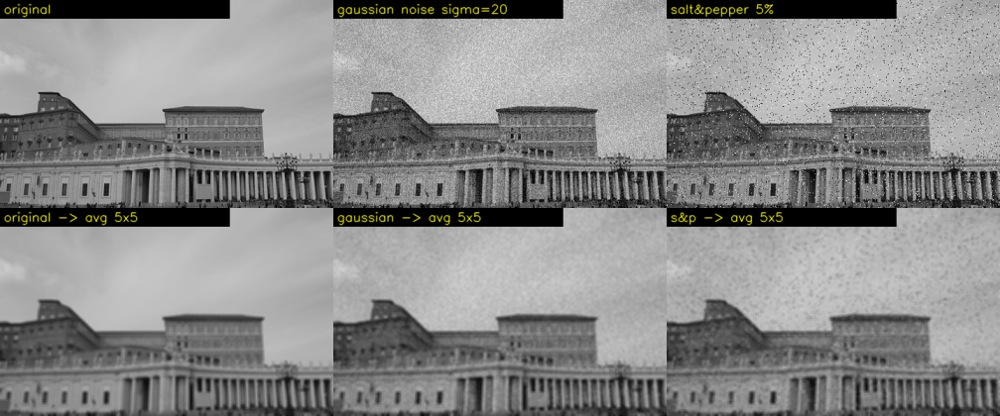
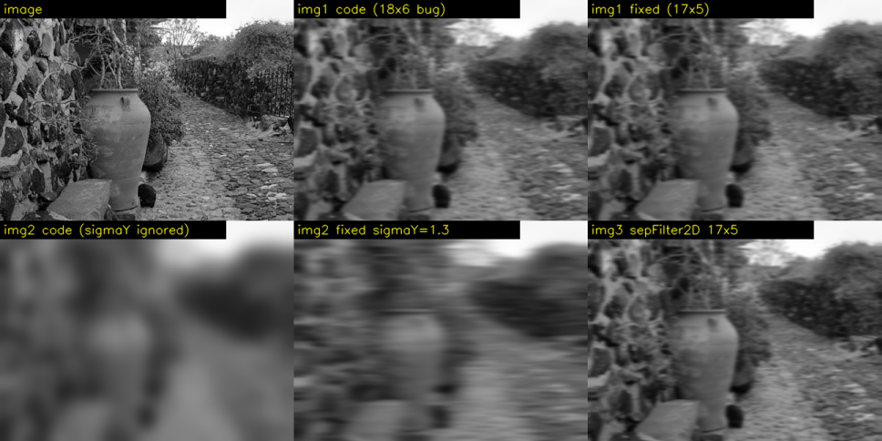
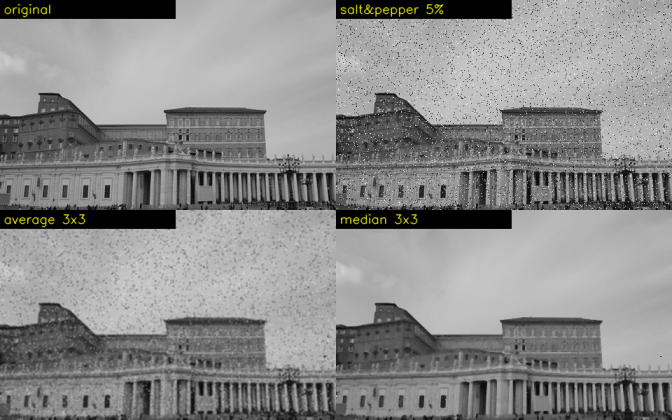
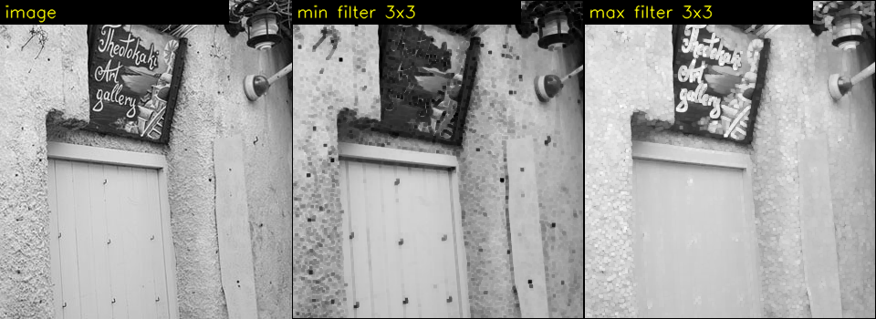

# Part 4. 잡음 제거 필터: Step 4-1, 4-2

Part 4는 내용이 많아서 세 번에 나눠 진행합니다.

| 이번 | 다음 | 그다음 |
|---|---|---|
| **4-1 잡음의 종류**, **4-2 평균값 필터 (10)** | 4-3 가우시안 필터 (12) | 4-4 미디언 (11), 4-5 최소/최대 (09), 4-6 정리 |

이번에도 숫자는 전부 실행해서 확인했어요.

---

## 🔁 Part 3 퀴즈 답

**1번. 가는 밝은 선 `[50, 50, 50, 200, 50, 50, 50]`에 `[1, −2, 1]`**

```
x      :   0     1     2     3     4     5     6
f      :  50    50    50   200    50    50    50
f″     :   -     0  +150  −300  +150     0     -
                    └─영교차─┘└─영교차─┘   → 영교차 2개
|f″|   :         0   150   300   150     0     → 밝은 화소 3개
```

선형 에지(Step 2-1-b의 ③번 모양)는 **양쪽에 에지가 하나씩**, 그래서 영교차도 **2개**입니다. `convertScaleAbs`로 보면 가운데(300)가 가장 밝고 양옆(150)이 조금 덜 밝은 **3칸 두께의 선 한 줄**처럼 보여요.

**2번. 밝기 +50, 그리고 그라데이션 f = 2x**

```
+50:   (f(x+1)+50) − 2(f(x)+50) + (f(x−1)+50) = f″(x) + (50 − 100 + 50) = f″(x)  → 변화 없음
f=2x:  2(x+1) − 2·2x + 2(x−1) = 2x + 2 − 4x + 2x − 2 = 0                       → 전부 0
```

라플라시안은 **일정한 밝기 변화**(조명 그라데이션)를 완전히 무시하고, **휘어지는 곳**(곡률)에만 반응해요. 소벨은 그라데이션에도 반응합니다 (f = 2x면 Gx가 모든 곳에서 일정한 값). 이 차이가 라플라시안의 장점 중 하나예요.

**3번. 밤에 라플라시안 분산은?**
양쪽으로 다 틀릴 수 있어요.
- 어두우면 대비와 디테일이 줄어서 **값이 낮아짐** → 렌즈가 깨끗한데도 "오염됨"으로 **오경보**
- 밤에는 센서 게인을 올려서 잡음이 늘어남 → 잡음이 분산을 **부풀림** → 실제로 렌즈가 흐려졌는데도 "선명함"으로 **놓침**

그래서 실무에서는 밝기 조건별로 기준값을 다르게 두거나, 일정 시간 동안 추세를 보고 판단합니다.

---

## Step 4-1. 잡음의 종류

### 4-1-a. 잡음이란?

카메라가 측정한 값은 항상 **진짜 값 + 오차**예요.

```
측정 화소값 = 진짜 밝기 + 잡음
```

잡음이 **어떤 모양**이냐에 따라 맞는 필터가 완전히 달라져요. 그래서 필터보다 잡음부터 알아야 합니다. 이 장에서 다루는 대표 잡음은 두 가지예요.

### 4-1-b. 가우시안 잡음: "모든 화소가 조금씩 흔들림"

**모든 화소**에 작은 랜덤 값이 더해집니다. 그 랜덤 값이 **정규분포**(종 모양 분포)를 따라서 가우시안 잡음이라고 불러요.

실제 이미지(`median2.jpg`)의 하늘 부분에 표준편차 σ = 20인 잡음을 넣고 한 행을 잘라 보면:

```
x       :  200   201   202   203   204   205
원본    :  191   191   191   191   191   191     ← 균일한 하늘
잡음 후 :  206   200   194   152   155   223     ← 모든 칸이 흔들림
차이    :  +15    +9    +3   −39   −36   +32
```

σ(시그마, 표준편차)는 흔들림의 크기예요. 정규분포에서는:

```
              ▁▃▅▇█▇▅▃▁
         ────┼───┼───┼───┼────
           −2σ  −σ   0  +σ  +2σ
              └──68%──┘           ← 약 68%의 화소는 ±σ(±20) 안에서 흔들림
           └─────95%─────┘        ← 약 95%는 ±2σ(±40) 안
```

위 예에서 −39는 ±2σ 근처라 드문 편이고, 나머지는 대부분 ±20 안에 있어요.

**원인:** 센서의 열, 전자 회로 잡음. **빛이 부족할수록** 심해져요. 어두우면 신호를 증폭(게인)해야 하는데, 잡음도 같이 증폭되거든요. 밤에 찍은 폰 사진이 자글자글한 이유입니다. AVM 카메라에서는 **야간 주차장 영상**이 대표적이에요.

### 4-1-c. 소금-후추 잡음: "소수 화소가 극단값으로 튐"

**일부 화소만** 완전히 흰색(255, 소금) 또는 완전히 검은색(0, 후추)으로 바뀝니다. 나머지 화소는 **멀쩡**해요.

```
원본    :  191   191   191   191   191   191
잡음 후 :  191   191   255   191     0   191     ← 대부분 그대로, 몇 개만 극단값
```

**원인:** 센서의 죽은 화소(항상 0)나 뜨거운 화소(항상 255), 그리고 **데이터 전송 중 비트 오류**예요. AVM에서는 카메라와 ECU를 잇는 고속 직렬 링크(GMSL, FPD-Link 등)에 전기적 간섭이 생기면 이런 점이 튈 수 있습니다.

### 두 잡음 비교

| | 가우시안 잡음 | 소금-후추 잡음 |
|---|---|---|
| 영향받는 화소 | **전부** | **일부** (예: 5%) |
| 잡음 크기 | 작음 (±σ 정도) | **극단적** (0 또는 255) |
| 겉모습 | 화면 전체가 자글자글 | 흰 점, 검은 점이 뿌려짐 |
| 원인 | 센서 열, 저조도 게인 | 죽은 화소, 전송 오류 |
| 잘 맞는 필터 | 평균, **가우시안** (4-2, 4-3) | **미디언** (4-4) |

### 4-1-d. `salt_pepper_noise()` 코드 해부 ([chap07/11.filter_median.py](../../chap07/11.filter_median.py))

11번 파일에 소금-후추 잡음을 만드는 함수가 있어서 여기서 미리 봅니다.

```python
def salt_pepper_noise(img, n):
    h, w = img.shape[:2]
    x, y = np.random.randint(0, w, n), np.random.randint(0, h, n)   # ① 좌표 n개 뽑기
    noise = img.copy()                                              # ② 원본 복사
    for (x,y) in zip(x,y):                                          # ③ 좌표 하나씩
        noise[y, x] = 0 if np.random.rand() < 0.5 else 255          # ④ 반반 확률로 0 또는 255
    return noise
```

`n = 5`일 때 단계별로 따라가면 (값은 예시):

```
① np.random.randint(0, w, 5) → x = [ 12, 300,  77, 451,   3]   ← 0 이상 w 미만 정수 5개
   np.random.randint(0, h, 5) → y = [ 40, 199,   5, 120, 260]
③ zip(x, y) → (12,40), (300,199), (77,5), (451,120), (3,260)  ← 짝지어서 좌표 5개
④ 좌표마다 동전 던지기: rand() < 0.5 이면 0(후추), 아니면 255(소금)
```

**꼼꼼히 볼 점 세 가지:**

1. **`img.copy()`가 꼭 필요해요.** 복사 없이 `noise = img`라고 쓰면 두 이름이 **같은 배열**을 가리켜서 원본까지 망가집니다. 그러면 나중에 "원본 vs 필터 결과"를 비교할 수가 없어요.
2. **`noise[y, x]` 순서.** 📚 numpy는 `[행, 열]` = `[y, x]` 순서예요. 변수는 (x, y)로 만들었지만 넣을 때는 순서를 바꿉니다.
3. **좌표가 겹칠 수 있어요.** 랜덤으로 뽑으니까 같은 좌표가 두 번 나올 수 있습니다. 실제로 300×480 이미지에서 500개를 뽑아 보니 **서로 다른 좌표는 499개**였어요. 500개를 요청해도 실제 잡음 화소는 조금 적을 수 있다는 뜻입니다.

> 💡 **규모 감각:** 500개 ÷ 144,000화소 = 전체의 **0.35%**예요. 꽤 적은 양이라서, 아래 실험에서는 차이를 잘 보이게 하려고 **5%**(약 7,200개)로 늘렸습니다. 이렇게 비율로 만들 때는 반복문 대신 numpy 마스크를 쓰면 한 줄로 끝나요.
> ```python
> m = np.random.random(img.shape)          # 화소마다 0~1 랜덤 값
> noise[m < 0.025] = 0                     # 2.5%는 후추
> noise[m > 0.975] = 255                   # 2.5%는 소금
> ```

---

## Step 4-2. 평균값 필터: [chap07/10.filter_average.py](../../chap07/10.filter_average.py)

평균값 필터는 Part 1의 1/9 블러와 **같은 연산**이에요. Part 1에서는 "회선이 어떻게 동작하나"를 봤고, 여기서는 **"잡음을 얼마나 줄이고, 그 대가가 무엇인가"**를 봅니다.

### 4-2-a. 평균이 가우시안 잡음을 줄이는 원리 📐

Part 2-4-c에서 본 원리가 그대로 적용돼요. **랜덤한 값 N개를 평균 내면 흔들림이 1/√N로 줄어듭니다.**

```
k×k 평균 필터: 화소 N = k² 개를 평균
  잡음 σ  →  σ / √(k²)  =  σ / k

예) σ = 20, 3×3 평균 → 20 / 3 = 6.67
```

🧠 **비유: 시험 점수.** 한 학생의 점수는 컨디션에 따라 크게 오르내리지만, 반 전체 평균은 매번 비슷하게 나오죠. 개별 흔들림(+, −)이 평균을 내면 서로 상쇄되기 때문이에요.

**실험:** 회색(128) 화면에 σ = 20 잡음을 넣고, 평균 필터 크기를 바꿔 가며 남은 잡음을 측정했어요.

| 필터 크기 | 평균 내는 화소 수 | 남은 잡음 σ (실측) | 이론값 σ/k |
|---|---|---|---|
| 없음 | 1 | 20.00 | 20.00 |
| 3×3 | 9 | 6.60 | 6.67 |
| 5×5 | 25 | 3.97 | 4.00 |
| 7×7 | 49 | 2.82 | 2.86 |
| 9×9 | 81 | 2.18 | 2.22 |

이론과 거의 정확히 맞아요. 그런데 크기를 키울수록 **효과가 줄어드는 것**도 보이죠. 3×3에서 20 → 6.6으로 크게 줄었지만, 7×7 → 9×9는 2.82 → 2.18로 조금만 줄어요. 1/k 곡선이라서 그렇습니다.

### 4-2-b. 대가: 에지가 k칸에 걸쳐 뭉개진다

0 → 100 계단 에지 하나에 평균 필터를 적용한 결과 (실행값):

```
위치          :   5     6     7     8     9    10    11    12    13    14
원본          :   0     0     0     0     0   100   100   100   100   100
3×3 평균      :   0     0     0     0  33.3  66.7   100   100   100   100     ← 2칸 경사
5×5 평균      :   0     0     0    20    40    60    80   100   100   100     ← 4칸 경사
9×9 평균      :   0  11.1  22.2  33.3  44.4  55.6  66.7  77.8  88.9   100     ← 8칸 경사
```

필터가 k×k이면 **계단이 k−1칸짜리 경사로**가 돼요. 잡음을 많이 줄이려고 필터를 키우면 에지도 그만큼 넓게 뭉개집니다.

```
          잡음 감소 ◀━━━━━━━━━━━━━━━━━━━━▶ 에지 보존
 9×9  ████████████ (σ 2.2)          ░ (8칸 경사)
 5×5  ██████████   (σ 4.0)          ░░░ (4칸 경사)
 3×3  ███████      (σ 6.6)          ░░░░░ (2칸 경사)
      → 크기는 둘 사이에서 고르는 타협점
```

### 4-2-c. 소금-후추 잡음에는 평균이 오히려 해롭다

**5×5 시험:** 10으로 균일한 곳에 소금 하나(255)가 있을 때 3×3 평균 결과 (실행값):

```
  원본 (7×7의 가운데)           3×3 평균 결과
  10   10   10                  37   37   37
  10  255   10       ──▶        37   37   37      ← 점 1개가 37짜리 3×3 얼룩 9칸으로 번짐
  10   10   10                  37   37   37

  계산: (8 × 10 + 255) / 9 = 335 / 9 = 37.2
```

255는 37로 줄었지만 **사라지지 않았어요.** 주변 10보다 여전히 3.7배 밝고, 1칸이던 점이 **9칸짜리 회색 얼룩**이 됐습니다. 극단값 하나가 평균 전체를 끌고 가 버려요.

**실제 이미지에서 측정:** 원본과 얼마나 다른지를 평균 절대 오차(MAE, 작을수록 원본에 가까움)로 쟀어요.

| | 필터 전 | 평균 3×3 후 | 평균 5×5 후 |
|---|---|---|---|
| 가우시안 잡음 (σ=20) | 15.9 | **7.7** ✅ 절반 이하로 줄어듦 | 8.0 |
| 소금-후추 잡음 (5%) | 6.3 | **8.5** ❌ 오히려 나빠짐 | 9.2 ❌ |
| (참고) 잡음 없는 원본 | 0 | — | 6.1 |

1. **가우시안 잡음**에는 효과가 좋아요 (15.9 → 7.7). 하지만 5×5는 3×3보다 오히려 살짝 나빠졌어요 (8.0). 잡음은 더 줄었지만 **디테일 손실**이 더 커졌기 때문입니다.
2. **소금-후추 잡음**에는 필터를 쓰면 **더 나빠져요** (6.3 → 8.5). 멀쩡하던 95%의 화소까지 흐려지고, 잡음은 얼룩으로 남으니까요.
3. **잡음 없는 원본**에 5×5 평균만 해도 MAE가 6.1이에요. 블러 자체가 원본 디테일을 지우는 비용입니다.

**이미지로 확인하기** (위: 원본 / 가우시안 잡음 / 소금-후추 잡음, 아래: 각각 5×5 평균):


- **가우시안 잡음 → 평균**: 모래 같던 자글거림이 **얼룩덜룩한 부드러운 무늬**로 바뀌어요. 많이 나아졌지만 건물 창문과 기둥은 흐려졌습니다.
- **소금-후추 → 평균**: 날카로운 흰 점, 검은 점이 **흐릿한 회색 얼룩**으로 바뀌었을 뿐 여전히 하늘 전체에 보여요. 건물까지 흐려져서 둘 다 잃은 결과입니다.

> 📌 **평균 필터의 한계:** 이웃을 **모두 똑같이 믿고, 이상한 값도 똑같이 섞기** 때문에 생기는 문제예요. 해결 방향은 두 가지입니다.
> - 가까운 이웃을 더 믿자 → **가우시안** (다음 Step 4-3)
> - 이상한 값은 아예 빼고 판단하자 → **미디언** (Step 4-4)

### 4-2-d. 코드 해부

```python
def average_filter(image, ksize):
    rows, cols = image.shape[:2]
    dst = np.zeros((rows, cols), np.uint8)              # ← 결과를 uint8로 만듦
    center = ksize // 2                                 # 5 // 2 = 2

    for i in range(rows):                               # ← 이번에는 테두리까지 전부 순회
        for j in range(cols):
            y1, y2 = i - center, i + center + 1
            x1, x2 = j - center, j + center + 1
            if y1 < 0 or y2 > rows or x1 < 0 or x2 > cols :    # 윈도우가 밖으로 나가면
                dst[i, j] = image[i, j]                         #   원본 화소를 그대로 복사
            else:
                mask = image[y1:y2, x1:x2]
                dst[i, j] = cv2.mean(mask)[0]                   # 윈도우 평균
    return dst
```

**Part 1 `filter()`와 다른 점 세 가지:**

**① 테두리 처리가 세 번째 방식이에요.**

| 방식 | 사용하는 곳 | 테두리 결과 |
|---|---|---|
| 계산 안 함, 0으로 둠 | Part 1 `filter()` | 검은 액자 |
| 거울 패딩 | OpenCV 기본 | 추측한 값으로 블러 |
| **원본 복사** | `average_filter()` | 테두리 2픽셀만 **블러가 안 된 원본** |

실제 결과에서 첫 행을 보면 원본과 `average_filter` 결과가 `[15, 18, 22, 12, 12, 26]`으로 똑같아요.

**② 12줄의 조건을 짚고 가요.** `y2 > rows`인 이유: 슬라이싱 `y1:y2`는 y2−1행까지 쓰니까, y2 = rows까지는 괜찮고 **rows를 넘을 때만** 밖으로 나간 거예요.

**③ `cv2.mean(mask)[0]`.** Step 1-3의 `sumElems`처럼 4채널 튜플을 돌려줘서 `[0]`이 필요해요. 결과는 파이썬 float(예: 145.68)이고, uint8 칸에 넣으면서 **소수점이 버려집니다.** OpenCV는 반올림하니까, 안쪽 영역에서 두 결과를 비교하면 **71,766개 화소가 1씩 차이**가 났어요 (최대 차이 1). Step 1-3-e에서 본 버림 vs 반올림 차이와 같은 현상입니다.

### OpenCV 함수 두 개

```python
blur_img = cv2.blur(image, (5, 5), borderType=cv2.BORDER_CONSTANT)   # 23줄
box_img  = cv2.boxFilter(image, ddepth=-1, ksize=(5, 5))             # 24줄
```

| 함수 | 하는 일 | 비고 |
|---|---|---|
| `cv2.blur(src, ksize)` | k×k 평균 | `boxFilter(normalize=True)`의 줄임말 |
| `cv2.boxFilter(src, ddepth, ksize, normalize=True)` | k×k 평균 | 기본 설정에서 `blur`와 **완전히 같은 결과** (확인함) |
| `cv2.boxFilter(..., normalize=False)` | k×k **합** | 10으로 균일한 곳에 3×3 → **90** (나누지 않음) |

`normalize=False`(합)는 "주변에 흰 화소가 몇 개 있나" 세는 용도 등에 써요.

**`borderType=cv2.BORDER_CONSTANT`의 효과:** 바깥을 0(검정)으로 채우니까 테두리 윈도우에 0이 섞여서 **테두리가 어두워져요.**

```
첫 행 앞 6칸:
  원본              :  15  18  22  12  12  26
  BORDER_CONSTANT   :   8  11  13  11  12  15    ← 바깥 0이 섞여서 어두워짐
  기본 (거울 패딩)    :  19  22  23  18  21  26

첫 행 전체 평균: 원본 158.3, 거울 패딩 158.7, CONSTANT 94.9  ← 테두리 밝기가 40% 떨어짐
```

### ⚠️ 이 파일의 버그

```python
cv2.imshow("blur_img", box_img)     # 28줄  ← blur_img가 아니라 box_img를 보여줌
cv2.imshow("box_img", box_img)      # 29줄
```

Step 1-3에서 본 버그와 같은 종류예요. "blur_img" 창에도 `box_img`가 나와서 **`BORDER_CONSTANT`의 어두운 테두리를 볼 수 없습니다.** 23줄에서 일부러 테두리 옵션을 바꿔 놓고 그 결과를 보여주지 않는 거예요. 28줄을 `cv2.imshow("blur_img", blur_img)`로 고치면 테두리 차이가 보입니다.

(26, 27줄 끝의 쉼표 `cv2.imshow(...),`는 튜플을 만들 뿐 아무 영향이 없는 오타예요.)

### 4-2-e. 속도: `cv2.blur`는 필터 크기와 상관없이 빠르다

직접 짠 `average_filter`(5×5)는 340×450 이미지에 **0.148초** 걸렸어요. OpenCV와 비교하려고 2000×2000 이미지로 필터 크기를 바꿔 가며 쟀습니다.

| 필터 크기 | `cv2.blur` | `cv2.filter2D` (같은 평균 마스크) |
|---|---|---|
| 3×3 | 2.4ms | 2.9ms |
| 15×15 | 2.0ms | 40.8ms |
| 31×31 | 2.6ms | 42.3ms |
| 61×61 | 2.8ms | 43.2ms |

**`cv2.blur`는 61×61(화소 3,721개 평균)이어도 3×3과 속도가 같아요.** 비결은 **누적합(슬라이딩 합)** 트릭입니다.

```
1D, 3칸 평균, f = [10, 20, 30, 40, 50, 60]

순진한 방법: 위치마다 3개를 새로 더함
  S(1) = 10 + 20 + 30 = 60
  S(2) = 20 + 30 + 40 = 90       ← 매번 k번 덧셈

누적합 방법: 직전 합에서 "들어오는 값"을 더하고 "나가는 값"을 뺌
  S(1) = 10 + 20 + 30 = 60                (처음 한 번만 k번)
  S(2) = S(1) + 40 − 10 = 90              ← 덧셈 1번 + 뺄셈 1번
  S(3) = S(2) + 50 − 20 = 120
  S(4) = S(3) + 60 − 30 = 150
  평균: 20, 30, 40, 50
```

🧠 **창문 밖 풍경이 지나가는 기차**를 떠올리면 돼요. 한 칸 움직일 때 바뀌는 건 **새로 들어온 풍경 한 줄과 빠져나간 풍경 한 줄**뿐이니까, 그 둘만 계산하면 됩니다. 필터가 아무리 커도 화소당 연산이 일정해요.

이건 **모든 가중치가 같을 때만** 쓸 수 있는 트릭이에요. `filter2D`는 마스크 숫자가 제각각일 수 있다고 가정하니까 이 트릭을 못 씁니다. (15×15부터 시간이 약 42ms로 비슷해지는 건, OpenCV가 큰 마스크에서 계산 방식을 푸리에 변환 기반으로 바꾸기 때문이에요. chap10에서 다룹니다.)

---

## 💼 실무 연결: 평균 필터와 모아레 (AVM 탑뷰)

탑뷰를 만들 때 카메라에서 **멀리 있는 바닥은 원본 영상의 넓은 영역이 탑뷰의 작은 영역으로 압축**돼요. 이렇게 이미지를 축소할 때, 미리 블러하지 않고 화소를 듬성듬성 골라 오면 줄무늬, 체크무늬 같은 **가짜 패턴(모아레)**이 생깁니다. 촘촘한 무늬를 너무 듬성듬성 샘플링해서 생기는 **에일리어싱**이에요.

해결책은 **축소하기 전에 평균을 내는 것**입니다.
- `cv2.resize(..., interpolation=cv2.INTER_AREA)`는 축소할 때 **해당 영역의 화소를 평균**내요. 사실상 박스 필터 + 샘플링입니다.
- LUT 기반 탑뷰에서도 축소 비율이 큰 영역은 미리 블러한 영상(또는 해상도를 단계별로 줄인 영상)에서 샘플링하는 방식으로 모아레를 줄여요.

여기서도 4-2-b의 트레이드오프가 그대로 적용돼요. **블러를 세게 하면 모아레는 사라지지만 주차선이 흐려집니다.**

---

## 📋 Step 4-1, 4-2 요약

| 개념 | 한 줄 정리 |
|---|---|
| 가우시안 잡음 | **모든** 화소가 작게 흔들림 (±σ). 저조도에서 심함 |
| 소금-후추 잡음 | **일부** 화소가 0 또는 255로 튐. 죽은 화소, 전송 오류 |
| `salt_pepper_noise` | 랜덤 좌표에 반반 확률로 0/255. `copy()` 필수, 좌표는 겹칠 수 있음 |
| 평균 → 가우시안 잡음 | σ가 σ/k로 줄어듦 (실측 6.60 vs 이론 6.67) |
| 평균의 대가 | 계단 에지가 k−1칸 경사로 뭉개짐 |
| 평균 → 소금-후추 | 점이 회색 얼룩으로 번질 뿐, MAE가 오히려 나빠짐 (6.3 → 8.5) |
| 코드 | 테두리는 원본 복사 방식. `cv2.mean`은 버림이라 OpenCV와 최대 1 차이 |
| 버그 | 28줄에서 `blur_img` 대신 `box_img`를 보여줘 `BORDER_CONSTANT` 효과가 안 보임 |
| 속도 | `cv2.blur`는 누적합 덕분에 크기와 무관하게 약 2.5ms |

### ✅ 확인 질문

1. σ = 30인 가우시안 잡음을 σ = 5 이하로 줄이려면 평균 필터가 최소 몇×몇이어야 할까요? 그때 계단 에지는 몇 칸짜리 경사가 될까요?
2. 3×3 윈도우 안에 소금(255)이 **2개**, 나머지 7개가 10이면 평균은? 같은 윈도우를 **크기 순으로 정렬해서 가운데 값**을 고르면? (Step 4-4 미리 보기)
3. 누적합 트릭을 2차원 k×k 평균에 쓰려면 어떻게 하면 될까요? (힌트: 가로로 한 번, 세로로 한 번)

---

다음은 **Step 4-3: 가우시안 필터 (12.filter_gaussian.py)**입니다. 종 모양 곡선 공식을 한 단계씩 계산하고, `meshgrid`로 2D 마스크를 만드는 과정을 숫자로 출력하고, **18×6 마스크 버그**를 실제로 확인한 다음, 2D 마스크와 1D 마스크 두 번(`sepFilter2D`)이 같은 결과인 이유를 봅니다.

**"다음"**이라고 하시면 이어가고, 어려운 부분이 있으면 **"더 쉽게"**라고 해 주세요.

---

# Part 4 · Step 4-3. 가우시안 필터: [chap07/12.filter_gaussian.py](../../chap07/12.filter_gaussian.py)

이번 Step은 Part 4의 핵심이에요. 가우시안 공식을 한 단계씩 계산하고, 코드에 있는 **버그 두 개**를 실행해서 확인합니다. 하나는 계획 때 미리 찾은 18×6 마스크 버그이고, 다른 하나는 이번에 새로 찾은 `cv2.GaussianBlur` 인자 버그예요.

---

## 🔁 지난 확인 질문 답

**1번. σ = 30을 5 이하로 줄이려면?**

```
σ / k ≤ 5  →  k ≥ 30 / 5 = 6  →  홀수여야 하니까 7×7
결과: 30 / 7 ≈ 4.29 ✓
대가: 계단 에지가 k − 1 = 6칸짜리 경사로가 됨
```

(6×6도 계산상 딱 5가 되지만, 짝수 크기는 중심 화소가 없어서 쓰지 않아요. 이 Step의 버그 ①이 바로 짝수 크기 때문에 생기는 문제입니다.)

**2번. 소금 2개(255) + 10이 7개**

```
평균:  (255 × 2 + 10 × 7) / 9 = (510 + 70) / 9 = 64.4     ← 소금 2개에 끌려서 6배 밝아짐
정렬:  10  10  10  10  [10]  10  10  255  255
                       ↑ 9개 중 5번째 = 가운데 값 = 10   ← 소금을 완전히 무시
```

가운데 값을 고르는 방법이 Step 4-4의 **미디언 필터**예요. 극단값이 섞여도 결과가 흔들리지 않습니다.

**3번. 누적합을 2차원으로**

```
① 가로 방향으로 누적합 → 각 화소에 "가로 k칸의 합"
② 그 결과에 세로 방향으로 누적합 → "k×k칸의 합"
③ k²로 나누기
```

k×k 합 = (가로 k칸 합)을 세로로 k개 더한 것이니까 두 번 나눠서 할 수 있어요. 이렇게 **가로 한 번, 세로 한 번으로 쪼개는 생각**이 이번 Step의 핵심인 **분리 가능성**과 같은 아이디어입니다.

> 💡 비슷한 방법으로 **적분 영상**(`cv2.integral`)도 있어요. 모든 위치에 "왼쪽 위 구석부터 여기까지의 합"을 미리 저장해 두면, 어떤 사각형의 합이든 **값 4개를 더하고 빼서** 바로 구할 수 있습니다.

---

## 4-3-a. 아이디어: 가까운 이웃일수록 더 믿자

평균 필터는 이웃 9개(또는 25개)를 **모두 똑같이** 믿었어요. 그런데 상식적으로 바로 옆 화소가 두세 칸 떨어진 화소보다 나와 비슷할 가능성이 높겠죠.

🧠 **모닥불 비유:** 모닥불 바로 옆은 뜨겁고, 멀어질수록 미지근해지다가, 어느 거리부터는 거의 느껴지지 않아요. 가우시안 마스크는 중심이 모닥불인 **"열기 지도"**입니다. 가까운 화소는 결과에 많이 반영되고, 먼 화소는 조금만 반영돼요.

가중치를 옆에서 본 모양(1D)으로 비교하면:

```
 평균 필터 (5칸)                  가우시안 (5칸, σ=1)
 가중치                            가중치
 0.40 |                           0.40 |        █
      |                                |        █
 0.20 | █  █  █  █  █              0.24 |     █  █  █
      | █  █  █  █  █                   |     █  █  █
 0.05 | █  █  █  █  █              0.05 |  ▄  █  █  █  ▄
      +──────────────────               +──────────────────
       −2 −1  0 +1 +2                    −2 −1  0 +1 +2
 "모두 똑같이 0.2"                  "가운데 0.40, 끝은 0.05"
 끝에서 뚝 끊김 (사각형 모양)         부드럽게 줄어듦 (종 모양)
```

---

## 4-3-b. 1D 가우시안 공식을 한 단계씩 📐

```
                1              x²
G(x) = ──────────── · exp( − ──── )
         √(2π) · σ             2σ²
```

처음 보면 무섭지만, **실제로 중요한 부분은 오른쪽 `exp(−x²/2σ²)`뿐**이에요. 앞의 분수는 곧 사라집니다 (아래에서 설명).

### σ = 1, x = −2 ~ +2로 계산해 보기

| 단계 | x = −2 | x = −1 | x = 0 | x = +1 | x = +2 |
|---|---|---|---|---|---|
| ① x² | 4 | 1 | 0 | 1 | 4 |
| ② x² / (2σ²) = x² / 2 | 2 | 0.5 | 0 | 0.5 | 2 |
| ③ exp(−②) | **0.1353** | **0.6065** | **1.0000** | **0.6065** | **0.1353** |
| ④ ÷ 합계 (2.4837) | **0.0545** | **0.2442** | **0.4026** | **0.2442** | **0.0545** |

**단계별 의미:**
- ① **x²**: 중심에서 떨어진 거리의 제곱이에요. 왼쪽(−)과 오른쪽(+)을 똑같이 취급해서 좌우 대칭이 됩니다.
- ② **÷ 2σ²**: 거리를 σ 단위로 잽니다. σ가 크면 같은 거리도 "가깝다"고 판단해요.
- ③ **exp(−…)**: 0이면 1이 되고, 커질수록 빠르게 0에 가까워집니다. 중심은 1, 1칸 떨어지면 0.61, 2칸 떨어지면 0.14예요.
- ④ **정규화**: ③의 합은 0.1353 + 0.6065 + 1 + 0.6065 + 0.1353 = 2.4837이에요. 모든 값을 이걸로 나누면 **합이 1**이 됩니다. Part 1의 원소 합 규칙대로 밝기를 유지하려는 거예요.

`cv2.getGaussianKernel(5, 1)`을 실행하면 `[0.0545, 0.2442, 0.4026, 0.2442, 0.0545]`이 나와서 **손계산과 정확히 같습니다.**

> 💡 **앞의 분수 1/(√(2π)σ)가 사라지는 이유**
> 이 분수는 모든 x에 **똑같이 곱해지는 상수**예요. ④에서 합계로 나누면 분자와 분모에 똑같이 들어 있어서 약분됩니다. 그래서 실제로는 ③까지만 계산하고 정규화하면 돼요. 코드 11줄의 `ratio`도 같은 이유로 결과에 아무 영향이 없습니다.

### σ는 "얼마나 넓게 퍼지나"를 정하는 손잡이

같은 x에서 σ만 바꿔서 ③(정규화 전 값)을 계산한 결과:

| x | −3 | −2 | −1 | 0 | +1 | +2 | +3 |
|---|---|---|---|---|---|---|---|
| σ = 0.5 | 0.0000 | 0.0003 | 0.1353 | 1 | 0.1353 | 0.0003 | 0.0000 |
| σ = 1 | 0.0111 | 0.1353 | 0.6065 | 1 | 0.6065 | 0.1353 | 0.0111 |
| σ = 2 | 0.3247 | 0.6065 | 0.8825 | 1 | 0.8825 | 0.6065 | 0.3247 |

```
σ=0.5  ▁ ▁ ▂ █ ▂ ▁ ▁     거의 중심만 반영 → 약한 블러
σ=1    ▁ ▂ ▅ █ ▅ ▂ ▁     ±2칸까지 의미 있음
σ=2    ▃ ▅ ▇ █ ▇ ▅ ▃     ±3칸도 많이 반영 → 강한 블러 (마스크도 더 커야 함)
```

**마스크 크기는 얼마로 잡아야 할까요?** 가우시안 값은 이론상 끝없이 이어지지만, **±3σ** 밖은 거의 0이에요 (넓이의 99.7%가 ±3σ 안에 있음). 그래서 보통 **마스크 크기 ≈ 6σ + 1**로 잡습니다.
- σ = 1 → 7칸
- σ = 2 → 13칸

---

## 4-3-c. 2D 가우시안과 `meshgrid` 📐

### 공식: 2D = 1D × 1D

```
G(x, y) ∝ exp( −x²/(2σx²) − y²/(2σy²) )
        = exp( −x²/(2σx²) ) × exp( −y²/(2σy²) )      ← 지수법칙 eᵃ⁺ᵇ = eᵃ × eᵇ
        =       G(x)        ×       G(y)
```

**2D 가우시안은 가로 1D와 세로 1D의 곱**입니다. 이 성질이 4-3-g의 속도 비결이에요.

σx = σy이면 값이 x² + y² = r²(중심까지 거리의 제곱)에만 달려서 **동심원 모양**이 됩니다. 어느 방향으로든 공평하게 블러해요 (Part 3의 등방성).

### 코드 방식(`meshgrid`)으로 작은 마스크를 직접 만들기

`getGaussianMask()`가 하는 일을 **5×3 크기, σ = 1**로 따라가 볼게요. 출력이 작아야 보기 쉬우니까 이 크기를 골랐고, 18×6 버그도 일단 고친 버전으로 계산합니다.

**① 좌표 1D 배열 만들기**

```
x = arange(0, 5) − 5//2 = [0,1,2,3,4] − 2 = [−2, −1, 0, 1, 2]
y = arange(0, 3) − 3//2 = [0,1,2]     − 1 = [−1,  0, 1]
```

**② `np.meshgrid(x, y)`: 1D 두 개를 2D 격자 두 장으로**

```
x 격자 (각 칸의 x 좌표)          y 격자 (각 칸의 y 좌표)
 −2  −1   0   1   2              −1  −1  −1  −1  −1
 −2  −1   0   1   2               0   0   0   0   0
 −2  −1   0   1   2               1   1   1   1   1
 (x 배열을 세로로 3번 복사)        (y 배열을 가로로 5번 복사)
```

두 격자를 겹치면 칸마다 (x, y) 좌표가 생겨요. 예: 왼쪽 위 칸 = (−2, −1). 이렇게 해 두면 반복문 없이 **모든 칸을 한 번에** 계산할 수 있습니다.

**③ `v1 = x²/(2σx²)`, `v2 = y²/(2σy²)`**

```
v1                               v2
 2    0.5   0   0.5   2          0.5  0.5  0.5  0.5  0.5
 2    0.5   0   0.5   2          0    0    0    0    0
 2    0.5   0   0.5   2          0.5  0.5  0.5  0.5  0.5
```

**④ `exp(−(v1 + v2))`**

```
 0.0821  0.3679  0.6065  0.3679  0.0821
 0.1353  0.6065  1.0000  0.6065  0.1353     ← 가운데 행 = 1D 가우시안 (4-3-b의 ③)
 0.0821  0.3679  0.6065  0.3679  0.0821
```

**⑤ `ratio` 곱하기** (1/(2π) = 0.1592): 결과 합이 0.8748이에요. 1이 아닌 이유는 마스크가 가우시안의 **가운데 부분만 잘라 낸 것**이라서예요.

**⑥ `/ np.sum(mask)`: 합이 1이 되게 정규화**

```
 0.0149  0.0669  0.1103  0.0669  0.0149
 0.0246  0.1103  0.1819  0.1103  0.0246     ← 합 = 1
 0.0149  0.0669  0.1103  0.0669  0.0149
```

**검증:** `getGaussianKernel(3, 1)`(세로) × `getGaussianKernel(5, 1)`(가로)의 외적을 계산하면 **위 행렬과 소수점 넷째 자리까지 똑같아요.** 2D = 1D × 1D를 숫자로 확인한 겁니다.

> 🔗 **Part 1 퀴즈 1번의 정체**
> ```
> 1/16  2/16  1/16       [1/4]
> 2/16  4/16  2/16   =   [2/4]  ×  [1/4, 2/4, 1/4]
> 1/16  2/16  1/16       [1/4]
> ```
> `cv2.getGaussianKernel(3, 0)`이 정확히 `[0.25, 0.5, 0.25]`를 돌려줘요. 그 마스크는 **OpenCV의 3×3 가우시안 블러 그 자체**였습니다.

---

## 4-3-d. σ를 0으로 주면? 자동 계산 공식

코드 4줄과 OpenCV 함수들은 σ ≤ 0이면 크기로부터 σ를 자동으로 계산합니다.

```
σ = 0.3 × ((ksize − 1) × 0.5 − 1) + 0.8
```

| ksize | 계산 과정 | σ |
|---|---|---|
| 3 | 0.3 × (1 − 1) + 0.8 | 0.8 |
| 5 | 0.3 × (2 − 1) + 0.8 | 1.1 |
| 7 | 0.3 × (3 − 1) + 0.8 | 1.4 |
| 9 | 0.3 × (4 − 1) + 0.8 | 1.7 |
| 17 | 0.3 × (8 − 1) + 0.8 | **2.9** |

마스크 크기의 절반((ksize−1)/2)이 대략 **2.5 ~ 3σ**가 되도록 맞춘 경험식이에요. 6σ+1 규칙과 비슷한 비율입니다.

### OpenCV의 숨은 규칙: 7 이하 크기는 고정 표를 쓴다

실행해 보니 `cv2.getGaussianKernel(k, 0)`은 **k ≤ 7일 때 공식 대신 미리 정해 둔 표**를 씁니다.

| k | `getGaussianKernel(k, 0)` 결과 | 정체 |
|---|---|---|
| 3 | `[0.25, 0.5, 0.25]` | [1, 2, 1] / 4 |
| 5 | `[0.0625, 0.25, 0.375, 0.25, 0.0625]` | **[1, 4, 6, 4, 1] / 16** |
| 7 | `[0.0312, 0.1094, 0.2188, 0.2812, ...]` | [2, 7, 14, 18, 14, 7, 2] / 64 |
| 9 | `[0.0156, 0.0508, 0.1172, ...]` | 공식 (σ = 1.7) |

[1, 4, 6, 4, 1]은 **파스칼의 삼각형** 다섯째 줄이에요. 이런 이항 계수는 정수라서 계산이 빠르고, 가우시안과 거의 같은 모양입니다. 공식으로 σ = 1.1을 넣으면 `[0.0708, 0.2445, 0.3695, ...]`이 나와서 표와 약간 달라요. 이 작은 차이가 아래 4-3-f에서 "고친 img1"과 img3이 0.11만큼 다른 이유입니다.

---

## 4-3-e. 가우시안 vs 평균: 무엇이 더 좋은가?

**잡음 감소** (σ = 20 잡음, 4-2-a와 같은 실험):

| 필터 | 남은 잡음 σ |
|---|---|
| 평균 3×3 | 6.60 |
| 가우시안 σ = 1 | 5.58 |
| 가우시안 σ = 1.5 | 3.72 |

**에지 모양** (0 → 100 계단, 실행값):

```
위치            :   6     7     8     9    10    11    12    13
평균 3×3        :   0     0     0  33.3  66.7   100   100   100     ← 꺾인 직선 경사
가우시안 σ=1    :   0   0.5   5.9  30.1  69.9  94.1  99.5   100     ← 부드러운 S자
평균 5×5        :   0     0    20    40    60    80   100   100
가우시안 σ=1.5  : 0.9   4.5  15.4  36.7  63.3  84.6  95.5  99.1
```

```
 평균: 모서리가 꺾임              가우시안: 부드러운 S자
 100|        ●───●               100|          ●──●
    |      ●                        |        ●
    |    ●                          |      ●
   0|●──●                          0|●──●
```

**솔직한 결론:** 잡음과 에지 선명도만 보면 둘 중 누가 압도적으로 낫다고 하기 어려워요 (σ를 어떻게 잡느냐에 따라 달라짐). 가우시안이 표준이 된 진짜 이유는 다른 데 있습니다.

| 가우시안의 장점 | 설명 |
|---|---|
| **자연스러움** | 가중치가 끝에서 뚝 끊기지 않아서 사각형 모양의 블러 자국이 안 생김. 렌즈의 초점 흐림도 가우시안과 비슷함 |
| **등방성** | σx = σy이면 동심원 → 어느 방향으로나 공평하게 블러 (평균은 사각형이라 대각선 방향이 더 넓음) |
| **분리 가능** | 2D = 1D × 1D → 아주 빠름 (4-3-g) |
| **겹쳐도 가우시안** | σ₁ 블러 후 σ₂ 블러 = σ = √(σ₁² + σ₂²) 블러 한 번. Part 5 DoG와 이미지 피라미드의 바탕 |
| **미분과 잘 맞음** | 가우시안을 미분해도 매끄러운 모양 → 소벨, LoG, 캐니의 기반 (Part 5, 6) |

---

## 4-3-f. 코드 해부와 버그 두 개 ⚠️

```python
ksize = (17, 5)                                        # 크기는 가로x세로로 표현   ← 20줄
```

**OpenCV의 크기 순서는 (가로, 세로) = (x, y)**예요. numpy `shape`의 (행, 열) = (세로, 가로)와 **반대**입니다. (17, 5)는 가로 17칸, 세로 5칸, 즉 **옆으로 긴 마스크**예요. 가로 방향으로 더 많이 흐려집니다.

```python
gaussian_2d = getGaussianMask(ksize, 0, 0)                          # 21줄: 직접 만든 2D 마스크
gaussian_1dX = cv2.getGaussianKernel(ksize[0], 0, cv2.CV_32F)       # 22줄: 가로 1D (17칸)
gaussian_1dY = cv2.getGaussianKernel(ksize[1], 0, cv2.CV_32F)       # 23줄: 세로 1D (5칸)

gauss_img1 = cv2.filter2D(image, -1, gaussian_2d)                   # 25줄: 방법 ① 2D 마스크
gauss_img2 = cv2.GaussianBlur(image, (0,0), 10.7, 1.3)              # 26줄: 방법 ② OpenCV 함수
gauss_img3 = cv2.sepFilter2D(image, -1, gaussian_1dX, gaussian_1dY) # 27줄: 방법 ③ 1D 두 번
```

세 방법으로 같은 블러를 만들어 비교하려는 의도인데, **①과 ②에 각각 버그**가 있어요.

### 버그 ①: `arange(0, ksize+1)` → 17×5가 아니라 18×6 마스크

```python
x = np.arange(0, ksize[0]+1, 1) - ksize[0] // 2      # 8줄
y = np.arange(0, ksize[1]+1, 1) - ksize[1] // 2      # 9줄
```

`np.arange(0, n)`은 0부터 **n−1까지**, 모두 n개를 만듭니다 (슬라이싱처럼 끝을 포함하지 않음). 그런데 여기서 `+1`을 붙여서 하나가 더 생겼어요.

```
의도: arange(0, 17) − 8 = [−8, −7, ..., 0, ..., 7, 8]       → 17개, 0이 정중앙 (9번째)
실제: arange(0, 18) − 8 = [−8, −7, ..., 0, ..., 7, 8, 9]    → 18개, 오른쪽에 9가 하나 더
       y도: [−2, −1, 0, 1, 2, 3]                           → 6개, 아래에 3이 하나 더
```

실행해서 확인한 결과:

```
마스크 모양: (6, 18)   ← 의도는 (5, 17)
가장 큰 값 위치: (행 2, 열 8)
가운데 행: [0.0011 0.0027 ... 0.0476 0.0505 0.0476 ... 0.0027 0.0011 0.0004]
                                     ↑ 최댓값 (인덱스 8)                ↑ 덤으로 붙은 칸
```

**왜 문제일까요?** 짝수 크기 마스크는 **중심 화소가 없어요.** `filter2D`는 이럴 때 `(가로//2, 세로//2)` = **(9, 3)**을 중심으로 삼습니다. 그런데 가우시안의 실제 최댓값은 (8, 2)에 있어요.

```
filter2D가 생각하는 중심: (열 9, 행 3)
가우시안의 실제 중심:    (열 8, 행 2)   ← 왼쪽 위로 1칸 어긋남

→ 결과 화소가 원본보다 1칸 위, 1칸 왼쪽 화소를 중심으로 블러됨
→ 결과 이미지 전체가 오른쪽 아래로 1픽셀 밀림
```

**증명:** img1과 img3(올바른 결과)의 차이를 구하고, img3을 한 칸씩 밀어 가며 다시 비교했어요.

| img3을 민 방향 | 평균 차이 |
|---|---|
| 그대로 | 4.91 |
| **오른쪽 1, 아래 1** | **0.20** ← 거의 일치 |
| 그 밖의 방향 | 2.5 ~ 9.2 |

그리고 `+1`을 지운 **고친 버전**은 img3과의 차이가 **0.11**밖에 안 돼요 (남은 차이는 4-3-d의 표 vs 공식 차이).

**수정 방법:** 8, 9줄에서 `+1`을 지우면 됩니다.

```python
x = np.arange(0, ksize[0], 1) - ksize[0] // 2
y = np.arange(0, ksize[1], 1) - ksize[1] // 2
```

### 버그 ②: `cv2.GaussianBlur`의 네 번째 위치 인자는 `sigmaY`가 아니다

Part 2 소벨, Part 3 라플라시안과 **같은 종류의 함정**이 또 있었어요. 시그니처를 출력해 보면:

```
GaussianBlur(src, ksize, sigmaX[, dst[, sigmaY[, borderType[, hint]]]]) -> dst
                                  ↑ 네 번째는 dst
```

그래서 `cv2.GaussianBlur(image, (0,0), 10.7, 1.3)`의 **1.3은 sigmaY가 아니라 dst로 들어가서 무시됩니다.** sigmaY를 안 주면 sigmaX와 같은 값을 쓰니까 실제로는 **σx = σy = 10.7**이에요. 실험으로 확인:

| 비교 | 결과가 같나? |
|---|---|
| `GaussianBlur(img, (0,0), 10.7, 1.3)` vs `GaussianBlur(img, (0,0), 10.7)` | ✅ **같음** (1.3이 무시됨) |
| `GaussianBlur(img, (0,0), 10.7, 1.3)` vs `GaussianBlur(img, (65,65), 10.7)` | ✅ **같음** |
| `GaussianBlur(img, (0,0), 10.7, 1.3)` vs `GaussianBlur(img, (0,0), 10.7, sigmaY=1.3)` | ❌ 다름 |

ksize가 (0, 0)이면 OpenCV가 σ로부터 크기를 정하는데, 8비트 이미지는 약 **6σ + 1** = 65가 돼요. 결국 이 줄은 **65×65 원형 블러**를 하고 있었습니다. 의도한 건 옆으로 긴 블러(가로 σ 10.7, 세로 σ 1.3)였을 거예요. 올바르게 고치면 `sigmaY=1.3`(키워드)을 쓰고, 이때 실제 크기는 65×9입니다 (확인함).

> ⚠️ 고쳐도 img2는 σ = (10.7, 1.3)이라서 img1, img3(σ = 2.9, 1.1)과 **같은 필터가 아니에요.** 세 결과가 같을 거라고 기대하면 안 됩니다. img2는 "가로로 아주 강하게 흐리는" 다른 예시로 보면 돼요.

### 📌 OpenCV 위치 인자 함정 모음 (지금까지 찾은 것)

| 함수 | 시그니처 | 잘못 쓴 곳 | 무시된 값 |
|---|---|---|---|
| `cv2.Sobel` | `(src, ddepth, dx, dy, dst, ksize, ...)` | 05, 08, **17** | ksize (17번은 5를 의도) |
| `cv2.Laplacian` | `(src, ddepth, dst, ksize, ...)` | 06, **07** | ksize (07번은 9를 의도) |
| `cv2.GaussianBlur` | `(src, ksize, sigmaX, dst, sigmaY, ...)` | **12** | sigmaY (1.3을 의도) |

**공통 원인:** OpenCV 파이썬 함수는 출력 배열 `dst`를 **선택 인자 맨 앞**에 둬요. 그래서 "그다음 옵션"을 위치로 넘기면 `dst` 자리로 들어갑니다. **선택 인자는 항상 이름=값으로 쓰세요.**

### 나머지 줄

```python
titles = ['image','gauss_img1','gauss_img2','gauss_img3']   # 29줄
[cv2.imshow(t, eval(t)) for t in titles]                     # 30줄
```

`eval('gauss_img1')`은 문자열을 코드로 실행해서 **그 이름의 변수 값**을 가져와요. 창 이름과 변수 이름을 맞춰 두면 한 줄로 끝나는 트릭이지만, `eval`은 임의의 코드를 실행할 수 있어서 실무에서는 피하는 게 좋습니다. 딕셔너리를 쓰면 같은 일을 안전하게 할 수 있어요.

```python
results = {'image': image, 'gauss_img1': gauss_img1, ...}
for name, img in results.items(): cv2.imshow(name, img)
```

---

## 4-3-g. 분리 가능성 = 속도 📐

```
2D 마스크 17×5를 직접 적용: 화소마다 17 × 5 = 85번 곱셈
1D 두 번 (가로 17 → 세로 5): 화소마다 17 + 5 = 22번 곱셈   ← 약 4배 적음
```

먼저 가로로 17칸 가우시안을 하고, 그 결과에 세로로 5칸 가우시안을 하면 **2D 마스크를 한 번 쓴 것과 결과가 같아요** (4-3-c에서 2D = 1D × 1D를 확인했죠). 실제로 `sepFilter2D` 결과와 외적 2D 마스크를 `filter2D`에 넣은 결과의 차이는 **0.00**이었습니다.

2000×2000 이미지, 17×5 가우시안 속도:

| 방법 | 시간 |
|---|---|
| `filter2D` (2D 마스크) | 32.5ms |
| `sepFilter2D` (1D 두 번) | 3.4ms |
| `GaussianBlur` | **1.1ms** (내부적으로 분리 + 정수 연산 최적화) |

마스크가 클수록 차이가 커져요. 65×65면 4,225번 대 130번, **32배**입니다.

---

## 4-3-h. 실제 이미지 결과 🖼️

6장 비교 (위: 원본 / img1 코드 그대로(18×6 버그) / img1 고친 버전, 아래: img2 코드 그대로(sigmaY 무시) / img2 고친 버전 / img3):


[chap07/images/smoothing.jpg](../../chap07/images/smoothing.jpg)는 돌담 골목과 항아리 사진이에요.

1. **img1 (버그)와 img1 (고침), img3**: 셋 다 **가로로 살짝 더 흐린** 블러예요 (17×5). 버그 버전은 1픽셀 밀려 있지만 눈으로는 구별하기 어렵습니다. 그래서 이런 버그는 **숫자로 비교해야** 찾을 수 있어요.
2. **img2 (코드 그대로)**: 65×65 원형 블러라서 **형체만 남을 정도로 뭉개져요.** 돌담, 항아리, 나무가 모두 덩어리로만 보입니다.
3. **img2 (고친 버전)**: 가로로만 강하게 흐려져서 **옆으로 빠르게 움직이며 찍은 사진(모션 블러)**처럼 보여요. 세로 구조(항아리 윤곽의 위아래)는 어느 정도 남아 있습니다. 26줄의 원래 의도가 이 결과였을 거예요.

---

## 💼 실무 연결 (AVM)

- **캐니 전처리**: 주차선 검출에서 에지를 찾기 전에 가우시안 블러로 아스팔트 질감과 센서 잡음을 누릅니다. 08번 캐니 코드의 첫 줄도 `GaussianBlur`예요 (Part 6).
- **가우시안 피라미드**: 블러 → 절반 축소를 반복한 영상 묶음(`cv2.pyrDown`)이에요. 탑뷰에서 멀리 있는 바닥처럼 많이 축소되는 영역은 적당히 작은 단계의 영상에서 샘플링해서 **모아레를 줄입니다** (GPU 텍스처의 밉맵과 같은 원리). 4-2의 박스 필터보다 가우시안이 자연스러운 결과를 내요.
- **방향별 σ**: 12번처럼 σx ≠ σy로 주면 한 방향으로만 블러할 수 있어요. 탑뷰 LUT에서 영역마다 가로, 세로 축소 비율이 다를 때 방향별 블러 강도를 다르게 줄 수 있습니다.

---

## 📋 Step 4-3 요약

| 개념 | 한 줄 정리 |
|---|---|
| 아이디어 | 가까운 이웃일수록 더 믿는 가중 평균 (모닥불 열기 지도) |
| 1D 공식 | exp(−x²/2σ²) 계산 → 합이 1이 되게 정규화. 앞의 상수는 약분되어 사라짐 |
| σ | 퍼짐 정도. 마스크 크기 ≈ 6σ + 1 |
| 2D | G(x, y) = G(x) × G(y). `meshgrid`로 좌표 격자를 만들어 한 번에 계산 |
| 자동 σ | 0.3 × ((k − 1) × 0.5 − 1) + 0.8. OpenCV는 k ≤ 7이면 이항 계수 표 사용 |
| 평균과 비교 | 잡음 감소는 비슷하고, 진짜 장점은 자연스러움, 등방성, 분리 가능성 |
| 버그 ① | `arange(0, k+1)` → 18×6 짝수 마스크 → 이미지가 1픽셀 밀림 (차이 4.91 → 밀면 0.20) |
| 버그 ② | `GaussianBlur(img, (0,0), 10.7, 1.3)`의 1.3은 dst로 들어감 → 65×65 원형 블러 |
| 속도 | 1D 두 번 = 2D 한 번. 85번 → 22번 곱셈, 32.5ms → 3.4ms |

### ✅ 확인 질문

1. σ = 3인 가우시안에는 마스크 크기를 대략 얼마로 잡아야 할까요? 그 크기에서 2D 마스크와 분리 방식의 곱셈 횟수는 각각 몇 번일까요?
2. σ = 3 블러를 한 다음 σ = 4 블러를 한 번 더 하면, σ가 얼마인 블러 한 번과 같을까요?
3. 4방향 라플라시안 `[0,1,0 / 1,−4,1 / 0,1,0]`은 분리 가능할까요? (힌트: 1D 두 개의 외적으로 만들 수 있나? Step 3-2-a의 유도를 떠올려 보세요.)

---

다음은 **Step 4-4 미디언 필터 (11), 4-5 최소/최대 필터 (09), 4-6 Part 4 정리**입니다. 정렬해서 가운데 값을 고르는 방법이 왜 소금-후추 잡음을 거의 완벽하게 지우면서 에지는 그대로 두는지 숫자로 보여 드리고, 최소/최대 필터가 Part 7 모폴로지로 어떻게 이어지는지도 봅니다.

**"다음"**이라고 하시면 이어가고, 어려운 부분이 있으면 **"더 쉽게"**라고 해 주세요.

---

# Part 4 · Step 4-4 ~ 4-6. 미디언 필터, 최소/최대 필터, Part 4 정리

이번에는 **비선형 필터**를 다룹니다. 지금까지 본 필터(평균, 가우시안, 소벨, 라플라시안)는 전부 "곱하고 더하는" 회선이었어요. 이번 필터들은 곱하지 않고 **줄을 세워서 순서로 고릅니다.** 이번에도 숫자는 전부 실행해서 확인했어요.

---

## 🔁 지난 확인 질문 답

**1번. σ = 3이면?**

```
크기 ≈ 6σ + 1 = 19  →  19×19
2D 마스크:  19 × 19 = 361번 곱셈
분리 방식:  19 + 19 =  38번 곱셈   (약 9.5배 적음)
```

**2번. σ = 3 블러 후 σ = 4 블러는?**

```
σ = √(3² + 4²) = √(9 + 16) = √25 = 5
```

블러를 두 번 하면 σ가 더해지는 게 아니라 **σ²이 더해집니다.** (3 + 4 = 7이 아니라 5!) Step 4-2-a에서 잡음이 √N으로 줄었던 것과 같은 "제곱의 합" 원리예요. Part 5의 DoG에서 다시 씁니다.

**3번. 4방향 라플라시안은 분리 가능할까?**
**하나의 외적으로는 안 돼요.** 이 마스크의 행렬 랭크(rank)를 구해 보면 **2**예요 (1D 두 개의 외적은 항상 랭크 1). 대신 Step 3-2-a에서 유도한 대로 **분리 가능한 마스크 두 개의 합**이에요.

```
  0  1  0       0  0  0       0  1  0
  1 −4  1   =   1 −2  1   +   0 −2  0
  0  1  0       0  0  0       0  1  0
              (가로 [1,−2,1])  (세로 [1,−2,1]ᵀ)
```

그래서 가로 2차 미분과 세로 2차 미분을 따로 구해서 더하면 빠르게 계산할 수 있어요.

---

## Step 4-4. 미디언 필터: [chap07/11.filter_median.py](../../chap07/11.filter_median.py)

### 4-4-a. 아이디어: 다수결 같은 "가운데 값"

윈도우 안 화소들을 **크기 순으로 줄 세우고 가운데 값**을 고릅니다. 수학 계산 없이 줄만 세우면 끝이에요.

🧠 **비유: 반 평균 키 vs 반 중간 키.** 우리 반 30명 평균 키가 172cm인데, 농구 선수 출신 전학생(220cm) 한 명이 오면 평균이 173.5cm로 올라가요. 하지만 키 순서로 줄 세웠을 때 **가운데 서 있는 사람의 키**는 거의 그대로입니다. 극단적인 한 명은 줄의 맨 끝에 설 뿐, 가운데까지 영향을 주지 못해요.

### 4-4-b. 손계산 ✍️: 소금 개수를 늘려 가며 실험

3×3 윈도우(9칸)에 255(소금)가 k개, 나머지는 10일 때 (실행값):

| 소금 개수 k | 정렬 결과 (가운데 = 5번째) | 평균 | **미디언** |
|---|---|---|---|
| 0 | 10 10 10 10 **10** 10 10 10 10 | 10.0 | **10** |
| 1 | 10 10 10 10 **10** 10 10 10 255 | 37.2 | **10** |
| 2 | 10 10 10 10 **10** 10 10 255 255 | 64.4 | **10** |
| 3 | 10 10 10 10 **10** 10 255 255 255 | 91.7 | **10** |
| 4 | 10 10 10 10 **10** 255 255 255 255 | 118.9 | **10** |
| 5 | 10 10 10 10 **255** 255 255 255 255 | 146.1 | **255** ❌ |

- **평균**은 소금이 하나만 들어와도 37로 흔들리고, 개수에 비례해서 계속 올라가요.
- **미디언**은 소금이 **4개(절반 미만)**까지는 정확히 10을 지킵니다. 5개 이상, 즉 절반을 넘으면 그때 처음 무너져요.

> 📌 **미디언의 버티는 힘:** 윈도우 n칸 중 이상값이 **(n−1)/2개 이하**면 결과가 흔들리지 않아요. 3×3이면 4개, 5×5면 12개까지 버팁니다. 이런 성질을 **강건하다**(robust)고 해요.

### 4-4-c. 놀라운 점: 에지가 그대로 남는다

Part 1의 세로 경계(10 | 100)에 3×3 미디언과 평균을 비교하면 (실행값):

```
원본 i=2 행 :   10    10    10   100   100
             (중심 j=1, 2, 3만 비교)

중심 (2,2):  윈도우 = [10 10 100] × 3줄  →  정렬: 10 10 10 10 10 10 100 100 100
                                                       ↑ 가운데 = 10
중심 (2,3):  윈도우 = [10 100 100] × 3줄 →  정렬: 10 10 10 100 100 100 100 100 100
                                                       ↑ 가운데 = 100

미디언 결과 :    10    10   100        ← 원본과 똑같음! 계단 그대로
평균 결과   :    10    40    70        ← 경사로로 뭉개짐
```

**미디언은 출력값으로 반드시 윈도우 안에 실제로 있는 값을 고릅니다.** 10과 100 사이의 40, 70 같은 "섞인 값"을 만들지 않아요. 그래서 경계 양쪽 중 **다수 쪽 값**을 그대로 가져오고, 계단이 무너지지 않습니다.

```
          잡음 제거                   에지 보존
평균      ✅ (가우시안 잡음)             ❌ 뭉갬
미디언    ✅ (소금-후추 잡음, 탁월)       ✅ 그대로 유지
```

### 4-4-d. 대가: 가는 선과 모서리가 사라진다

미디언이 만능은 아니에요. **다수결이라서 소수파 구조는 잡음과 함께 지워집니다.**

**1픽셀 두께의 밝은 선** (10 배경에 200 세로선, 실행값):

```
원본 행    :   10    10    10   200    10    10    10
미디언 3×3 :    -    10    10    10    10    10     -     ← 선이 완전히 사라짐!
평균 3×3   :   10    10    73    73    73    10    10     ← 흐려졌지만 남아 있음
```

선 위의 화소에서 3×3 윈도우를 보면 200은 **3개**(세로로 한 줄)뿐이고 10이 6개예요. 다수결에서 지니까 10이 됩니다.

**모서리** (오른쪽 아래 100 사각형):

```
원본                        미디언 3×3
 10  10  10  10  10  10      10  10  10  10  10  10
 10  10  10  10  10  10      10  10  10  10  10  10
 10  10 100 100 100 100      10  10 [10] 100 100 100    ← 모서리 화소 하나가 깎임
 10  10 100 100 100 100      10  10 100 100 100 100
```

모서리 화소 (2,2)의 윈도우에는 100이 4개, 10이 5개라서 10이 이겨요. **직각 모서리가 둥글게 깎입니다.**

> AVM 관점에서 보면, 멀리 있는 **가는 주차선**(탑뷰에서 1~2픽셀 두께)은 미디언 필터에 지워질 수 있어요. 필터 크기를 **지키고 싶은 가장 가는 구조보다 작게** 골라야 합니다.

### 4-4-e. 실제 이미지 실험: 잡음 양에 따라

`median2.jpg`에 소금-후추 잡음 비율을 바꿔 가며 원본과의 평균 절대 오차(MAE, 작을수록 좋음)를 측정했어요.

| 소금-후추 비율 | 잡음 상태 그대로 | 평균 3×3 | **미디언 3×3** | 미디언 5×5 |
|---|---|---|---|---|
| 0.35% (11번 파일 기본값 500개) | **0.44** | 4.30 | 2.70 | 4.48 |
| 5% | 6.31 | 8.51 | **2.84** | 4.56 |
| 20% | 25.57 | 18.45 | **3.76** | 4.94 |
| 40% | 50.52 | 27.79 | 9.14 | **5.77** |
| (참고) 잡음 없는 원본 | 0 | 3.95 | 2.70 | — |

**관찰:**

1. **5~20% 잡음에서 미디언 3×3이 압도적**이에요. 20% 잡음(화소 5개 중 1개가 망가짐)에서도 오차가 25.57 → 3.76으로 줄어요. 평균은 18.45에 그칩니다.
2. **40% 잡음에서는 3×3이 버티지 못하고(9.14) 5×5가 이겨요(5.77).** 3×3 윈도우 9칸 중 절반 가까이가 잡음이라 다수결이 자주 무너지기 때문이에요. 5×5는 25칸이라 12개까지 버팁니다. **잡음이 많을수록 윈도우를 키워야** 해요.
3. ⚠️ **잡음이 아주 적을 때(0.35%)는 필터를 안 쓰는 게 더 나아요** (0.44 vs 2.70). 망가진 화소는 0.35%뿐인데, 미디언은 멀쩡한 99.65%까지 전부 처리하면서 가는 디테일을 깎으니까요. 잡음 없는 원본에 미디언을 써도 오차가 2.70이에요. 이 오차가 "필터 자체의 비용"입니다.
   - 해결책: 극단값(0, 255)이거나 주변과 너무 다른 화소만 **골라서** 미디언 값으로 바꾸는 방식이 있어요 (스위칭 미디언, 적응형 미디언).

**가우시안 잡음(σ = 20)에는?**

| | 잡음 상태 | 평균 3×3 | 가우시안 3×3 | 미디언 3×3 |
|---|---|---|---|---|
| MAE | 15.94 | 7.67 | **7.48** | 8.42 |
| 평평한 곳에 남은 잡음 σ | 20 | **6.72** | — | 8.21 |

가우시안 잡음에는 미디언이 평균, 가우시안보다 **조금 못해요.** 모든 화소가 조금씩 흔들리는 잡음에는 "이상한 값을 무시"하는 장점이 쓸모가 없고, 평균처럼 모두 섞어서 상쇄시키는 쪽이 더 효율적이거든요.

> 📌 **잡음과 필터 짝꿍:** 소금-후추 → 미디언 / 가우시안 잡음 → 가우시안(평균) 블러

**이미지로 확인하기** (원본 / 소금-후추 5% / 평균 3×3 / 미디언 3×3):


- **평균 3×3**: 흰 점, 검은 점이 **회색 얼룩**으로 바뀌었을 뿐, 하늘 전체에 여전히 보여요. 건물도 흐려졌습니다.
- **미디언 3×3**: 하늘의 점이 **거의 완벽하게 사라졌고**, 건물 창문과 기둥 윤곽도 선명하게 남아 있어요. 원본과 나란히 놓아도 차이를 찾기 어렵습니다.

### 4-4-f. 코드 해부

```python
def median_filter(image, ksize):
    rows, cols = image.shape[:2]
    dst = np.zeros((rows, cols), np.uint8)
    center = ksize // 2
    for i in range(center, rows - center):              # 테두리는 건너뜀 → 0으로 남음
        for j in range(center, cols - center):
            y1, y2 = i - center, i + center + 1
            x1, x2 = j - center, j + center + 1
            mask = image[y1:y2, x1:x2].flatten()                     # ① 3×3 → 9개 1차원
            sort_mask = cv2.sort(mask, cv2.SORT_EVERY_COLUMN).flat   # ② 정렬
            dst[i, j] = sort_mask[mask.size//2]                      # ③ 가운데 값
    return dst
```

소금 하나가 있는 윈도우로 한 줄씩 따라가면 (실행값):

```
① image[y1:y2, x1:x2]          .flatten()
   10  10  10            →     [ 10  10  10  10 255  10  10  10  10]    shape (9,)
   10 255  10
   10  10  10

② cv2.sort(mask, cv2.SORT_EVERY_COLUMN)
   OpenCV는 1차원 배열 (9,)을 "9행 1열" 행렬로 봄 → shape (9, 1)
   SORT_EVERY_COLUMN = 각 열을 위에서 아래로 정렬 → 열이 하나뿐이니 9개 전체가 정렬됨
   → [[10] [10] [10] [10] [10] [10] [10] [10] [255]]
   .flat → (9, 1)을 1차원처럼 순서대로 꺼낼 수 있게 함

③ mask.size // 2 = 9 // 2 = 4  →  sort_mask[4] = 5번째 값 = 10
```

**`SORT_EVERY_COLUMN`이 왜 필요할까요?** `cv2.sort`는 원래 행렬을 **행별로 또는 열별로** 정렬하는 함수예요. 1차원 배열이 열 하나짜리 행렬로 바뀌니까, "열 방향으로 정렬"을 골라야 9개가 한 줄로 정렬됩니다. 만약 `SORT_EVERY_ROW`를 쓰면 원소가 하나뿐인 행 9개를 각각 정렬해서 **아무것도 바뀌지 않아요.**

> 💡 numpy로 쓰면 훨씬 간단해요.
> ```python
> dst[i, j] = np.median(image[y1:y2, x1:x2])
> ```

**OpenCV와 비교 (소금-후추 5% 이미지):**

| | 직접 짠 `median_filter` | `cv2.medianBlur(noise, 3)` |
|---|---|---|
| 시간 | 0.237초 | 0.00003초 (**약 8,000배** 빠름) |
| 안쪽 결과 | **완전히 같음** (확인함) | |
| 테두리 첫 행 | `[0, 0, 0, 0]` (검은 액자) | `[161, 161, 162, 163]` (테두리 복제 패딩) |

`cv2.medianBlur`의 주의점: `ksize`는 **3 이상의 홀수**여야 하고, 5보다 크면 **uint8 이미지만** 받습니다 (내부적으로 히스토그램을 이용한 빠른 알고리즘을 쓰기 때문이에요).

> 11번 파일은 실행할 때마다 잡음 위치가 바뀌어요 (`np.random`에 시드를 고정하지 않음). 결과를 재현하거나 비교하려면 맨 위에 `np.random.seed(0)`을 넣으면 됩니다.

---

## Step 4-5. 최소/최대 필터: [chap07/09.filter_minmax.py](../../chap07/09.filter_minmax.py)

### 4-5-a. 줄의 맨 앞과 맨 뒤

미디언이 줄의 **가운데**를 골랐다면, 최소 필터는 **맨 앞**(가장 작은 값), 최대 필터는 **맨 뒤**(가장 큰 값)를 고릅니다.

```
윈도우 정렬:  [ 10   10   10   10   10   10   10   10  255 ]
               ↑                    ↑                   ↑
            최소 필터            미디언              최대 필터
             → 10                 → 10               → 255
```

이 셋을 묶어서 **순위 필터**(rank filter)라고 해요. 정렬했을 때 몇 번째를 고르느냐만 다릅니다.

### 4-5-b. 1차원 실험 ✍️ (3칸 윈도우, 실행값)

신호에 **넓은 밝은 덩어리**(200이 3칸), **밝은 점 하나**(200), **어두운 점 하나**(0)를 넣었어요.

```
위치    :   0    1    2    3    4    5    6    7    8    9   10   11   12
원본    :  10   10  200  200  200   10   10  200   10   10    0   10   10
                    └─ 밝은 덩어리 ─┘          ↑ 밝은 점      ↑ 어두운 점

최소    :  10   10   10  200   10   10   10   10   10    0    0    0   10
최대    :  10  200  200  200  200  200  200  200  200   10   10   10   10
```

**최소 필터** (이웃 중 가장 어두운 값):
- 밝은 덩어리는 양쪽 끝이 깎여서 3칸 → **1칸**으로 줄었어요.
- **밝은 점(7번)은 사라졌어요.**
- 어두운 점(10번)은 1칸 → **3칸으로 커졌어요.**
- 🧠 "어두운 쪽이 영토를 넓힌다"

**최대 필터** (이웃 중 가장 밝은 값):
- 밝은 덩어리는 3칸 → **5칸**으로 커졌어요.
- 밝은 점도 1칸 → 3칸으로 커져서, 덩어리와 점 사이(5, 6번)가 **이어져 버렸어요.**
- **어두운 점(10번)은 사라졌어요.**
- 🧠 "밝은 쪽이 영토를 넓힌다"

### 4-5-c. 실제 이미지 🖼️

[chap07/images/min_max.jpg](../../chap07/images/min_max.jpg)는 "Theotokaki Art gallery" 간판과 흰 문이 있는 벽 사진이에요.

이미지 (원본 / 최소 3×3 / 최대 3×3):


| | 평균 밝기 | 보이는 변화 |
|---|---|---|
| 원본 | 166.6 | 흰 문의 작은 못 자국, 벽의 작은 구멍들 |
| **최소** | 149.5 (어두워짐) | 못 자국과 벽 구멍이 **3×3 검은 네모로 커짐**. 간판의 흰 글씨가 **가늘어짐** |
| **최대** | 183.3 (밝아짐) | 못 자국과 구멍이 **사라짐**. 간판의 흰 글씨가 **두꺼워짐** |

### 4-5-d. 코드 해부

```python
dst[i, j] = cv2.minMaxLoc(mask)[mode]               # 14줄
```

`cv2.minMaxLoc`은 4가지를 한 번에 돌려줘요. 실행 결과:

```
mask = [[10, 10, 10], [10, 255, 10], [10, 0, 10]]
cv2.minMaxLoc(mask) → (0.0, 255.0, (1, 2), (1, 1))
                        ↑      ↑       ↑       ↑
                     [0]최솟값 [1]최댓값 [2]최솟값 위치 [3]최댓값 위치
```

`mode = 0`이면 최솟값, `mode = 1`이면 최댓값이 나와요.

⚠️ **위치는 (x, y) 순서**예요. 0은 행 2, 열 1에 있는데 결과는 `(1, 2)`입니다. numpy의 `[행, 열]`과 반대예요. OpenCV 함수가 좌표를 돌려줄 때는 거의 항상 (x, y) 순서라는 걸 기억해 두세요.

⚠️ **주석 복사-붙여넣기 실수:**

```python
minfilter_img = minmax_filter(image, 3, 0)    # 3x3 마스크 최솟값 필터링
maxfilter_img = minmax_filter(image, 3, 1)    # 3x3 마스크 최솟값 필터링   ← "최댓값"이어야 함
```

### 4-5-e. 🔗 Part 7 미리 보기: 최소 → 최대를 이어 붙이면?

4-5-b의 신호에 **두 필터를 순서대로** 적용해 봤어요 (실행값).

```
원본       :  10   10  200  200  200   10   10  200   10   10    0   10   10

최소 → 최대 :  10   10  200  200  200   10   10   10   10   10    0   10   10
              ✅ 덩어리 3칸 그대로 복원     ✅ 밝은 점 제거     (어두운 점은 그대로)

최대 → 최소 :  10   10  200  200  200  200  200  200   10   10   10   10   10
              (덩어리 유지)  ⚠️ 덩어리와 점 사이 틈이 메워짐      ✅ 어두운 점 제거
```

- **최소 → 최대**: 최소 필터가 작은 밝은 점을 지우고 덩어리를 깎아요. 그다음 최대 필터가 **살아남은 덩어리를 원래 크기로 되돌립니다.** 지워진 점은 되돌아올 게 없으니 그대로 사라져요. 결과적으로 **"윈도우보다 작은 밝은 것만 지우는"** 필터가 됩니다.
- **최대 → 최소**: 반대로 **"윈도우보다 작은 어두운 것(점, 틈)만 메우는"** 필터가 돼요.

이 두 조합이 Part 7의 **열림**(opening)과 **닫힘**(closing)이에요. 그리고 최소 필터는 `cv2.erode`(**침식**)와, 최대 필터는 `cv2.dilate`(**팽창**)와 **안쪽 영역 결과가 완전히 같다**는 것도 확인했습니다. 모폴로지는 이 순위 필터들을 흑백(이진) 영상에 쓴 것이에요.

---

## Step 4-6. Part 4 정리

### 필터 비교표

| 필터 | 종류 | 계산 | 가우시안 잡음 | 소금-후추 잡음 | 에지 | 가는 선 | OpenCV 함수 |
|---|---|---|---|---|---|---|---|
| 평균 | 선형 (회선) | 모두 똑같이 평균 | ✅ 좋음 | ❌ 얼룩이 됨 | 뭉갬 | 흐려지지만 남음 | `cv2.blur` |
| 가우시안 | 선형 (회선) | 가까울수록 큰 가중치 | ✅ **최고** | ❌ 얼룩이 됨 | 부드럽게 뭉갬 | 흐려지지만 남음 | `cv2.GaussianBlur` |
| 미디언 | 비선형 (순위) | 정렬 후 가운데 | 보통 | ✅ **최고** | ✅ **보존** | ❌ 지워짐 | `cv2.medianBlur` |
| 최소 | 비선형 (순위) | 정렬 후 맨 앞 | — | 소금 제거, 후추 확대 | 어두운 쪽이 넓어짐 | 밝은 선 지워짐 | `cv2.erode` |
| 최대 | 비선형 (순위) | 정렬 후 맨 뒤 | — | 후추 제거, 소금 확대 | 밝은 쪽이 넓어짐 | 어두운 선 지워짐 | `cv2.dilate` |

### 선형 vs 비선형

```
선형 필터 (회선)                          비선형 필터 (순위)
──────────────────                       ──────────────────
결과 = Σ 가중치 × 화소                    결과 = 정렬해서 k번째
섞인 값을 새로 만들어 냄 (40, 70...)        윈도우에 실제로 있는 값만 고름
극단값 하나에 결과 전체가 끌려감             극단값은 줄 끝에 설 뿐 (강건함)
분리 가능, 누적합 등으로 매우 빠름           정렬이 필요해서 상대적으로 느림
수학적으로 다루기 쉬움 (미분과 결합 → 소벨, LoG)  미분과 결합하기 어려움
```

### 이번 Part에서 찾은 코드 문제

| 파일 | 문제 |
|---|---|
| 10 | 28줄에서 `blur_img` 대신 `box_img` 표시 → `BORDER_CONSTANT` 효과가 안 보임 |
| 12 | `arange(0, k+1)` → 18×6 마스크 → 1픽셀 밀림 |
| 12 | `GaussianBlur(img, (0,0), 10.7, 1.3)` → 1.3은 dst로 들어감 → 65×65 원형 블러 |
| 11 | 시드가 고정되지 않아 매번 잡음 위치가 다름 (버그라기보다 재현성 문제) |
| 09 | 21줄 주석 "최솟값"은 "최댓값"의 오타 |

### ✅ Part 4 퀴즈

1. 주행 중인 AVM 카메라 영상에서 **전송 오류로 흰 점, 검은 점이 1% 정도** 생기고, 동시에 **야간이라 화면 전체가 자글자글**합니다. 어떤 필터를 **어떤 순서로** 쓰면 좋을까요? 순서를 반대로 하면 어떤 문제가 생길까요?
2. 5×5 미디언 필터는 윈도우 25칸 중 이상값이 몇 개까지일 때 버틸 수 있나요? 그럼 **두께 2픽셀**인 밝은 선은 5×5 미디언을 통과하면 살아남을까요?
3. 흰 바탕에 **검은 글씨**가 있는 문서 사진에서 글씨 획이 끊어져 있어요. 끊어진 틈을 메우려면 최소 → 최대와 최대 → 최소 중 어느 쪽을 써야 할까요? (주의: 이번에는 글씨가 **어두운** 쪽입니다.)

---

다음은 **Part 5: LoG와 DoG (07.edge_DOG.py)**입니다. Part 3의 라플라시안과 Part 4의 가우시안을 합치면 잡음에 강한 2차 미분 에지 검출기가 돼요. "멕시칸 햇" 모양의 마스크를 숫자로 만들어 보고, DoG가 LoG와 거의 같은 이유를 Step 4-3의 σ² 원리로 설명합니다. 07번 코드에 있는 **uint8 빼기 함정(10 − 20 = 246)**과 **`cv2.Laplacian`의 ksize 9가 무시되는 문제**도 실제로 확인할 거예요.

**"다음"**이라고 하시면 이어가고, 어려운 부분이 있으면 **"더 쉽게"**라고 해 주세요.
