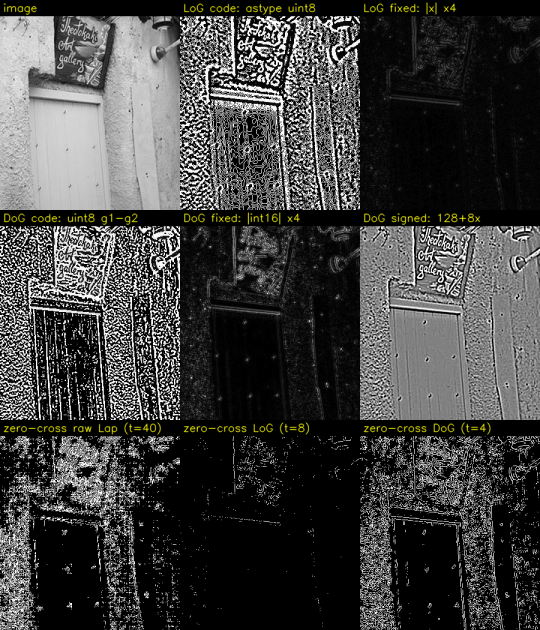

# Part 5. LoG와 DoG: [chap07/07.edge_DOG.py](../../chap07/07.edge_DOG.py)

계산과 그림이 모두 준비됐어요. Part 5 설명을 정리합니다.

Part 3의 라플라시안은 에지 위치를 정밀하게 찾지만 잡음에 너무 약했어요. Part 4의 가우시안은 잡음을 잘 누르죠. 이번 Part에서는 **둘을 합칩니다.** 파일이 하나라서 Step 5-1 ~ 5-4를 한 번에 진행하고, 이번에도 숫자는 전부 실행해서 확인했어요.

---

## 🔁 Part 4 퀴즈 답

**1번. 전송 오류(소금-후추 1%) + 야간 잡음(가우시안)이 섞이면?**

**이론적으로는 미디언 → 가우시안 순서**가 맞아요. 순서를 반대로 하면 이런 일이 생깁니다 (소금 한 점에 가우시안 3×3 → 미디언 3×3, 실행값).

```
가우시안 먼저 (소금 255가 번짐)        그다음 미디언
 10  10  10  10  10                    10  25  10
 10  25  41  25  10                    25  41  25      ← 41짜리 얼룩이 남음
 10  41  71  41  10       ──▶          10  25  10
 10  25  41  25  10
 10  10  10  10  10
```

가우시안이 소금 하나를 **9칸짜리 얼룩**으로 퍼뜨리면, 그 얼룩은 더 이상 "튀는 소수파"가 아니라서 미디언이 지우지 못해요. 미디언을 먼저 쓰면 소금은 **완전히** 사라집니다.

다만 정직하게 말하면, 실제 이미지(1% + σ 15)로 측정했을 때는 두 순서의 MAE가 **6.39 vs 6.38로 거의 같았어요.** 소금이 적고 블러가 약하면 차이가 작습니다. 그래도 원리상 **"극단값부터 제거하고, 그다음 전체를 부드럽게"**가 안전한 순서예요.

**2번. 5×5 미디언과 두께 2픽셀 선**

```
버틸 수 있는 이상값: (25 − 1) / 2 = 12개
두께 2픽셀 선 위의 윈도우: 선 화소 = 2열 × 5행 = 10개, 배경 = 15개
→ 다수결에서 배경이 이김 → 선이 사라짐 ❌
```

5×5에서 살아남으려면 선이 **3픽셀 이상**(3 × 5 = 15개, 과반수)이어야 해요.

**3번. 검은 글씨의 끊어진 틈 메우기**

끊어진 틈은 어두운 획 사이의 **작은 밝은 영역**이에요. 4-5-e에서 "**최소 → 최대** = 작은 밝은 것만 지운다"고 했죠. 그래서 **최소 → 최대**가 정답입니다. 최소 필터가 어두운 획을 넓혀서 틈을 메우고, 최대 필터가 넓어진 획을 원래 두께로 되돌려요. (이번에는 물체가 어두운 쪽이라 4-5-e와 반대로 생각해야 해요. Part 7에서 정확한 이름을 붙입니다.)

---

## Step 5-1. LoG: 가우시안 + 라플라시안

### 5-1-a. 아이디어

```
Part 3의 문제: 라플라시안은 미세한 흔들림(잡음)마다 + − 영교차를 만듦
해결:          먼저 가우시안으로 흔들림을 누르고 → 그다음 라플라시안

LoG(f) = ∇²( G * f )        "f를 가우시안으로 블러(*)한 것에 라플라시안(∇²)을 적용"
       = (∇²G) * f           ← 순서를 바꿔도 같음
```

**두 번째 줄이 핵심이에요.** 회선은 결합법칙이 성립해서, 블러하고 미분하는 대신 **가우시안 마스크를 먼저 미분해서 만든 마스크 하나**로 한 번에 처리할 수 있습니다. 그 마스크가 **LoG**(Laplacian of Gaussian)예요.

🧠 **비유: 흔들리는 손으로 그린 지도에서 절벽 찾기.** 손떨림 때문에 지도 곳곳에 작은 굴곡이 있으면, 굴곡 하나하나가 다 절벽처럼 보여요. 그래서 먼저 지도를 **부드럽게 다듬고**(가우시안) 나서 **휘어지는 곳**(라플라시안)을 찾는 겁니다.

### 5-1-b. 1D LoG 마스크를 직접 계산하기 📐

가우시안 exp(−x²/2σ²)를 x로 두 번 미분하면 (정규화 상수는 Step 4-3-b처럼 생략):

```
d²/dx² exp(−x²/2σ²) = ( x²/σ⁴ − 1/σ² ) · exp(−x²/2σ²)
```

σ = 1, x = −4 ~ +4로 계산하면 (실행값):

| x | −4 | −3 | −2 | −1 | 0 | +1 | +2 | +3 | +4 |
|---|---|---|---|---|---|---|---|---|---|
| G(x) = exp(−x²/2) | 0.000 | 0.011 | 0.135 | 0.607 | 1 | 0.607 | 0.135 | 0.011 | 0.000 |
| x² − 1 | 15 | 8 | 3 | 0 | −1 | 0 | 3 | 8 | 15 |
| **LoG = (x² − 1)·G** | 0.005 | 0.089 | **0.406** | **0** | **−1** | **0** | **0.406** | 0.089 | 0.005 |

```
 LoG(x)
 +0.4 |           ●                       ●
      |
    0 |──●──●────────●───────────────●────────●──●──
      |              ↑ x = −σ         ↑ x = +σ   (값이 0이 되는 곳)
 −1.0 |                      ●
        −4  −3  −2  −1    0   +1  +2  +3  +4
        "가운데가 깊게 파이고, 양옆이 살짝 솟은 모양"
```

**모양 읽기:**
- **x = 0**: 가장 깊은 음수 (−1)
- **x = ±σ** (여기서는 ±1): 정확히 0
- **|x| > σ**: 양수 고리가 생겼다가 서서히 0으로

이걸 뒤집으면(부호 반대) 챙 넓은 모자처럼 생겨서 **멕시칸 햇**(sombrero)이라고 불러요.

### 5-1-c. 2D LoG 마스크 (7×7, σ = 1)

2D 공식은 x² 대신 r² = x² + y²(중심까지 거리의 제곱)을 씁니다.

```
LoG(x, y) ∝ ( x² + y² − 2σ² ) / σ⁴ · exp( −(x² + y²) / 2σ² )
```

실행해서 7×7을 만들고 합이 정확히 0이 되도록 보정한 결과:

```
 0.003  0.018  0.055  0.079  0.055  0.018  0.003
 0.018  0.111  0.247  0.272  0.247  0.111  0.018
 0.055  0.247  0.001 −0.605  0.001  0.247  0.055
 0.079  0.272 −0.605 −1.999 −0.605  0.272  0.079     ← 가운데 깊은 구덩이
 0.055  0.247  0.001 −0.605  0.001  0.247  0.055
 0.018  0.111  0.247  0.272  0.247  0.111  0.018     ← 바깥 양수 고리
 0.003  0.018  0.055  0.079  0.055  0.018  0.003
```

위에서 보면 **가운데가 음수인 구덩이를 양수 고리가 둘러싼** 동심원 모양이에요. 원소 합 = 0이라 평평한 곳은 0이 됩니다 (Part 1 규칙).

> 🔗 **Part 3 라플라시안과 비교**
> ```
> Part 3 라플라시안:       LoG:
>   0   1   0              (위 7×7)
>   1  −4   1              → 가운데 음수 + 주변 양수라는 구조는 같음
>   0   1   0              → 하지만 "주변"이 1칸이 아니라 σ에 비례해 넓게 퍼지고,
>                            가중치가 가우시안처럼 부드럽게 줄어듦
> ```
> LoG는 **라플라시안을 σ 크기로 부드럽게 펼친 것**이에요.

### 5-1-d. 효과: 잡음 구별력이 얼마나 좋아졌나?

Part 2, 3과 **같은 실험**(세로 경계 10 → 100, 표준편차 10 잡음)입니다.

| 연산자 | 에지 반응 | 잡음 반응 | **에지 / 잡음** |
|---|---|---|---|
| 라플라시안 4방향 (Part 3) | 90 | 35.8 | 2.51 |
| 소벨 (Part 2) | 360 | 43.2 | 8.33 |
| **LoG σ = 1.0** | 16.9 | 2.63 | **6.42** |
| **LoG σ = 1.7** (07번 코드의 9×9) | 7.19 | 0.587 | **12.25** |
| **LoG σ = 2.5** | 3.44 | 0.195 | **17.60** |

- σ = 1.7만 돼도 라플라시안보다 **약 5배**, 소벨보다도 좋아졌어요.
- σ를 키울수록 더 좋아지지만, **에지 반응 자체가 작아집니다** (90 → 7.19 → 3.44). 이 값을 그대로 화면에 띄우면 거의 까맣게 보여요. 아래 5-3에서 실제로 확인합니다.
- σ를 키우면 잃는 것도 있어요. Part 4와 같은 트레이드오프로, **가는 디테일과 가까이 붙은 에지들이 뭉개져서** 사라집니다.

### 5-1-e. σ = "어떤 크기의 구조를 볼 것인가"

LoG의 σ는 일종의 **돋보기 배율**이에요.
- 작은 σ: 벽돌 하나하나의 테두리, 글자 획 같은 **잔디테일**까지 반응
- 큰 σ: 잔디테일은 블러에 묻히고, 문짝이나 간판 같은 **큰 물체의 윤곽**만 반응

또 LoG는 **반지름 ≈ √2·σ인 둥근 점(blob)**에 가장 강하게 반응해요. 그래서 σ를 여러 개 바꿔 가며 반응을 비교하면 "이 위치에 이 크기의 점이 있다"를 알 수 있습니다. 이게 **SIFT** 같은 특징점 검출기의 기본 아이디어예요 (아래 💼 참고).

---

## Step 5-2. DoG: 블러 두 장의 차이로 LoG 흉내 내기

### 5-2-a. 아이디어

```
DoG(f) = G(σ₁) * f  −  G(σ₂) * f       (σ₁ < σ₂)
        = 약하게 블러한 영상 − 강하게 블러한 영상
```

라플라시안을 계산할 필요 없이 **블러 두 장을 빼기만** 하면 됩니다. 가우시안 블러는 분리 가능해서 아주 빠르니까(Step 4-3-g) DoG도 빨라요.

### 5-2-b. 왜 LoG와 비슷할까? 직관 3가지

**① Part 1 샤프닝의 "디테일"과 같은 구조**

Step 1-4에서 `디테일 = 원본 − 블러`라고 했어요. DoG는 원본 대신 **살짝 블러한 영상**에서 빼는 거예요.

```
원본 − 블러         = 디테일 (잡음까지 다 포함)       ← 라플라시안과 비슷
약한 블러 − 강한 블러 = 잡음은 빼고 남은 중간 크기 디테일  ← LoG와 비슷
```

**② 주파수(크기) 관점: 대역 통과**

```
                      아주 잔 것(잡음)   중간 크기(에지)   아주 큰 것(전체 밝기)
약한 블러 (σ₁)         ✗ 지워짐           ✓ 남음            ✓ 남음
강한 블러 (σ₂)         ✗ 지워짐           ✗ 지워짐          ✓ 남음
──────────────────────────────────────────────────────────────────────
차이 (DoG)            ✗                  ✓ 남음            ✗ (서로 빼서 없어짐)
```

**두 블러 사이에 끼인 크기의 구조만** 남아요. 잡음처럼 너무 작은 것은 둘 다 지웠고, 전체 밝기처럼 너무 큰 것은 둘 다 남겨서 빼면 0이 됩니다. 정해진 크기 대역만 통과시킨다고 해서 **대역 통과 필터**라고 불러요.

**③ 📐 수학: "블러를 조금 더 하면 얼마나 변하나" = 라플라시안**

가우시안 블러는 **열이 퍼지는 것**(확산)과 같은 수학을 따릅니다. 열 확산 방정식에 따르면:

```
∂G/∂σ = σ · ∇²G         "σ를 아주 조금 늘렸을 때 변하는 양 = σ × 라플라시안"

그래서  G(σ₂) − G(σ₁)  ≈  (σ₂ − σ₁) · σ · ∇²G       (차분으로 미분을 근사, Part 2 아이디어)
즉      DoG = G(σ₁) − G(σ₂)  ≈  −(σ₂ − σ₁) · σ · LoG
```

🧠 **뜨거운 쇠막대 비유:** 막대의 온도 분포가 시간에 따라 퍼질 때, **뾰족하게 뜨거운 곳**(봉우리)은 빠르게 식고 **움푹 차가운 곳**(골짜기)은 빠르게 데워져요. 평평하거나 일정하게 기울어진 곳은 거의 변하지 않습니다. 이 "얼마나 휘었나"가 바로 라플라시안이에요. 블러를 조금 더 했을 때의 **변화량**(= DoG)이 라플라시안에 비례하는 이유입니다.

(부호가 반대인 건 상관없어요. 화면에 띄울 때 절댓값을 취하고, 영교차 위치도 똑같거든요.)

### 5-2-c. 얼마나 비슷한가? 측정 결과

1D로 촘촘하게 샘플링해서, DoG 곡선과 가장 닮은 LoG를 찾아 **모양 유사도**(상관계수 절댓값, 1이면 완전히 같은 모양)를 쟀어요.

| σ₁ / σ₂ | 비율 k | 가장 닮은 LoG의 σ | **유사도** |
|---|---|---|---|
| 1.0 / 1.6 | 1.6 | 1.25 | **0.9993** |
| 0.8 / 1.7 (07번 코드) | 2.1 | 1.14 | 0.9960 |
| 1.0 / 3.0 | 3.0 | 1.63 | 0.9855 |

- **비율 1.6**일 때 거의 완벽하게 같아요 (0.9993). 이게 Marr와 Hildreth가 1980년에 제안한 값입니다.
- 비율이 커질수록 조금씩 달라지지만, 07번 코드의 비율 2.1도 0.996으로 충분히 비슷해요.
- 닮은 LoG의 σ는 대략 **√(σ₁ × σ₂)**(기하평균)예요: √(1 × 1.6) = 1.26 ≈ 1.25 ✓

---

## Step 5-3. 코드 해부와 함정 3개 ⚠️

```python
gaus = cv2.GaussianBlur(image, (9,9), 0, 0)          # 6줄
dst1 = cv2.Laplacian(gaus, cv2.CV_16S, 9)            # 7줄
gaus1 = cv2.GaussianBlur(image, (3, 3), 0)           # 9줄   σ 자동 = 0.8
gaus2 = cv2.GaussianBlur(image, (9, 9), 0)           # 10줄  σ 자동 = 1.7
dst2 = gaus1 - gaus2                                  # 11줄
cv2.imshow("dst1 - LoG", dst1.astype("uint8"))       # 14줄
cv2.imshow("dst2 - DoG", dst2)                        # 15줄
```

**6줄**의 네 번째 `0`도 Step 4-3-f처럼 `dst` 자리로 들어가요. 하지만 sigmaY를 안 주면 sigmaX(= 0, 자동 계산)를 그대로 쓰니까 결과가 같아서 **해롭지 않습니다** (같은 결과인지 확인함). 9×9이므로 σ = 1.7이에요.

### 함정 ①: `cv2.Laplacian(gaus, cv2.CV_16S, 9)`의 9는 무시된다 (Part 3 복습)

Part 3에서 예고한 그 문제예요. 세 번째 위치 인자는 `dst`라서 실제로는 **`ksize=1`**(3×3 4방향 라플라시안)로 계산됩니다. `ksize=1`과 결과가 **완전히 같다**는 걸 확인했어요.

그런데 재밌는 건, **진짜로 `ksize=9`를 주면 오히려 망가진다는 점**이에요.

```
ksize=1 (코드가 실제로 하는 것) 결과 범위: −28 ~ 35
ksize=9 (주석 의도대로)        결과 범위: −32,768 ~ 32,767   ← int16 한계에 꽉 참 (포화)
```

9×9 라플라시안은 가중치가 매우 커서 int16 범위를 넘어 버려요. 이미 가우시안으로 블러했으니 **라플라시안은 작은 크기(ksize=1)가 맞습니다.** 결과적으로 코드는 우연히 올바르게 동작하고 있어요. 그래도 의도를 분명히 하려면 `ksize=1`이라고 써야 합니다.

### 함정 ②: `dst1.astype("uint8")`: 음수가 밝은 값으로 뒤집힘

LoG 결과는 int16이고 **41.9%가 음수**예요. 이걸 `astype("uint8")`로 바꾸면 Step 1-3-e에서 본 "한 바퀴 돌기"가 일어납니다. 실제 한 행 12칸 (100행, 150~161열):

```
LoG 값 (int16)     :   −7   −6   −1    7   12   10    3    0   −2   −4   −7   −7
astype("uint8")    :  249  250  255    7   12   10    3    0  254  252  249  249   ← 음수가 거의 흰색으로!
convertScaleAbs    :    7    6    1    7   12   10    3    0    2    4    7    7   ← 올바른 크기
```

−1은 255(가장 밝음), −7은 249가 돼요. **"거의 0"인 작은 음수가 가장 밝게** 표시되니까, 화면이 의미 없는 흰 무늬로 뒤덮입니다.

### 함정 ③: `gaus1 - gaus2`: uint8 빼기에서 음수가 한 바퀴 돎

계획 단계에서 "10 − 20 = 246"이라고 예고했던 함정이에요. `gaus1`과 `gaus2`는 둘 다 uint8이라서, numpy 뺄셈 결과도 uint8이고 **음수가 256을 더한 값으로 바뀝니다.**

같은 12칸 (실행값):

```
gaus1 (σ 0.8)    :  112  120  122   98   75   88  122  142  143  144  159  177
gaus2 (σ 1.7)    :  112  110  105  100  100  108  122  136  148  156  159  155
───────────────────────────────────────────────────────────────────────────
진짜 차이 (int16) :    0   10   17   −2  −25  −20    0    6   −5  −12    0   22
uint8 빼기 (코드) :    0   10   17  254  231  236    0    6  251  244    0   22   ← 음수 → 큰 양수
cv2.subtract     :    0   10   17    0    0    0    0    6    0    0    0   22   ← 음수 → 0 (포화)
```

| 빼기 방법 | 음수 처리 | 결과 |
|---|---|---|
| numpy `a - b` (uint8) | +256 (한 바퀴 돎) | ❌ 화소의 **37.7%**가 엉뚱하게 밝아짐 |
| `cv2.subtract(a, b)` | 0으로 자름 | ⚠️ 깨지지는 않지만 DoG의 **음수 쪽 절반을 잃음** |
| `a.astype(np.int16) - b` | 음수 보존 | ✅ 진짜 DoG (범위 −87 ~ 82) |

> 📌 **uint8 산술 규칙 (총정리)**
> - numpy `+`, `−`: 범위를 넘으면 **한 바퀴 돎** (200 + 100 = 44, 10 − 20 = 246)
> - OpenCV `cv2.add`, `cv2.subtract`: 범위를 넘으면 **0 또는 255에서 자름** (포화)
> - 결과가 음수일 수 있으면(미분, DoG): **먼저 int16이나 float32로 바꾼 다음** 빼기

### 고친 코드

```python
gaus = cv2.GaussianBlur(image, (9, 9), 0)
dst1 = cv2.Laplacian(gaus, cv2.CV_16S, ksize=1)                       # 의도를 명확히

gaus1 = cv2.GaussianBlur(image, (3, 3), 0)
gaus2 = cv2.GaussianBlur(image, (9, 9), 0)
dst2 = gaus1.astype(np.int16) - gaus2.astype(np.int16)                # 음수 보존

cv2.imshow("dst1 - LoG", cv2.convertScaleAbs(dst1, alpha=4))          # 절댓값, 4배 확대
cv2.imshow("dst2 - DoG", cv2.convertScaleAbs(dst2, alpha=4))
```

`alpha=4`는 `convertScaleAbs`의 배율 옵션이에요 (|x × 4|). LoG와 DoG 값은 작아서(최대 35, 87) 그대로 보면 너무 어두워요 (5-1-d에서 본 "에지 반응이 작아지는" 현상).

---

## Step 5-4. 실제 이미지 결과와 영교차 🖼️

[chap07/images/dog.jpg](../../chap07/images/dog.jpg)는 Part 4의 `min_max.jpg`와 같은 장면(간판 + 흰 문 + 벽)이에요. (파일 이름의 dog는 강아지가 아니라 **DoG**입니다 😄)

9장 비교 이미지:


| 위치 | 내용 | 보이는 모습 |
|---|---|---|
| 1행 1 | 원본 | |
| 1행 2 | **LoG 코드 그대로** (`astype`) | 화면 전체가 **흰 지렁이 무늬**로 뒤덮임. 벽, 문 구분이 거의 안 됨 (함정 ②) |
| 1행 3 | LoG 고침 (\|x\| × 4) | 검은 바탕에 문틀, 간판 테두리, 글씨가 **가는 선**으로 나옴. 벽 질감은 약하게만 |
| 2행 1 | **DoG 코드 그대로** (uint8 빼기) | 하얀 점, 선이 마구 섞인 **잡음 같은 화면** (함정 ③) |
| 2행 2 | DoG 고침 (\|int16\| × 4) | LoG 고친 것과 비슷하게 테두리가 나옴. σ₁이 작아서(0.8) 벽 질감이 조금 더 보임 |
| 2행 3 | DoG 부호 유지 (128 + 8×값) | **회색 바탕에 양각 조각처럼** 보임. 에지 한쪽은 밝고(+) 반대쪽은 어두움(−) |
| 3행 1 | 영교차: **블러 없는** 라플라시안 | 벽 전체가 하얀 점으로 뒤덮임 (Part 3에서 본 문제) |
| 3행 2 | 영교차: **LoG** | 문틀, 간판, 램프 윤곽이 **깔끔한 1픽셀 선**으로 나옴. 벽은 거의 비어 있음 ✅ |
| 3행 3 | 영교차: DoG | LoG와 비슷한데 σ가 작은 만큼 벽 질감도 조금 더 잡힘 |

**3행 비교가 이번 Part의 결론이에요.** 같은 영교차 방법인데, 가우시안으로 먼저 다듬었더니(LoG) Part 3의 자글자글한 결과가 **물체 윤곽만 남는 선 그림**으로 바뀌었어요.

> 💡 **2행 3열(부호 유지)을 보는 법**
> 밝은 쪽과 어두운 쪽이 나란히 붙어 있는 곳이 영교차, 즉 에지예요. 에지 양쪽이 **반대 부호**를 갖는 2차 미분의 특징(Step 3-1)을 눈으로 볼 수 있는 표현입니다. 절댓값(1행 3열)으로는 이 정보가 사라져요.

이 방법(LoG + 영교차)을 **Marr-Hildreth 에지 검출기**(1980)라고 해요. 다음 Part의 캐니(1986)가 나오기 전까지 대표적인 에지 검출기였습니다. 장점은 닫힌 윤곽선을 잘 만든다는 것이고, 약점은 약한 에지에서도 영교차가 생겨서 **임계값 정하기가 까다롭다**는 거예요. 캐니는 이 약점을 "두 개의 임계값"으로 해결합니다.

---

## 💼 실무 연결 (AVM)

- **특징점 검출 (SIFT)**: 가우시안 블러를 σ, 1.6σ, 1.6²σ, ...로 쌓은 뒤 이웃끼리 빼서 **DoG 피라미드**를 만들고, 위치와 크기 모두에서 극값인 점을 특징점으로 씁니다. 카메라 사이 **정합**(스티칭할 때 겹치는 영역 맞추기), 캘리브레이션 검증, 차량 이동량 추정 등에 쓰이는 기술의 출발점이에요. 5-2-c의 1.6이 SIFT에도 그대로 나옵니다.
- **선 폭에 맞춘 대역 통과**: 주차선은 탑뷰에서 대략 일정한 폭(예: 15cm → 몇 픽셀)을 가져요. DoG의 σ를 그 폭에 맞추면 **그 폭의 밝은 선에 가장 강하게 반응**하고, 아스팔트 질감(더 작음)이나 조명 그라데이션(더 큼)은 억제됩니다. 단순 이진화보다 그림자와 조명 변화에 강한 주차선 강조 방법이에요.
- **uint8 함정은 실무 단골 버그**: 영상 두 장을 빼는 코드(배경 차분, 프레임 차분, 캘리브레이션 전후 비교)에서 `a - b`를 uint8로 하는 실수가 정말 흔합니다. 이번에 본 함정 ③을 꼭 기억해 두세요.

---

## 📋 Part 5 정리

| 개념 | 한 줄 정리 |
|---|---|
| LoG | 가우시안 블러 + 라플라시안을 마스크 하나로. 결합법칙 ∇²(G*f) = (∇²G)*f |
| 모양 | 가운데 음수 구덩이 + 양수 고리 (멕시칸 햇). x = ±σ에서 0 |
| 효과 | 에지/잡음 비율 2.51(라플라시안) → 12.25(LoG σ = 1.7) |
| σ | 볼 구조의 크기. 크면 잡음에 강하지만 디테일을 잃고 반응도 작아짐 |
| DoG | 약한 블러 − 강한 블러. 대역 통과. 열 확산 때문에 ≈ LoG |
| 최적 비율 | σ₂/σ₁ = 1.6에서 유사도 0.9993 |
| 함정 ① | `Laplacian(gaus, CV_16S, 9)`의 9는 dst → 실제로는 ksize=1 (그게 오히려 맞음) |
| 함정 ② | int16 LoG를 `astype("uint8")` → −1이 255로 |
| 함정 ③ | uint8 `gaus1 − gaus2` → 37.7% 화소가 한 바퀴 돎. int16으로 바꾼 뒤 빼야 함 |
| 영교차 | LoG + 영교차 = Marr-Hildreth 에지 검출기. 깔끔한 1픽셀 윤곽선 |

### ✅ Part 5 퀴즈

1. DoG를 σ₁ = 2, σ₂ = 3.2로 만들면 비율은? 이 DoG는 대략 σ가 몇인 LoG와 비슷할까요?
2. `cv2.subtract(gaus1, gaus2)`로 DoG를 만들면 에지의 어느 쪽 절반이 사라질까요? (힌트: gaus1이 gaus2보다 큰 곳은 에지의 밝은 쪽일까, 어두운 쪽일까?)
3. 한 변이 약 6픽셀인 정사각형 점(예: 문의 못 자국)을 가장 강하게 잡으려면 LoG의 σ를 대략 얼마로 하면 될까요? (5-1-e의 √2·σ 규칙 사용)

---

다음은 **Part 6: 캐니 에지 (08, 13)**입니다. chap07에서 가장 어려운 Part예요. 4단계 파이프라인(가우시안 → 소벨 크기와 방향 → 비최대 억제 → 이력 임계값)을 하나씩 나눠서, 특히 `first = [3, 0, 1, 2]` 인덱스 트릭과 재귀 `trace()` 추적 순서를 작은 격자로 한 칸씩 따라갑니다. Part 6은 두세 번에 나눠 진행할게요.

**"다음"**이라고 하시면 이어가고, 어려운 부분이 있으면 **"더 쉽게"**라고 해 주세요.
