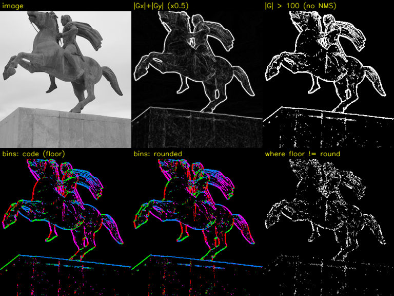
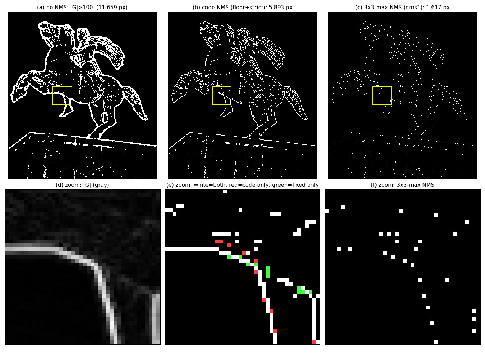
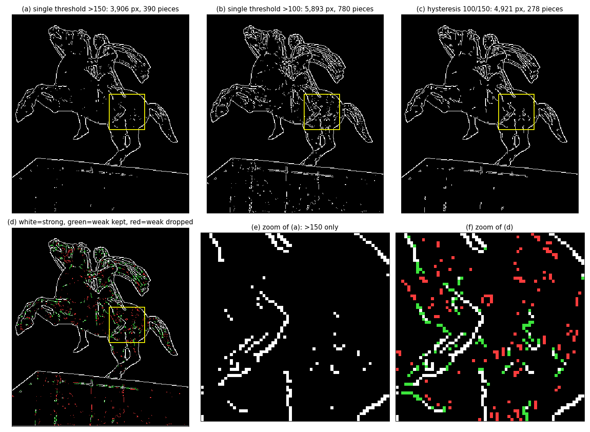
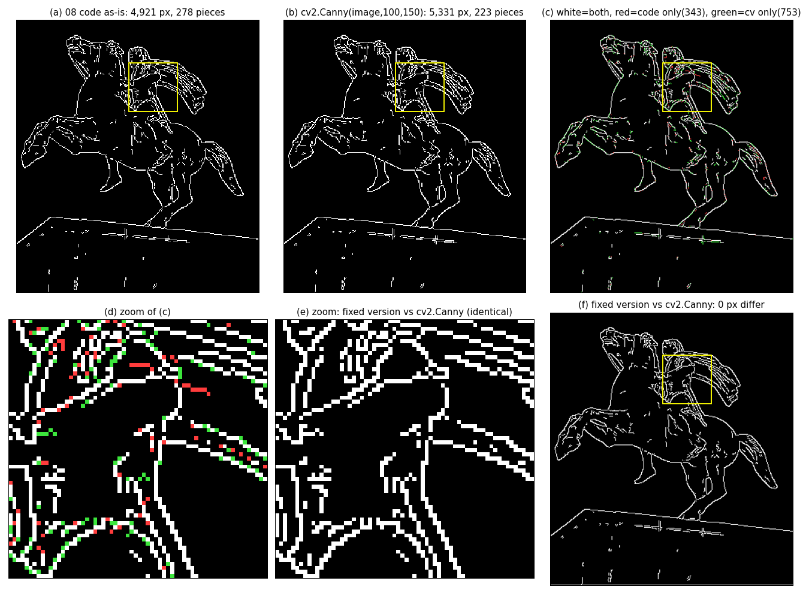
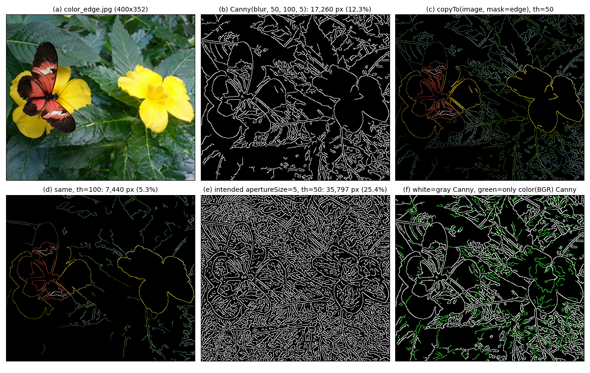

# Part 6. 캐니 에지 — Step 6-1 ~ 6-4: [chap07/08.edge_canny.py](../../chap07/08.edge_canny.py)

캐니 앞부분(블러, 그래디언트 크기와 방향)의 계산과 그림이 끝났어요. 이번 답변에서는 Step 6-1 ~ 6-4를 설명합니다.

chap07에서 가장 어려운 Part라서 세 번에 나눠 진행합니다.

| 이번 | 다음 | 그다음 |
|---|---|---|
| **6-1 좋은 에지의 조건**, **6-2 전체 흐름**, **6-3 ① 블러**, **6-4 ② 크기와 방향** | 6-5 ③ 비최대 억제 | 6-6 ④ 이력 임계값, 6-7 OpenCV와 비교, 6-8 컬러 캐니 (13) |

이번에도 숫자는 전부 실행해서 확인했어요. 그리고 이번 범위에서 **코드 문제를 두 개** 새로 찾았습니다 (6-3, 6-4).

---

## 🔁 Part 5 퀴즈 답

**1번. σ₁ = 2, σ₂ = 3.2**

```
비율 = 3.2 / 2 = 1.6   ← 유사도가 가장 좋은 비율
비슷한 LoG의 σ ≈ √(σ₁ × σ₂) = √(2 × 3.2) = √6.4 ≈ 2.53
```

**2번. `cv2.subtract(gaus1, gaus2)`에서 사라지는 쪽**

`gaus1`(약한 블러)이 `gaus2`(강한 블러)보다 큰 곳만 남아요. 경계 근처에서 강한 블러는 반대편 값을 더 많이 섞어 오니까:

```
         어두운 쪽 │ 밝은 쪽
gaus1 :    10  12 │ 98 100     (경계가 비교적 선명함)
gaus2 :    25  35 │ 75  85     (밝은 값이 어두운 쪽으로, 어두운 값이 밝은 쪽으로 더 많이 섞임)
차이  :   −15 −23 │+23 +15
                 ↑
        음수 → 0으로 잘림     양수 → 남음
```

**에지의 어두운 쪽 절반이 사라지고 밝은 쪽만 남습니다.**

**3번. 한 변 약 6픽셀인 점**

반지름 ≈ 3이니까 `√2 · σ = 3` → σ ≈ 3 / 1.41 ≈ **2.1**

---

## Step 6-1. 좋은 에지 검출기의 조건

### 6-1-a. 지금까지의 문제점 정리

Part 2 ~ 5에서 만든 에지 지도를 실제로 쓰려고 하면 문제가 세 가지 있었어요.

| 문제 | 어디서 봤나 | 예시 |
|---|---|---|
| **에지가 두꺼움** | Part 2 소벨 결과 | 경계 하나가 3 ~ 5픽셀 두께의 띠로 나옴 |
| **잡음과 질감도 에지로 잡힘** | Part 3 라플라시안 | 벽 질감, 물방울이 모두 하얀 점 |
| **"어디부터 에지냐"를 정하기 어려움** | Part 5 영교차 | 임계값을 낮추면 잡음, 높이면 끊어진 선 |

### 6-1-b. 캐니의 세 가지 조건 (John Canny, 1986)

캐니는 에지 검출기가 갖춰야 할 조건을 이렇게 정리했어요.

| 조건 | 뜻 | 위 문제 중 해결하는 것 |
|---|---|---|
| ① **잘 찾기** | 진짜 에지는 놓치지 말고, 가짜 에지(잡음)는 잡지 말 것 | 잡음과 질감 |
| ② **정확한 위치** | 찾은 에지가 실제 경계 위치에 놓일 것 | 두꺼운 띠 |
| ③ **한 에지에 한 응답** | 경계 하나에 선은 한 줄만 나올 것 | 두꺼운 띠, 이중선 |

🧠 **비유: 산맥 지도를 그리는 측량사.** 좋은 측량사는 ① 진짜 능선은 빠짐없이 그리고 작은 돌무더기는 능선으로 착각하지 않으며, ② 능선을 정확한 위치에 그리고, ③ 능선 하나를 선 한 줄로 그립니다. 경사가 급한 지역을 통째로 칠해 놓으면 능선 지도가 아니에요.

---

## Step 6-2. 캐니의 4단계 파이프라인

```
 원본 이미지
     │
     ▼
 ① 가우시안 블러 ─────────── "잡음부터 누른다"              조건 ①
     │                       (Part 4)
     ▼
 ② 소벨 → 크기 |G|, 방향 θ ── "어디가 얼마나 가파르고,       (Part 2)
     │                         어느 쪽으로 가파른가"
     ▼
 ③ 비최대 억제 (NMS) ──────── "능선 꼭대기 한 줄만 남긴다"     조건 ②③
     │                       두꺼운 띠 → 1픽셀 선
     ▼
 ④ 이력 임계값 ─────────────── "확실한 에지에서 출발해          조건 ①
     │                         이어진 약한 에지까지 따라간다"
     ▼
 최종 에지 (0 또는 255인 1픽셀 선)
```

08번 코드의 해당 줄:

| 단계 | 줄 | 코드 |
|---|---|---|
| ① 블러 | 64 | `gaus_img = cv2.GaussianBlur(image, (5, 5), 0.3)` |
| ② 크기 | 65 ~ 68 | `Gx`, `Gy` = 소벨, `sobel = np.fabs(Gx) + np.fabs(Gy)` |
| ② 방향 | 69 ~ 70 | `directs = cv2.phase(Gx, Gy) / (np.pi / 4)` → `astype(int) % 4` |
| ③ NMS | 71 | `max_sobel = nonmax_suppression(sobel, directs)` |
| ④ 이력 임계값 | 72 | `hysteresis_th(max_sobel, 100, 150)` |
| 비교 | 73 | `canny2 = cv2.Canny(image, 100, 150)` |

**실습 이미지** [chap07/images/canny.jpg](../../chap07/images/canny.jpg)(320×360)는 하늘을 배경으로 한 **말 탄 기마상**과 돌 받침대예요. 매끈한 하늘과 복잡한 동상 윤곽이 대비되어 에지 검출을 시험하기 좋은 사진입니다.

---

## Step 6-3. ① 가우시안 블러 (64줄)

### 6-3-a. 왜 맨 앞에서 블러할까?

Part 2 ~ 5에서 계속 확인했듯이 **미분은 잡음을 키웁니다.** 캐니는 ②에서 소벨(미분)을 쓰니까, 그 전에 잡음을 눌러 둬야 조건 ①을 지킬 수 있어요. Part 5의 LoG와 같은 발상입니다.

### 6-3-b. ⚠️ 코드 문제: σ = 0.3은 사실상 블러가 아니다

```python
gaus_img = cv2.GaussianBlur(image, (5, 5), 0.3)      # 64줄
```

시그니처 `GaussianBlur(src, ksize, sigmaX, ...)`에서 세 번째 인자는 **sigmaX가 맞아요** (Part 4의 위치 인자 함정은 아님). 문제는 **σ = 0.3이라는 값 자체**입니다. 5칸 마스크 가중치를 직접 출력해 보면:

```
σ = 0.3 :  [0.0000  0.0038  0.9923  0.0038  0.0000]   ← 가운데 99.2%, 사실상 원본 그대로
σ = 1.0 :  [0.0545  0.2442  0.4026  0.2442  0.0545]   ← 이웃을 제대로 섞음 (비교용)
```

Step 4-3-b의 공식으로 이유를 확인하면:

```
x = ±1에서:  exp(−1² / (2 × 0.3²)) = exp(−1 / 0.18) = exp(−5.56) ≈ 0.0039
```

σ = 0.3이면 **1칸 떨어진 이웃도 0.4%밖에 반영되지 않아요.** 실제 이미지에 적용해서 원본과 비교한 결과:

| | 바뀐 화소 비율 | 평균 변화량 | 최대 변화량 |
|---|---|---|---|
| σ = 0.3 (코드) | **1.16%** | **0.012** | 3 |
| σ = 1.0 (비교) | — | 3.155 | — |

**사실상 블러를 하지 않은 것**과 같아요. 5×5 크기를 줬지만 σ가 너무 작아서 바깥 칸들은 전부 0입니다.

**왜 이렇게 썼을까요?** 추측이지만 `cv2.Canny`는 내부에 가우시안 블러 단계가 **없고** 소벨만 써요. 그래서 비교를 공정하게 하려고 블러를 거의 안 했을 가능성이 있습니다. 하지만 원래 캐니 알고리즘을 따르려면 σ = 1 ~ 1.5 정도가 일반적이에요.

```python
gaus_img = cv2.GaussianBlur(image, (5, 5), 1.0)     # 캐니 원래 의도에 맞는 블러
```

> 📌 **`cv2.Canny`를 쓸 때는 블러를 직접 해야 해요.** 13번(컬러 캐니)이 `cv2.Canny` 앞에 `GaussianBlur((5,5), 0)`(σ 자동 = 1.1)을 넣은 이유가 이거예요. `cv2.Canny`가 하는 스무딩은 소벨 마스크 안의 `[1, 2, 1]`뿐입니다 (Step 2-5).

---

## Step 6-4. ② 그래디언트 크기와 방향 (65 ~ 70줄)

이 단계는 Part 2-2-c에서 배운 그래디언트를 **캐니에 맞게 가공**하는 과정이에요.

### 6-4-a. 소벨로 Gx, Gy 구하기 (65 ~ 66줄)

```python
Gx = cv2.Sobel(np.float32(gaus_img), cv2.CV_32F, 1, 0, 3)  # x방향 마스크
Gy = cv2.Sobel(np.float32(gaus_img), cv2.CV_32F, 0, 1, 3)  # y방향 마스크
```

Part 2에서 본 그대로예요. 다섯 번째 `3`은 Part 2-5-d에서 찾은 것처럼 **`dst` 자리로 들어가 무시되지만**, 기본값도 ksize = 3이라 결과는 같습니다. `CV_32F`는 음수를 보존하려는 거예요. ②에서 방향을 구하려면 부호가 꼭 필요합니다.

### 6-4-b. 크기: L1 근사 (67 ~ 68줄)

```python
#sobel = cv2.magnitude(Gx, Gy)            # 두 행렬 벡터 크기       ← 주석 처리됨
sobel = np.fabs(Gx) + np.fabs(Gy)         # 두 행렬 절댓값 덧셈     ← 실제 사용
```

| 방식 | 식 | 이름 |
|---|---|---|
| 주석 처리된 줄 | √(Gx² + Gy²) | L2 노름 (정확한 크기) |
| 실제 사용 | \|Gx\| + \|Gy\| | L1 노름 (근사) |

Part 2-2-c에서 봤듯이 L1은 대각선에서 최대 1.41배 과대평가해요. 이 이미지에서 강한 에지(> 100)만 모아 비교하면 **평균 1.27배** 컸습니다.

**왜 굳이 L1을 썼을까요?** `cv2.Canny(image, 100, 150)`의 기본값이 `L2gradient=False`, 즉 **L1을 쓰기 때문**이에요. 임계값 100, 150을 똑같이 쓰려면 크기를 계산하는 방식도 같아야 비교가 공정합니다. 좋은 선택이에요.

**실제 크기 값 (한 행 잘라 보기, 180행, x = 100 ~ 129):** 하늘(223)에서 동상(53 ~ 105)으로 넘어가는 구간이에요.

```
원본 :  223 223 223 ... 223 222 220 224 233 246 181  53  89  99  95 105  97  87 ...
|G|  :    6   4   4 ...   4   6  20  58  28 116 460 880 464 170 152 100  80  78 ...
                                          └────────────────────┘
                              100을 넘는 칸이 7개 (116, 460, 880, 464, 170, 152, 100)
                              진짜 경계는 하나인데 7칸짜리 띠
```

이게 6-1-a의 "**에지가 두꺼움**" 문제예요. 가장 큰 880이 **능선 꼭대기**이고, 나머지는 산비탈입니다. 다음 Step의 비최대 억제가 꼭대기 880만 남기고 나머지를 지워요.

### 6-4-c. 방향: 360°를 4개 구간으로 (69 ~ 70줄) 📐

```python
directs = cv2.phase(Gx, Gy) / (np.pi / 4)        # 69줄
directs = directs.astype(int) % 4                # 70줄
```

**왜 방향이 필요할까요?** 다음 Step의 비최대 억제는 "내가 **그래디언트 방향으로** 양옆 이웃보다 큰가?"를 봅니다. 그런데 3×3 격자에서 이웃은 8개뿐이라, 방향도 이웃이 있는 방향 몇 개로 **어림(양자화)**해야 해요.

한 단계씩 따라가 볼게요.

```
① cv2.phase(Gx, Gy)       → 0 ~ 2π 라디안 (0° ~ 360°)       (Part 2-2-c)
② ÷ (π/4)                 → 0 ~ 8         (45°를 1로 보는 단위)
③ .astype(int)            → 0, 1, 2, ..., 7  (소수점 버림)
④ % 4                     → 0, 1, 2, 3
```

**④ `% 4`를 하는 이유:** 그래디언트가 30°든 210°(정반대)든 **에지 선의 방향은 같아요.** 비최대 억제는 어차피 **양쪽** 이웃을 모두 보니까, 반대 방향을 같은 구간으로 묶어도 됩니다.

```
③ 결과:  0   1   2   3   4   5   6   7
④ 결과:  0   1   2   3   0   1   2   3
         └───────────────┘ └───────────────┘
         0°~180°            180°~360° (반대 방향 → 같은 번호)
```

**구간 번호와 비교할 이웃** (코드 15 ~ 22줄 주석, 그래디언트 방향 기준):

| 번호 | 의미하는 그래디언트 방향 | 비교할 이웃 (3×3) | 이 방향의 에지 선 |
|---|---|---|---|
| 0 | 0° (→) | 왼쪽, 오른쪽 | 세로선 │ |
| 1 | 45° (↘) | 왼쪽 위, 오른쪽 아래 | ╱ |
| 2 | 90° (↓) | 위, 아래 | 가로선 ─ |
| 3 | 135° (↙) | 오른쪽 위, 왼쪽 아래 | ╲ |

(이미지는 y축이 아래를 향해서 90°가 ↓예요. Part 2-2-c 참고.)

### 6-4-d. ⚠️ 코드 문제: 반올림이 아니라 버림이라 22.5° 어긋남

각 번호는 **그 각도 근처**를 대표해야 해요. 예를 들어 0번(0°)은 −22.5° ~ +22.5°, 1번(45°)은 22.5° ~ 67.5°를 맡아야 합니다. 그런데 70줄의 `astype(int)`는 **버림**이라서 실제 구간이 반 칸(22.5°) 밀려 있어요.

```
                   0°        45°        90°        135°       180°
올바른 구간 (반올림): ├──0──┼────1────┼────2────┼────3────┼──0──┤
                  −22.5°  22.5°     67.5°     112.5°    157.5°

코드 구간 (버림):   ├─────0─────┼─────1─────┼─────2─────┼─────3─────┤
                   0°         45°         90°        135°       180°
```

**실제 값으로 확인하기** (각 (Gx, Gy)를 코드와 똑같이 계산):

| (Gx, Gy) | 실제 각도 | phase ÷ (π/4) | 코드 (버림) | 올바름 (반올림) | 문제 |
|---|---|---|---|---|---|
| (360, 0) | 0.00° | 0.00000 | 0 | 0 | |
| (100, 80) | 38.66° | 0.85906 | **0** (→) | 1 (↘) | 거의 대각선인데 가로로 비교 |
| **(270, 270)** | **44.99°** | **0.99979** | **0** (→) | 1 (↘) | **정확한 45° 대각선이 0번으로!** |
| (80, 100) | 51.34° | 1.14094 | 1 | 1 | |
| (20, 100) | 78.69° | 1.74866 | **1** (↘) | 2 (↓) | 거의 수직인데 대각선으로 비교 |
| (0, 360) | 90.00° | 2.00000 | 2 | 2 | |
| (100, −10) | 354.29° | 7.87312 | **3** (↙) | 0 (→) | **거의 수평인데 135° 대각선으로!** |

**가장 놀라운 줄은 (270, 270)이에요.** Part 2의 대각선 경계 예제가 정확히 이 값이었죠. 수학적으로는 정확히 45°라서 1이 나와야 하는데:
1. Part 2-2-c에서 봤듯이 `cv2.phase`는 근사 계산이라 0.7854가 아니라 **0.7852**를 돌려줘요 (44.99°).
2. ÷ (π/4) = 0.99979, 1보다 아주 조금 작아요.
3. 버림 → **0**

반올림했다면 0.99979 + 0.5 → 1이 됐을 거예요. **버림 + 근사 오차**가 겹쳐서 정확한 대각선이 수평으로 분류되는 겁니다.

**실제 이미지에서 얼마나 자주 틀릴까요?** 강한 에지(|G| > 100) 화소 중 버림과 반올림의 구간 번호가 다른 비율:

```
44.9%   ← 강한 에지 화소의 거의 절반이 "엉뚱한 이웃"과 비교됨
```

랜덤한 각도면 정확히 절반이 반 칸 밀린 쪽에 걸리니까 약 50%가 나오는 게 당연해요.

**고치는 방법:** 22.5°(= π/8)를 더한 다음 버리면 반올림이 됩니다.

```python
directs = (cv2.phase(Gx, Gy) + np.pi / 8) / (np.pi / 4)     # +22.5° 해서
directs = directs.astype(int) % 4                            # 버림 = 반올림 효과
```

### 6-4-e. 🖼️ 그림으로 보기

6장 비교 (위: 원본 / |Gx| + |Gy| / |G| > 100 그냥 자르기, 아래: 방향 구간 코드 버전 / 반올림 버전 / 두 버전이 다른 곳):


방향 색: 🔴 0번(→, 세로선) / 🟢 1번(↘) / 🔵 2번(↓, 가로선) / 🟣 3번(↙). |G| ≤ 100인 곳은 검은색이에요.

1. **|Gx| + |Gy|**: 동상 윤곽이 하얗게 빛나는데, 선이 **두툼**해요. 하늘은 거의 검고, 받침대 돌 이음매도 약하게 보입니다.
2. **|G| > 100 그냥 자르기**: 비최대 억제 없이 임계값만 적용한 결과예요. 윤곽이 **굵은 붓으로 칠한 것처럼 뭉툭**합니다. 6-4-b의 "7칸짜리 띠"가 이미지 전체에서 일어난 모습이에요. 이걸 보면 왜 ③ 단계가 필요한지 알 수 있습니다.
3. **방향 구간 (두 버전)**: 같은 윤곽선을 따라가며 색이 바뀌어요. 말의 다리처럼 곧게 선 부분은 대부분 🔴, 말 등이나 받침대 윗면처럼 누운 부분은 🔵 쪽이 많습니다.
4. **두 버전이 다른 곳**: 윤곽선 **거의 전체에 하얀 점이 흩어져** 있어요 (44.9%). 특정 부분만이 아니라 에지 곳곳에서 비교 방향이 어긋난다는 뜻입니다.

---

## 📋 Step 6-1 ~ 6-4 요약

| 개념 | 한 줄 정리 |
|---|---|
| 캐니 3조건 | ① 잘 찾기 ② 정확한 위치 ③ 한 에지에 한 응답 |
| 4단계 | 블러 → 크기와 방향 → 비최대 억제 → 이력 임계값 |
| ① 블러 | 미분 전에 잡음을 누름. **코드의 σ = 0.3은 가운데 가중치 99.2%라 사실상 블러 없음** |
| `cv2.Canny` | 내부에 가우시안 블러가 없음 → 직접 블러해야 함 (13번처럼) |
| ② 크기 | L1(\|Gx\| + \|Gy\|) 사용. `cv2.Canny` 기본값(`L2gradient=False`)과 맞추려는 선택 |
| 두꺼운 에지 | 경계 하나가 7칸짜리 띠 (116 … 880 … 100) → ③이 필요한 이유 |
| ② 방향 | phase ÷ 45° → 정수 → % 4. 반대 방향은 같은 에지라서 4개 구간 |
| **방향 버그** | 버림 때문에 구간이 22.5° 밀림. 정확한 45° 대각선(270, 270)이 0번으로. 강한 에지의 44.9%가 어긋남 |
| 수정 | `(phase + π/8) / (π/4)`로 반올림 |

### ✅ 확인 질문

1. Gx = −50, Gy = 120일 때 각도는 약 몇 도이고, 코드(버림) 구간 번호와 올바른(반올림) 구간 번호는 각각 무엇일까요? (힌트: atan2(120, −50) ≈ 112.6°)
2. 6-4-b의 크기 값 `… 116 460 880 464 170 152 100 …`에서, 그래디언트 방향이 0번(→)이라고 할 때 "왼쪽 이웃과 오른쪽 이웃보다 모두 큰" 값은 무엇인가요? 그 값만 남기면 에지 두께는 몇 픽셀이 될까요?
3. 블러 σ를 0.3에서 2.0으로 키우면, 6-4-b의 880(꼭대기 값)과 띠의 두께는 각각 어떻게 변할까요? (Part 4-2-b의 "에지가 경사로가 된다"를 떠올려 보세요.)

---

다음은 **Step 6-5: ③ 비최대 억제(NMS)**입니다. `values = sobel[i-1:i+2, j-1:j+2].flatten()`의 0 ~ 8 인덱스 그림, `first = [3, 0, 1, 2]`와 `values[id]`, `values[8 - id]`의 **대칭 트릭**을 해독하고, 작은 격자에서 NMS 전후를 한 칸씩 비교해요. 그리고 `v1 < sobel[i, j] > v2`의 **엄격한 부등호** 때문에 완벽한 계단 에지가 통째로 사라지는 함정도 실험으로 보여드릴게요.

**"다음"**이라고 하시면 이어가고, 어려운 부분이 있으면 **"더 쉽게"**라고 해 주세요.

---

# Part 6. 캐니 에지 — Step 6-5: ③ 비최대 억제 (NMS)

대상은 [chap07/08.edge_canny.py:3-35](../../chap07/08.edge_canny.py#L3-L35)예요. 이번에도 숫자는 전부 실행해서 확인했어요.

이번 Step에서 다루는 것은 세 가지예요.
- **동점 함정**(새로 찾은 코드 문제): 부등호가 엄격해서 생겨요.
- **방향 버그의 실제 피해**: 지난번 6-4-d의 버림 문제가 NMS 결과를 얼마나 바꾸는지 측정했어요.
- **비교용 함수의 한계**: `nonmax_suppression1`이 왜 점선을 만드는지 봐요.

---

## 🔁 지난 퀴즈 답

**1번. Gx = −50, Gy = 120**

```
cv2.phase → 112.62°
코드 (버림):    112.62 ÷ 45          = 2.503  → 2번 (↓, 위·아래 비교)
반올림:        (112.62 + 22.5) ÷ 45 = 3.003  → 3번 (↙, 오른쪽 위·왼쪽 아래 비교)
```

반올림 기준 정답은 **3번**이에요. 다만 112.62°는 구간 경계(112.5°)를 0.12° 넘었을 뿐이에요. 90°와 135°의 거의 한가운데라서, 어느 쪽으로 비교해도 실제 방향과 약 22.5° 어긋나요. 이것이 **4방향 어림의 근본 한계**이고, 6-5-f에서 다시 다룹니다.

**2번. 0번(→)으로 좌우 비교할 때**

```
값      :  116  460  880  464  170  152  100
왼쪽 이웃 :   28  116  460  880  464  170  152
오른쪽 이웃:  460  880  464  170  152  100   80
둘 다 큼?   ✗    ✗    ✓    ✗    ✗    ✗    ✗
```

**880 하나만 남고 두께는 1픽셀**이 돼요. 이게 바로 이번 Step의 주제입니다.

**3번. σ를 0.3에서 2.0으로 키우면** (같은 180행, x = 110 ~ 127을 실제로 계산)

```
σ = 0.3 :   4   4   6  20  58  28 116 460 880 464 170 152 100  80  78  42  28  18
σ = 2.0 :  54  76 102 134 172 216 260 284 276 226 146  68  38  28  24  18  12  10
```

- **꼭대기 높이:** 880에서 **284**로 약 1/3이 됐어요. 계단이 완만한 경사로로 바뀌어서 기울기가 작아진 거예요.
- **100을 넘는 칸:** 7칸에서 **9칸**으로 늘었어요. 산이 낮고 펑퍼짐해졌어요.
- **꼭대기 위치:** 118열에서 117열로 한 칸 이동했어요. 블러를 세게 하면 잡음에는 강해지지만(조건 ①) 위치 정확도(조건 ②)를 조금 잃어요. 캐니 3조건 사이의 **트레이드오프**예요.
- **NMS 이후:** 여전히 꼭대기 한 칸만 남으니 선 두께는 1픽셀 그대로예요. 대신 크기 값이 전체적으로 작아졌으니 **임계값 100/150도 함께 낮춰야** 해요. 블러 σ와 임계값은 한 세트로 조정하는 값입니다.

---

## Step 6-5. ③ 비최대 억제 (Non-Maximum Suppression)

### 6-5-a. 아이디어: 능선 꼭대기만 남기기

이름을 그대로 풀면 "최대가 **아닌**(Non-Maximum) 것을 **억제**(Suppression)한다", 즉 **0으로 만든다**는 뜻이에요.

6-4-b에서 본 180행 단면을 막대로 세우면 이렇게 생겼어요.

```
열 116 │███                       116   비탈 → 지움
열 117 │███████████               460   비탈 → 지움
열 118 │██████████████████████    880   ★ 꼭대기 → 남김
열 119 │████████████              464   비탈 → 지움
열 120 │████                      170   비탈 → 지움
열 121 │████                      152   비탈 → 지움
열 122 │███                       100   비탈 → 지움 (작은 혹이지만 꼭대기는 아님)
```

규칙은 한 줄이에요.

> **"그래디언트 방향으로 양옆에 있는 이웃 두 개보다 크면 남기고, 아니면 0."**

### 6-5-b. 왜 꼭 "그래디언트 방향" 이웃이어야 할까? 실제 3×3 창으로 보기

위 880 화소, 즉 (행 180, 열 118)을 중심으로 한 실제 3×3 창이에요.

```
            열117  열118  열119
  행179  │  938    702    122  │
  행180  │  460   [880]   464  │
  행181  │   68    702    770  │

  Gx = −592, Gy = 288  →  각도 154° (대부분 ←, 약간 ↓)
```

**938 → 880 → 770이 대각선으로 이어져 있어요.** 이 셋은 말 앞다리 **윤곽선 하나 위에 나란히 놓인 화소**예요. 그래디언트는 이 선을 **가로지르는** 방향(154°)을 가리켜요.

```
            열117  열118  열119
  행179  │ (938)   702  ·122· │     ( ) = 같은 에지 선 위의 이웃 (선을 "따라가는" 방향)
  행180  │  460   [880]   464  │     · · = 에지를 "가로지르는" 이웃 (그래디언트 방향, 구간 3)
  행181  │ ·68·    702  (770) │
```

네 방향 중 어느 쪽으로 비교하느냐에 따라 880의 운명이 갈려요.

| 구간 | 비교하는 두 이웃 | 값 | 880이 둘보다 큰가? | 결과 |
|---|---|---|---|---|
| 0 (→) | 왼쪽, 오른쪽 | 460, 464 | ✓ | 남김 |
| 1 (↘) | 왼쪽 위, 오른쪽 아래 | **938**, 770 | ✗ (938이 더 큼) | **지움 ❌** |
| 2 (↓) | 위, 아래 | 702, 702 | ✓ | 남김 |
| **3 (↙) ← 실제 구간** | 오른쪽 위, 왼쪽 아래 | 122, 68 | ✓ | **남김 ✅** |

154°는 버림으로도 반올림으로도 3번이라, 이 화소는 운 좋게 맞는 경우예요.

**1번 줄이 핵심이에요.** 938은 비탈이 아니라 **같은 선의 옆 화소**예요. 선을 따라가며 비교하면 에지 화소끼리 키를 재다가 서로를 지우고, 선이 **점선으로 끊겨요.**

🧠 **비유: 지붕 용마루 찾기.** 용마루(지붕 꼭대기 줄)를 찾으려면 **지붕 경사를 따라 위아래로**(가로지르는 방향) 봐야 해요. 용마루를 **따라 옆으로** 보면 용마루 기와끼리 높이를 비교하게 되고, 조금이라도 낮은 기와는 "꼭대기가 아니다"라며 빠져서 용마루가 군데군데 끊겨요.

### 6-5-c. 코드 해독: `first = [3, 0, 1, 2]` 트릭 (9 ~ 12줄)

```python
values = sobel[i-1:i+2, j-1:j+2].flatten()    #  9줄: 3×3 창을 1차원 9칸으로 폄
first = [3, 0, 1, 2]                          # 10줄
id = first[direct[i, j]]                      # 11줄: 방향 구간 → 한쪽 이웃 번호
v1, v2 = values[id], values[8-id]             # 12줄: 반대쪽 이웃 번호는 8 − id
```

**① flatten 번호표**

> 📚 **복습 (numpy):** `flatten()`은 2차원 배열을 **행 우선 순서**(첫 행 왼쪽→오른쪽, 그다음 행…)로 1차원으로 펴고, **복사본**을 돌려줘요.

```
 3×3 창 (행, 열)                              flatten 번호
 (i-1,j-1)  (i-1,j)  (i-1,j+1)                 0   1   2
 (i,  j-1)  (i,  j)  (i,  j+1)        →        3  [4]  5
 (i+1,j-1)  (i+1,j)  (i+1,j+1)                 6   7   8

 번호 = 4 + 3·(행 이동) + (열 이동)       예) 오른쪽 위: 4 + 3·(−1) + (+1) = 2
```

**② 정반대 칸끼리는 번호 합이 항상 8**

```
 0 ↔ 8   (↖ ↘)     0 + 8 = 8
 1 ↔ 7   (↑ ↓)     1 + 7 = 8
 2 ↔ 6   (↗ ↙)     2 + 6 = 8
 3 ↔ 5   (← →)     3 + 5 = 8
```

**왜 그럴까요?** 가운데를 기준으로 정반대 칸은 행 이동과 열 이동의 **부호가 둘 다 뒤집혀요.**

```
한쪽:   4 + 3·dr + dc
반대쪽: 4 − 3·dr − dc
합   :  8
```

그래서 **한쪽 번호 `id`만 알면 반대쪽은 `8 − id`**예요. 방향마다 두 칸을 따로 적을 필요가 없어요.

**③ `first`는 "방향 구간 → 한쪽 이웃 번호" 변환표**

| direct (구간) | id = first[direct] | v1 = values[id] | v2 = values[8 − id] | 주석 if문(15 ~ 22줄)과 대조 |
|---|---|---|---|---|
| 0 (0°, →) | **3** | 왼쪽 (i, j−1) | 5: 오른쪽 (i, j+1) | ✓ 같음 |
| 1 (45°, ↘) | **0** | 왼쪽 위 (i−1, j−1) | 8: 오른쪽 아래 (i+1, j+1) | ✓ 같음 |
| 2 (90°, ↓) | **1** | 위 (i−1, j) | 7: 아래 (i+1, j) | ✓ 같음 |
| 3 (135°, ↙) | **2** | 오른쪽 위 (i−1, j+1) | 6: 왼쪽 아래 (i+1, j−1) | ✓ v1·v2 순서만 반대 |

구간이 45°씩 커질 때 한쪽 이웃 번호는 **3 → 0 → 1 → 2**로, 가운데를 **시계 방향으로 한 칸씩** 돌아요.

```
  0 ──→ 1 ──→ 2        구간 0: 3 (왼쪽)
  ↑                     구간 1: 0 (왼쪽 위)
  3    [4]    5         구간 2: 1 (위)
                        구간 3: 2 (오른쪽 위)
  6     7     8
```

이미지 좌표는 y축이 아래를 향해서, 각도가 커지면 화면에서는 시계 방향으로 돌아요(Part 2-2-c). 그 회전이 그대로 번호표에 나타난 거예요.

**④ 실제 값 대입 (6-5-b의 창)**

```
values = [938, 702, 122, 460, 880, 464,  68, 702, 770]
번호   :   0    1    2    3    4    5    6    7    8

direct[180, 118] = 3
id = first[3]       = 2
v1 = values[2]      = 122     (오른쪽 위)
v2 = values[8 − 2]  = values[6] = 68    (왼쪽 아래)
```

**⑤ 판정 (24줄)**

```python
dst[i, j] = sobel[i, j] if (v1 < sobel[i , j] > v2) else 0
```

> 📚 **파이썬 문법:** `a < b > c`는 **연쇄 비교**예요. `a < b and b > c`와 같고, "b가 a보다도 크고 c보다도 크다"는 뜻이에요.

```
122 < 880 > 68   →   True and True   →   dst[180, 118] = 880  (남김)
```

📌 **결과를 `sobel`이 아니라 새 배열 `dst`에 쓰는 이유:** Part 1의 회선 레시피와 같아요. 같은 배열에 0을 써 넣으면, 다음 화소가 **이미 지워진 값**과 비교하게 돼서 결과가 순회 순서에 따라 달라져요. "읽기는 원본에서, 쓰기는 새 배열에" 원칙입니다. 테두리(0행, 마지막 행 등)는 반복문이 건너뛰니 0으로 남아요.

### 6-5-d. 작은 격자로 NMS 전후 비교 (실제 데이터, 행 177 ~ 184, 열 112 ~ 120)

말 앞다리 윤곽이 가로로 누웠다가 아래로 휘어지는 부분이에요.

**NMS 전 (|Gx| + |Gy|)**

```
열 →   112  113  114  115  116  117  118  119  120
행177  832  826  670  334   94  154  146   98   94
행178  258  534  814  874  814  510  194   94   44
행179   42   22  168  432  770  938  702  122  158
행180    6   20   58   28  116  460  880  464  170
행181    6   10    8   22   86   68  702  770  132
행182    4    2    0    0   30   26  462  904  244
행183    4    4    0    0   10   56  300  942  508
행184    2    4    0    0    4   62  182  830  690
```

100을 넘는 칸이 **37개**이고, 띠 두께가 3 ~ 7칸이에요.

**NMS 후 (코드 그대로 실행, `·` = 0)**

```
열 →   112  113  114  115  116  117  118  119  120
행177  832  826    ·    ·    ·    ·    ·    ·   94
행178    ·    ·  814  874  814    ·  194    ·    ·
행179    ·    ·    ·    ·    ·  938    ·    ·    ·
행180    ·    ·    ·    ·    ·    ·  880    ·    ·
행181    ·    ·    ·    ·    ·    ·  702  770    ·
행182    ·    ·    ·    ·    ·    ·    ·  904    ·
행183    ·    4    ·    ·    ·    ·    ·  942    ·
행184    ·    4    ·    ·    ·    ·    ·  830  690
```

100을 넘는 칸이 **14개**로 줄었어요. 모양만 점으로 찍어 보면 이래요.

```
열 →   112 113 114 115 116 117 118 119 120
행177   ●   ●   ·   ·   ·   ·   ·   ·   ·
행178   ·   ·   ●   ●   ●   ·   ○   ·   ·      ● = 남은 강한 값 (> 100)
행179   ·   ·   ·   ·   ·   ●   ·   ·   ·      ○ = 194, 곁가지
행180   ·   ·   ·   ·   ·   ·   ●   ·   ·
행181   ·   ·   ·   ·   ·   ·   ●   ●   ·
행182   ·   ·   ·   ·   ·   ·   ·   ●   ·
행183   ·   ·   ·   ·   ·   ·   ·   ●   ·
행184   ·   ·   ·   ·   ·   ·   ·   ●   ●
```

3 ~ 7칸 두께의 띠가 **8방향으로 이어진 가는 선 하나**가 됐어요. 관찰할 점은 세 가지예요.

1. **누운 부분(177 ~ 178행)**은 주로 위·아래 비교로, **선 부분(181 ~ 184행)**은 대각선 비교로 꼭대기를 골랐어요.
2. **○ 194 (178, 118)**은 **방향 버그가 남긴 군더더기**예요.
   - 각도가 73°라서 반올림하면 2번(위·아래)이 돼요. 위·아래 비교라면 아래쪽 702보다 작아서 지워졌어야 해요.
   - 버림 때문에 1번(대각선)으로 분류됐고, 대각선 이웃 154와 122보다는 커서 살아남았어요.
3. **181행의 702와 770처럼 2칸 두께인 곳**도 있어요. 곡선을 3×3 격자 위에 그리면 생기는 계단 현상이라, 6-5-f의 "정답지"도 이 둘을 모두 남겨요. NMS가 항상 완벽한 1픽셀을 보장하지는 않아요.

**NMS는 임계값을 쓰지 않아요.** 오직 "주변보다 높은 봉우리인가"만 봐요. 그래서 평평한 하늘의 4 ~ 6짜리 잡음 혹(위 격자의 `4`, `94`)도 봉우리면 살아남아요.
- 이미지 전체에서 NMS 후 0이 아닌 화소: **31,665개**
- 그중 100 이하: **25,772개**

이것들을 치우는 건 다음 Step ④(이력 임계값)의 일이에요.

> 📌 **③ NMS = 얇게 만들기 (thinning)**, **④ 이력 임계값 = 고르기 (selection)**. 역할이 나뉘어 있어요.

### 6-5-e. ⚠️ 코드 문제 ①: 부등호가 엄격해서 완벽한 계단 에지가 통째로 사라짐

24줄의 `v1 < s > v2`는 **양쪽 모두 엄격하게(<)** 비교해요. 이웃과 값이 **같으면** 탈락이에요. 완벽한 계단 영상으로 실험해 볼게요.

```
원본 한 행 :     0    0    0    0  255  255  255  255
           열0    1    2    3    4    5    6    7
|Gx|+|Gy|  :     0    0    0 1020 1020    0    0    0
                           └──────────┘
                   경계를 사이에 둔 두 칸이 똑같이 1020
```

**왜 똑같을까요?**
- 소벨 Gx는 "오른쪽 − 왼쪽"을 **2칸 간격**으로 봐요(Part 2의 중앙 차분).
- 열 3: (1 + 2 + 1) × (f[4] − f[2]) = 4 × 255 = 1020
- 열 4: 4 × (f[5] − f[3]) = 4 × 255 = 1020

1칸짜리 계단에 대해 **쌍둥이 봉우리**가 생기는 거예요. 코드의 판정을 따라가면:

```
열 3:  v1 = 0,    v2 = 1020   →   0 < 1020 > 1020 ?   →  1020 > 1020 거짓  →  0
열 4:  v1 = 1020, v2 = 0      →   1020 < 1020 > 0 ?   →  1020 < 1020 거짓  →  0
```

**둘 다 지워져요.** 쌍둥이가 서로 "내가 더 크지 않네"라며 동시에 물러나는 셈이에요.

40×40 계단 영상 전체로 확인한 결과:

| 방식 | 남은 에지 화소 |
|---|---|
| **코드 NMS (24줄)** | **0개** ← 에지가 하나도 없음 |
| `cv2.Canny(step, 100, 150)` | 40개 (세로 한 줄) |

`cv2.Canny`의 실제 출력(7×8 계단):

```
0 0 0 255 0 0 0 0      ← 7행 모두 똑같이 열 3만 255
```

OpenCV는 **한쪽은 `>`, 다른 쪽은 `>=`**로 비교해서 동점이면 한쪽만 살려요. 소스에서 좌우·상하 비교는 `m > 왼쪽(위) && m >= 오른쪽(아래)` 형태예요.
- 열 3: 1020 > 0 그리고 1020 >= 1020 → **남김**
- 열 4: 1020 > 1020 거짓 → 지움

그래서 정확히 한 줄만 나오고, 어두운 쪽(열 3)이 선택됐어요. 계단을 뒤집거나(255 → 0) 가로 방향으로 돌려도 똑같이 한 줄이 나오는 것까지 확인했어요.

**고치는 법:**

```python
s = sobel[i, j]
dst[i, j] = s if (s > v1 and s >= v2) else 0      # 동점이면 한쪽만 살림
```

**실제 사진에서는 얼마나 생길까요?** 이 기마상 사진에서 동점 때문에 사라진 강한 에지는 **30화소**뿐이에요. 잡음 덕분에 정확히 같은 값이 나오기 어렵기 때문이에요. 하지만 **합성 영상**(검은 바탕에 흰 사각형, 렌더링한 체커보드 등)에서는 **100% 발생**해요.

### 6-5-f. ⚠️ 방향 버그(6-4-d)가 NMS 결과에 끼치는 실제 영향

6-4-d에서 "강한 에지의 44.9%가 엉뚱한 이웃과 비교된다"고 했죠. 그게 결과를 얼마나 망가뜨리는지 측정하려면 **정답지**가 필요해요.

**정답지 = 보간 NMS.** 4방향으로 어림하지 않고, **실제 그래디언트 방향(예: 154°)으로 정확히 1픽셀 떨어진 지점**의 값을 읽어서 비교해요. 그 지점은 보통 화소 사이에 걸치니까, 주변 네 화소를 거리 비율로 섞어서 읽어요. 이 방법을 양선형 보간이라고 하고, chap08의 [03.scaling_bilinear.py](../../chap08/03.scaling_bilinear.py)에서 배울 거예요.

| 버전 | 남은 화소 (> 100) | 정밀도 | 재현율 | 조각 수 |
|---|---|---|---|---|
| **보간 NMS (정답지)** | 6,039 | — | — | 668 |
| **코드: 버림 + 엄격 부등호** | 5,893 | 91.5% | **89.3%** | **780** |
| 수정: 반올림 + (`>`, `>=`) | 6,280 | 91.5% | 95.1% | 692 |
| 3×3 최대 (`nonmax_suppression1`) | 1,617 | 100% | 26.8% | 1,571 |

용어 풀이:
- **정밀도** = 내가 남긴 화소 중 정답지도 남긴 비율 → "헛것을 얼마나 안 남겼나"
- **재현율** = 정답지가 남긴 화소 중 내가 찾아낸 비율 → "진짜를 얼마나 안 놓쳤나"
- **조각 수** = 8방향으로 이어진 덩어리 개수 → 많을수록 선이 자주 끊김

결과 해석:
1. **정밀도는 같아요 (91.5%).** 코드가 헛것을 더 많이 남기지는 않아요.
2. **재현율이 달라요.** 코드는 진짜 능선의 **10.7%를 놓치고**, 수정본은 4.9%만 놓쳐요.
3. **조각 수가 780 대 692예요.** 코드 쪽 선이 약 90군데 더 끊겨 있어요. 다음 Step의 추적(`trace`)은 끊긴 틈을 건너지 못하니, 이 차이는 **최종 에지가 짧아지는 것**으로 이어져요.
4. 동점 수정의 효과는 이 사진에서 30화소뿐이에요. 차이의 대부분은 **방향 반올림**에서 와요.
5. **수정본도 완벽하지 않아요.** 정밀도 91.5%의 나머지는 퀴즈 1번(112.6°)처럼 4방향 사이에 끼인 각도에서 생겨요. `cv2.Canny`도 4방향을 쓰지만 경계를 tan 22.5°로 잡아 **반올림이 올바르게** 되어 있어요(소스의 상수 `TG22 = 13573` = tan 22.5° × 2¹⁵).

### 6-5-g. 비교용 함수 `nonmax_suppression1` (27 ~ 35줄): 3×3 전체 최대

```python
values = sobel[i-1:i+2, j-1:j+2].flat
max = np.max(values)
dst[i, j] = sobel[i, j] if sobel[i , j] >= max else 0
```

**방향을 안 쓰고**, 8개 이웃 **전부**보다 크거나 같아야 남겨요. 즉 6-5-b 표의 1번 줄 실수(선을 따라 비교)를 **모든 방향에서** 저지르는 셈이에요. 6-5-b의 880도 같은 선 위의 938 때문에 지워져요.

- 결과: **1,617화소**만 남아요. 정밀도는 **100%**예요. 8방향 전부보다 크면 그래디언트 방향 두 이웃보다도 당연히 크니까, 남긴 건 전부 진짜 꼭대기예요.
- 하지만 **재현율은 26.8%**로, 진짜 능선의 73%를 버려요.
- **조각이 1,571개**로, 남은 화소 수와 거의 같아요. 화소 하나하나가 따로 떨어진 **점선**이라는 뜻이에요.

08 코드에서 이 함수는 **정의만 되어 있고 호출되지 않아요** (71줄은 `nonmax_suppression` 사용). "방향 정보가 왜 필요한가"를 보여 주는 비교용이에요.

> 🔧 **작은 코드 메모 (동작에는 영향 없음):** 11줄의 `id`와 33줄의 `max`는 파이썬 **내장 함수 이름을 가려요.** 함수 안에서 나중에 `max(...)`를 쓰려고 하면 에러가 나니, `idx`, `vmax` 같은 이름이 안전해요.

### 6-5-h. 🖼️ 그림으로 보기



위 줄은 이미지 전체, 아래 줄은 노란 상자 부분(말 앞다리, 행 160 ~ 200, 열 95 ~ 135)을 확대한 거예요.

1. **(a) NMS 없이 > 100 (11,659화소):** 말과 기수의 윤곽이 **굵은 매직펜**으로 그린 것처럼 뭉툭해요.
2. **(b) 코드 NMS (5,893화소):** 같은 윤곽이 **가는 펜 선**이 됐어요. 말갈기와 꼬리의 결, 받침대 윗면 모서리가 한 줄로 또렷해요. 받침대 돌 이음매와 하늘의 잡음 일부는 ④가 정리할 몫이에요.
3. **(c) 3×3 최대 (1,617화소):** 윤곽 자리에 **스프레이로 뿌린 듯한 점**만 남았어요. 형체는 알아보지만 선이 아니에요.
4. **(d) 확대한 |G|:** 회색 띠가 3 ~ 5칸 두께로 휘어져 내려가요.
5. **(e) 확대 비교:** 흰색은 코드와 수정본이 둘 다 남긴 곳, 빨강은 코드만, 초록은 수정본만 남긴 곳이에요. 휘어지는 곳의 계단 모서리에 빨강과 초록이 **섞여** 있어요. 한 화소씩 보면 어느 쪽이 항상 낫다고 말하기 어렵고, 6-5-f 같은 **전체 통계로 봐야 차이가 드러나요.**
6. **(f) 확대 3×3 최대:** 윤곽선 자리에 점이 듬성듬성 찍혀 있어요.

### 6-5-i. 🚗 AVM 연결

- **주차선 폭 측정**
  - 흰 페인트 선에는 에지가 **두 개**(왼쪽 경계, 오른쪽 경계) 있어요.
  - NMS로 각 경계가 1픽셀 선이 돼야 두 선 사이 거리 = 페인트 폭(픽셀)을 잴 수 있어요.
  - 탑뷰에서 1픽셀이 몇 cm인지 알면 실제 폭을 검증할 수 있어요. NMS 없이 7칸짜리 띠면 측정값이 몇 픽셀씩 흔들려요.
  - 반대로 선이 소벨 폭(약 3칸)보다 좁게 찍히면 두 능선이 하나로 합쳐져요. 멀리 있는 선이나 어안 가장자리처럼 **압축된 선**에서 생겨요.
- **어안 영상과 방향 버그:** 직선 주차선도 어안에서는 휘어져 보여서, 선을 따라 **방향이 연속적으로 바뀌어요.** 모든 각도가 다 등장하니 6-5-f의 방향 버그가 화면 전체에 영향을 줘요.
- **단위 테스트의 함정:** 검은 바탕에 흰 직사각형으로 주차선 검출 테스트를 만들면, 6-5-e의 동점 함정 때문에 이 구현은 **에지를 0개** 돌려줘요. 테스트가 실패해도 원인이 "알고리즘"이 아니라 "부등호 한 글자"일 수 있어요.

---

## 📋 Step 6-5 요약

| 개념 | 한 줄 정리 |
|---|---|
| NMS | 그래디언트 방향 양옆 두 이웃보다 크면 남기고 아니면 0 → 띠가 1픽셀 선으로 |
| 왜 그래디언트 방향? | 선을 **따라** 비교하면 같은 선 화소끼리 지워서 점선이 됨 (880 vs 938) |
| flatten 번호 | 0 ~ 8, 가운데 4, 정반대 칸은 번호 합이 8 → `values[id]`, `values[8 − id]` |
| `first = [3, 0, 1, 2]` | 방향 구간 → 한쪽 이웃 번호 (왼쪽 → 왼쪽 위 → 위 → 오른쪽 위, 시계 방향) |
| 새 배열 `dst` | 지운 값과 다시 비교하지 않도록 (Part 1 회선 원칙) |
| NMS는 임계값 없음 | 하늘 잡음 혹도 남음 (31,665개 중 25,772개 ≤ 100) → ④가 정리 |
| **동점 함정** | `v1 < s > v2`라 쌍둥이 봉우리가 둘 다 사라짐. 계단 영상에서 에지 0개. `s > v1 and s >= v2`로 수정 |
| **방향 버그 피해** | 재현율 89.3% vs 95.1%, 조각 780 vs 692 → 선이 더 자주 끊김 |
| `nonmax_suppression1` | 3×3 전체 최대 → 정밀도 100%, 재현율 26.8%, 점선 (호출되지 않는 비교용) |

### ✅ 확인 질문

1. 다음 3×3 창에서 `direct = 0`일 때 `id`, `v1`, `v2`는 무엇인가요? 그리고 **코드(24줄)**와 **수정본(`s > v1 and s >= v2`)**의 결과는 각각 무엇일까요?
   ```
    10   50   90
    20  100  100
    30   60   95
   ```
2. `first`를 `[5, 8, 7, 6]`으로 바꾸면 코드(24줄)의 결과가 달라질까요? 수정본(`>`와 `>=`)에서는요?
3. 6-5-d 격자에서 NMS 후에도 남은 **194, 94, 4**는 다음 단계(low = 100, high = 150)에서 각각 어떻게 될까요? 힌트: 이 세 값이 low, high와 비교해 어디에 있는지부터 보세요.

---

다음은 **Step 6-6: ④ 이력 임계값 (37 ~ 56줄)**이에요. 내용은 이래요.
- 두 임계값으로 화소를 **강한 / 약한 / 버림** 세 부류로 나누는 이유를 봐요.
- 재귀 `trace()`가 8방향으로 퍼지는 순서를 작은 격자에서 **호출 하나하나** 따라가요.
- 코드의 위험 요소 두 가지를 확인해요.
  - 전역 변수 `pos_ck`, `canny`를 쓰는 문제
  - 긴 에지에서 **재귀 깊이 한계**에 걸리는 문제
- 이어서 6-7에서는 직접 만든 캐니와 `cv2.Canny` 결과를 나란히 비교해요.

**"다음"**이라고 하시면 이어가고, 어려운 부분이 있으면 **"더 쉽게"**라고 해 주세요. 이번에도 파일은 수정하지 않았어요.

---

# Part 6. 캐니 에지 — Step 6-6: ④ 이력 임계값 (Hysteresis Thresholding)

대상은 [chap07/08.edge_canny.py:37-56](../../chap07/08.edge_canny.py#L37-L56)예요. 숫자는 이번에도 전부 실행해서 확인했어요.

이번 Step에서는 코드 문제를 **두 개** 더 다뤄요.
- **재귀 깊이 한계:** 긴 에지에서 프로그램이 죽어요.
- **전역 변수:** 두 번째 호출의 결과가 틀려요.

또 하나 재미있는 걸 발견했어요. 앞 Step의 버그들이 이 재귀 버그를 **가리고** 있었어요.

---

## 🔁 지난 퀴즈 답

**1번.** `direct = 0`이면 `id = first[0] = 3`이에요.

```
values = [10, 50, 90, 20, 100, 100, 30, 60, 95]
v1 = values[3] = 20,   v2 = values[5] = 100

코드 (24줄):  20 < 100 > 100 ?   → 100 > 100 거짓 → 0 (지워짐)
수정본     :  100 > 20 and 100 >= 100 → 참   → 100 (남음)
```

6-5-e의 **동점 함정**이 그대로 나타난 예예요.

**2번.** `first = [5, 8, 7, 6]`이면 v1과 v2만 **서로 바뀌고 비교하는 쌍은 그대로**예요(5↔3, 8↔0, 7↔1, 6↔2).
- **코드(24줄):** `v1 < s > v2`는 좌우 대칭이라 결과가 **완전히 같아요.**
- **수정본:** `s > v1 and s >= v2`는 비대칭이라 **동점일 때 살아남는 쪽이 뒤집혀요.** 계단 영상에서 원래는 어두운 쪽(열 3)이 남았는데, 바꾸면 밝은 쪽(열 4)이 남아요.

**3번.** 실제로 끝까지 실행해서 확인했어요.

| 값 | low(100), high(150)와 비교 | 최종 결과 |
|---|---|---|
| 194 (178, 118) | > 150 → **강한 에지** | **255로 남음.** 방향 버그가 만든 곁가지가 최종 결과까지 살아남았어요 |
| 94 (177, 120) | ≤ 100 | 0 |
| 4 (183, 113) | ≤ 100 | 0 |

---

## Step 6-6. ④ 이력 임계값

### 6-6-a. 임계값 하나로는 왜 안 될까?

NMS가 끝난 지도에는 진짜 에지, 약한 진짜 에지, 잡음 봉우리가 섞여 있어요. 여기서 **임계값 하나**로 고르면 딜레마가 생겨요.

예시로, 윤곽선 하나를 **따라가며** 읽은 값과 근처의 잡음 점을 생각해 볼게요(설명용 가상 값).

```
선을 따라 읽은 값 :  420  380  160  130  120  140  170  390  450       근처 잡음 점: 120
                              └── 그림자로 약해진 구간 ──┘

> 150 하나만      :   ●    ●    ●    ·    ·    ·    ●    ●    ●       잡음: ·
                                    ↑ 선이 끊김 ❌                       잡음 제거 ✅

> 100 하나만      :   ●    ●    ●    ●    ●    ●    ●    ●    ●       잡음: ● ❌
                       선은 이어짐 ✅                                      잡음도 남음
```

- **높은 임계값:** 깨끗하지만 **끊겨요.**
- **낮은 임계값:** 이어지지만 **지저분해요.**

**실제 기마상 사진**(NMS 후)에서 측정한 값이에요.

| 방식 | 남은 화소 | 조각 수 | 2화소 이하 자투리 |
|---|---|---|---|
| > 150 하나만 | 3,906 | 390 | 239 |
| > 100 하나만 | 5,893 | 780 | 448 |
| **이력 임계값 100 / 150** | **4,921** | **278** | **61** |

**이력 임계값의 조각 수(278)가 > 150 하나만 쓴 경우(390)보다도 적어요.** 화소는 더 많은데 조각은 더 적다는 건, 약한 화소가 강한 선 사이의 **틈을 메워서 이어 붙였다**는 뜻이에요. 동시에 따로 떨어진 잡음 점은 버렸어요.

### 6-6-b. 세 부류로 나누기

```
 NMS 후 크기 m
 0 ──────────────────── 100 ───────────────────── 150 ─────────────────────→
      ✗ 버림 (m ≤ 100)    │   약한 에지 (100 < m ≤ 150)  │    강한 에지 (m > 150)
      무조건 0            │   강한 에지와 이어지면 남김    │    무조건 남김 (출발점)
                          │                             │
              40줄: max_sobel[i, j] > low     56줄: max_sobel[i, j] > high
```

- 두 비교 모두 **엄격한 `>`**예요. 그래서 정확히 100인 화소는 **버림**, 정확히 150인 화소는 **약한 에지**(출발점이 못 됨)예요.
- 약한 에지는 강한 에지와 **직접** 붙어 있지 않아도 돼요. **약한 에지끼리 사슬로 이어져 강한 에지에 닿기만 하면** 남아요.
- 기마상 사진에서 약한 화소 **1,987개** 중 **1,015개(51%)가 살아남고 972개가 버려졌어요.**

🧠 **비유 1: 불씨와 마른 풀**
- **강한 에지 = 불씨:** 혼자서도 타요.
- **약한 에지 = 마른 풀:** 스스로는 불이 안 붙지만, 불씨와 **이어져 있으면** 불이 번져서 타요.
- **버림 = 젖은 땅:** 불이 건너가지 못해요.

결과적으로 불씨에서 마른 풀을 타고 번진 곳만 타고, 불씨와 떨어진 마른 풀 무더기는 끝까지 안 타요.

🧠 **비유 2: "이력(Hysteresis)"이라는 이름**
에어컨 온도 조절기는 **26°에 켜지고 24°에 꺼져요.** 켜는 기준과 끄는 기준이 다르면, 25° 근처에서 켰다 껐다를 반복하는 깜빡임이 없어요. 이처럼 **과거 상태(이력)에 따라 기준이 달라지는 것**을 히스테리시스라고 해요.
- **에지에 "올라타는" 기준:** 높음 (150, 확실해야 시작)
- **에지에 "머무는" 기준:** 낮음 (100, 일단 올라탔으면 조금 약해져도 계속)

> 📌 **임계값 비율:** 캐니 원 논문은 **high : low = 2 : 1 ~ 3 : 1**을 권해요. 08번 코드는 150 : 100 = 1.5 : 1이고, 13번 코드는 `th, th*2`로 2 : 1을 써요.

### 6-6-c. 코드 구조

```python
def hysteresis_th(max_sobel, low, high):                # 52줄
    rows, cols = max_sobel.shape[:2]
    for i in range(1, rows - 1):                         # 행 우선으로 훑으며
        for j in range(1, cols - 1):
            if max_sobel[i, j] > high:  trace(max_sobel, i, j, low)  # 강한 화소에서 추적 시작
```

```python
def trace(max_sobel, i, j, low):                         # 37줄
    h, w = max_sobel.shape
    if (0 <= i < h and 0 <= j < w) == False: return      # 39줄: 이미지 밖이면 돌아감
    if pos_ck[i, j] == 0 and max_sobel[i, j] > low:      # 40줄: 처음 오는 곳이고, 버림 대상이 아니면
        pos_ck[i, j] = 255                               # 41줄: 방문 표시
        canny[i, j] = 255                                # 42줄: 결과에 에지로 기록
        trace(max_sobel, i - 1, j - 1, low)              # 43~50줄: 8방향으로 자기 자신을 다시 호출
        ...
```

**8방향 호출 순서(43 ~ 50줄)**는 **왼쪽 열 → 가운데 열 → 오른쪽 열** 순이고, 각 열 안에서는 위에서 아래로 가요.

```
 ①  ④  ⑥        ① (i-1, j-1)   ④ (i-1, j)    ⑥ (i-1, j+1)
 ②  [ ] ⑦        ② (i,   j-1)                 ⑦ (i,   j+1)
 ③  ⑤  ⑧        ③ (i+1, j-1)   ⑤ (i+1, j)    ⑧ (i+1, j+1)
```

> 📚 **재귀(recursion):** 함수가 **자기 자신을 다시 부르는 것**이에요. `trace`는 이웃이 에지면 그 이웃에서 또 `trace`를 불러요. 미로에서 갈림길이 나오면 **첫 번째 길로 끝까지 들어갔다가, 막히면 되돌아와 다음 길로** 가는 방식이에요. 이것을 **깊이 우선 탐색(DFS)**이라고 해요. 되돌아올 자리를 기억하려고 파이썬은 호출할 때마다 **호출 스택**에 한 층씩 쌓아요.

**`pos_ck`(방문 표시)가 왜 꼭 필요할까요?** 이웃한 A와 B가 둘 다 에지라고 해 볼게요. A가 B를 부르면 B도 8방향을 보다가 A를 다시 불러요. 방문 표시가 없으면 A → B → A → B …가 **끝없이** 이어져요.

### 6-6-d. 작은 격자로 `trace`를 한 칸씩 따라가기

low = 100, high = 150인 5×8 격자예요. 이미 NMS를 거친 값이라고 가정해요.

```
         열0  열1  열2  열3  열4  열5  열6  열7
 행0       0    0    0    0    0    0    0    0
 행1       0  120    0    0    0    0    0    0
 행2       0    0  200    0    0    0    0    0
 행3       0    0    0  160  120   95  130  110
 행4       0    0    0    0    0    0    0    0
```

**분류**(강 = 강한 에지, 약 = 약한 에지, ✗ = 버림, · = 0):

```
         열0  열1  열2  열3  열4  열5  열6  열7
 행1       ·    약    ·    ·    ·    ·    ·    ·
 행2       ·    ·    강    ·    ·    ·    ·    ·
 행3       ·    ·    ·    강    약    ✗    약    약
```

**`hysteresis_th`의 스캔:** 행 1 → 행 2 순으로 훑다가 **(2, 2) = 200 > 150**을 처음 발견하고 `trace(2, 2)`를 시작해요.

아래 로그는 실제 코드를 그대로 돌려서 기록한 호출 순서예요(✅ = 표시함, ✗ = 0이거나 ≤ low, ↩ = 이미 방문).

```
깊이1  trace(2,2)  200 > 100, 미방문 → ✅ 표시
│
├ 깊이2  ① trace(1,1)  120 > 100, 미방문 → ✅ 표시          ← 왼쪽 위부터 보니까 제일 먼저 감
│   ├ 깊이3  (0,0)✗ (1,0)✗ (2,0)✗ (0,1)✗ (2,1)✗ (0,2)✗ (1,2)✗
│   └ 깊이3  (2,2) ↩ 이미 방문 → 돌아감
│   (1,1)의 8방향 끝 → (2,2)로 복귀
│
├ 깊이2  ② (2,1)✗  ③ (3,1)✗  ④ (1,2)✗  ⑤ (3,2)✗  ⑥ (1,3)✗  ⑦ (2,3)✗
│
└ 깊이2  ⑧ trace(3,3)  160 > 100, 미방문 → ✅ 표시
    ├ 깊이3  (2,2)↩ (3,2)✗ (4,2)✗ (2,3)✗ (4,3)✗ (2,4)✗
    ├ 깊이3  trace(3,4)  120 > 100, 미방문 → ✅ 표시
    │   ├ 깊이4  (2,3)✗ (3,3)↩ (4,3)✗ (2,4)✗ (4,4)✗ (2,5)✗
    │   ├ 깊이4  trace(3,5)  95 ≤ 100 → ✗  ★ 여기서 막힘!
    │   └ 깊이4  (4,5)✗
    └ 깊이3  (4,4)✗

[스캔 계속]  (3,3) = 160 > 150 → trace(3,3) → ↩ 이미 방문 → 즉시 돌아감
```

- **호출 횟수:** 총 **34번**이에요. 표시한 화소 4개 × 8방향 = 32번, 시작 호출 1번, 두 번째 스캔 호출 1번.
- **최대 깊이:** 4.

**최종 결과:**

```
         열0  열1  열2  열3  열4  열5  열6  열7
 행1       ·  255    ·    ·    ·    ·    ·    ·
 행2       ·    ·  255    ·    ·    ·    ·    ·
 행3       ·    ·    ·  255  255    ·    ·    ·
```

관찰할 점은 네 가지예요.
1. **(1, 1) = 120과 (3, 4) = 120:** 약한 에지지만 강한 에지와 이어져서 **남았어요.**
2. **(3, 6) = 130과 (3, 7) = 110:** 약한 에지끼리 서로 붙어 있지만, 95라는 **"젖은 땅" 한 칸** 때문에 불이 건너가지 못해서 **버려졌어요.** 95가 105였다면 이 둘까지 모두 255가 됐을 거예요. **화소 하나가 가지 전체의 운명을 결정해요.**
3. **(3, 3) = 160:** 강한 에지라서 스캔이 시작점으로 또 부르지만, `pos_ck` 덕분에 **즉시 돌아와요.** 같은 영역을 두 번 칠하지 않아요.
4. **0인 화소도 매번 호출해요.** 표시한 화소마다 8번씩 부르기 때문이에요. 기마상 사진에서는 4,921화소를 표시하는 데 `trace`가 **43,274번** 불렸어요(화소당 약 8.8번).

### 6-6-e. ⚠️ 코드 문제 ②: 긴 에지에서 재귀 깊이 한계로 프로그램이 죽음

파이썬은 재귀를 **기본 1000층**까지만 허용해요(이 PC의 Python 3.12.9에서 `sys.getrecursionlimit()` = 1000 확인). 그런데 `trace`는 **선을 따라 한 칸 갈 때마다 한 층씩** 쌓여요.

```
trace(행, 0)                    ← 이 호출은 아래가 전부 끝나야 끝남
 └ trace(행, 1)
    └ trace(행, 2)
       └ trace(행, 3)
          └ ...
             └ trace(행, 997)   ← 1000층 근처에서 RecursionError 💥
```

앞 화소의 `trace`는 **선의 나머지 전체를 다 돌고 나서야** 끝나요. 그래서 이어진 선이 길면 그 길이만큼 층이 쌓여요.

**실험 결과** (원본 `trace`와 `hysteresis_th`를 그대로 사용):

| 입력 | 결과 |
|---|---|
| 기마상 사진 (360×320) | 최대 깊이 **435층** → 통과. 한계의 43.5%라 **운이 좋았던 것** |
| 일직선 990화소 | 통과 |
| 일직선 1000화소 | **RecursionError**, 998화소만 표시하고 중단 |
| 800×1280 영상의 주차선 (에지 1,204화소, 잡음 없음) | **RecursionError** |
| 같은 영상, `sys.setrecursionlimit(5000)` | 통과 |

결과가 조금 틀리는 정도가 아니라 **예외가 나서 프로그램이 멈춰요.**

**🔍 버그가 버그를 가린다:** 같은 주차선 영상에 약한 잡음(σ = 3)을 넣으면 이렇게 돼요.

| 단계 | 결과 |
|---|---|
| 코드의 NMS (버림 + 엄격 부등호) | 선이 **218조각**으로 끊김 (가장 긴 조각 68화소) → 재귀가 깊어지지 않아 에러 **없음** |
| 6-4·6-5 수정본 NMS (반올림 + `>=`) | 선이 **1조각** 2,428화소로 이어짐 → **RecursionError 발생** |

앞의 버그들이 선을 잘게 끊어 놓은 덕분에 재귀 버그가 드러나지 않았던 거예요. **앞 버그를 고치는 순간 이 버그가 터져요.** (이 실험의 나머지 이야기는 6-7에서 이어갈게요.)

**고치는 법 세 가지** (뒤의 두 가지는 원본 결과와 **화소 하나까지 똑같은지** 확인했어요):

**(1) 한계 올리기** — 임시방편

```python
import sys
sys.setrecursionlimit(10000)
```

여전히 "충분히 긴 선"이 오면 다시 터져요. 또 Python 3.11 이전 버전에서 한계를 지나치게 높이면 예외 대신 **파이썬 프로세스 자체가 죽을 수** 있어요.

**(2) 명시적 스택** — OpenCV 내부 방식, 0.018초

```python
def hysteresis_stack(ms, low, high):
    h, w = ms.shape
    out = np.zeros((h, w), np.uint8)
    stack = [(i, j) for i, j in zip(*np.where(ms > high))]   # 강한 화소 전부를 시작점으로
    for i, j in stack: out[i, j] = 255
    while stack:
        i, j = stack.pop()                                   # 하나 꺼내서
        for di in (-1, 0, 1):
            for dj in (-1, 0, 1):
                y, x = i + di, j + dj
                if 0 <= y < h and 0 <= x < w and out[y, x] == 0 and ms[y, x] > low:
                    out[y, x] = 255
                    stack.append((y, x))                     # 할 일 목록에 추가
    return out
```

"나중에 가 볼 곳"을 함수 호출 대신 **리스트에 직접 쌓아요.** 리스트는 메모리가 허락하는 만큼 커질 수 있으니 깊이 한계가 없어요.

**(3) 연결 요소** — 가장 짧고 빠름, 0.0015초 (재귀 원본 0.044초의 약 30배)

```python
def hysteresis_cc(ms, low, high):
    n, lab = cv2.connectedComponents((ms > low).astype(np.uint8), connectivity=8)
    keep = np.unique(lab[ms > high])           # 강한 화소가 속한 덩어리 번호들
    keep = keep[keep > 0]                      # 0번(배경) 제외
    return np.where(np.isin(lab, keep), 255, 0).astype(np.uint8)
```

이력 임계값을 한 문장으로 바꿔 말하면 이래요.

> **"low를 넘는 화소들의 8연결 덩어리 중, 강한 화소를 하나라도 품은 덩어리만 남긴다."**

`cv2.connectedComponents`가 덩어리마다 번호를 붙여 주니까, 강한 화소가 있는 번호만 고르면 끝이에요.

### 6-6-f. ⚠️ 코드 문제 ③: 전역 변수 `pos_ck`, `canny`

`trace`는 함수 바깥(60 ~ 61줄)에서 만든 `pos_ck`와 `canny`를 **몰래** 읽고 써요.

```python
pos_ck = np.zeros(image.shape[:2], np.uint8)   # 60줄
canny = np.zeros(image.shape[:2], np.uint8)    # 61줄
```

**문제 ①: 다시 호출하면 결과가 틀려요.** 실제로 실험해 봤어요.

```python
hysteresis_th(max_sobel, 100, 150)    # canny: 4,921화소 ✅
hysteresis_th(max_sobel, 200, 300)    # 기대: 2,733화소   실제: 4,921화소 그대로 ❌
```

첫 호출에서 이미 모든 에지 화소에 "방문함" 표시가 찍혀서, 두 번째 호출의 `trace`는 전부 즉시 돌아와요. 13번처럼 **트랙바로 임계값을 바꾸는 프로그램**에 이 함수를 쓰면 화면이 **전혀 바뀌지 않아요.**

**문제 ②: 다른 파일에서 가져다 쓸 수 없어요.** `from ... import hysteresis_th`만으로는 동작하지 않고, 호출하는 쪽에서 `pos_ck`와 `canny`라는 이름의 전역 변수를 따로 만들어 줘야 해요.

**덤: 두 배열은 항상 똑같아요.** 41 ~ 42줄에서 언제나 함께 255가 되고, 다른 곳에서는 쓰지 않아요. 그러니 `canny` 자체를 방문 표시로 써도 돼요. 6-6-e의 (2), (3) 수정본은 결과를 **반환**하니 두 문제가 모두 사라져요.

### 6-6-g. 🖼️ 그림으로 보기



1. **(a) > 150 하나만:** 윤곽은 깔끔한데, 말 몸통 안쪽 근육선과 받침대 이음매가 **짧게 토막** 나 있어요.
2. **(b) > 100 하나만:** 말 몸통과 받침대 돌 표면에 **잔점과 잔선이 우글우글**해요.
3. **(c) 이력 임계값:** (a)처럼 깔끔하면서 선이 조금씩 더 길어요. 받침대 잡음은 (b)보다 훨씬 적어요.
4. **(d) 색으로 구분:** 흰색 = 강한 에지, 초록 = 살아남은 약한 에지, 빨강 = 버려진 약한 에지.
   - **초록**은 거의 다 흰 선의 **끝에 꼬리처럼 붙어서** 선을 연장해요.
   - **빨강**은 받침대와 말 배 쪽에 **외딴 점**으로 흩어져 있어요.
5. **(e) → (f) 확대:** 말 엉덩이·몸통 부분(행 144 ~ 208, 열 176 ~ 240)이에요.
   - (e)의 짧은 흰 토막들이 (f)에서는 초록으로 이어져 길어져요.
   - 가운데의 빨간 점 무리는 어느 흰 선과도 닿지 않아 버려져요.
   - 이 상자 안에서 약한 화소 253개 중 110개가 살아남고 143개가 버려졌어요.

### 6-6-h. 🚗 AVM 연결

- **닳은 주차선:** 페인트가 벗겨지거나 그림자가 걸친 구간은 약한 에지가 돼요. 양 끝의 선명한 구간(강한 에지)과 이어져 있으니 이력 임계값이 **선 전체를 살려요.** 아스팔트 자갈 질감의 외딴 점은 버려져요.
- **같은 원리, 다른 곳:** 주차선 **추적 상태**에도 히스테리시스를 써요. 예를 들어 신뢰도 0.7을 넘어야 "검출", 0.4 아래로 떨어져야 "놓침"으로 바꾸면, 화면의 주차 가이드가 **깜빡거리지 않아요.** 에어컨 온도 조절기와 같은 발상이에요.
- **재귀 금지:** 탑뷰의 주차선은 수백 ~ 천 픽셀이 넘게 이어져서 6-6-e의 한계에 바로 걸려요. 양산 차량 ECU는 스택 메모리가 작아서 재귀가 더 위험하고, 자동차 코딩 표준 **MISRA C:2012 Rule 17.2**는 재귀를 아예 **금지**해요("함수는 직접이든 간접이든 자기 자신을 호출하면 안 된다"). 실무에서는 6-6-e의 (2) 스택 방식이나 (3) 연결 요소 방식을 써요.

---

## 📋 Step 6-6 요약

| 개념 | 한 줄 정리 |
|---|---|
| 임계값 하나의 딜레마 | 높으면 끊기고(390조각), 낮으면 잡음(780조각) |
| 이력 임계값 | 강한 에지(> high)에서 출발해, 이어진 약한 에지(> low)까지만 번짐 → 278조각 |
| 세 부류 | ≤ 100 버림 / 100 ~ 150 약함(연결되면 남음) / > 150 강함(무조건 남음) |
| 이름의 뜻 | 올라타는 기준(high)과 머무는 기준(low)이 다름 (에어컨 26° 켜짐, 24° 꺼짐) |
| `trace` | 8방향 재귀 DFS. 순서: 왼쪽 열 → 가운데 열 → 오른쪽 열, 각 열은 위 → 아래 |
| `pos_ck` | 방문 표시. 없으면 이웃끼리 무한 호출 |
| 화소 하나의 힘 | 95 한 칸이 약한 가지 전체(130, 110)를 끊음 |
| **재귀 깊이 한계** | 1000층. 일직선 1000화소에서 RecursionError. 기마상은 435층이라 운 좋게 통과 |
| 버그가 버그를 가림 | NMS 버그가 선을 218조각으로 끊어 재귀 버그를 숨김. NMS를 고치면 에러 발생 |
| **전역 변수** | 두 번째 호출(200/300)이 기대 2,733 대신 4,921 → 트랙바에서 쓸 수 없음 |
| 대안 | 명시적 스택(OpenCV 방식) 또는 `connectedComponents` (4줄, 약 30배 빠름, 결과 동일) |

### ✅ 확인 질문

1. low = 100, high = 150일 때, 아래 격자에서 최종적으로 255가 되는 화소는 무엇인가요? 그리고 `trace`가 **두 번째, 세 번째, 네 번째로** 표시하는 화소는 무엇일까요? (힌트: 6-6-c의 ① ~ ⑧ 순서)
   ```
          열0 열1 열2 열3 열4 열5
   행0     0   0   0   0   0   0
   행1     0  90 160 140   0   0
   행2     0   0   0 110   0   0
   행3     0 130   0   0 155   0
   행4     0   0   0   0   0   0
   ```
2. 40줄에서 `pos_ck[i, j] == 0 and` 부분을 지우면 무슨 일이 일어날까요? 위 격자로 생각해 보세요.
3. high는 150으로 두고 low만 100에서 **50**으로 내리면, 기마상 사진의 결과 화소 수와 조각 수는 각각 늘까요, 줄까요? 이유도 같이 생각해 보세요. (다음 시간에 실제 숫자로 확인해요.)

---

다음은 **Step 6-7: 직접 만든 캐니 vs `cv2.Canny`**예요.
- 08번 결과(`canny`)와 `canny2`를 화소 단위로 비교해요.
- 차이가 어디서 오는지 하나씩 분해해요: 블러 σ, 방향 버림, 동점, 경계 처리.
- 버그를 하나씩 고칠 때마다 `cv2.Canny`에 얼마나 가까워지는지 측정해요. 주차선 영상에서는 두 버그를 고친 버전이 `cv2.Canny`와 **화소 하나까지 똑같아지는 것**을 이미 확인했어요.
- 이어서 **6-8**에서 13번 컬러 캐니(트랙바, `cv2.copyTo`)로 Part 6을 마무리해요.

**"다음"**이라고 하시면 이어가고, 어려운 부분이 있으면 **"더 쉽게"**라고 해 주세요. 이번에도 파일은 수정하지 않았어요.

---

# Part 6. 캐니 에지 — Step 6-7: 직접 만든 캐니 vs `cv2.Canny`

[chap07/08.edge_canny.py:71-77](../../chap07/08.edge_canny.py#L71-L77)의 `canny`(직접 구현)와 `canny2`(`cv2.Canny`)를 화소 단위로 비교했어요(OpenCV 4.12.0). 숫자는 전부 실행해서 확인했습니다.

이번 Step의 결론부터 말하면 이래요.

> **08번 코드의 버그 세 군데를 고치고 테두리 규칙 하나를 맞추면, `cv2.Canny`와 화소 하나까지 똑같아져요.** 교과서 알고리즘의 뼈대는 맞았고, 차이는 전부 세부 구현에서 와요.

---

## 🔁 지난 퀴즈 답

**1번.** 실제 코드에 기록 장치를 달아서 표시 순서를 확인했어요.

```
         열0 열1 열2 열3 열4 열5
 행1      0  90 160 140   0   0
 행2      0   0   0 110   0   0
 행3      0 130   0   0 155   0

스캔: (1,2)=160 > 150 발견 → trace 시작
 1번째 ✅ (1,2)=160
   ① (0,1)✗  ② (1,1)=90 ✗ (강한 에지 바로 옆이지만 ≤ low)  ③~⑥ 0 ✗
   ⑦ (1,3)
 2번째 ✅ (1,3)=140    ← ② (1,2)는 ↩ 이미 방문
   ⑤ (2,3)
 3번째 ✅ (2,3)=110    ← ① (1,2)↩, ④ (1,3)↩
   ⑧ (3,4)
 4번째 ✅ (3,4)=155
스캔 계속: (3,4)=155 > 150 → ↩ 이미 방문 → 즉시 복귀
```

**최종 255는 160, 140, 110, 155**예요.
- **90:** 강한 에지 바로 옆이지만 ≤ low라서 버려져요.
- **130:** 약한 에지인데 혼자 떨어져 있어서 버려져요.
- **155:** 강한 에지지만, 스캔이 도착하기 전에 `trace`가 먼저 표시했어요.

**2번.** (1,2)는 ⑦번으로 (1,3)을 부르고, (1,3)은 ②번으로 다시 (1,2)를 불러요. 방문 표시가 없으니 둘이 **끝없이 서로를 불러서** 곧바로 RecursionError가 나요(실행해서 확인).

**3번.** low만 100에서 50으로 내렸을 때의 실측값이에요.

| low | 화소 수 | 조각 수 |
|---|---|---|
| 100 | 4,921 | 278 |
| 50 | **6,650 (증가)** | **220 (감소)** |

화소는 늘고 조각은 줄었어요. 이유는 이래요.
- 조각이 하나 생기려면 **강한 화소가 꼭 있어야** 해요. 그런데 강한 화소 집합(> 150)은 그대로예요.
- low를 내리면 기존 조각에 약한 화소가 **더 붙거나**, 떨어져 있던 조각끼리 **합쳐질** 뿐이에요. 새 조각은 생길 수 없어요.
- 대가도 있어요. 강한 선에 붙어 있던 질감 가지까지 따라 들어와서 결과가 지저분해져요.

---

## Step 6-7. 직접 만든 캐니 vs `cv2.Canny`

### 6-7-a. 첫 비교: 얼마나 다른가

| | 08 코드 (`canny`) | `cv2.Canny` (`canny2`) |
|---|---|---|
| 에지 화소 | 4,921 | 5,331 |
| 조각 수 | 278 | 223 |
| 2화소 이하 자투리 | 61 | 29 |

```
둘 다 에지     : 4,578
코드에만 있음  :   343   (빨강)
OpenCV에만 있음:   753   (초록)
───────────────────────
다른 화소 합계 : 1,096   ← 에지의 약 20%
```

20%면 꽤 커 보이죠. 그런데 **1픽셀 오차를 허용**하면 이야기가 달라져요.
- 코드 에지의 **98.6%**는 OpenCV 에지에서 1픽셀 안에 있어요.
- OpenCV 에지의 **98.0%**도 코드 에지에서 1픽셀 안에 있어요.

즉 차이의 대부분은 **선이 한 칸 옆으로 비켜났거나 군데군데 구멍이 난 것**이에요. 완전히 다른 곳을 에지로 잡은 게 아니에요. OpenCV에만 있는 화소(753)가 코드에만 있는 화소(343)의 두 배라는 점은, 6-5-f에서 본 것처럼 **코드가 더 많이 놓친다**는 뜻이에요.

### 6-7-b. 차이 분해: 하나씩 고치며 OpenCV에 다가가기

실험 방법은 이래요. 08 코드에서 출발해서, 한 번에 **한 가지만** 바꾸고 `cv2.Canny`와 다른 화소 수를 세요.

| 단계 | 바꾼 것 | 에지 화소 | `cv2.Canny`와 다른 화소 |
|---|---|---|---|
| v0 | 08 코드 그대로 | 4,921 | **1,096** |
| v1 | 블러(σ = 0.3) 제거 | 4,919 | 1,090 |
| v2 | + 방향을 **반올림** (6-4-d) | 5,320 | **13** |
| v3 | + **동점 처리** (6-5-e) | 5,329 | 4 |
| v3b | + 방향 경계를 정수 tan 22.5°로 판정 | 5,328 | 3 |
| v4 | + **테두리 규칙** | 5,331 | **0 ✅ 완전 일치** |

막대로 그리면 한 단계가 압도적이에요.

```
다른 화소 수
v0 (원본)        ██████████████████████████████████████████████ 1,096
v1 (블러 제거)    █████████████████████████████████████████████▉ 1,090
v2 (+반올림)      ▌ 13                          ← 여기서 98%가 사라짐
v3 (+동점)        ▏ 4
v3b (+정수 판정)  ▏ 3
v4 (+테두리)        0
```

단계별로 하나씩 해석해 볼게요.

**① 블러 제거 (v1): 6화소만 바뀜.** 6-3에서 말한 "σ = 0.3은 사실상 블러가 아니다"가 다시 확인됐어요. `cv2.Canny`에는 블러 단계가 아예 없으니, 이 차이는 원래 거의 없어야 정상이에요.

**② 방향 반올림 (v2): 1,090 → 13.** **차이의 약 98%가 이 버그 하나에서** 나와요. 70줄의 `astype(int)`가 버림이라 비교 방향이 22.5° 밀린 문제였죠.

**③ 동점 처리 (v3): 13 → 4.** 사진에서는 정확히 같은 값이 드물어서 9화소뿐이에요. 하지만 합성 영상에서는 이 문제가 전부를 좌우해요(6-5-e, 그리고 아래 6-7-c).

**④ 정수 판정 (v3b): 4 → 3.** `cv2.phase`의 근사 오차 때문에 구간 경계 바로 위 화소 1개가 다른 구간으로 갔어요. OpenCV는 각도를 아예 계산하지 않고 **정수 비교**로 구간을 정해요.

```python
# cv2.Canny 내부의 방향 판정 (OpenCV canny.cpp의 논리를 파이썬으로 옮긴 것)
x = abs(dx)
y = abs(dy) << 15                    # 2^15배 해서 정수로 계산
TG22 = 13573                         # tan(22.5°) × 2^15 = 0.41421 × 32768
if   y < x * TG22:                   # |dy/dx| < tan 22.5°  → 거의 수평 그래디언트
    좌우 비교:  m > 왼쪽  and m >= 오른쪽
elif y > x * TG22 + (x << 16):       # |dy/dx| > tan 67.5° (= tan 22.5° + 2) → 거의 수직
    상하 비교:  m > 위    and m >= 아래
else:                                # 그 사이 → 대각선
    대각선 비교: m > 양쪽 둘 다      # dx, dy 부호가 같으면 ↖↘, 다르면 ↗↙
```

`atan`도 나눗셈도 없이 곱셈과 비교만 써요. 그래서 **빠르고, 근사 오차도 없어요.** 비교 규칙을 보면 좌우와 상하에서는 **한쪽만 `>=`**라서 동점이면 한쪽만 살아요. 6-5-e에서 계단 영상으로 확인한 바로 그 규칙이에요.

**⑤ 테두리 (v4): 3 → 0.** 남은 3화소는 전부 **이미지 맨 가장자리**에 있었어요. 차이는 두 가지예요.

| | 08 코드 | `cv2.Canny` 내부 |
|---|---|---|
| 소벨의 테두리 처리 | `BORDER_REFLECT_101` (기본값, Part 1) | **`BORDER_REPLICATE`** |
| NMS 대상 | 테두리 1줄 제외 (`range(1, rows-1)`) | 테두리 화소도 검사 (바깥은 0으로 취급) |

`cv2.Canny(dx, dy, ...)`에 `BORDER_REPLICATE`로 계산한 소벨을 넣으면 `cv2.Canny(image, ...)`와 **완전히 같고**, 기본 테두리로 계산하면 2화소가 달라요. 이 실험으로 내부 테두리 방식을 확인했어요.

**⑥ 이력 임계값은 차이 없음.** 재귀든 스택이든 연결 요소든, 같은 지도에 적용하면 결과가 같아요(6-6-e에서 확인). OpenCV도 강한 에지는 `m > high`, 약한 에지는 `m > low`, 8방향 연결로 판정해서 08 코드와 규칙이 같아요.

> 📌 **정리: `cv2.Canny` = 08 코드 − 블러 + 방향 반올림 + 동점 처리 + 정수 판정 + REPLICATE 테두리.** 다르게 말하면, Part 6에서 찾은 버그들이 **차이의 전부**였어요.

### 6-7-c. 왜 방향 버그가 그렇게 치명적일까: 수평·수직선의 저주

6-6-e에서 예고한 주차선 실험의 나머지 이야기예요. 핵심은 **구간 경계가 어디에 놓였느냐**예요.

```
버림(코드)의 구간 경계:     0°      45°      90°      135°     180°
                          ↑                 ↑
                  수직선의 그래디언트   수평선의 그래디언트
                  → 경계 바로 위!       → 경계 바로 위!

반올림의 구간 경계:          22.5°    67.5°    112.5°   157.5°
                          → 0°, 90°에서 22.5°씩 떨어져 있음 (안전)
```

사람이 만든 장면(건물, 도로, 주차선)에서 **가장 흔한 에지는 수평선과 수직선**이에요. 그런데 버림 방식은 구간 경계를 **하필 정확히 그 방향들 위에** 놓아요. 그러면 잡음이 ±1°만 흔들어도 89.9°는 1번 구간(대각선 비교), 90.1°는 2번 구간(상하 비교)으로 **동전 던지기처럼** 갈려요.

**실험 조건:** 800×1280 영상에 폭 15픽셀, 길이 1,200픽셀의 흰 수평 주차선을 그리고, 약한 잡음(σ = 3)을 넣었어요.

윗변 에지 화소들의 방향 구간 분포:

```
버림   : 1번 1,082개 / 2번 1,238개   ← 반반으로 갈림 (무작위)
반올림 : 2번 2,320개                 ← 전부 올바르게 "상하 비교"
```

NMS 방식별로 이력 임계값까지 적용한 최종 결과예요.

| NMS 방식 | 조각 수 | 가장 긴 조각 |
|---|---|---|
| **08 코드 (버림 + 엄격 부등호)** | **218** | **68화소** |
| 반올림 + 엄격 부등호 | 110 | 100화소 |
| 버림 + 동점 처리 | 150 | 118화소 |
| **반올림 + 동점 처리** | **1** | **2,428화소** |
| `cv2.Canny` | 1 | 2,428화소 (**화소 하나까지 동일**) |

- 08 코드는 쭉 뻗은 주차선 하나를 **218조각**으로 부숴요.
- **버그 하나만 고치면 부족해요.** 반올림만 고치면 110조각, 동점만 고치면 150조각이에요. 흐린 사각형 경계는 좌우 대칭이라 정수 크기가 **동점**이 되는 경우가 잦기 때문이에요.
- **둘 다 고쳐야** 한 줄로 이어져요.

기마상 사진에서는 "1,096화소 차이" 정도로 보였던 버그가, 수평·수직선이 주인공인 영상에서는 **선을 산산조각** 내요.

### 6-7-d. 속도: 1,300배

| 영상 크기 | 08 코드 | `cv2.Canny` | 배수 |
|---|---|---|---|
| 360×320 (기마상) | 0.137초 (그중 NMS 0.127초) | **0.105ms** | 약 1,300배 |
| 1280×800 (AVM 카메라 해상도) | NMS만 **1.18초** | **1.00ms** | 1,000배 이상 |

08 코드의 이력 임계값은 원래 재귀 버전(0.044초)이에요. 여기서는 연결 요소 버전으로 쟀으니, 원본 그대로면 더 느려요.

**왜 이렇게 차이 날까요?** Part 1에서 본 "파이썬 반복문 vs OpenCV" 차이와 같은 이유예요.
1. **화소마다 파이썬 해석 비용이 들어요.** 08 코드는 화소마다 슬라이싱, `flatten`, 리스트 인덱싱, 비교를 파이썬이 하나하나 해석해요.
2. **OpenCV는 C++ 정수 연산을 SIMD로** 처리해요. 한 명령으로 여러 화소를 동시에 다뤄요.
3. **행 단위로 여러 스레드에 나눠** 처리해요. 이 PC는 `cv2.getNumThreads()` = 12예요.

### 6-7-e. `cv2.Canny` 사용법과 함정

```python
cv2.Canny(image, threshold1, threshold2[, edges[, apertureSize[, L2gradient]]])
cv2.Canny(dx, dy, threshold1, threshold2[, edges[, L2gradient]])     # 그래디언트를 직접 넣는 버전
```

| 항목 | 내용 | 확인 결과 |
|---|---|---|
| `threshold1`, `threshold2` | low, high. **순서를 바꿔 넣어도 OpenCV가 알아서 정렬해요** | `Canny(img, 150, 100)` = `Canny(img, 100, 150)` ✓ |
| ⚠️ 4번째 위치 인자 | **`edges`(출력 배열) 자리**예요. apertureSize가 아니에요 | 아래 참고 |
| `apertureSize` | 소벨 크기 3, 5, 7. 클수록 크기 값이 커져서 임계값을 다시 맞춰야 해요 | — |
| `L2gradient` | 기본값 `False` = L1(\|dx\| + \|dy\|). `True`면 √(dx² + dy²) | 같은 100/150에서 L2는 4,181화소 (L1은 5,331) |
| 블러 | **내장 블러 없음.** 필요하면 직접 해야 해요 | 6-3 참고 |
| 반환값 | 에지 0/255만 돌려줘요. **방향이나 크기는 안 줘요** | — |

**⚠️ Part 2부터 따라온 위치 인자 함정이 여기도 있어요.**

```python
cv2.Canny(img, 100, 200, 5)                  # 5가 edges 자리로 들어감 → 무시됨
cv2.Canny(img, 100, 200, apertureSize=5)     # 이렇게 써야 5×5 소벨
```

실행해 보면 `cv2.Canny(img, 100, 200, 5)`는 **기본값(3×3)과 결과가 똑같고**, `apertureSize=5`와는 달라요. 그리고 13번 코드에 바로 이 줄이 있어요. `cv2.Canny(edge, th, th*2, 5)`. 다음 Step에서 자세히 볼게요.

**`cv2.Canny(dx, dy, ...)` 버전이 유용한 경우:**
- 그래디언트 **방향도 필요할 때**가 있어요(예: 주차선의 기울기). 이때 소벨을 한 번만 계산해서 방향 계산과 캐니에 **같이 쓸 수 있어요.**
- 샤르(Scharr) 같은 **다른 미분 필터**를 쓰고 싶을 때도 써요.
- 조건: `dx`, `dy`는 **`CV_16S`(int16)**여야 해요. `cv2.Canny(image)`와 똑같은 결과가 필요하면 `borderType=cv2.BORDER_REPLICATE`로 계산하세요(위에서 확인).

```python
dx = cv2.Sobel(img, cv2.CV_16S, 1, 0, ksize=3, borderType=cv2.BORDER_REPLICATE)
dy = cv2.Sobel(img, cv2.CV_16S, 0, 1, ksize=3, borderType=cv2.BORDER_REPLICATE)
edges = cv2.Canny(dx, dy, 100, 150)                     # cv2.Canny(img, 100, 150)과 동일
angle = cv2.phase(dx.astype(np.float32), dy.astype(np.float32), angleInDegrees=True)  # 방향도 함께
```

### 6-7-f. 🖼️ 그림으로 보기



1. **(a) 08 코드와 (b) `cv2.Canny`:** 멀리서 보면 거의 같아 보여요. 자세히 보면 (b)가 기수의 망토 주름과 말 꼬리 결에서 **선이 조금 더 길고 덜 끊겨** 있어요(조각 278 vs 223).
2. **(c) 차이 지도:** 흰색 = 둘 다, 빨강 = 코드만(343), 초록 = OpenCV만(753)이에요. 빨강과 초록이 특정 부분에 몰려 있지 않고 **윤곽선 전체에 흩어져** 있어요. 방향 버그가 화면 어디서나 일어난다는 뜻이에요.
3. **(d) 확대 (기수 상체와 망토, 행 56 ~ 120, 열 148 ~ 212):**
   - 대각선으로 흐르는 망토 주름을 따라 **초록 점이 코드 선의 구멍을 메우는** 모습이 많아요.
   - 빨강은 주로 초록 바로 옆에 붙어 있어요. 같은 선이 **한 칸 비켜 간** 경우라서, 앞에서 본 "1픽셀 안에 98%"와 맞아요.
4. **(e), (f) 수정본(v4) vs `cv2.Canny`:** 확대해도, 전체를 봐도 **빨강과 초록이 하나도 없이 전부 흰색**이에요. 다른 화소 0개.

### 6-7-g. 🚗 AVM 연결

- **탑뷰는 이 버그의 최악 조건이에요.** 차가 주차 칸과 나란히 서 있으면 탑뷰의 주차선은 거의 **정확히 수평·수직**이 돼요. 6-7-c처럼 구간 경계 바로 위에 놓이니, 08 코드라면 선이 수백 조각으로 깨져요.
- **실시간 예산:** 30fps면 프레임당 33ms이고, 카메라 4대 1280×800이면 `cv2.Canny`만으로 약 4ms예요(대당 1ms 실측 기준). 08 코드는 NMS 하나에 대당 1.18초라 **불가능**해요. 학습용 구현은 원리를 이해하는 데 쓰고, 제품 코드에는 `cv2.Canny`를 쓰세요.
- **외부 코드 검증 습관:** 책이나 블로그의 구현을 가져오면 먼저 **OpenCV와 화소 단위로 비교하는 테스트**부터 만드세요. 이번처럼 "대충 비슷해 보이는데 20%가 다른" 상황을 바로 잡아내요. 예: `assert np.array_equal(my_canny(img), cv2.Canny(img, lo, hi))`.
- **방향이 필요할 때:** 주차선 각도 추정처럼 방향이 필요하면 `cv2.Canny(dx, dy, ...)`로 소벨을 한 번만 계산해서 재사용하세요.

---

## 📋 Step 6-7 요약

| 개념 | 한 줄 정리 |
|---|---|
| 첫 비교 | 4,921 vs 5,331화소, 1,096화소 다름. 그러나 1픽셀 허용하면 98% 일치 |
| 차이의 98% | **방향 버림 버그** 하나 (1,090 → 13) |
| 나머지 | 동점 9, `cv2.phase` 근사 1, 테두리 3 → 모두 고치면 **0 (완전 일치)** |
| 블러 | 6화소 차이뿐. σ = 0.3은 블러가 아니고, `cv2.Canny`엔 블러가 없음 |
| OpenCV 방향 판정 | 각도 대신 정수 비교 (`TG22 = 13573`) → 빠르고 근사 오차 없음 |
| OpenCV 테두리 | 소벨에 `BORDER_REPLICATE`, 테두리 화소도 검사 |
| 수평·수직선의 저주 | 버림은 구간 경계를 0°·90° 위에 둠 → 주차선 1개가 218조각. 두 버그를 다 고쳐야 1조각 |
| 속도 | 약 1,300배 (1280×800에서 1.18초 vs 1.00ms) |
| ⚠️ 4번째 위치 인자 | `edges` 자리. `Canny(img, a, b, 5)`의 5는 무시됨 → `apertureSize=5`로 |
| `Canny(dx, dy, ...)` | 소벨을 직접 넣는 버전. int16 + REPLICATE면 완전 동일 |

### ✅ 확인 질문

1. `cv2.Canny(img, 100, 150, L2gradient=True)`는 4,181화소로, L1(5,331화소)보다 적어요. L2로 바꾸면서 결과를 L1과 비슷하게 맞추려면 임계값을 **어느 쪽으로, 대략 얼마로** 바꿔야 할까요? (힌트: 6-4-b에서 강한 에지의 L1/L2 비율이 평균 1.27이었어요.)
2. 버림 방식에서 구간 경계가 0°, 45°, 90°, 135°에 놓이는 게 왜 하필 **수평·수직선**에 치명적인지, 그리고 반올림으로 바꾸면 **어떤 각도의 에지**가 새로 "경계 위"에 놓이게 되는지 설명해 보세요.
3. 13번 코드는 `cv2.Canny(edge, th, th*2, 5)`를 써요. 작성자가 의도한 소벨 크기는 몇이고, 실제로 적용되는 크기는 몇일까요? 의도대로 5×5가 적용된다면 같은 `th`에서 에지가 더 많아질까요, 적어질까요?

---

다음은 **Step 6-8: 13번 컬러 캐니** ([chap07/13.edge_color_canny.py](../../chap07/13.edge_color_canny.py))로 Part 6을 마무리해요.
- 트랙바 콜백이 어떻게 동작하는지 봐요.
- `GaussianBlur((5, 5), 0)`의 자동 σ를 계산해요.
- `cv2.Canny(edge, th, th*2, 5)`의 **5가 정말 무시되는지**와, 의도대로 고치면 어떻게 달라지는지 실험해요.
- `cv2.copyTo(image, mask=edge)`로 **에지 자리에만 원본 색을 칠하는** 원리와 `hconcat`을 봐요.
- 마지막으로 Part 6 전체를 정리해요.

**"다음"**이라고 하시면 이어가고, 어려운 부분이 있으면 **"더 쉽게"**라고 해 주세요. 이번에도 파일은 수정하지 않았어요.

---

# Part 6. 캐니 에지 — Step 6-8: 13번 컬러 캐니 + Part 6 정리

이번 대상은 [chap07/13.edge_color_canny.py](../../chap07/13.edge_color_canny.py)(20줄)이에요. 숫자는 모두 실행해서 확인했어요.

이번 Step의 핵심은 세 가지예요.
- **`cv2.Canny(edge, th, th*2, 5)`의 5는 정말 무시돼요.** 그런데 그 덕분에 트랙바가 쓸모 있어요. 의도대로 5가 적용됐다면 슬라이더가 거의 무용지물이 돼요.
- 이름은 "컬러 캐니"지만 **에지는 회색조 영상에서 찾아요.** 색은 화면에 보여 줄 때만 써요.
- `cv2.Canny`에 컬러 영상을 **그대로** 넣으면 진짜 컬러 에지를 찾아요(내부 규칙을 실험으로 확인).

---

## 🔁 지난 퀴즈 답

**1번. L2로 바꾸면 임계값은 낮춰야 해요.** L2(√(dx² + dy²))는 L1(|dx| + |dy|)보다 항상 작거나 같아요. 강한 에지에서 L1/L2가 평균 1.27이었으니 임계값도 1.27로 나눠요.

```
low  : 100 / 1.27 ≈ 79
high : 150 / 1.27 ≈ 118

cv2.Canny(img, 79, 118, L2gradient=True) → 5,401화소   (L1 100/150은 5,331화소, 거의 비슷)
```

**2번. 경계가 어디에 놓이느냐의 문제예요.**
- **버림:** 경계가 0°, 45°, 90°, 135°에 있어요. 가장 흔한 수평선과 수직선의 그래디언트 방향이 **정확히 경계 위**에 놓여요. 89.9°는 1번 구간(대각선 비교, **45° 틀림**), 90.1°는 2번 구간(상하 비교, 정확)으로 갈려서 잡음이 동전 던지기를 해요.
- **반올림:** 경계가 22.5°, 67.5°, 112.5°, 157.5°로 옮겨가요. 이제 이 각도의 에지가 경계 위에 놓이지만 두 가지 이유로 덜 해로워요.
  1. 인공 구조물에서 드문 방향이에요.
  2. 22.5°는 0°와 45° 비교의 딱 중간이라, 어느 쪽으로 가도 **똑같이 22.5°만** 틀려요.

  정리하면 최악의 비교 오차가 45°에서 22.5°로 반으로 줄어요.

**3번. 의도는 5×5인데 실제로는 3×3이에요.** 5×5 소벨은 크기 값이 약 12 ~ 14배 커서, 같은 `th`에서 에지가 **훨씬 많아져요**(th = 50일 때 12.3%에서 25.4%로). 아래 6-8-d에서 자세히 볼게요.

---

## Step 6-8. 13번 컬러 캐니

### 6-8-a. 프로그램 전체 흐름

```
[시작]
 11줄  imread("color_edge.jpg") ──→ image (352×400×3, 나비와 노란 꽃)
 15줄  cvtColor(BGR → GRAY)      ──→ gray  (352×400)
 16~17 imshow(hconcat[image, image])   ← 창 "color edge"를 먼저 만들어 둠 (트랙바를 붙일 자리)
 18줄  createTrackbar("Canny th", "color edge", 50, 150, onTrackbar)   ← 콜백 등록만 하고 호출은 안 함
 19줄  onTrackbar(50)                   ← 첫 화면을 그리려고 직접 한 번 호출
 20줄  waitKey(0) ── 슬라이더가 움직일 때마다 ──→ onTrackbar(새 값) 자동 호출
                                               │
        ┌──────────────────────────────────────┘
        ▼
 onTrackbar(th):                                                        (3 ~ 9줄)
   gray ─GaussianBlur 5×5→ 흐린 gray ─Canny(th, 2·th)→ edge (0/255)
   copyTo(image, mask=edge) ──→ color_edge (에지 자리만 원본 색, 나머지 검정)
   hconcat([image, color_edge]) ──→ 352×800 한 장 → imshow
```

### 6-8-b. 트랙바와 콜백 (18 ~ 20줄)

> 📚 **복습 (chap04 트랙바):** `cv2.createTrackbar(이름, 창이름, 초깃값, 최댓값, 콜백)`. 최솟값은 0이에요. 슬라이더 위치가 바뀔 때마다 OpenCV가 **`콜백(새 위치)`**를 불러 줘요.

꼭 알아야 할 점은 네 가지예요.

1. **창이 먼저 있어야 해요.** 트랙바는 창에 붙어요. 그래서 16 ~ 17줄에서 원본 두 장을 붙인 임시 화면을 먼저 띄워요.
2. **등록할 때는 콜백이 불리지 않아요.** 그래서 19줄에서 `onTrackbar(th)`를 직접 한 번 불러 첫 결과를 그려요. 이 줄이 없으면 슬라이더를 건드리기 전까지 원본 두 장만 보여요.
3. **콜백은 `waitKey` 안에서 불려요.** `waitKey(0)`은 키 입력을 기다리는 동안 창 이벤트(슬라이더 이동 등)를 처리해요. 이때 콜백이 실행돼요.
4. **전역 변수는 읽기만 해요.** 콜백은 바깥의 `gray`와 `image`를 **읽기만** 해요. 08번의 `trace`처럼 전역을 **써서** 결과가 누적되는 문제는 없어요.

**슬라이더 값과 결과**(5×5 블러 후, 실측):

| th (low) | high = 2·th | 에지 화소 비율 |
|---|---|---|
| 0 | 0 | 27.1% |
| 10 | 20 | 25.0% |
| 25 | 50 | 19.1% |
| **50 (초깃값)** | **100** | **12.3%** |
| 75 | 150 | 8.1% |
| 100 | 200 | 5.3% |
| 150 (최대) | 300 | 2.4% |

`th*2`는 6-6-b에서 본 **high : low = 2 : 1** 권장 비율이에요. 슬라이더 하나로 두 임계값을 비율을 유지하며 함께 움직이는 좋은 설계예요.

콜백 본문(블러 + 캐니 + copyTo + hconcat)은 **0.71ms**밖에 안 걸려요. 슬라이더를 드래그해도 화면이 즉시 따라와요. 08번 직접 구현(0.137초)이었다면 드래그할 때마다 버벅였을 거예요.

### 6-8-c. 블러: `GaussianBlur(gray, (5, 5), 0)` (4줄)

σ = 0이면 OpenCV가 σ를 **자동**으로 정해요(Part 4).

```
σ = 0.3 × ((ksize − 1) × 0.5 − 1) + 0.8
  = 0.3 × ((5 − 1) × 0.5 − 1) + 0.8
  = 0.3 × (2 − 1) + 0.8
  = 1.1
```

ksize ≤ 7이고 σ ≤ 0이면, OpenCV는 공식 대신 **이항 계수 표**를 써요(Part 4). 커널을 출력해 보면:

```
GaussianBlur((5,5), 0) 실제 커널 : [0.0625  0.25    0.375   0.25    0.0625]  = [1 4 6 4 1] / 16
진짜 σ = 1.1 가우시안            : [0.0708  0.2445  0.3695  0.2445  0.0708]   ← 거의 같음
(비교) 08번의 σ = 0.3            : [0.0000  0.0038  0.9923  0.0038  0.0000]   ← 사실상 블러 없음
```

> 📚 **복습 (Part 4):** [1 4 6 4 1]은 파스칼 삼각형의 다섯 번째 줄이에요. 합이 16이라 16으로 나누면 밝기가 보존돼요.

13번은 `cv2.Canny` 앞에서 **제대로 블러를 해요.** 6-3에서 말한 "`cv2.Canny`에는 블러가 없으니 직접 해야 한다"를 올바르게 실천한 코드예요.

> 🔧 **사소한 메모:** 4 ~ 5줄은 `edge`라는 이름을 처음엔 "흐린 영상"으로, 다음엔 "에지 지도"로 **재사용**해요. 동작에는 문제가 없지만 읽을 때 헷갈려요. `blur`와 `edge`로 나누는 게 좋아요. `gray`는 변하지 않으니 블러를 콜백 **밖에서** 한 번만 해 둬도 돼요.

### 6-8-d. ⚠️ `cv2.Canny(edge, th, th*2, 5)`의 5 (5줄)

6-7-e에서 예고한 함정이에요.

```python
cv2.Canny(image, threshold1, threshold2[, edges[, apertureSize[, L2gradient]]])
#                                          ↑ 4번째 위치 = edges (출력 배열 자리)
```

`5`는 `edges` 자리로 들어가 **무시돼요.** 소벨 크기는 기본값 3 그대로예요. th = 0, 10, 25, 50, 75, 100, 150 **모두에서** `Canny(blur, th, 2th, 5)`와 `Canny(blur, th, 2th)`의 결과가 **화소 하나까지 같았어요.**

**작성자 의도대로 5×5가 적용됐다면?** 먼저 5×5 소벨 마스크를 만들어 볼게요(Part 2-5의 분리 구조, [1 4 6 4 1]ᵀ × [−1 −2 0 2 1]).

```
 −1  −2   0   2   1
 −4  −8   0   8   4
 −6 −12   0  12   6       행 가중치 합 = 1 + 4 + 6 + 4 + 1 = 16
 −4  −8   0   8   4       (3×3은 1 + 2 + 1 = 4)
 −1  −2   0   2   1
```

0 → 255 계단에 대한 응답을 실제로 계산하면:

```
3×3 :      0     0     0  1,020  1,020     0     0
5×5 :      0     0  4,080 12,240 12,240 4,080     0      ← 꼭대기가 12배, 폭도 넓음

꼭대기 = 16 × (2 + 1) × 255 = 12,240     (3×3: 4 × 1 × 255 = 1,020)
```

실제 나비 사진의 강한 에지에서는 5×5 / 3×3 비율의 중앙값이 **14.3배**였어요. 크기 값이 열 배 넘게 커지니, 같은 슬라이더 범위(0 ~ 150)가 갑자기 **"아주 낮은 임계값"**이 돼요.

| th | 실제 동작 (3×3) | 의도대로 (5×5) |
|---|---|---|
| 0 | 27.1% | 25.6% |
| 50 | **12.3%** | **25.4%** |
| 100 | 5.3% | 24.7% |
| 150 | **2.4%** | **23.5%** |

- **3×3(실제):** 슬라이더를 끝까지 밀면 27%에서 2.4%로 **11배** 변해요. 조절이 잘 돼요.
- **5×5(의도):** 끝까지 밀어도 25.6%에서 23.5%로 **거의 그대로**예요. 화면은 그림 (e)처럼 질감으로 뒤덮여요.

**결론: 버그가 오히려 트랙바를 살렸어요.** 5×5를 정말 쓰고 싶다면 키워드 인자로 넘기고 **임계값도 12 ~ 14배** 키워야 해요.

```python
edge = cv2.Canny(blur, th * 13, th * 26, apertureSize=5)   # 슬라이더 0~150을 5×5 크기 단위로 환산
```

### 6-8-e. `cv2.copyTo(image, mask=edge)`: 에지 자리에만 원본 색 (7줄)

규칙은 한 줄이에요. **마스크가 0이 아닌 곳은 원본을 복사하고, 0인 곳은 검정(0)으로 둬요.** 결과 배열을 새로 만들 때 OpenCV가 0으로 채운 다음 복사하기 때문이에요.

실제 화소로 따라가 볼게요.

```
위치          image (B, G, R)     edge (마스크)    →  color_edge
(179, 197)    [ 71,  75,  40]      255              →  [ 71,  75,  40]   복사 ✅
(0, 0)        [ 96, 111,  79]        0              →  [  0,   0,   0]   검정
```

- **마스크는 1채널인데 영상은 3채널이에요.** 마스크 한 칸이 B, G, R **세 채널을 한꺼번에** 결정해요.
- 마스크 값은 255가 아니어도 돼요. **0이 아니기만 하면** 복사해요. 0/1 마스크(`edge // 255`)로 바꿔도 결과가 같았어요(Part 7에서 0/255와 0/1이 다시 문제가 되니 기억해 두세요).
- 아래 세 줄은 결과가 모두 같아요(확인함).

```python
color_edge = cv2.copyTo(image, mask=edge)
color_edge = cv2.bitwise_and(image, image, mask=edge)        # 📚 복습: 마스크 연산
color_edge = np.where(edge[..., None] > 0, image, 0).astype(np.uint8)
```

### 6-8-f. `cv2.hconcat([image, color_edge])` (8줄)

여러 영상을 **가로로 이어 붙여요.** 세로로는 `cv2.vconcat`, numpy로는 `np.hstack`이에요.

```
image (352×400×3)  +  color_edge (352×400×3)  →  dst (352×800×3)
┌──────────────┐┌──────────────┐
│   원본        ││ 에지 자리만 색 │
└──────────────┘└──────────────┘
```

**조건: 높이와 타입(채널 수)이 같아야 해요.** `cv2.hconcat([image, edge])`처럼 3채널과 1채널을 붙이면 **Assertion 에러**가 나요(확인함). 에지 지도를 나란히 보이려면 먼저 3채널로 바꿔야 해요.

```python
cv2.hconcat([image, cv2.cvtColor(edge, cv2.COLOR_GRAY2BGR)])
```

### 6-8-g. "컬러 캐니"의 정체, 그리고 진짜 컬러 에지

13번은 에지를 **회색조(`gray`)에서** 찾고, 색은 **보여 줄 때만** 써요. 그런데 회색조 변환은 정보를 잃어요.

> 📚 **복습:** gray = 0.299·R + 0.587·G + 0.114·B. 색이 달라도 이 가중합이 같으면 같은 회색이 돼요.

**실험: 밝기가 같은 빨강과 초록**

```
왼쪽 BGR (50, 50, 200) 빨강           │  오른쪽 BGR (50, 127, 50) 초록
gray = 0.299·200 + 0.587·50 + 0.114·50 │  gray = 0.299·50 + 0.587·127 + 0.114·50
     = 59.8 + 29.35 + 5.7 = 95         │       = 14.95 + 74.55 + 5.7 = 95

회색조 영상: 95 95 95 │ 95 95 95   → 차이 0 → gray Canny 에지 0화소 ❌
```

사람 눈에는 선명한 빨강·초록 경계인데, 회색조에서는 **완전히 사라져요.**

**`cv2.Canny`에 컬러 영상을 그대로 넣으면?** 같은 영상에서 **60화소**, 즉 경계 세로 한 줄 전체를 찾아요. 내부 규칙은 이래요.

```
화소마다:
  B, G, R 채널 각각 소벨 → (dx_B, dy_B), (dx_G, dy_G), (dx_R, dy_R)
  |dx| + |dy| 가 가장 큰 채널 하나를 골라 그 채널의 dx, dy를 사용
  → 이후 NMS, 이력 임계값은 회색조와 똑같이
```

이 규칙을 직접 구현해서 `cv2.Canny(dx, dy, ...)`에 넣었더니 `cv2.Canny(컬러 영상)`과 **화소 하나까지 같았어요.** 나비 사진의 강한 에지에서 이긴 채널의 비율은 B 52.6%, R 34.2%, G 13.2%였어요.

**나비 사진에서의 비교 (th = 50/100):**

| | 에지 화소 |
|---|---|
| 회색조 캐니 (13번 방식) | 17,260 |
| 컬러(BGR) 캐니 | 21,265 |
| 컬러에서만 찾은 에지 | 6,969 |

컬러에서만 찾은 에지는 주로 **잎사귀 안쪽**(잎맥, 겹친 잎의 경계)에 있어요. 밝기는 비슷하고 색만 조금 다른 곳이에요. 단, 컬러 캐니가 무조건 낫지는 않아요. 질감 에지도 함께 늘어나니 **목적에 따라** 골라야 해요.

### 6-8-h. 🖼️ 그림으로 보기



1. **(a) 원본:** 빨강·검정 날개에 흰 띠가 있는 나비가 노란 꽃 위에 앉아 있고, 오른쪽에 노란 꽃이 하나 더 있어요. 배경은 짙은 초록 잎이에요.
2. **(b) 13번의 에지 (th = 50, 12.3%):** 나비 날개 윤곽, 꽃잎 테두리, 잎사귀 가장자리와 잎맥이 하얀 선으로 나와요.
3. **(c) 13번 화면의 오른쪽 절반 (`copyTo`):** 검은 바탕 위에 **선만 원래 색으로** 빛나요. 날개 테두리는 붉은 선, 꽃잎은 노란 선, 잎은 초록 선이에요. 네온사인으로 그린 그림 같아요.
4. **(d) th = 100 (5.3%):** 잎맥 대부분이 사라지고 나비와 꽃의 **큰 윤곽**만 남아요. 슬라이더를 올리면 이렇게 돼요.
5. **(e) 의도대로 5×5를 적용한 경우 (th = 50, 25.4%):** 화면 전체가 **질감 선으로 뒤덮여** 나비와 꽃이 묻혀요. 6-8-d의 "버그가 트랙바를 살렸다"를 눈으로 확인할 수 있어요.
6. **(f) 회색조 vs 컬러 캐니:** 흰색 = 회색조 에지, 초록 = 컬러에서만 찾은 에지예요. 초록이 **잎사귀 영역에 집중**되어 있고, 나비와 꽃 윤곽에는 거의 없어요. 나비와 꽃은 이미 밝기 차이가 커서 회색조로도 충분히 잡혀요.

### 6-8-i. 🚗 AVM 연결

- **디버그 화면의 기본형:** "에지(또는 검출 결과)를 원본 색 위에 표시 + `hconcat`으로 나란히"는 실무 디버그 뷰의 기본이에요. 검출된 에지가 정말 주차선 위에 있는지, 그림자 경계에 속은 건 아닌지 한눈에 확인할 수 있어요. 카메라 4대 화면을 `hconcat`과 `vconcat`으로 2×2로 묶는 것도 같은 방식이에요.
- **튜닝 도구:** 13번의 트랙바는 [projects/cvkit/tuner.py](../../projects/cvkit/tuner.py)의 최소 버전이에요. tuner.py 첫머리 설명처럼, 녹화해 둔 AVM 영상에서 임계값을 슬라이더로 맞추고 저장한 값을 config로 옮겨 고정하는 흐름이에요. 이때 6-8-d의 교훈이 중요해요. **소벨 크기를 바꾸면 임계값 단위가 12 ~ 14배 바뀌어서 튜닝한 값을 그대로 쓸 수 없어요.**
- **색만 다른 선:** 밝기가 아스팔트와 비슷한 **색 있는 선**(예: 파란 장애인 주차 구역 선, 오래된 노란 선)은 회색조 캐니에서 약하거나 사라질 수 있어요. 컬러 캐니를 쓰거나, 노랑에 민감한 채널(HSV의 S, Lab의 b 등)을 따로 보는 방법이 있어요.

---

## 📋 Step 6-8 요약

| 개념 | 한 줄 정리 |
|---|---|
| 트랙바 | 창을 먼저 만들고 → 등록(호출 안 됨) → 첫 호출은 직접. 콜백은 `waitKey` 안에서 불림 |
| `th, th*2` | high : low = 2 : 1을 유지하며 슬라이더 하나로 조절 |
| `GaussianBlur((5,5), 0)` | 자동 σ = 1.1, 실제로는 이항 표 [1 4 6 4 1]/16 |
| ⚠️ `Canny(..., 5)` | 5는 `edges` 자리라 무시됨 → 3×3. 의도대로 5×5면 크기 12 ~ 14배라 슬라이더가 무용지물 |
| `copyTo(mask=)` | 마스크가 0이 아닌 곳만 복사, 나머지는 0. 1채널 마스크로 3채널을 한꺼번에 처리 |
| `hconcat` | 높이와 채널 수가 같아야 함. 1채널은 `GRAY2BGR`로 바꿔서 |
| 컬러 캐니의 정체 | 13번은 회색조 에지 + 색은 표시용. 밝기가 같은 색 경계는 놓침 |
| `cv2.Canny(컬러)` | 화소마다 크기가 가장 큰 채널의 dx, dy를 사용 → 색 경계도 검출 |

---

## 🏁 Part 6 전체 정리: 캐니 에지

### 한 장 요약

```
 원본 ─① 블러─→ ─② 소벨: 크기 |Gx|+|Gy|, 방향 4구간─→ ─③ NMS: 능선 꼭대기만─→ ─④ 이력 임계값: 불씨에서 번지기─→ 에지
        잡음 누름     "얼마나, 어느 쪽으로 가파른가"       두꺼운 띠 → 1픽셀 선          강한 에지와 이어진 약한 에지만
        (조건 ①)                                           (조건 ②③)                    (조건 ①)
```

### 찾은 코드 문제 총정리

| # | 위치 | 문제 | 측정한 영향 | 고치는 법 |
|---|---|---|---|---|
| 1 | 08번 64줄 | σ = 0.3 블러는 사실상 블러가 아님 | 바뀐 화소 1.16%, 최종 차이 6화소 | σ = 1 ~ 1.5 |
| 2 | 08번 70줄 | 방향 **버림** → 구간이 22.5° 밀림 | `cv2.Canny`와의 차이의 **98%**. 주차선 1개가 218조각 | `(phase + π/8) / (π/4)` |
| 3 | 08번 24줄 | NMS 엄격 부등호 → **동점이면 둘 다 사라짐** | 완벽한 계단 영상에서 에지 0개 | `s > v1 and s >= v2` |
| 4 | 08번 37 ~ 50줄 | 재귀 깊이 한계 | 1000화소 직선에서 RecursionError | 명시적 스택 또는 `connectedComponents` |
| 5 | 08번 60 ~ 61줄 | 전역 변수 `pos_ck`, `canny` | 두 번째 호출 결과가 틀림 (2,733 대신 4,921) | 결과를 반환하는 함수로 |
| 6 | 08번 65 ~ 66줄 | 소벨 5번째 인자 3 → `dst` 자리 | 기본값도 3이라 우연히 무해 | `ksize=3` |
| 7 | 13번 5줄 | 캐니 4번째 인자 5 → `edges` 자리 | 5×5 의도가 무시됨 (오히려 트랙바엔 유리) | `apertureSize=5` + 임계값 ×13 |
| — | 08번 11·33줄 | `id`, `max`가 내장 함수 이름을 가림 | 동작 영향 없음 | `idx`, `vmax` |

1 ~ 3번을 고치고 테두리 규칙(`BORDER_REPLICATE` + 테두리 화소 검사)을 맞추면 **`cv2.Canny`와 완전히 같아요**(6-7-b).

### OpenCV 위치 인자 함정 누적표 (Part 2 ~ 6)

| 함수 | 위치 인자 순서 | 함정 | 등장한 곳 |
|---|---|---|---|
| `cv2.Sobel` | src, ddepth, dx, dy, **dst**, ksize | 5번째 숫자는 dst | 05, 08, 17 |
| `cv2.Laplacian` | src, ddepth, **dst**, ksize | 3번째 숫자는 dst | 06, 07 |
| `cv2.GaussianBlur` | src, ksize, sigmaX, **dst**, sigmaY | 4번째 숫자는 dst | 12 |
| `cv2.Canny` | image, th1, th2, **edges**, apertureSize | 4번째 숫자는 edges | 13 |

> 📌 **교훈:** OpenCV 파이썬 함수는 출력 배열 자리가 **선택 인자의 맨 앞**에 끼어 있어요. 숫자 옵션은 **항상 키워드로** 쓰세요.

### ✅ 확인 질문

1. 13번의 슬라이더 범위(0 ~ 150)는 그대로 두고 `apertureSize=5`를 **제대로** 쓰고 싶어요. 슬라이더 값 `th`를 `cv2.Canny`에 넘길 때 어떻게 바꾸면 될까요? 그리고 왜 그 정도로 바꿔야 할까요?
2. 빨강 BGR (50, 50, 200) 옆에 회색 BGR (v, v, v)를 놓아요. **회색조 캐니가 경계를 못 찾는** v는 얼마일까요? 그때 **컬러 캐니**는 경계를 찾을까요? 채널별 차이로 설명해 보세요.
3. Part 6에서 찾은 버그 중 **(가) 결과를 눈에 띄게 바꾼 것**, **(나) 특정 조건에서만 터지는 것**, **(다) 우연히 무해했던 것**을 하나씩 골라 보세요. 여러분이 실무 코드 리뷰어라면 어느 것을 가장 먼저 고치라고 하겠어요?

---

다음은 **Part 7: 모폴로지** ([14](../../chap07/14.erode.py), [15](../../chap07/15.dilate.py), [16](../../chap07/16.close_open.py))예요.
- 이진 영상의 **침식(erosion)과 팽창(dilation)**을 직접 구현한 코드와 `cv2.erode`, `cv2.dilate`를 비교해요.
- Part 4의 **최소·최대 필터가 사실 침식·팽창과 같다**는 연결 고리를 이어가요.
- **열림(opening)과 닫힘(closing)**이 잡음 점과 구멍을 어떻게 다르게 처리하는지 봐요.
- 0/255 영상과 0/1 마스크를 섞을 때 생기는 함정을 작은 격자로 한 칸씩 따라가요.

**"다음"**이라고 하시면 이어가고, 어려운 부분이 있으면 **"더 쉽게"**라고 해 주세요. 이번에도 파일은 수정하지 않았어요.
