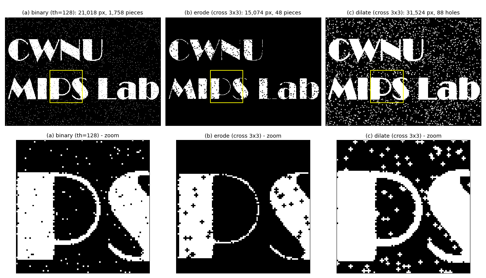
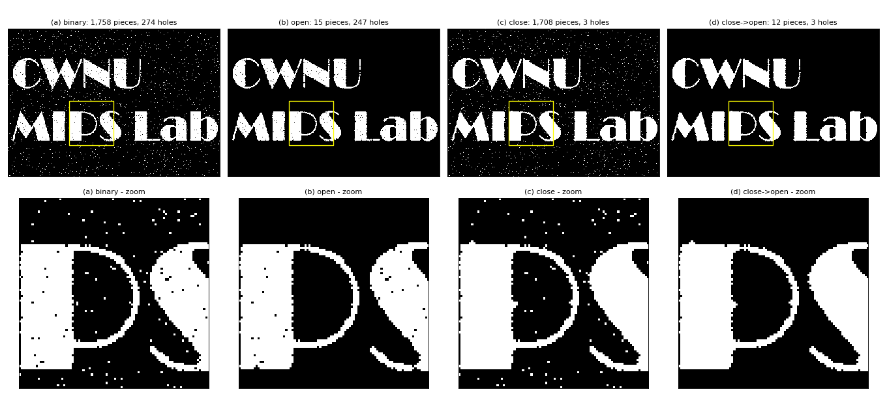

# Part 7. 모폴로지 — Step 7-1 ~ 7-4: 구조 요소, 침식, 팽창, 그리고 최소·최대 필터

이번 대상은 [chap07/14.erode.py](../../chap07/14.erode.py)와 [chap07/15.dilate.py](../../chap07/15.dilate.py)예요. 지난번 예고에서 16번 파일명을 잘못 적었는데, 실제 파일은 [chap07/16.close_open.py](../../chap07/16.close_open.py)예요. 숫자는 이번에도 전부 실행해서 확인했어요.

Part 7은 두 번에 나눠 진행할게요.

| 이번 | 다음 |
|---|---|
| **7-1** 이진 영상과 구조 요소, **7-2** 침식 (14), **7-3** 팽창 (15), **7-4** 최소·최대 필터와의 관계, 쌍대성 | 7-5 열림·닫힘 (16), 7-6 함정 정리, 7-7 AVM 연결과 Part 7 정리 |

이번 범위에서 새로 찾은 문제는 두 가지예요.
- 직접 구현한 침식·팽창이 **255가 홀수라서 우연히 동작**하는 코드예요.
- 직접 구현한 팽창은 **테두리 한 줄이 항상 0**이에요.

---

## 🔁 Part 6 마지막 퀴즈 답

**1번.** `apertureSize=5`는 크기 값이 약 12 ~ 14배 커지니, 임계값도 같은 비율로 키워요.

```python
edge = cv2.Canny(blur, th * 13, th * 26, apertureSize=5)
```

| th | 3×3 (원래 동작) | 5×5 + 임계값 ×13 |
|---|---|---|
| 50 | 12.3% | 12.2% |
| 100 | 5.3% | 5.6% |
| 150 | 2.4% | 2.7% |

슬라이더의 감도가 거의 똑같이 돌아왔어요. 왜 13배일까요? 계단 에지에서는 16 × 3 / 4 = 12배, 실제 사진의 중앙값은 14.3배였어요. 그 사이 값이에요.

**2번. v = 95**예요. 빨강 (50, 50, 200)의 회색값이 95라서, 회색 (95, 95, 95)를 옆에 두면 회색조에서는 경계가 사라져요(회색조 캐니 0화소). 그런데 **컬러 캐니는 찾아요**(40행 영상에서 40화소, 즉 세로 한 줄 전체). 채널별 차이를 보면 이래요.

```
        빨강  회색   차이
B :      50   95  →  45
G :      50   95  →  45
R :     200   95  → 105   ← 가장 큰 채널(R)이 이김 → 에지
```

**3번.**
- **(가) 결과를 눈에 띄게 바꾼 것:** 방향 버림. `cv2.Canny`와의 차이의 98%를 차지했어요.
- **(나) 특정 조건에서만 터지는 것:** 재귀 깊이(긴 에지), 동점(합성 영상), 전역 변수(두 번째 호출).
- **(다) 우연히 무해했던 것:** 소벨 5번째 인자 3(기본값과 같음), 캐니 4번째 인자 5(오히려 도움).

리뷰어라면 **방향 버그를 1순위**로 고치라고 하겠어요. 크래시는 요란해서 금방 발견되지만, 이 버그는 **조용히 틀린 결과**를 내서 OpenCV와 비교하기 전까지 아무도 몰라요. (다)는 지금은 무해해도 **시한폭탄**이에요. 나중에 누가 `3`을 `5`로 바꾸면 아무 일도 일어나지 않으니까요. 키워드 인자 습관으로 막아야 해요.

---

## Step 7-1. 이진 영상과 구조 요소

### 7-1-a. 모폴로지란?

**모폴로지(morphology, 형태학)**는 원래 생물의 **모양**을 연구하는 학문 이름이에요. 영상 처리에서는 **물체의 모양을 깎거나 불리는 연산**을 말해요.

이진 영상에서는 이렇게 약속해요.
- **255 = 물체(전경)**
- **0 = 배경**

### 7-1-b. 실습 영상: [chap07/images/morph.jpg](../../chap07/images/morph.jpg)

430×300 크기이고, 어두운 잡음 배경 위에 흰 글자 **"CWNU / MIPS Lab"**이 쓰여 있어요. 14 ~ 16번 모두 먼저 이렇게 이진화해요.

```python
th_img = cv2.threshold(image, 128, 255, cv2.THRESH_BINARY)[1]   # 128보다 크면 255, 아니면 0
```

> 📚 **복습:** `cv2.threshold`는 `(사용된 임계값, 결과 영상)` 튜플을 돌려줘요. 그래서 `[1]`로 영상만 꺼내요.

이진화 결과를 세어 보면 잡음이 두 종류 섞여 있어요.

| 항목 | 값 | 의미 |
|---|---|---|
| 물체 화소 | 21,018 (16.3%) | |
| 물체 조각 수 | **1,758개** | 글자는 11개뿐인데! |
| └ 4화소 이하 조각 | **1,747개** | 배경의 **흰 소금 점** (1화소짜리만 1,634개) |
| 배경 구멍(물체 속 검은 영역) | **274개** | |
| └ 4화소 이하 구멍 | **271개** | 글자 속의 **검은 후추 점** |
| └ 큰 구멍 3개 | 1,007 / 458 / 237화소 | P, b, a의 **진짜 속 구멍** |

**목표는 두 가지예요.** ① 배경의 흰 점을 지우고 ② 글자 속 검은 점을 메우되, **글자 모양은 지키는 것**(P, a, b의 진짜 구멍은 남겨야 해요). Part 7 전체가 이 목표를 향해 가요.

### 7-1-c. 구조 요소 (Structuring Element)

코드의 `mask`가 **구조 요소(SE)**예요. 14 ~ 16번은 모두 **3×3 십자**를 써요.

```
십자 (MORPH_CROSS)      사각 (MORPH_RECT)
  0 1 0                   1 1 1
  1 1 1                   1 1 1
  0 1 0                   1 1 1
```

코드의 십자 마스크는 `cv2.getStructuringElement(cv2.MORPH_CROSS, (3, 3))`와 똑같아요(확인함).

**회선 마스크와의 차이:**

| | 회선 마스크 (Part 1 ~ 5) | 구조 요소 (Part 7) |
|---|---|---|
| 칸의 값 | **곱할 가중치** (−1, 2, 0.111…) | **볼 곳(1) / 무시할 곳(0)** |
| 계산 | 곱해서 **더하기** | 전부 / 하나라도 **물체인가** 묻기 |

🧠 **비유: 도장.** 구조 요소는 **도장의 모양**이에요. 도장의 중심을 화소마다 찍어 보면서 질문을 던져요.
- **침식:** "도장이 **완전히 물체 안에** 들어가나?" (맞춤 검사, fit)
- **팽창:** "도장이 물체에 **조금이라도 걸치나?**" (닿음 검사, hit)

---

## Step 7-2. 침식 (Erosion, 14번)

### 7-2-a. 정의

> **SE의 1인 칸이 전부 물체(255)면 255, 하나라도 배경이면 0.**

집합으로 쓰면 이래요(A = 물체 화소 집합, B = 구조 요소, B_z = B를 위치 z로 옮긴 것).

```
A ⊖ B = { z | B_z ⊆ A }     "B를 z에 놓았을 때 A 안에 완전히 들어가는 z들"
```

🧠 **비유: 바람에 깎이는 모래성.** 가장자리부터 **한 겹씩 벗겨져요.** 작은 모래 알갱이(소금 점)는 통째로 날아가요.

### 7-2-b. 작은 격자로 한 칸씩

7×9 격자예요(■ = 255, · = 0). 5×5 블록 가운데에 **후추 구멍** 하나 (3, 3), 오른쪽에 **소금 점** 하나 (2, 7)이 있어요.

```
       열0 1 2 3 4 5 6 7 8
 행0    ·  · · · · · · · ·
 행1    ·  ■ ■ ■ ■ ■ · · ·
 행2    ·  ■ ■ ■ ■ ■ · ■ ·     ← (2,7) 소금 점
 행3    ·  ■ ■ · ■ ■ · · ·     ← (3,3) 후추 구멍
 행4    ·  ■ ■ ■ ■ ■ · · ·
 행5    ·  ■ ■ ■ ■ ■ · · ·
 행6    ·  · · · · · · · ·
```

화소 네 개를 실제 코드 그대로 계산해 볼게요. 각 화소에서 3×3 영역(`roi`)을 꺼내 십자와 비교해요.

**(2, 2): 블록 안쪽, 대각선 아래가 구멍**

```
roi              십자           temp = roi & 십자
255 255 255      0 1 0          0 1 0
255 255 255  &   1 1 1    =     1 1 1      cnt = 5 = mcnt → 255 ✅
255 255   0      0 1 0          0 1 0
                                    ↑ (3,3) 구멍은 십자의 0 자리라서 무시됨
```

**(2, 3): 바로 아래가 구멍**

```
255 255 255      0 1 0          0 1 0
255 255 255  &   1 1 1    =     1 1 1      cnt = 4 ≠ 5 → 0 ❌
255   0 255      0 1 0          0 0 0      ← 아래 칸이 구멍
```

**(2, 7): 소금 점**

```
  0   0   0      0 1 0          0 0 0
  0 255   0  &   1 1 1    =     0 1 0      cnt = 1 → 0 (소금 점 사라짐)
  0   0   0      0 1 0          0 0 0
```

**(3, 3): 구멍 자신**

```
255 255 255      0 1 0          0 1 0
255   0 255  &   1 1 1    =     1 0 1      cnt = 4 (가운데가 0) → 0
255 255 255      0 1 0          0 1 0
```

**전체 결과** (직접 구현과 `cv2.erode` 모두 같음):

```
       열0 1 2 3 4 5 6 7 8
 행1    ·  · · · · · · · ·
 행2    ·  · ■ · ■ · · · ·
 행3    ·  · · · · · · · ·
 행4    ·  · ■ · ■ · · · ·
 행5    ·  · · · · · · · ·
```

**결과 해석:**
1. **소금 점은 사라졌어요.** 침식의 첫 번째 쓰임새예요.
2. 구멍이 없었다면 5×5 블록(25화소)은 3×3(9화소)으로 **한 겹** 깎였을 거예요.
3. 그런데 후추 구멍 하나가 **자기 상하좌우 4칸까지 함께 죽여서** 모서리 4화소만 남았어요. **침식은 구멍을 키워요.** 후추 잡음에는 오히려 해로워요.

### 7-2-c. 코드 해독 (3 ~ 17줄)

```python
def erode(img, mask=None):
    dst = np.zeros(img.shape, np.uint8)                       # 4줄: 새 배열 (Part 1 원칙)
    if mask is None: mask = np.ones((3, 3), np.uint8)         # 5줄: 기본 SE = 3×3 사각
    ycenter, xcenter = np.divmod(mask.shape[:2], 2)[0]        # 6줄: 중심 좌표

    mcnt = cv2.countNonZero(mask)                             # 8줄: SE의 1 개수 (십자면 5)
    for i in range(ycenter, img.shape[0] - ycenter):          # 9~10줄: 테두리 제외 순회
        for j in range(xcenter, img.shape[1] - xcenter):
            ...
            roi = img[y1:y2, x1:x2]                           # 13줄: 3×3 영역
            temp = cv2.bitwise_and(roi, mask)                 # 14줄: ★ 비트 AND 트릭
            cnt  = cv2.countNonZero(temp)                     # 15줄: 일치한 칸 수
            dst[i, j] = 255 if (cnt == mcnt) else 0           # 16줄: 전부 일치해야 255
```

**6줄의 `np.divmod`:** 몫과 나머지를 **한꺼번에** 구해요.

```
np.divmod((3, 3), 2)  →  (array([1, 1]),  array([1, 1]))
                           └── 몫 ──┘      └ 나머지 ┘
                     [0] → 몫만 → ycenter = 1, xcenter = 1

3×5 SE라면: np.divmod((3, 5), 2)[0] → [1, 2]
```

`mask.shape[0] // 2, mask.shape[1] // 2`와 같은 뜻이에요.

**14줄의 비트 AND 트릭:** 이진 영상은 0/255, SE는 0/1이에요. 둘을 **비트 단위로** AND하면:

```
255 = 1111 1111₂
  1 = 0000 0001₂
 AND= 0000 0001₂ = 1      → "물체이고 SE가 보는 칸" = 1

  0 & 1   = 0             → 배경이면 0
255 & 0   = 0             → SE가 안 보는 칸은 무조건 0
```

`temp`는 **SE가 보는 칸 중 물체인 곳만 1**인 지도가 돼요. `countNonZero`가 그 개수를 세고, `mcnt`(5)와 같으면 "전부 물체"예요.

### 7-2-d. ⚠️ 코드 문제 ①: 255가 "홀수라서" 동작하는 코드

비트 AND로 보는 건 사실 **맨 끝 비트 하나**, 즉 **홀수냐 짝수냐**뿐이에요. 255가 우연히 홀수라서 동작하는 거예요.

```
255 & 1 = 1   (1111 1111₂, 홀수) → 물체로 인식 ✅
128 & 1 = 0   (1000 0000₂, 짝수) → 배경으로 인식 ❌
254 & 1 = 0   (짝수)              → 배경으로 인식 ❌
129 & 1 = 1   (홀수)              → 물체로 인식
```

**실험 ① 이진화 값을 128로 하면** (`cv2.threshold(image, 128, 128, ...)`, 흔히 하는 실수예요):

| 함수 | 결과 |
|---|---|
| 직접 구현 `erode` | 255인 화소 **0개** (전부 검정) |
| 직접 구현 `dilate` | 255인 화소 **0개** (전부 검정) |
| `cv2.erode` | 0이 아닌 화소 15,074개 (정상) |

128은 짝수라서 **모든 물체가 배경으로 보인** 거예요.

**실험 ② 이진화를 깜빡하고 회색조 영상을 그대로 넣으면:** 직접 구현 `dilate`의 결과가 **90.1%가 흰색**이에요. 화소값이 홀수인 곳(원본의 40.4%)이 이웃에 하나라도 있으면 255가 되니까, 의미 없는 결과예요.

**고치는 법:** 비트 연산 대신 **조건으로** 물어봐요.

```python
fg = roi[mask > 0] > 0                    # SE가 보는 칸들이 물체인가 (True/False)
dst[i, j] = 255 if fg.all() else 0        # 침식: 전부
dst[i, j] = 255 if fg.any() else 0        # 팽창: 하나라도
```

물론 실무에서는 `cv2.erode`를 쓰면 돼요. 0/255와 0/1이 섞이는 문제는 다음 시간에 7-6에서 한 번 더 정리할게요.

### 7-2-e. `cv2.erode`와 비교 (29줄)

```python
dst2 = cv2.erode(th_img, mask)    # cv2.erode(src, kernel[, dst[, anchor[, iterations[, borderType[, borderValue]]]]])
```

| 비교 | 결과 |
|---|---|
| 화소 차이 | **0개** (테두리 포함 완전히 같음) |
| 시간 | 직접 구현 **0.374초** vs `cv2.erode` **0.020ms** (약 18,000배) |

**테두리는 우연히 같았어요.**
- 직접 구현은 테두리를 건너뛰어서 항상 0이에요.
- `cv2.erode`는 이미지 바깥을 **"최댓값(255)"으로 취급**해서, 바깥 때문에 깎이지는 않아요. 전부 255인 영상을 침식해도 테두리까지 255로 남아요(확인함).
- morph.jpg의 테두리 화소는 잡음 때문에 어차피 다 깎여서 결과가 같아졌을 뿐이에요. 물체가 테두리에 닿는 영상이라면 달라져요.

### 7-2-f. 실제 영상 결과

| | 이진 영상 | 침식 후 |
|---|---|---|
| 물체 화소 | 21,018 | 15,074 (−28%) |
| 물체 조각 | 1,758 | **48** |
| 4화소 이하 조각 (소금) | 1,747 | **13** |
| 4화소 이하 구멍 (후추) | 271 | **0** ← 사라진 게 아니라 **커져서** 4화소를 넘음 |

---

## Step 7-3. 팽창 (Dilation, 15번)

### 7-3-a. 정의

> **SE의 1인 칸 중 하나라도 물체(255)면 255.**

```
A ⊕ B = { z | (B̂)_z ∩ A ≠ ∅ }     "B를 z에 놓았을 때 A와 한 칸이라도 겹치는 z들"
                                     (B̂ = B를 뒤집은 것. 십자는 대칭이라 B와 같음)
```

🧠 **비유: 종이에 번지는 잉크.** 물체가 **한 겹 부풀어요.** 작은 구멍은 번진 잉크에 메워져요.

### 7-3-b. 작은 격자 (같은 7×9 입력)

**`cv2.dilate` 결과:**

```
       열0 1 2 3 4 5 6 7 8
 행0    ·  ■ ■ ■ ■ ■ · · ·
 행1    ■  ■ ■ ■ ■ ■ ■ ■ ·
 행2    ■  ■ ■ ■ ■ ■ ■ ■ ■     ← 소금 점이 십자로 커져 블록과 붙음
 행3    ■  ■ ■ ■ ■ ■ ■ ■ ·     ← (3,3) 구멍이 메워짐
 행4    ■  ■ ■ ■ ■ ■ ■ · ·
 행5    ■  ■ ■ ■ ■ ■ ■ · ·
 행6    ·  ■ ■ ■ ■ ■ · · ·
```

**결과 해석:**
1. **(3, 3) 구멍이 메워졌어요.** 팽창의 쓰임새예요.
2. **소금 점은 십자 모양 5화소로 커졌고**, 블록과 **붙어 버렸어요.** 팽창은 가까운 물체끼리 합쳐요.
3. 5×5 블록이 7×7로 커지되 **네 모서리는 비어 있어요**(0행 0열 등). 십자 SE는 대각선으로 번지지 않아서 모서리가 둥글게(마름모꼴로) 깎여요.

**직접 구현 `dilate`의 결과:**

```
       열0 1 2 3 4 5 6 7 8
 행0    ·  · · · · · · · ·     ← 테두리 한 줄이 전부 0
 행1    ·  ■ ■ ■ ■ ■ ■ ■ ·
 행2    ·  ■ ■ ■ ■ ■ ■ ■ ·
 행3    ·  ■ ■ ■ ■ ■ ■ ■ ·
 행4    ·  ■ ■ ■ ■ ■ ■ · ·
 행5    ·  ■ ■ ■ ■ ■ ■ · ·
 행6    ·  · · · · · · · ·
```

### 7-3-c. ⚠️ 코드 문제 ②: 직접 구현한 팽창은 테두리가 항상 0

반복문이 `range(ycenter, rows - ycenter)`로 **테두리를 건너뛰고**, `dst`는 0으로 시작해요. 그래서 0행, 마지막 행, 0열, 마지막 열은 **절대 255가 될 수 없어요.**
- 침식은 "테두리는 깎아도 된다"는 해석이 가능해서 덜 아파요.
- 팽창은 **불려야 할 곳을 0으로 두는** 거라 명백히 틀려요.
- morph.jpg에서 `cv2.dilate`와 **84화소**가 달랐고, **84개 전부 테두리**였어요. 안쪽은 완전히 같아요.

`cv2.dilate`는 이미지 바깥을 **"최솟값(0)"으로 취급**해서 바깥 때문에 부풀지 않으면서도 테두리 화소를 정상 계산해요.

> 🔧 **사소한 메모:** 15번의 `def dilate(img, mask)`는 기본값이 없는데 5줄에서 `if mask is None`을 검사해요. 14번처럼 `mask=None`으로 맞추는 게 자연스러워요.

### 7-3-d. 실제 영상 결과

| | 이진 영상 | 팽창 후 (십자) | 참고: 팽창 (사각) |
|---|---|---|---|
| 물체 화소 | 21,018 | 31,524 (+50%) | 39,100 |
| 구멍 수 | 274 | **88** | — |
| 4화소 이하 구멍 (후추) | 271 | **85** | — |
| 물체 조각 | 1,758 | 1,220 | — |

후추 구멍의 약 3분의 2가 메워졌어요. 하지만 **소금 점 1,700여 개도 전부 십자로 커져서** 배경이 지저분해졌어요(조각 수가 별로 안 줄어든 이유예요).

**사각 SE**는 대각선으로도 번져서 십자보다 많이 불려요(39,100 vs 31,524). 침식도 사각이 더 많이 깎아요(13,243 vs 15,074).

### 7-3-e. 🖼️ 그림으로 보기



위 줄은 전체, 아래 줄은 노란 상자(**"P"와 "S" 일부**, 행 146 ~ 236, 열 124 ~ 214)를 확대한 거예요.

1. **(a) 이진 영상:** 글자 속에 검은 후추 점, 배경과 P의 속 구멍 안에 흰 소금 점이 흩어져 있어요.
2. **(b) 침식:**
   - 배경의 소금 점은 **깨끗이 사라졌어요.**
   - 대신 P 기둥 속의 후추 점이 **검은 "+" 모양으로 커졌어요**(7-2-b의 "구멍이 이웃을 죽인다").
   - P의 둥근 고리와 S의 가는 꼬리는 **더 가늘어져서** 끊어질락 말락 해요.
3. **(c) 팽창:**
   - P 기둥 속 후추 점이 **메워져 꽉 찬 흰색**이 됐어요.
   - 대신 배경과 P 속 구멍 안의 소금 점이 **흰 "+" 모양으로 커져서** 화면 전체에 별처럼 흩뿌려졌어요.

**침식은 소금을 잡고 후추를 키우고, 팽창은 후추를 잡고 소금을 키워요.** 둘 다 혼자서는 목표(7-1-b)를 못 이뤄요. 그래서 다음 시간의 **열림·닫힘**이 필요해요.

---

## Step 7-4. 침식 = 최소 필터, 팽창 = 최대 필터

### 7-4-a. 이진 영상에서 보면

| | 규칙 | 0/255 값으로 바꿔 말하면 |
|---|---|---|
| 침식 | SE 안이 **전부** 255여야 255 | SE 안의 **최솟값** |
| 팽창 | SE 안에 **하나라도** 255면 255 | SE 안의 **최댓값** |

"전부 255"는 "가장 작은 값도 255"와 같고, "하나라도 255"는 "가장 큰 값이 255"와 같아요. 즉 **침식은 최소 필터, 팽창은 최대 필터**예요.

> 📚 **복습 (Part 4, 09번):** 최소 필터는 밝은 영역을 줄이고 작은 흰 점을 지웠고, 최대 필터는 밝은 영역을 넓히고 작은 검은 점을 지웠어요. 그때 "최소→최대 = 열림, 최대→최소 = 닫힘"이라고 미리 말했는데, 바로 이 관계예요.

### 7-4-b. 회색조에서도 성립 (실험)

`cv2.erode`와 `cv2.dilate`는 **회색조 영상에도** 쓸 수 있고, 그때 정의가 바로 최소·최대예요. 직접 만든 슬라이딩 최소·최대와 비교해서 확인했어요.

| 비교 (테두리 제외) | 결과 |
|---|---|
| `cv2.erode(gray, 3×3 사각)` vs 3×3 슬라이딩 **최솟값** | 완전히 같음 ✅ |
| `cv2.dilate(gray, 3×3 사각)` vs 3×3 슬라이딩 **최댓값** | 완전히 같음 ✅ |
| `cv2.erode(gray, 십자)` vs **십자 모양 안의** 최솟값 | 완전히 같음 ✅ |

14 ~ 15번의 직접 구현(비트 AND)은 **이진 영상 전용**이고(7-2-d), OpenCV 버전은 회색조까지 일반화된 거예요.

### 7-4-c. 쌍대성: 물체를 깎는 것 = 배경을 불리는 것

```
erode(f)  = 255 − dilate(255 − f)
dilate(f) = 255 − erode(255 − f)        (대칭 SE일 때)
```

이진 영상과 회색조 영상 **모두에서** 화소 하나까지 성립했어요(확인함).

🧠 **비유: 바둑판.** 흑돌 영역을 한 겹 깎는 것은 백돌 영역을 한 겹 넓히는 것과 같아요. 같은 경계선을 어느 쪽에서 보느냐의 차이예요.

이 관계 덕분에 "흰 글자 속 **검은** 점 메우기"와 "검은 배경 속 **흰** 점 지우기"가 **같은 문제의 앞뒷면**이 돼요. 다음 시간의 열림과 닫힘도 서로 쌍대예요.

### 7-4-d. 🚗 AVM 미리보기

차선·주차선 마스크(밝기나 색으로 이진화한 것)에 그대로 적용해 보면:
- **침식:** 아스팔트 반사 점 같은 작은 흰 잡음은 지워요. 하지만 멀리 있어 **2 ~ 3픽셀 폭으로 찍힌 선은 통째로 사라질 수** 있어요(3×3 십자로 침식하면 폭이 2픽셀 줄어요).
- **팽창:** 닳아서 끊긴 선의 틈은 메워요. 하지만 반사 점도 같이 키워요.

그래서 실무에서는 둘을 **순서대로 묶어서** 써요. 다음 시간에 다룰 열림과 닫힘이에요.

---

## 📋 Step 7-1 ~ 7-4 요약

| 개념 | 한 줄 정리 |
|---|---|
| 모폴로지 | 이진 영상(255 = 물체)의 모양을 깎거나 불리는 연산 |
| 구조 요소 | 곱할 가중치가 아니라 "볼 곳" 모양. 십자 = `getStructuringElement(MORPH_CROSS, (3,3))` |
| 침식 | SE가 **전부** 물체 안 → 255. 소금 점 제거, 대신 후추 구멍 확대, 가는 선 위험 |
| 팽창 | SE가 **하나라도** 물체에 닿음 → 255. 후추 구멍 메움, 대신 소금 점 확대, 물체끼리 붙음 |
| 비트 AND 트릭 | 0/255 & 0/1 → 끝 비트만 봄 → **255가 홀수라 우연히 동작**. maxval 128이면 전부 0 |
| 테두리 | 직접 구현 팽창은 테두리가 항상 0 (84화소 차이). `cv2`는 바깥을 무시하도록 처리 |
| 속도 | 직접 구현 0.374초 vs `cv2.erode` 0.020ms (약 18,000배) |
| 최소·최대 | 침식 = 최소 필터, 팽창 = 최대 필터 (회색조에서도 성립, 실험 확인) |
| 쌍대성 | erode(f) = 255 − dilate(255 − f) |

### ✅ 확인 질문

1. 7×7 검은 바탕 한가운데 **3×3 흰 정사각형**이 있어요.
   - (가) 십자 SE로 침식하면 몇 화소가 남을까요? 사각 SE로 침식하면요?
   - (나) 각 결과를 **같은 SE로 다시 팽창**하면 어떤 모양이 될까요? 원래 정사각형으로 돌아올까요?
   - (힌트: 다음 시간의 "열림"이 바로 이 연산이에요.)
2. 14번 코드에서 이진화 `maxval`을 255 대신 **127**로 바꾸면 직접 구현 `erode`가 제대로 동작할까요? **200**이라면요? 비트로 설명해 보세요.
3. 쌍대성을 이용해서, "흰 글자 속의 검은 후추 점을 메우는 일"을 **침식 함수만으로** 하는 방법을 생각해 보세요.

---

다음은 **Step 7-5 ~ 7-7: 열림과 닫힘** ([chap07/16.close_open.py](../../chap07/16.close_open.py))이에요.
- **열림(침식 → 팽창)**이 소금을, **닫힘(팽창 → 침식)**이 후추를 어떻게 지우는지 봐요. 둘 다 글자 크기는 거의 그대로 지켜요.
- morph.jpg에서 "소금과 후추를 **둘 다** 지우려면 어떤 순서로 묶어야 하나"를 실험해요.
- 열림·닫힘의 수학적 성질(두 번 해도 같음, 원본과의 포함 관계)을 확인해요.
- `cv2.morphologyEx(th_img, cv2.MORPH_CLOSE, mask, 1)`의 **1이 또 위치 인자 함정**인지 확인해요.
- 마지막으로 AVM 활용과 Part 7 정리로 마무리해요.

**"다음"**이라고 하시면 이어가고, 어려운 부분이 있으면 **"더 쉽게"**라고 해 주세요. 이번에도 파일은 수정하지 않았어요.

---

# Part 7. 모폴로지 — Step 7-5 ~ 7-7: 열림, 닫힘, 함정, AVM

이번 대상은 [chap07/16.close_open.py](../../chap07/16.close_open.py)예요. 숫자는 전부 실행해서 확인했어요.

이번 Step에서 정리할 것은 다섯 가지예요.
- 7-1-b의 목표("소금과 후추를 둘 다 지우고 글자는 지키기")를 **어떤 순서로 묶어야** 이루는지 실험해요.
- 비교 삼아 Part 4의 **3×3 미디언 필터**도 돌려 봤는데, 이 영상에서는 미디언이 가장 깔끔했어요. 그런데도 모폴로지를 쓰는 이유를 정리해요.
- `cv2.morphologyEx`의 위치 인자 함정, `iterations`의 진짜 의미, 0/255와 0/1을 섞을 때의 함정을 봐요.
- `cv2`의 닫힘이 이미지 **가장자리에서** 물체를 키우는 현상을 새로 찾았어요.

---

## 🔁 지난 퀴즈 답

**1번. 3×3 정사각형 물체**

| SE | (가) 침식 | (나) 다시 팽창 (= 열림) |
|---|---|---|
| 십자 | 가운데 **1화소** | **+ 모양 5화소** (네 모서리가 사라짐) |
| 사각 | 가운데 **1화소** | **3×3 정사각형 9화소** (원래대로 복원) |

```
원본           십자로 열림      사각으로 열림
· · · · ·      · · · · ·        · · · · ·
· ■ ■ ■ ·      · · ■ · ·        · ■ ■ ■ ·
· ■ ■ ■ ·      · ■ ■ ■ ·        · ■ ■ ■ ·
· ■ ■ ■ ·      · · ■ · ·        · ■ ■ ■ ·
· · · · ·      · · · · ·        · · · · ·
```

침식에서 둘 다 1화소가 됐는데, **같은 SE로 다시 불리면** 그 SE 모양이 돼요. 그래서 열림은 **"물체 안에 SE를 넣어 칠할 수 있는 영역"**만 남겨요. 사각 SE는 정사각형 모서리까지 들어가지만, 십자는 모서리에 닿지 못해요.

**2번.**
- **127** = 0111 1111₂ → 홀수 → 끝 비트가 1이라 **제대로 동작**해요(15,074화소, 정상 결과와 같음).
- **200** = 1100 1000₂ → 짝수 → 끝 비트가 0이라 **전부 배경으로 보여 0화소**예요.

maxval이 홀수인지 짝수인지가 결과를 가르는, 말이 안 되는 상황이에요.

**3번.** 쌍대성 `dilate(f) = 255 − erode(255 − f)`를 써요.

```
① 반전:   흰 글자 속 검은 후추  →  검은 글자 속 흰 소금
② 침식:   흰 소금 점 제거 (7-2-b에서 본 침식의 특기)
③ 다시 반전: 후추가 메워진 흰 글자
```

침식 함수만으로 팽창을 한 셈이에요.

---

## Step 7-5. 열림(Opening)과 닫힘(Closing)

### 7-5-a. 정의와 직관

```
열림:  A ∘ B = (A ⊖ B) ⊕ B      침식 → 팽창
닫힘:  A • B = (A ⊕ B) ⊖ B      팽창 → 침식
```

**왜 이 순서가 마법처럼 동작할까요?** 핵심은 "**한번 사라진 것은 되살아나지 못한다**"예요.

**열림 (침식 → 팽창):**
- 침식이 작은 것(소금 점, 가는 털)을 **완전히 없애요.**
- 팽창이 살아남은 물체를 **원래 크기로 되돌려요.**
- 없어진 소금 점은 **불릴 씨앗이 없으니** 돌아오지 않아요.

**닫힘 (팽창 → 침식):**
- 팽창이 작은 구멍과 좁은 틈을 **완전히 메워요.**
- 침식이 바깥 윤곽을 **원래 크기로 되돌려요.**
- 메워진 구멍은 **깎아 낼 빈 곳이 남지 않았으니** 다시 열리지 않아요.

🧠 **비유: 붓으로 칠하기.**
- **열림** = 물체 **안쪽**에서 SE 모양 붓을 굴려 칠할 수 있는 곳만 남겨요. 붓이 들어가지 못하는 작은 점, 가는 털, 뾰족한 모서리는 사라져요.
- **닫힘** = **배경** 쪽에서 붓을 굴려요. 붓이 들어가지 못하는 작은 구멍과 좁은 틈은 물체로 메워져요.

### 7-5-b. 작은 격자: 열림

5×5 블록, 소금 점 (2, 8), 2×2 잡음 덩어리가 있는 격자예요.

```
입력                          침식 (십자)                    열림 (십자)                    열림 (사각)
· · · · · · · · · · · ·       · · · · · · · · · · · ·       · · · · · · · · · · · ·       · · · · · · · · · · · ·
· ■ ■ ■ ■ ■ · · · · · ·       · · · · · · · · · · · ·       · · ■ ■ ■ · · · · · · ·       · ■ ■ ■ ■ ■ · · · · · ·
· ■ ■ ■ ■ ■ · · ■ · · ·       · · ■ ■ ■ · · · · · · ·       · ■ ■ ■ ■ ■ · · · · · ·       · ■ ■ ■ ■ ■ · · · · · ·
· ■ ■ ■ ■ ■ · · · · · ·       · · ■ ■ ■ · · · · · · ·       · ■ ■ ■ ■ ■ · · · · · ·       · ■ ■ ■ ■ ■ · · · · · ·
· ■ ■ ■ ■ ■ · · · ■ ■ ·       · · ■ ■ ■ · · · · · · ·       · ■ ■ ■ ■ ■ · · · · · ·       · ■ ■ ■ ■ ■ · · · · · ·
· ■ ■ ■ ■ ■ · · · ■ ■ ·       · · · · · · · · · · · ·       · · ■ ■ ■ · · · · · · ·       · ■ ■ ■ ■ ■ · · · · · ·
· · · · · · · · · · · ·       · · · · · · · · · · · ·       · · · · · · · · · · · ·       · · · · · · · · · · · ·
```

1. **침식:** 소금 점과 2×2 덩어리가 **완전히 사라지고**, 블록은 3×3으로 줄어요.
2. **팽창:** 3×3이 다시 커져요. 소금 점과 2×2는 씨앗이 없어서 **돌아오지 않아요.**
3. **SE에 따라 블록 결과가 달라요.** 십자로 열면 블록의 **네 모서리가 깎이고**(퀴즈 1번과 같은 이유), 사각으로 열면 5×5가 **그대로 복원돼요.**

### 7-5-c. 작은 격자: 닫힘

1픽셀 틈으로 끊긴 두꺼운 선(닳은 주차선 같은 것)이고, 왼쪽 토막에 후추 구멍 (3, 4)가 있어요.

```
입력                               팽창 (십자)
· · · · · · · · · · · · · · ·      · · · · · · · · · · · · · · ·
· · · · · · · · · · · · · · ·      · · ■ ■ ■ ■ ■ · ■ ■ ■ ■ ■ · ·
· · ■ ■ ■ ■ ■ · ■ ■ ■ ■ ■ · ·      · ■ ■ ■ ■ ■ ■ ■ ■ ■ ■ ■ ■ ■ ·
· · ■ ■ · ■ ■ · ■ ■ ■ ■ ■ · ·      · ■ ■ ■ ■ ■ ■ ■ ■ ■ ■ ■ ■ ■ ·
· · ■ ■ ■ ■ ■ · ■ ■ ■ ■ ■ · ·      · ■ ■ ■ ■ ■ ■ ■ ■ ■ ■ ■ ■ ■ ·
· · · · · · · · · · · · · · ·      · · ■ ■ ■ ■ ■ · ■ ■ ■ ■ ■ · ·
                ↑ 틈 (열 7)                        ↑ (1,7)은 비어 있음 (십자는 대각선으로 안 번짐)

닫힘 (십자)                        닫힘 (사각)
· · · · · · · · · · · · · · ·      · · · · · · · · · · · · · · ·
· · · · · · · · · · · · · · ·      · · · · · · · · · · · · · · ·
· · ■ ■ ■ ■ ■ · ■ ■ ■ ■ ■ · ·      · · ■ ■ ■ ■ ■ ■ ■ ■ ■ ■ ■ · ·
· · ■ ■ ■ ■ ■ ■ ■ ■ ■ ■ ■ · ·      · · ■ ■ ■ ■ ■ ■ ■ ■ ■ ■ ■ · ·
· · ■ ■ ■ ■ ■ · ■ ■ ■ ■ ■ · ·      · · ■ ■ ■ ■ ■ ■ ■ ■ ■ ■ ■ · ·
· · · · · · · · · · · · · · ·      · · · · · · · · · · · · · · ·
```

1. **후추 구멍 (3, 4)는 둘 다 메웠어요.**
2. **틈을 메우는 방식은 SE 모양에 따라 달라요.**
   - **십자:** 가운데 줄 (3, 7)만 이어져요. 팽창 단계에서 (1, 7)이 비어 있었기 때문이에요. 그래서 침식할 때 (2, 7)의 십자 위쪽 칸이 0이 되어 (2, 7)이 다시 깎여요. (4, 7)도 같은 이유예요.
   - **사각:** 대각선으로도 번지니까 틈 전체가 메워져서 **한 덩어리 3×11 선**이 돼요.
3. **바깥 윤곽은 두 경우 모두 원래 크기 그대로예요.** 닫힘은 구멍과 틈만 채우고 물체를 키우지 않아요.

### 7-5-d. 16번 코드 (4 ~ 25줄)

```python
from Common.filters import erode, dilate      # 2줄: 14·15번과 같은 비트 AND 방식의 구현

def opening(img, mask):                       # 4줄: 열림 = 침식 → 팽창
    tmp = erode(img, mask)
    dst = dilate(tmp, mask)
    return dst

def closing(img, mask):                       # 9줄: 닫힘 = 팽창 → 침식
    tmp = dilate(img, mask)
    dst = erode(tmp, mask)
    return dst

dst3 = cv2.morphologyEx(th_img, cv2.MORPH_OPEN, mask)       # 24줄
dst4 = cv2.morphologyEx(th_img, cv2.MORPH_CLOSE, mask, 1)   # 25줄 ← 7-6-①에서 다시 봐요
```

| 비교 | 결과 |
|---|---|
| 직접 구현 열림 vs `cv2` | **0화소** 차이 |
| 직접 구현 닫힘 vs `cv2` | **45화소** 차이. **전부 테두리 2픽셀 안**(정확히 테두리 위가 20화소) |
| 시간 (열림 + 닫힘) | 직접 구현 **1.262초** vs `cv2` **0.072ms** |

닫힘의 차이는 7-3-c의 문제, 즉 **직접 구현 팽창의 테두리가 항상 0**이라서 생겨요. 팽창이 먼저인 닫힘에서만 드러나요.

### 7-5-e. 실제 영상: 어떤 조합이 목표를 이룰까?

목표(7-1-b)는 **조각 11개(글자 수), 구멍 3개(P, a, b의 속 구멍)**예요. 전부 3×3이고, 따로 적지 않은 건 십자 SE예요.

| 방법 | 물체 화소 | 조각 (목표 11) | 소금 ≤ 4px | 구멍 (목표 3) | 후추 ≤ 4px | P / b / a 구멍 |
|---|---|---|---|---|---|---|
| 이진 영상 | 21,018 | 1,758 | 1,747 | 274 | 271 | 1007 / 458 / 237 |
| 열림 | 18,897 | 15 | **0** ✅ | 247 | 244 ❌ | 1024 / 470 / 238 |
| 닫힘 | 21,511 | 1,708 | 1,695 ❌ | **3** ✅ | **0** ✅ | 998 / 451 / 235 |
| 열림 → 닫힘 | 19,199 | 15 | 0 | 3 | 0 | 1022 / 466 / 237 |
| **닫힘 → 열림** | **19,552** | **12** | 0 | **3** | 0 | 1012 / 458 / 236 |
| 열림 → 닫힘 (사각) | 18,765 | 25 | 0 | **1** ❌ | 0 | (P, b 구멍 사라짐) |
| 닫힘 → 열림 (사각) | 19,629 | 25 | 0 | **1** ❌ | 0 | (P, b 구멍 사라짐) |
| *(비교) 미디언 3×3* | 19,378 | **11** 🏆 | 0 | **3** 🏆 | 0 | 1017 / 465 / 240 |
| *(비교) 미디언 5×5* | 19,258 | 13 | 0 | 1 ❌ | 0 | — |

하나씩 읽어 볼게요.

**① 열림만, 닫힘만은 반쪽짜리예요.** 열림은 소금을 **전부** 지웠지만 후추는 244개가 남았어요. 닫힘은 후추를 **전부** 메웠지만 소금은 1,695개가 남았어요. 7-3-e의 "침식과 팽창은 혼자서 반쪽"이 그대로 이어지는 거예요.

**② 순서가 중요해요. 이 영상에서는 닫힘 → 열림이 더 나아요.**
- **열림 → 닫힘:** 열림의 침식 단계가 후추 구멍을 키워서 **가는 획을 먼저 끊어 버려요.** 63, 41, 28, 16화소짜리 파편이 생겨서 조각이 15개예요.
- **닫힘 → 열림:** 닫힘이 후추를 메워 **획을 먼저 튼튼하게** 만들어요. 그 뒤의 침식은 소금만 지우고 획은 덜 다쳐서 조각이 12개예요(63화소 파편 하나만 남음).
- 반대로 소금 점이 **뭉쳐 있는** 영상이라면 닫힘이 소금끼리 붙여 덩어리로 만들어서, 열림이 못 지울 수 있어요. **어느 잡음이 더 해로운지 보고 순서를 정하세요.**

**③ 사각 SE는 이 글꼴에 너무 세요.** 대각선까지 깎으니 P와 b의 고리처럼 **가는 획이 끊겨서** 구멍이 바깥 배경과 이어졌어요(구멍 3개 → 1개). 글자가 둘로 쪼개지기도 했어요(조각 25개, 500화소 이상 덩어리 12개). **SE 크기와 모양은 지켜야 할 가장 가는 획보다 작아야** 해요.

**④ 이 영상의 1등은 미디언 3×3이에요.** 정확히 조각 11개, 구멍 3개예요.
- 이진 영상에서 3×3 미디언은 **9칸 중 5칸 이상이 흰색이면 흰색**인 다수결이에요.
- Part 4에서 "소금·후추 잡음에는 미디언"이라고 배운 그대로예요.

**그럼 모폴로지는 왜 쓸까요?** 미디언은 **대칭**(소금과 후추를 똑같이 다룸)이고 **모양을 고를 수 없어요.** 모폴로지는 그게 돼요.
- **한쪽만:** 소금만 지우기(열림), 구멍만 메우기(닫힘)가 가능해요. 예를 들어 "글자 속 구멍은 메우되 바깥 잡음은 그대로 둬도 된다"면 닫힘만 하면 돼요.
- **모양 선택:** SE의 모양과 크기로 **무엇을 지울지** 정해요. 1×15 가로 막대 SE로 열면 "가로 길이 15픽셀 이상인 가로 구조"만 남아요.
- **크기 보장:** 열림 결과는 항상 원본보다 작거나 같고, 닫힘 결과는 항상 크거나 같아요(아래 7-5-f). 미디언에는 이런 보장이 없어요.

### 7-5-f. 수학적 성질 (실험으로 확인)

| 성질 | 식 | morph.jpg 확인 |
|---|---|---|
| **멱등성** | open(open(f)) = open(f), close(close(f)) = close(f) | ✅ 둘 다 화소 하나까지 같음 |
| **포함 관계** | open(f) ⊆ f ⊆ close(f) | ✅ |
| **쌍대성** | open(f) = 255 − close(255 − f) | ✅ |

**멱등성의 뜻:** 열림을 **두 번 해도 더 지워지지 않아요.** 붓이 들어갈 수 있는 영역은 이미 다 칠했으니까요. 더 큰 잡음을 지우려면 **SE를 키워야** 해요. 반복은 소용없어요. 단, `iterations` 인자는 반복이 **아니에요**(7-6-② 참고).

**포함 관계의 뜻:** 열림은 **지우기만** 하고 새로 칠하지 않아요. 닫힘은 **채우기만** 하고 지우지 않아요. 결과를 예측하기 쉬워요.

### 7-5-g. 덤: `morphologyEx`의 다른 연산들

| 상수 | 정의 | morph.jpg 결과 | 쓰임 |
|---|---|---|---|
| `MORPH_GRADIENT` | 팽창 − 침식 | 글자 **윤곽선** (정의대로임을 확인) | 미분 없이 최소·최대로 만든 **에지 검출** (Part 2와 비교해 보세요) |
| `MORPH_TOPHAT` | f − 열림 | 2,121화소 | **열림이 버린 것**: 소금 점과 깎인 가는 부분 |
| `MORPH_BLACKHAT` | 닫힘 − f | 493화소 | **닫힘이 채운 것**: 후추 구멍 |

탑햇(top-hat)은 "배경보다 밝은 **작은** 것"만 뽑아내요. 조명이 고르지 않은 영상에서 작은 밝은 물체(글자, 점)를 찾을 때 자주 써요.

### 7-5-h. 🖼️ 그림으로 보기



위 줄은 전체, 아래 줄은 P와 S 부분을 확대한 거예요.

1. **(a) 이진 영상:** 배경에 흰 소금 점, 글자 속에 검은 후추 점이 있어요.
2. **(b) 열림:** **배경이 깨끗한 검정**이 됐어요. 하지만 P 기둥 속의 검은 후추 점은 그대로 남아 있어요.
3. **(c) 닫힘:** P 기둥이 **꽉 찬 흰색**이 됐어요. 하지만 배경과 P 속 구멍 안의 흰 소금 점은 그대로예요.
4. **(d) 닫힘 → 열림:** **배경도 깨끗하고 기둥도 꽉 찼어요.** P의 둥근 고리와 S의 가는 꼬리도 끊어지지 않고 이어져 있어요. 7-1-b의 목표를 달성한 모습이에요.

---

## Step 7-6. 모폴로지 함정 정리

### ① `morphologyEx`의 4번째 위치 인자 (25줄)

```python
cv2.morphologyEx(src, op, kernel[, dst[, anchor[, iterations[, borderType[, borderValue]]]]])
#                                  ↑ 4번째 = dst

dst4 = cv2.morphologyEx(th_img, cv2.MORPH_CLOSE, mask, 1)   # 1은 dst 자리 → 무시됨
```

작성자는 아마 `iterations=1`을 쓰려 했을 텐데, `1`은 출력 배열 자리로 들어가 무시돼요. 기본값도 `iterations=1`이라 결과가 **우연히 같아요**(확인함). Part 6 정리의 누적표에 한 줄을 추가할게요.

| 함수 | 위치 인자 순서 | 함정 | 등장한 곳 |
|---|---|---|---|
| `cv2.Sobel` | src, ddepth, dx, dy, **dst**, ksize | 5번째 숫자는 dst | 05, 08, 17 |
| `cv2.Laplacian` | src, ddepth, **dst**, ksize | 3번째 숫자는 dst | 06, 07 |
| `cv2.GaussianBlur` | src, ksize, sigmaX, **dst**, sigmaY | 4번째 숫자는 dst | 12 |
| `cv2.Canny` | image, th1, th2, **edges**, apertureSize | 4번째 숫자는 edges | 13 |
| **`cv2.morphologyEx`** | src, op, kernel, **dst**, anchor, iterations | 4번째 숫자는 dst | **16** |

### ② `iterations`는 "열림을 여러 번"이 아니에요

```python
cv2.morphologyEx(th, cv2.MORPH_OPEN, cross, iterations=2)
```

이건 **침식, 침식, 팽창, 팽창** 순서예요("열림, 열림"이 아님). 화소 하나까지 같음을 확인했어요.
- **열림을 두 번** 하면 멱등성 때문에 열림 한 번과 같아요(18,897화소).
- **`iterations=2`**는 더 많이 지워요(17,081화소).

또 십자로 `iterations=2` 침식하는 것은 **5×5 마름모 SE로 한 번** 침식하는 것과 같아요(확인함).

```
십자 3×3 를 두 번      =     5×5 마름모 한 번
                              · · ■ · ·
                              · ■ ■ ■ ·
                              ■ ■ ■ ■ ■
                              · ■ ■ ■ ·
                              · · ■ · ·
```

즉 **`iterations`는 SE를 키우는 효과**예요. Part 8의 17번 코드가 5×17 SE로 `iterations=3` 닫힘을 하는데, 실제로는 훨씬 큰 SE를 쓰는 셈이에요.

### ③ 0/255와 0/1을 섞을 때

7-2-d의 홀짝 함정에 이어, **마스크끼리 섞을 때도** 문제가 생겨요.

```python
m255 = th                                   # OpenCV 스타일: 0 / 255
m01  = (opened > 0).astype(np.uint8)        # numpy·딥러닝 스타일: 0 / 1
mix  = cv2.bitwise_and(m255, m01)           # 결과 값: {0, 1}   ← 255가 아님!

(mix == 255).sum()   →  0          ❌ "아무것도 없네?"
(mix > 0).sum()      →  18,897     ✅
cv2.imshow(mix)      →  거의 새까맣게 보임 (1은 아주 어두운 회색)
```

**규칙 두 가지:**
1. 마스크는 만들자마자 **한 가지 형식으로 정규화**해요. 예: `mask = (m > 0).astype(np.uint8) * 255`
2. 검사할 때는 **`> 0`**을 쓰고 `== 255`는 쓰지 않아요.

### ④ 가장자리 효과 두 가지

**(가) 직접 구현:** 팽창의 테두리가 항상 0이에요. 그래서 닫힘에서 45화소가 달랐어요(7-5-d).

**(나) `cv2`의 닫힘도 가장자리에서 이상해요(새로 찾음).** `cv2.erode`는 이미지 바깥을 "255"로 취급해요(7-2-e). 그래서 **가장자리에서 1픽셀 떨어진 물체**를 닫으면, 팽창이 가장자리까지 번진 부분을 침식이 깎지 못해서 물체가 **가장자리까지 늘어나요.**

```
입력 (5×6)          cv2 닫힘 (십자)
· · · · · ·         · · ■ ■ · ·      ← 원래 없던 화소
· ■ ■ ■ ■ ·         · ■ ■ ■ ■ ·
· ■ ■ ■ ■ ·         ■ ■ ■ ■ ■ ■      ← 양쪽 가장자리까지 늘어남
· ■ ■ ■ ■ ·         · ■ ■ ■ ■ ·
· · · · · ·         · · ■ ■ · ·      ← 원래 없던 화소
```

닫힘이 원본보다 커지는 건 포함 관계상 허용되지만(f ⊆ close(f)), 바깥이 0인 무한 평면이라고 보면 원본 그대로여야 하는 경우예요. **고치는 법**은 SE 반지름만큼 0으로 덧대고 연산한 뒤 잘라내는 거예요. 이렇게 하면 원본과 정확히 같아지는 것을 확인했어요.

```python
pad = cv2.copyMakeBorder(img, 1, 1, 1, 1, cv2.BORDER_CONSTANT, value=0)
out = cv2.morphologyEx(pad, cv2.MORPH_CLOSE, cross)[1:-1, 1:-1]
```

morph.jpg에서는 가장자리에 붙은 물체가 없어서 이 효과가 0화소였어요. 하지만 **ROI를 잘라낸 영상**처럼 물체가 가장자리에 걸치는 경우에는 생길 수 있어요.

### ⑤ SE 모양의 영향

| SE | 장점 | 단점 |
|---|---|---|
| 십자 | 가는 획을 덜 다침 | 모서리를 둥글게 깎음 (7-5-b), 틈을 가운데만 이음 (7-5-c) |
| 사각 | 직사각형 복원, 틈을 꽉 메움 | 가는 획을 끊음 (morph.jpg에서 구멍 3 → 1) |
| 막대 (1×N, N×1) | **방향을 골라** 남기거나 이음 | 다른 방향 구조는 사라짐 |

---

## Step 7-7. 🚗 AVM 연결

- **주차선 마스크 정리:** 밝기나 색으로 이진화한 탑뷰 주차선 마스크에 **닫힘 → 열림**을 적용해요. 닫힘이 닳은 페인트의 구멍과 끊긴 틈을 메우고, 열림이 아스팔트 반사 점과 자갈 질감을 지워요. 순서를 정하는 원리는 7-5-e의 ②와 같아요.
- **SE 크기 = 실제 크기:** 탑뷰는 픽셀과 실제 거리가 비례하니까 SE 크기를 **cm 단위로** 정할 수 있어요. 예를 들어 1px = 2cm라고 가정하면, 3×3 열림은 대략 폭 6cm 미만의 얇은 잡음을 지워요. 폭 15cm인 주차선은 지키면서 반사 점은 지우는 크기를 계산으로 고를 수 있어요.
- **방향성 SE:** 차량과 나란한 주차선을 이을 때는 **선 방향의 막대 SE**(예: 1×15)로 닫으면, 선을 따라서만 틈을 메우고 옆 선과는 붙지 않아요. Part 8의 17번이 번호판 글자를 하나로 묶으려고 **가로로 긴 5×17 SE**를 쓰는 것도 같은 발상이에요. 단, 점선 차선에 쓰면 점선끼리 이어 붙어 실선이 될 수 있으니 SE 길이는 점선 간격보다 짧게 잡아야 해요.
- **딥러닝 분할 마스크와 섞을 때:** 주차 공간이나 주행 가능 영역 같은 분할 네트워크 출력은 보통 **0/1(또는 클래스 번호)**이고, OpenCV 이진화는 **0/255**예요. 7-6-③의 함정이 실무에서 가장 흔히 터지는 곳이에요. 후처리 순서는 보통 이래요: 닫힘(구멍 메우기) → 열림(섬 제거) → `connectedComponents`로 가장 큰 덩어리만 남기기.
- **자차·카메라 하우징 마스크:** 탑뷰 가장자리나 ROI 경계에 걸친 마스크를 닫으면 7-6-④(나)처럼 가장자리로 번질 수 있어요. 덧대고 자르는 습관을 들이세요.

---

## 🏁 Part 7 정리: 모폴로지

| 개념 | 한 줄 정리 |
|---|---|
| 구조 요소 | 곱할 가중치가 아니라 "볼 곳" 모양 (십자, 사각, 타원, 막대) |
| 침식 / 팽창 | 전부 물체면 255 / 하나라도 물체면 255 = **최소 / 최대 필터** |
| 쌍대성 | erode(f) = 255 − dilate(255 − f), open(f) = 255 − close(255 − f) |
| 열림 | 침식 → 팽창. **소금, 가는 털, 뾰족한 모서리 제거.** 결과 ⊆ 원본 |
| 닫힘 | 팽창 → 침식. **후추, 작은 구멍, 좁은 틈 메움.** 원본 ⊆ 결과 |
| 순서 | morph.jpg에서는 닫힘 → 열림이 더 나음 (12조각 vs 15조각). 더 해로운 잡음을 보고 결정 |
| 미디언과 비교 | 소금·후추가 섞인 경우엔 3×3 미디언이 최고(11조각, 3구멍). 모폴로지는 **한쪽만, 모양 선택, 크기 보장** |
| 멱등성 | 열림, 닫힘은 두 번 해도 같음 → 더 지우려면 SE를 키움 |
| `iterations` | 반복이 아니라 침식 k번 → 팽창 k번 = **SE를 키우는 효과** |
| 기타 연산 | 그래디언트 = 윤곽, 탑햇 = 열림이 버린 것, 블랙햇 = 닫힘이 채운 것 |

**찾은 코드 문제:**

| # | 위치 | 문제 | 영향 |
|---|---|---|---|
| 1 | 14·15번, `Common/filters.py` | 비트 AND가 **끝 비트(홀짝)만** 봄 | maxval이 128이나 200이면 결과 전부 0, 회색조 입력이면 엉터리 |
| 2 | 15번, `filters.dilate` | 테두리가 항상 0 | 팽창 84화소, 닫힘 45화소 차이 (전부 테두리 근처) |
| 3 | 16번 25줄 | `morphologyEx(..., 1)`의 1 → dst | 기본값과 같아 우연히 무해 |
| 4 | `cv2` 자체 동작 | 닫힘이 가장자리 1px 안쪽 물체를 가장자리로 늘림 | 덧대고 자르기로 해결 |
| — | 15번 3줄 | `mask` 기본값 없이 `None` 검사 | 사소함 |

### ✅ 확인 질문

1. 주차선 탑뷰 마스크에 **1×9 가로 막대 SE**(가로 9칸, 세로 1칸)로 **열림**을 하면 무엇이 남고 무엇이 사라질까요? 세로 주차선은 어떻게 될까요?
2. 흰 글자 속에 **3×3 크기(9화소)의 검은 구멍**이 있어요. 3×3 **십자** SE로 닫으면 구멍이 다 메워질까요? 어떤 모양으로 남을까요? (힌트: 7-5-a의 붓 비유를 **배경 쪽**에서 생각해 보세요. 이번 Part의 첫 퀴즈와 쌍대예요.)
3. `cv2.morphologyEx(f, cv2.MORPH_OPEN, cross, iterations=3)`과 열림을 세 번 반복한 `open(open(open(f)))` 중 어느 쪽이 더 많이 지울까요? 이유는요?

---

다음은 **Part 8: 번호판 검출** ([chap07/17.detect_plate.py](../../chap07/17.detect_plate.py))이에요. chap07에서 배운 것을 전부 조합하는 실전 예제예요.
- **블러 → 소벨(세로 에지) → 이진화 → 5×17 닫힘 `iterations=3` → 윤곽선 → 가로세로 비율 검사** 파이프라인을 단계별 중간 영상으로 따라가요.
- 계획 단계에서 이미 본 문제를 실험으로 확인해요.
  - `cv2.Sobel(gray, cv2.CV_8U, 1, 0, 5)`의 **5가 무시**되는 문제 (위치 인자 함정의 마지막 등장)
  - **`CV_8U`가 음수를 잘라** 밝아지는 쪽 에지만 남기는 문제
- 마지막으로 AVM의 **주차 칸·주차선 후보 검출**과 어떻게 같은 구조인지 연결해요.

**"다음"**이라고 하시면 이어가고, 어려운 부분이 있으면 **"더 쉽게"**라고 해 주세요. 이번에도 파일은 수정하지 않았어요.
