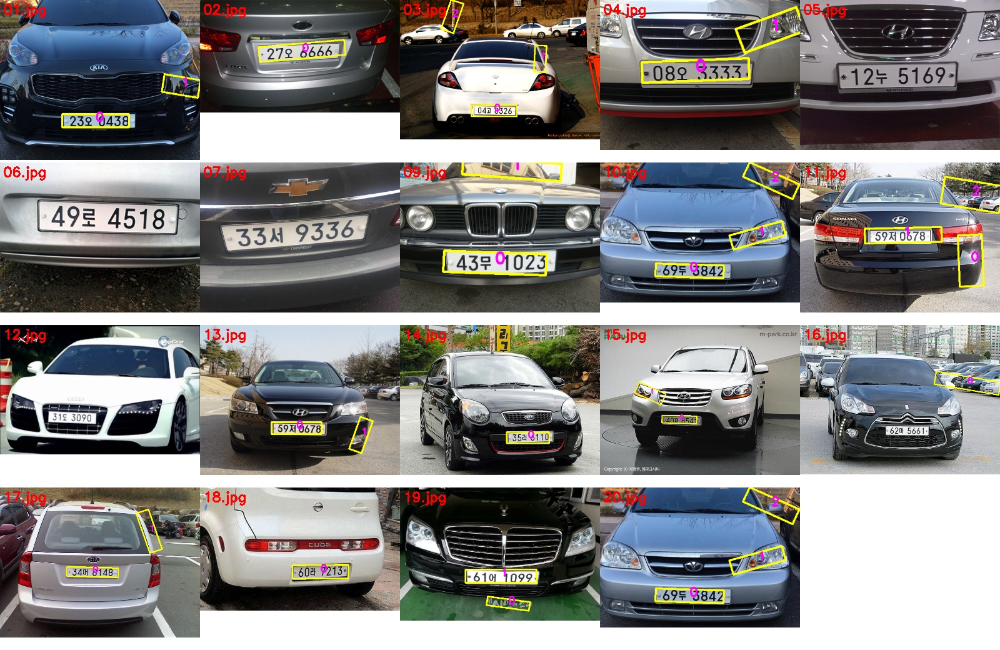
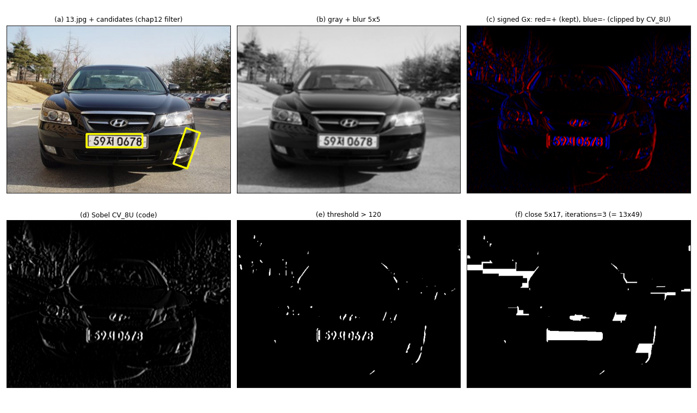

# Part 8. 번호판 후보 검출 — [chap07/17.detect_plate.py](../../chap07/17.detect_plate.py) + chap07 마무리

chap07의 마지막 Part예요. 숫자는 전부 실행해서 확인했어요(19장 모두 처리).

먼저 지난번 예고를 하나 바로잡을게요. 17번 코드는 **20줄의 닫힘 연산에서 끝나요.** "윤곽선 → 가로세로 비율 검사"는 17번이 아니라 이 파이프라인의 다음 편인 [chap12/header/plate_preprocess.py](../../chap12/header/plate_preprocess.py)의 `find_candidates`에 있어요. 이번에는 그 함수를 **가져와서** 17번 결과에 붙여 성능을 측정했어요(파일은 수정하지 않았어요).

이번 Part의 핵심은 세 가지예요.
- **위치 인자 함정의 마지막 등장**이에요. 그리고 이번에도 13번처럼 **버그가 프로그램을 살렸어요.** 의도대로 5×5 소벨이 적용되면 번호판을 **0/19장** 찾아요.
- `CV_8U`가 음수를 버리는 건 Part 2 기준으로는 잘못이에요. 그런데 이 작업에서는 **양쪽 에지를 다 쓰면 오히려 더 못 찾아요**(14장 → 11장). 고치기 전에 측정해야 하는 이유예요.
- chap12의 후보 필터까지 붙이면 **19장 중 14장**에서 번호판을 찾아요. 놓친 5장의 원인도 둘로 나눠 분석했어요.

---

## 🔁 Part 7 퀴즈 답

**1번. 1×9 가로 막대 SE로 열림**

"가로로 9칸짜리 막대가 들어갈 수 있는 곳만 남는다"예요.

| 구조 | 결과 (실험) |
|---|---|
| 가로선 (두께 1px, 길이 50) | **50/50 화소 남음.** 두께가 1px이어도 가로로 길면 살아남음 |
| 세로선, 폭 7px | **0/210 화소.** 가로로 막대가 안 들어감 → 전부 사라짐 |
| 세로선, 폭 12px | **360/360 화소 남음.** 폭이 9px 이상이면 막대가 가로로 들어감 |

그래서 세로 주차선이 남을지는 **탑뷰 해상도에 달려 있어요.** 예를 들어 폭 15cm 선이 2cm/px이면 7.5px라서 사라지고, 1cm/px이면 15px라서 남아요. 가로 막대 열림은 사실상 **"가로 방향 길이 필터"**예요.

**2번. 3×3 구멍을 십자로 닫으면 구멍이 + 모양(5화소)으로 남아요.**

```
원래 구멍(검정 = ■)    닫힘 후 남은 구멍
· · · · · · ·          · · · · · · ·
· · · · · · ·          · · · · · · ·
· · ■ ■ ■ · ·          · · · ■ · · ·
· · ■ ■ ■ · ·    →     · · ■ ■ ■ · ·
· · ■ ■ ■ · ·          · · · ■ · · ·
· · · · · · ·          · · · · · · ·
```

배경 쪽에서 십자 붓이 구멍 안에 들어갈 수 있으니 + 모양만큼은 구멍으로 남아요. 붓이 닿지 못하는 네 모서리만 메워져요. 지난번 "정사각형을 십자로 열면 + 모양"과 정확히 **쌍대**예요.

**3번. `iterations=3`이 훨씬 많이 지워요.**

| 방법 | 남은 화소 |
|---|---|
| `morphologyEx(OPEN, iterations=3)` | **16,059** |
| `open(open(open(f)))` | 18,897 (= 열림 한 번, 멱등성) |

`iterations=3`은 침식 3번 → 팽창 3번이라 SE를 7×7 마름모로 키운 것과 같아요.

---

## Step 8-1. 전체 그림: chap07을 한 줄로 꿰기

```
컬러 → 회색조 → ① 평균 블러 5×5 → ② 소벨 x방향 → ③ 이진화 >120 → ④ 닫힘 5×17 ×3 → ⑤ [chap12] 윤곽선 + 비율·넓이 검사
         (chap06)    (Part 4)         (Part 2)        (chap06)          (Part 7)              (chap12 미리보기)
                                                                       ↑ 17번은 여기까지
```

**핵심 아이디어: "글자는 세로획이 빽빽한 가로 띠"**
- 번호판 글자(숫자, 한글)에는 **세로 획**이 많고, 그 획들이 **가로로 촘촘히** 늘어서 있어요. 그래서 x방향 미분(세로 에지)이 **좁은 가로 띠 안에 빽빽하게** 모여요.
- 반면 차체의 범퍼, 그릴 살, 보닛 선은 대부분 **가로선**이라 x방향 미분에 약하게 반응해요.
- 그래서 세로 에지만 뽑고 **가로로 긴 SE로 닫으면**, 글자들의 에지가 하나로 뭉쳐 **번호판 모양의 흰 덩어리**가 돼요.

---

## Step 8-2. 프로그램 구조 (3 ~ 13줄)

```python
while True:
    no = int(input("차량 영상 번호( 0:종료 ) : "))      # 4줄: 콘솔에서 번호 입력
    if no == 0: break;                                   # 5줄: 0이면 종료 (세미콜론은 무해)
    fname = "images/test_car/{0:02d}.jpg".format(no)     # 7줄: 5 → "05.jpg" (두 자리, 앞을 0으로 채움)
    image = cv2.imread(fname, cv2.IMREAD_COLOR)
    if image is None: ... continue                       # 9~11줄: 파일이 없으면 다시 입력
    mask = np.ones((5, 17), np.uint8)                    # 13줄: 5×17 사각 SE
```

- **입력이 숫자가 아니면** `int("abc")`에서 `ValueError`가 나서 프로그램이 끝나요.
- `test_car` 폴더에는 01 ~ 07, 09 ~ 20번, **19장**이 있어요. **08번은 없어서** "08번 영상 파일이 없습니다"가 떠요.
- **10.jpg와 20.jpg는 화소 하나까지 같은 파일**이에요(확인함). 실제로 서로 다른 사진은 18장이에요.
- 실행 위치는 `chap07` 폴더여야 상대 경로가 맞아요. `.vscode/launch.json`의 `cwd=${fileDirname}`이 이걸 해 줘요.

---

## Step 8-3. ① 평균 블러 5×5 (15줄)

```python
gray = cv2.blur(gray, (5, 5))
```

> 📚 **복습 (Part 4):** `cv2.blur`는 평균 필터예요. 5×5 안의 25칸을 똑같이 1/25씩 섞어요.

미분 전에 블러하는 이유는 캐니 ① 단계(6-3)와 같아요. **미분은 잡음을 키우니까 먼저 누르는 거예요.** 여기서는 잡음뿐 아니라 나무, 아스팔트, 건물 같은 **잔 질감**도 함께 누르는 효과가 커요.

---

## Step 8-4. ② 소벨 (16줄): 함정 두 개

```python
gray = cv2.Sobel(gray, cv2.CV_8U, 1, 0, 5)     # x방향 미분 (세로 에지)
```

### 8-4-a. ⚠️ 5는 또 `dst` 자리예요 (위치 인자 함정의 마지막 등장)

`cv2.Sobel(src, ddepth, dx, dy, dst, ksize)`이니까 5는 dst로 들어가 무시되고, **ksize는 기본값 3**이에요.

| 비교 | 결과 |
|---|---|
| 코드 결과 vs `ksize=3` | **완전히 같음** |
| 코드 결과 vs `ksize=5` | 다름 |

**의도대로 5×5가 적용됐다면?** 6-8-d에서 본 것처럼 크기 값이 12 ~ 14배 커져요. 임계값 120이 너무 낮아지니 거의 모든 곳이 흰색이 되고, 닫힘이 그걸 커다란 덩어리로 뭉쳐요. 19장 전체로 실험했어요.

```
의도대로 ksize=5 적용  →  번호판 검출 0 / 19장  ❌
코드 그대로 (ksize=3)  →  번호판 검출 14 / 19장  ✅
```

13번 컬러 캐니와 **똑같은 패턴**이에요. 임계값 120은 3×3 소벨에 맞춰 손으로 튜닝된 값이라, 무시된 5 덕분에 프로그램이 동작해요.

### 8-4-b. ⚠️ `CV_8U`는 음수를 0으로 잘라요

> 📚 **복습 (Part 1 ~ 2):** 미분 결과는 음수가 나올 수 있어요. 그래서 Part 2에서는 `CV_16S`나 `CV_32F`로 받은 뒤 절댓값을 썼어요.

`CV_8U`로 받으면 OpenCV가 **포화(saturate)** 처리를 해요. 0 미만은 0, 255 초과는 255가 돼요. 실제로 `CV_8U` 결과는 `clip(CV_16S 결과, 0, 255)`와 **화소 하나까지 같았어요.**

13.jpg(검은 쏘나타)에서 번호판 가운데 줄(y = 309, x = 224 ~ 261)을 실제로 잘라 보면 이래요.

```
x      : 224 ... 233  234  235  236 ... 240  241  242  243  244  245  246  247  248  249  250  251  252  253  254  255  256  257
원본   : 139 ... 208  163   93   76 ...  75   56   43   12   18   86  174  234  233  212  186  116   37   11   55  146  221  233
                         └ 획 ┘          └───── 어두운 획 ─────┘                         └ 획 ┘
Gx(부호): ... −162 −172 −125  −47 ... −104 −172 −107   41  156  236  254  182   30 −154 −282 −280 −162   −1  150  259  245
CV_8U  : ...    0    0    0    0 ...    0    0    0   41  156  236  254  182   30    0    0    0    0    0  150  255  245
>120   :        ·    ·    ·    · ...    ·    ·    ·    ·    ■    ■    ■    ■    ·    ·    ·    ·    ·    ·    ■    ■    ■
```

**읽는 법:**
- 흰 번호판 위의 **검은 획 하나**를 왼쪽에서 오른쪽으로 지나가면 밝음 → 어두움(**음수** 골짜기) → 밝음(**양수** 봉우리)이 나와요.
- `CV_8U`는 음수 골짜기를 **0으로 버리고** 양수 봉우리만 남겨요. 즉 **검은 획의 오른쪽 가장자리만** 남아요.
- 13.jpg 전체에서 **41.6%**의 화소가 음수라서 버려졌어요. 120을 넘는 화소도 양쪽을 다 쓰면 5,355개인데 `CV_8U`에서는 2,736개로 **약 절반**이에요. 255로 포화된 화소도 330개 있었어요.

**그럼 버그일까요? 19장으로 측정해 봤어요.**

| 소벨 처리 | 번호판 검출 | 거짓 후보 |
|---|---|---|
| **코드 그대로 (`CV_8U`, 한쪽만)** | **14 / 19** | 16 |
| 양쪽 모두 (`convertScaleAbs(CV_16S)`) | 11 / 19 | 19 |

**양쪽을 다 쓰면 오히려 나빠졌어요.** 이유는 이래요.
- 번호판에는 획이 충분히 많아서, **획마다 에지 하나**(오른쪽)만 있어도 닫힘으로 충분히 뭉쳐져요.
- 양쪽을 다 쓰면 번호판 주변의 그릴, 전조등, 차체 테두리 에지도 **두 배**가 돼요. 이것들이 번호판 덩어리와 **붙어 버려서** 모양 검사를 통과하지 못해요(02, 11, 19번이 새로 놓쳐졌어요).

> 📌 **교훈:** Part 2 기준으로 `CV_8U`는 "틀린" 코드예요. 일반적인 에지 검출이라면 반드시 고쳐야 해요. 하지만 **이 작업, 이 임계값, 이 SE 조합**에서는 결과가 더 좋아요. 코드를 "고치기" 전에 **측정할 테스트 세트**부터 있어야 하는 이유예요. 그리고 "왜 한쪽만 써도 되는지"를 이해하고 쓰는 것과 우연히 동작하는 것은 다른 문제예요. 의도라면 주석이나 `np.clip`으로 **명시**해 두세요.

---

## Step 8-5. ③ 이진화 (19줄)

```python
_, th_img = cv2.threshold(gray, 120, 255, cv2.THRESH_BINARY)    # 미분값 > 120 → 255
```

밝기가 아니라 **미분값(에지 세기)**을 이진화해요. 120은 고정값이라 조명과 대비에 민감해요. 어두운 지하 주차장이나 역광에서는 같은 번호판도 에지 세기가 약해져 놓칠 수 있어요. 그래서 실무에서는 오츠(Otsu) 같은 자동 임계값이나 영상별 정규화를 함께 고려해요.

---

## Step 8-6. ④ 닫힘 5×17, `iterations=3` (20줄)

```python
morph = cv2.morphologyEx(th_img, cv2.MORPH_CLOSE, mask, iterations=3)
```

### 8-6-a. 실제로는 13×49 SE 한 번

7-6-②에서 본 대로 `iterations=3`은 "팽창 3번 → 침식 3번"이에요. 사각 SE를 k번 팽창하면 SE가 그만큼 커지니까:

```
a×b 사각형을 k번  =  (k·(a−1) + 1) × (k·(b−1) + 1) 사각형 한 번

5×17, 3번  →  (3·4 + 1) × (3·16 + 1)  =  13 × 49
```

`close(5×17, iterations=3)`과 `close(13×49)`가 **화소 하나까지 같았어요**(팽창만 따로 비교해도 같음).

**왜 가로로 길까요?** 글자와 글자 사이, 한글 글자의 획과 획 사이에 **가로 간격**이 있어요. 가로 49칸이 이 간격을 넘어 글자들을 한 덩어리로 이어 줘요. 세로 13칸은 획 위아래의 작은 끊김을 메워요.

### 8-6-b. 반복 횟수에 따른 변화 (13.jpg)

| `iterations` | 윤곽선 수 | 흰 영역 비율 | 19장 검출 |
|---|---|---|---|
| 1 (실제 5×17) | 50 | 2.0% | **4 / 19** (글자가 다 안 이어짐) |
| 2 (실제 9×33) | 31 | 3.1% | — |
| **3 (실제 13×49)** | 27 | 4.1% | **14 / 19** |

> 🔧 **사소한 메모:** 24줄의 창 제목이 `"opening"`인데 실제 연산은 **닫힘**이에요.

---

## Step 8-7. ⑤ [chap12 미리보기] 후보 고르기, 그리고 성능 측정

### 8-7-a. `find_candidates` (chap12/header/plate_preprocess.py)

```python
def find_candidates(image):
    contours = cv2.findContours(image, cv2.RETR_EXTERNAL, cv2.CHAIN_APPROX_SIMPLE)[0]   # 바깥 윤곽선만
    rects = [cv2.minAreaRect(c) for c in contours]          # 각 덩어리를 감싸는 최소 회전 사각형
    return [r for r in rects if verify_aspect_size(r[1])]   # 크기·비율 검사 통과한 것만

def verify_aspect_size(size):
    w, h = size
    aspect = 긴 변 / 짧은 변
    return 3000 < w*h < 12000 and 2.0 < aspect < 6.5         # 넓이(픽셀²), 가로세로 비율
```

비율 범위 2.0 ~ 6.5는 국내 번호판 실물 비율을 포함하도록 잡은 거예요. 긴 번호판 520×110mm는 약 4.7, 예전 짧은 번호판 335×155mm는 약 2.2예요.

### 8-7-b. 19장 결과



노란 상자가 후보이고, 분홍 숫자는 후보 번호예요.

```
번호판 찾음 : 14 / 19장   (01 02 03 04 09 10 11 13 14 15 17 18 19 20)
놓침       :  5 / 19장   (05 06 07 12 16)
후보 총 30개 = 번호판 14 + 거짓 16 (전조등 모서리, 후미등 옆, 배경 건물·차량 등)
```

**놓친 5장의 원인을 하나씩 확인했어요.** 번호판 자리에 있는 덩어리를 찾아 크기를 쟀어요.

| 사진 | 번호판 덩어리 | 넓이 | 비율 | 원인 |
|---|---|---|---|---|
| 05 | 68 × 362 | **24,698** | 5.32 | **너무 큼** (> 12,000). 번호판이 화면을 꽉 채운 근접 사진 |
| 06 | 283 × 59 | **16,762** | 4.79 | **너무 큼** |
| 07 | 58 × 332 | **19,557** | 5.65 | **너무 큼** |
| 12 | 575 × 177 | 101,927 | 3.25 | 검은 그릴과 LED 전조등에 **붙어 버림** |
| 16 | 288 × 181 | 52,151 | **1.59** | 그릴 무늬에 **붙어 버림**. 비율도 탈락 |

- **05 ~ 07:** 비율은 완벽한데 **넓이를 픽셀 절댓값**으로 검사해서 떨어졌어요. 같은 번호판도 카메라와의 거리에 따라 크기가 달라지니까요.
- **12, 16:** 13×49짜리 강한 닫힘이 번호판을 주변 구조물과 **이어 붙였어요.**

### 8-7-c. 설정을 바꿔 가며 측정

| 실험 | 검출 | 거짓 후보 | 놓친 사진 |
|---|---|---|---|
| **A. 코드 그대로** | **14** | 16 | 05 06 07 12 16 |
| B. 소벨 양쪽 극성 | 11 | 19 | + 02 11 19 |
| C. 의도대로 `ksize=5` | **0** | 2 | 전부 |
| D. 넓이를 **영상 대비 비율**(0.5 ~ 15%)로 | **17** | **38** | 12 16 |
| E. chap12의 5×13 SE | 15 | 23 | 05 06 07 12 |
| F. `iterations=1` | 4 | 15 | 15장 |
| G. D + B | 14 | 44 | 06 11 12 16 19 |

1. **넓이를 상대값으로(D):** 근접 사진 3장을 되찾았어요(17/19). 하지만 거짓 후보가 16개에서 38개로 늘었어요. **찾는 비율과 헛것 사이의 맞교환**이에요.
2. **SE를 줄이면(E):** 16번을 되찾았지만 거짓이 늘었어요. chap12가 5×13을 쓰는 것도 이 균형을 다시 잡은 결과로 보여요.
3. **그래서 실제 시스템은 두 단계로 가요.** ① 후보를 넉넉히 뽑고(높은 재현율) ② 각 후보를 따로 검증해요(높은 정밀도). chap12는 바로 이 ②단계로 색상 검사와 SVM 분류를 붙여요. Part 6-6의 이력 임계값("강한 것에서 출발해 약한 것까지")과 비슷한 철학이에요.

### 8-7-d. 🖼️ 중간 단계 그림 (13.jpg)



1. **(a) 결과:** 번호판 "59저 0678"에 노란 상자, 오른쪽 범퍼 모서리에 거짓 후보 하나가 있어요.
2. **(b) 블러:** 나무와 아스팔트의 잔 질감이 뭉개졌어요.
3. **(c) 부호 있는 Gx:** 빨강은 양수(남는 쪽), 파랑은 음수(`CV_8U`가 버리는 쪽)예요. 번호판 글자마다 **파랑-빨강 쌍**이 촘촘히 붙어 있어요. 반면 차체는 대부분 어둡고 약해요.
4. **(d) `CV_8U` 소벨:** 파랑이 사라지고, 번호판 글자가 **밝은 세로 줄무늬**로 도드라져요.
5. **(e) > 120:** 번호판 글자 줄무늬와 차체 윤곽 일부, 나무 몇 점만 남아요.
6. **(f) 닫힘 13×49:** 번호판이 **꽉 찬 흰 직사각형** 하나가 됐어요. 그 밖에 왼쪽 배경 건물, 범퍼 모서리 같은 덩어리들도 생겨서 ⑤단계의 비율·넓이 검사가 필요해요.

---

## Step 8-8. 🚗 AVM 연결: 주차선·주차 칸 검출은 같은 뼈대예요

```
번호판 : 블러 → x방향 미분 → 이진화 → 가로 막대 닫힘     → 윤곽선 → 비율·넓이 검사 → 분류기 검증
주차선 : 탑뷰 → 선 방향 미분 → 이진화 → 선 방향 막대 닫힘 → 윤곽선 → 폭·길이·각도 검사 → 추적·검증
```

- **탑뷰에서는 절대 크기 검사가 오히려 강점이에요.** 번호판에서는 넓이를 픽셀로 고정해서 근접 사진을 놓쳤죠(05 ~ 07). 보정된 탑뷰는 **픽셀 = 실제 cm**라서 "선 폭 10 ~ 20cm", "주차 칸 폭 약 2.5m(국내 일반형)" 같은 **물리 단위 조건**을 그대로 쓸 수 있어요.
- **부호는 버리지 말고 써요.** 어두운 아스팔트 위의 흰 주차선을 가로지르면 **왼쪽 경계는 +Gx, 오른쪽 경계는 −Gx**가 나와요. "+에지 다음에 선 폭만큼 떨어져 −에지가 오는 쌍"을 찾는 건 고전적이고 강력한 차선·주차선 검출법이에요. 번호판에서는 `CV_8U`로 한쪽을 버려도 괜찮았지만, 주차선에서는 **부호 자체가 정보**예요. Part 2에서 `CV_16S`나 `CV_32F`를 쓰라고 한 이유가 여기서 다시 살아나요.
- **두 단계 설계:** 후보 생성(재현율)과 검증(정밀도)을 나누는 구조는 AVM 주차 보조에서도 그대로예요. 프레임 사이 추적이 검증 역할을 하고, 7-7의 히스테리시스처럼 "검출 시작"과 "유지" 기준을 다르게 둬요.
- **튜닝 값의 출처를 기록하세요.** 120, 5×17, 3회, 3000 ~ 12000은 모두 이 19장에 맞춰진 값이에요. 이 값들을 config로 빼고 측정 세트와 함께 관리하는 것이 [projects/cvkit/tuner.py](../../projects/cvkit/tuner.py)가 하려는 일이에요.

---

## 🏁 chap07 전체 정리

### Part별 한 장 요약

| Part | 주제 | 핵심 한 줄 | 파일 |
|---|---|---|---|
| 1 | 회선 | 마스크를 겹쳐 곱해서 더해 **새 배열**에 쓴다. 합이 1이면 밝기 유지, 0이면 디테일만 | 01, 02 |
| 2 | 1차 미분 | 이웃 차이 = 기울기. 소벨 = 스무딩 [1 2 1] × 차분 [−1 0 1] | 03 ~ 05 |
| 3 | 2차 미분 | 라플라시안은 방향 무관, 영교차. 잡음에 매우 약함 | 06 |
| 4 | 잡음 제거 | 평균(가우시안 잡음), 가우시안(σ와 분리), 미디언(소금·후추), 최소·최대 | 09 ~ 12 |
| 5 | LoG / DoG | 먼저 흐리고 미분 = 한 번에. DoG ≈ LoG (비율 1.6) | 07 |
| 6 | 캐니 | 블러 → 크기·방향 → NMS → 이력 임계값. 3조건을 만족 | 08, 13 |
| 7 | 모폴로지 | 침식·팽창 = 최소·최대. 열림은 소금을, 닫힘은 후추를 지움 | 14 ~ 16 |
| 8 | 번호판 후보 | 세로 에지 + 가로 막대 닫힘 + 모양 검사 = 전부 조합 | 17 |

### OpenCV 위치 인자 함정 최종표

| 함수 | 4·5번째 위치의 정체 | 등장 | 결과 |
|---|---|---|---|
| `Sobel(src, ddepth, dx, dy, dst, ksize)` | 5번째 = dst | 05, 08, **17** | 3은 우연히 무해. **17번의 5는 무시돼서 오히려 동작** |
| `Laplacian(src, ddepth, dst, ksize)` | 3번째 = dst | 06, 07 | 07의 9가 무시됨 |
| `GaussianBlur(src, ksize, sigmaX, dst, sigmaY)` | 4번째 = dst | 12 | sigmaY 1.3이 무시됨 |
| `Canny(img, t1, t2, edges, apertureSize)` | 4번째 = edges | 13 | 5가 무시돼서 오히려 동작 |
| `morphologyEx(src, op, kernel, dst, ...)` | 4번째 = dst | 16 | 1은 기본값과 같아 무해 |

> 📌 **chap07의 가장 큰 실무 교훈:** 숫자 옵션은 **항상 키워드로** 쓰세요. 그리고 "고쳤더니 더 나빠지는" 경우(13, 17)가 있으니, **측정할 테스트 세트**를 먼저 두고 고치세요.

### ✅ 확인 질문

1. 예전 **녹색 번호판**(어두운 바탕에 **흰 글자**)이라면 `CV_8U` 소벨은 글자 획의 **어느 쪽 가장자리**를 남길까요? 그래도 검출은 될까요?
2. chap12는 `np.ones((5, 13))`에 `iterations=3`을 써요. **실제 SE 크기**는 얼마일까요?
3. 06.jpg의 번호판 덩어리는 넓이가 16,762라서 탈락했어요. 처리 전에 영상을 **가로세로 절반으로 줄이면** 넓이 검사는 통과할까요? 대신 블러와 SE 입장에서는 무엇이 달라질까요?

---

chap07이 모두 끝났어요. 수고 많으셨어요! 🎉

- 지난 장처럼 이번 세션을 `study-notes/chap07/`로 정리할까요? 이번엔 Part 하나가 여러 답변으로 나뉘어 있어서, 정리 전에 [study-notes/tools/extract_session.py](../../study-notes/tools/extract_session.py)가 같은 Part의 블록들을 **순서대로 이어 붙이도록** 먼저 손봐야 해요.
- 어떤 Part든 다시 보고 싶으면 **"Part N 더 쉽게"**라고 하시면 HTML 시각화로 설명할게요.

이번에도 저장소 파일은 수정하지 않았어요.
