# Chap07 OpenCV 기능 원리와 구현


---

## Q1  <sub>2026-10-20T12:50:22.242Z</sub>

> @chap07 에 대해서 배워보고 싶어. 
> 이 기능이 어떻게 동작하는지, 원리와 코드 구현이 궁금해! 내가 이 분야의 문외한이라고 가정하고 너는 친절한 선생님이야. 아주 verbose하게 자세하게 설명할 수 있게 계획을 세워봐. 시각화 ,예시, 비유, 수학적-이론적 원리 설명 등 설명을 잘 하기 위한 각종 기법들도 잘 활용하구. 
> 직설적이고 구체적으로 설명해 주세요. 모든 중간 단계를 보여주시고, 마치 20살 청년에게 설명하듯이 이야기해 주세요. (be direct and concrete. show all intermediate state. explain like i'm 20). 
> 우선 최초에는 md에서 시각화 설명을 진행. 그걸로는 이해하기 어려워서 내가 더 쉽고 이해하기 쉽게 설명해달라고 추가 요청하면 html 사용해서 시각화 설명.
> 우선 설명하기 전에 단계를 상세하게 나누자. 매우 detail하고 verbose하게 새로운 기능의 원리와 구현에 대해 설명해줘. 각 스텝에 대해서도 한번에 설명하지말고 단계를 다시 나눠서 자세하게 설명해줘.
> reference\Chapter06은 다른곳에서 몇년전에 배웠던 opencv 기본? 이라서 이정도 배경지식이 있다고 가정하고 플랜을 세워줘


### A1

# 📘 Chapter 07 학습 계획: "이웃을 보고 판단하는 영상 처리"

chap07 파일 17개와 공용 모듈 [Common/filters.py](Common/filters.py)를 모두 읽었습니다. 코드에서 수상해 보이는 부분은 Python으로 직접 돌려서 확인했어요. 이번 메시지는 **계획만** 드리고, 본격적인 설명은 다음부터 한 Step씩 하겠습니다.

---

## 0. 큰 그림: chap06과 chap07은 뭐가 다른가?

chap06(밝기 조절, 이진화, 히스토그램)은 **화소 처리**였어요. 출력 화소 하나를 정할 때 입력 화소 **하나만** 봅니다.
chap07은 **영역 처리**예요. 출력 화소 하나를 정할 때 입력 화소와 **그 주변 이웃까지** 같이 봅니다.

```
   chap06 화소 처리                      chap07 영역 처리
   입력          출력                    입력              출력
 . . . . .    . . . . .               . . . . .         . . . . .
 . . . . .    . . . . .               . ■ ■ ■ .         . . . . .
 . . ● . . ─▶ . . ◎ . .               . ■ ● ■ .  ─▶     . . ◎ . .
 . . . . .    . . . . .               . ■ ■ ■ .         . . . . .
 . . . . .    . . . . .               . . . . .         . . . . .
 ● 하나만 보고 ◎를 정함                ●와 이웃 ■ 8개, 모두 9개를 보고 ◎를 정함
```

17개 파일은 다섯 가족으로 나눌 수 있어요.

| 가족 | 이 가족이 답하는 질문 | 파일 |
|---|---|---|
| ① 회선(선형 필터) | 이웃 값에 가중치를 곱해서 더하면 무슨 일이 생기나? | 01, 02 |
| ② 에지 검출(미분) | 밝기가 확 바뀌는 곳은 어디인가? | 03 ~ 08, 13 |
| ③ 잡음 제거 필터 | 튀는 값은 어떻게 없애나? | 09 ~ 12 |
| ④ 모폴로지 | 흰 덩어리를 어떻게 깎고, 어떻게 불리나? | 14, 15, 16 |
| ⑤ 종합 응용 | 위 기술을 묶어서 번호판을 찾으려면? | 17 |

### 🗺️ 학습 순서 (파일 번호 순서와 다릅니다)

```
Part1 회선 ──▶ Part2 1차 미분 에지 ──▶ Part3 2차 미분(라플라시안)
                                           │  "잡음에 너무 약하네?"
                                           ▼
                        Part4 잡음 제거 필터 (평균·가우시안·미디언·최소/최대)
                                           │
                       ┌───────────────────┴──────────────┐
                       ▼                                  ▼
                 Part5 LoG / DoG                    Part6 캐니 에지
                                                          │
    Part4의 최소/최대 필터 ──(이진 영상 버전)──▶  Part7 모폴로지
                                                          │
                                         Part8 종합: 번호판 검출
```

**순서를 바꾼 이유:** 07(DoG)과 08(Canny)은 `GaussianBlur`를 씁니다. 그런데 가우시안의 원리는 12번 파일에 있어요. 12번을 먼저 배우면 07과 08에서 블러를 "그냥 쓰는 함수"가 아니라 이해한 상태로 쓸 수 있습니다. 09번 최소/최대 필터는 사실상 침식/팽창과 같은 연산이라서, 모폴로지로 넘어가는 다리 역할도 합니다.

---

## 🧰 설명할 때 쓰는 도구

| 표시 | 의미 |
|---|---|
| 🎯 목표 | 이 Step이 끝나면 할 수 있게 되는 것 |
| 🧠 비유 | 일상에서 가져온 비유 |
| 📐 수학 | 공식과 유도 과정 (중간 계산 생략 없음) |
| ✍️ 손계산 | 5×5 같은 작은 숫자 행렬로 모든 곱셈과 덧셈을 직접 적기 |
| 🔬 코드 해부 | 한 줄씩 무엇을 하는지 설명하고, 그 줄의 중간 값을 출력 |
| 🖼️ 관찰 | 실제 이미지 결과에서 무엇을 봐야 하는지 |
| ⚠️ 함정 | 실제 코드에 있는 버그나 헷갈리는 부분 |
| 📚 복습 | reference/Chapter06 내용을 짧게 다시 짚기 |
| ✅ 퀴즈 | Part 끝 확인 문제 |

---

## Part 1. 회선(Convolution): 영역 처리의 엔진 [01, 02]

**Step 1-1. 왜 이웃을 봐야 할까?**
- 1-1-a. 화소 처리의 한계: 점 하나만 보면 그게 잡음인지 물체 경계인지 알 수 없습니다. 🧠 어떤 사람이 어떤지 궁금하면 그 사람 친구들한테 물어보는 것과 비슷해요.
- 1-1-b. 용어 정리: 마스크, 커널, 필터, 윈도우는 전부 같은 것을 가리키는 이름입니다.

**Step 1-2. 회선을 손으로 계산해 보기 ✍️**
- 1-2-a. 5×5 숫자 이미지와 3×3 마스크를 준비합니다.
- 1-2-b. 마스크를 이미지의 한 위치에 겹쳐 올리고, 곱셈 9개를 전부 적은 다음 더합니다.
- 1-2-c. 마스크를 한 칸씩 옮기면서(슬라이딩 윈도우) 출력 칸을 모두 채웁니다.
- 1-2-d. 가장자리 문제: 마스크가 이미지 밖으로 나가면 어떻게 할까요? 이 코드는 테두리를 0으로 남기고, OpenCV는 테두리 값을 채워 넣습니다.
- 1-2-e. 📐 공식은 `dst(i,j) = ΣΣ src(i+u−c, j+v−c)·mask(u,v)`입니다. 수학에서 말하는 진짜 회선은 마스크를 뒤집어서 곱하는데, `filter2D`는 뒤집지 않는 상관(correlation)입니다. 마스크가 대칭이면 두 결과가 같아요.

**Step 1-3. 블러링 코드 해부 (01)** 🔬
- 1-3-a. `filter()`(슬라이싱 방식)와 `filter2()`(for문 4중첩)를 비교합니다. 📚 numpy 슬라이싱 `image[y1:y2, x1:x2]` 복습.
- 1-3-b. 왜 `float32`로 계산할까요? 📚 uint8 오버플로와 포화(clip) 복습.
- 1-3-c. 원소가 전부 1/9인 마스크는 곧 평균입니다. 원소 합이 1이라서 전체 밝기가 그대로 유지됩니다.
- 1-3-d. 결과를 화면에 띄울 때 `astype('uint8')`와 `convertScaleAbs`가 어떻게 다른지 봅니다.
- 1-3-e. 속도를 재 봅니다. 파일에 `time`을 import만 하고 쓰지 않아서 우리가 직접 측정하고, `cv2.filter2D`와도 비교합니다.
- ⚠️ `blur2`를 계산해 놓고 화면에는 `blur1`을 두 번 보여줍니다.

**Step 1-4. 샤프닝 (02)**
- 1-4-a. 📐 "원본 + (원본 − 흐린 이미지)"라는 아이디어에서 `[0,-1,0 / -1,5,-1 / 0,-1,0]` 마스크가 나오는 과정을 직접 유도합니다.
- 1-4-b. 가운데 값이 5인 마스크(4방향 이웃)와 9인 마스크(8방향 이웃)의 강도를 비교합니다.
- 1-4-c. 결과에 음수가 나오면 `convertScaleAbs`가 어떻게 처리하는지 숫자로 확인합니다.
- 1-4-d. 마스크 원소 합의 규칙: 합이 1이면 밝기 유지, **합이 0이면 에지만 남습니다** (Part 2로 이어지는 복선).

---

## Part 2. 에지 검출 ①: 1차 미분 [03, 04, 05]

**Step 2-1. 에지란 무엇인가?**
- 2-1-a. 밝기 변화를 1차원 그래프(ASCII)로 그려 보면, 에지는 계단처럼 확 올라가는 부분입니다.
- 2-1-b. 🧠 등산 지도에서 등고선이 빽빽한 곳, 즉 경사가 급한 곳이 에지예요.

**Step 2-2. 미분을 디지털로 바꾸기** 📐
- 2-2-a. 미분 정의 `lim (f(x+h)−f(x))/h`에서 h=1로 두면 차분 `f(x+1)−f(x)`가 됩니다.
- 2-2-b. ✍️ `[10,10,10,200,200,200]`의 차분을 계산하면 에지 위치에서만 값이 커집니다.
- 2-2-c. 2차원에서는 그래디언트 `(Gx, Gy)`가 있고, 크기는 `√(Gx²+Gy²)`(`cv2.magnitude`), 방향은 `atan2`로 구합니다.

**Step 2-3. 로버츠 (03)**: 대각선 방향 차분. 왜 3×3 마스크 안에 2×2를 넣었는지, 손계산, 잡음에 약한 이유를 봅니다. 03 파일의 `np.abs + clip`과 Common 모듈의 `convertScaleAbs`도 비교합니다.

**Step 2-4. 프리윗 (04)**
- "수직 마스크"가 수직 에지를 찾는다는 게 실제로는 x방향 미분이라는 뜻입니다. 이 헷갈리는 이름을 정리합니다.
- 📐 마스크를 분해하면 평균 `(1,1,1)` ⊗ 차분 `(-1,0,1)`입니다. 미분하면서 동시에 살짝 흐리게 만드는 구조예요.

**Step 2-5. 소벨 (05)**
- `(1,2,1) ⊗ (-1,0,1)`: 가운데에 가중치 2를 줘서 가우시안에 가깝게 흐리고, 그다음 차분합니다.
- ✍️ 같은 계단 이미지에 로버츠, 프리윗, 소벨을 적용한 값을 한 표에 나란히 놓고 비교합니다.
- `cv2.Sobel(src, ddepth, dx, dy, ksize)` 인자를 하나씩 봅니다. `ddepth=CV_32F`를 쓰는 이유는 음수를 보존하기 위해서입니다 (Part 8 복선).

---

## Part 3. 에지 검출 ②: 2차 미분, 라플라시안 [06]

- **Step 3-1.** 2차 미분은 "기울기의 기울기"입니다. 에지 위치에서 값이 +에서 −로 0을 가로질러요(영교차, zero crossing). 1차원 숫자 예로 확인합니다.
- **Step 3-2.** 📐 `f(x+1)+f(x−1)−2f(x)`에서 출발해 `[0,1,0 / 1,−4,1 / 0,1,0]` 마스크를 유도하고, 8방향 버전도 만듭니다.
- **Step 3-3.** 🔬 `filter2D`, `CV_16S`, `cv2.Laplacian`을 해부합니다. ⚠️ 주석에는 int8이라고 적혀 있지만 실제 코드는 int16입니다.
- **Step 3-4.** 실험: 잡음 점 하나에 라플라시안을 적용하면 반응이 엄청나게 크게 나옵니다. 그래서 먼저 부드럽게 만들어야 하고, 이게 Part 4로 이어집니다.

---

## Part 4. 잡음 제거 필터 [10, 12, 11, 09]

**Step 4-1. 잡음의 종류**: 가우시안 잡음(화면 전체가 자글자글)과 소금-후추 잡음(흰 점, 검은 점이 툭툭 튐)이 있습니다. 11번 파일의 `salt_pepper_noise()`를 해부합니다.

**Step 4-2. 평균값 필터 (10)**: Part 1의 블러와 같은 연산입니다. `cv2.blur`와 `cv2.boxFilter`, 그리고 테두리를 원본으로 복사하는 처리를 봅니다. ⚠️ `"blur_img"` 창에 실제로는 `box_img`가 표시됩니다.

**Step 4-3. 가우시안 필터 (12)**: 이번 Part의 핵심이라 잘게 나눕니다.
- 4-3-a. 🧠 가까운 이웃의 말을 더 믿는 가중 평균입니다.
- 4-3-b. 📐 1D 가우시안 공식과 σ의 의미를 보고, σ=1일 때 x=−2..2의 실제 값을 표로 적습니다.
- 4-3-c. 2D 가우시안은 1D 두 개의 곱입니다(분리 가능성). `meshgrid`로 마스크를 만드는 과정을 단계별로 출력합니다.
- 4-3-d. 마스크를 정규화(합=1)하는 이유를 봅니다.
- 4-3-e. σ 자동 계산 공식 `0.3·((k−1)·0.5−1)+0.8`을 해석합니다.
- 4-3-f. `filter2D`, `GaussianBlur`, `sepFilter2D` 세 방법을 비교하고, 연산량 k²와 2k의 차이를 봅니다.
- ⚠️ **실행해서 확인한 버그:** `np.arange(0, ksize+1)` 때문에 17×5가 아니라 **18×6 마스크**가 만들어지고(x가 −8..9), 중심이 한 칸 어긋납니다.

**Step 4-4. 미디언 필터 (11)**: 값을 정렬한 뒤 가운데 값을 고릅니다. ✍️ `[10,12,11,255,13,…]`에 평균과 미디언을 각각 적용해 보면 왜 미디언이 소금-후추 잡음에 강한지 보입니다. `cv2.sort`와 `medianBlur`도 봅니다.

**Step 4-5. 최소/최대 필터 (09)**: 정렬했을 때 맨 앞과 맨 뒤를 고르는 필터입니다. `cv2.minMaxLoc`의 반환값 구조 `(minVal, maxVal, minLoc, maxLoc)[mode]`를 봅니다. Part 7의 복선입니다.

**Step 4-6. 정리표**: 선형 필터와 비선형 필터를 나누고, 잡음 종류별로 어떤 필터를 추천하는지 정리합니다.

---

## Part 5. LoG와 DoG [07]

- **Step 5-1.** LoG는 가우시안으로 흐린 다음 라플라시안을 적용합니다. 이 둘을 마스크 하나로 합칠 수 있고, 그 모양이 "멕시칸 햇"입니다(ASCII 그래프).
- **Step 5-2.** DoG는 작은 σ 블러에서 큰 σ 블러를 뺀 것이고, LoG와 거의 같은 결과를 냅니다. 너무 세밀한 성분과 너무 큰 성분을 둘 다 걸러낸다는 직관(대역 통과)으로 설명합니다.
- **Step 5-3.** 🔬 코드를 해부하고 ⚠️ **실행해서 확인한 함정 두 가지**를 봅니다.
  - int16 값을 `.astype('uint8')`로 바꾸면 **−30이 226**이 됩니다.
  - uint8끼리 빼면 **10 − 20이 246**이 됩니다.
  - 올바르게 고치는 방법도 시연합니다.

---

## Part 6. 캐니 에지 [08, 13]: 가장 어려운 Part라 가장 잘게 나눕니다

- **Step 6-1.** 좋은 에지 검출기의 세 조건: 에지를 빠짐없이 찾고, 위치가 정확하고, 에지 하나에 응답이 하나만 나와야 합니다.
- **Step 6-2.** 4단계 파이프라인을 ASCII 그림으로 먼저 훑어봅니다.
- **Step 6-3.** ① 가우시안 블러 (Part 4의 내용을 그대로 씁니다)
- **Step 6-4.** ② 소벨로 기울기의 크기와 방향 구하기
  - `|Gx|+|Gy|` 근사를 쓰는 이유를 봅니다.
  - `cv2.phase`는 0~2π를 돌려줍니다. 이걸 `/(π/4)`로 나누면 0~7, `%4`를 하면 4방향이 됩니다. 이 변환을 숫자로 따라갑니다.
  - ⚠️ 반올림 대신 내림을 써서 방향 구간이 22.5°씩 어긋납니다.
- **Step 6-5.** ③ 비최대 억제
  - 🧠 산맥에서 능선만 남기는 것과 같습니다.
  - 3×3을 `flatten`한 인덱스 0~8 그림을 그리고, `first=[3,0,1,2]`와 `values[id]`, `values[8-id]`의 대칭 트릭을 해독합니다.
- **Step 6-6.** ④ 이력 임계값
  - 🧠 high 이상은 "확실한 범인", low 이상이면서 범인과 연결된 것은 "공범"으로 봅니다.
  - `trace()` 재귀는 8방향 플러드 필입니다. 작은 격자에서 추적 순서를 한 칸씩 보여줍니다.
  - ⚠️ 에지가 길면 재귀 깊이 한계에 걸릴 수 있습니다.
- **Step 6-7.** 직접 만든 캐니와 `cv2.Canny`의 결과를 비교하고, 차이가 나는 이유를 봅니다.
- **Step 6-8.** 컬러 캐니 (13): 📚 트랙바 콜백 복습, `Canny(…, th, th*2, 5)`의 인자, `cv2.copyTo(mask=)`, `hconcat`을 봅니다.

---

## Part 7. 모폴로지 [14, 15, 16]

- **Step 7-1.** 이진 영상과 구조 요소. 📚 `threshold` 복습.
- **Step 7-2.** 침식
  - 🧠 바닷물이 섬 가장자리를 깎아내는 모습입니다. 마스크가 흰 영역에 "완전히 들어맞을 때만" 흰색으로 남깁니다.
  - ✍️ 7×7 격자에서 손으로 계산합니다.
  - `bitwise_and`에 0/255 영상과 0/1 마스크를 넣어도 되는 이유는 `255 & 1 = 1`이기 때문입니다.
  - Part 4의 최소 필터와 결과가 같다는 것을 실험으로 확인합니다.
- **Step 7-3.** 팽창: "하나라도 겹치면 흰색"으로, 최대 필터와 같습니다.
- **Step 7-4.** 열림(침식 후 팽창)은 작은 흰 잡음을 지우고, 닫힘(팽창 후 침식)은 작은 구멍과 틈을 메웁니다. 같은 격자로 모든 단계를 출력해서 확인합니다.
- **Step 7-5.** `cv2.erode`, `cv2.dilate`, `cv2.morphologyEx`와 `iterations` 인자를 봅니다.

---

## Part 8. 종합: 번호판 영역 찾기 [17]

- **Step 8-1.** 번호판의 특징: 글자가 가로로 늘어서 있어서, 세로 에지가 촘촘하게 모인 직사각형으로 보입니다.
- **Step 8-2.** 파이프라인의 단계마다 중간 이미지를 봅니다: 흑백 변환 → 블러 → x방향 Sobel → 이진화 → 닫힘(5×17 마스크, 3회).
- **Step 8-3.** 파라미터마다 그 값을 고른 이유를 봅니다. ⚠️ Sobel을 `CV_8U`로 계산하면 음수 기울기가 0으로 잘려서 에지의 한쪽 면만 남습니다. Part 2의 복선을 여기서 회수합니다.
- **Step 8-4.** 다음 단계 아이디어: 윤곽선을 찾고 사각형인지 판정하는 방법 (다음 챕터와 연결).

---

## 진행 방식

- 한 번에 Step 하나씩만 설명합니다. 길면 서브스텝 몇 개씩 끊어서 갑니다.
- 손계산 숫자는 Python으로 실제로 돌린 값을 씁니다. 지어낸 숫자는 쓰지 않습니다.
- Part가 끝날 때마다 요약표와 퀴즈가 있습니다.
- 설명이 어렵다고 하시면 그 Step을 HTML 인터랙티브 시각화(마스크가 미끄러지는 애니메이션 등)로 다시 설명합니다.

준비되면 **"Part 1 시작"**이라고 말씀해 주세요. 위 학습 순서 대신 파일 번호 순서(01→17)로 가고 싶으시면 그렇게 말씀하시면 됩니다.


---

## Q2  <sub>2026-10-20T12:55:28.620Z</sub>

> Part 1 시작


### A2

# Part 1. 회선(Convolution): 영역 처리의 엔진

이번에는 **Step 1-1(왜 이웃을 보나)**과 **Step 1-2(회선 손계산)**를 합니다. 1-1은 짧은 도입이라 1-2와 묶었어요. 아래 숫자는 전부 Python으로 실제로 돌려서 확인한 값입니다.

---

## Step 1-1. 왜 이웃을 봐야 할까?

### 1-1-a. 화소 하나만 보면 판단할 수 없는 상황

> **📚 복습: chap06의 화소 처리**
> chap06에서 한 연산은 모두 `출력 = f(입력 화소 하나)` 형태였어요.
> - 밝게 하기: `dst = image + 50`, 즉 f(x) = x + 50
> - 이진화: `cv2.threshold(image, 128, 255, ...)`, 즉 f(x) = 255 if x > 128 else 0
>
> 핵심은 **화소 값이 같으면 출력도 무조건 같다**는 점입니다. 190은 어디에 있든 f(190)이 돼요.

이게 왜 문제인지 볼게요. 아래 세 줄에는 **모두 가운데에 190**이 있습니다.

```
상황 A:   10   10  [190]  10   10     ← 어두운 곳에 혼자 튀는 점 → 잡음일 가능성 큼 → 지우고 싶음
상황 B:  190  190  [190] 190  190     ← 밝은 물체의 일부 → 그대로 두고 싶음
상황 C:   10   10  [190] 190  190     ← 어두운 곳에서 밝은 곳으로 넘어가는 경계(에지) → 강조하고 싶음
```

가운데 값은 셋 다 190인데, 원하는 처리는 **지우기, 그대로 두기, 강조하기**로 모두 다릅니다. 화소 처리는 f(190)이 하나뿐이라 셋을 구별할 수 없어요. **구별하려면 주변을 봐야 합니다.**

🧠 **비유: 단어 "배"**
- "**배**를 깎아 먹었다" → 과일
- "**배**를 타고 섬에 갔다" → 탈것
- "**배**가 아프다" → 신체

"배"라는 글자만 봐서는 뜻을 알 수 없고, 앞뒤 단어(문맥)를 봐야 알 수 있죠. 화소도 마찬가지예요. **이웃 화소가 그 화소의 문맥**입니다. chap07 전체가 이 문맥을 읽는 방법에 관한 장이에요.

| 이웃을 보고 하고 싶은 일 | chap07에서 부르는 이름 | Part |
|---|---|---|
| 혼자 튀는 점을 주변에 맞춰 누르기 | 스무딩, 블러링, 잡음 제거 | 1, 4 |
| 경계를 더 또렷하게 만들기 | 샤프닝 | 1 |
| 경계가 어디인지 찾기 | 에지 검출 | 2, 3, 5, 6 |
| 흰 덩어리 모양 다듬기 | 모폴로지 | 7 |

이 중 대부분(스무딩, 샤프닝, 에지 검출)은 **회선**이라는 같은 도구 하나로 합니다. 마스크에 넣는 숫자만 바꾸면 돼요. 미디언 필터와 모폴로지는 예외인데, 이건 Part 4와 7에서 다룹니다.

---

### 1-1-b. 용어 정리: 같은 것을 부르는 여러 이름

책, 코드, 블로그마다 이름이 달라서 처음에 많이 헷갈려요. 정리하면 이렇습니다.

| 이름 | 가리키는 것 | 코드에서 보이는 곳 |
|---|---|---|
| **마스크** (mask) | 작은 숫자 격자 (예: 3×3) | `mask = np.array(data).reshape(3,3)` |
| **커널** (kernel) | 마스크와 같음 (OpenCV 문서에서 주로 씀) | `cv2.filter2D(src, ddepth, kernel)` |
| **필터** (filter) | 마스크, 또는 마스크를 적용하는 행위 전체 | `def filter(image, mask)` |
| **윈도우** (window) | 마스크가 덮고 있는 이미지 조각 | |
| **관심 영역** (ROI) | 윈도우와 같음 | `roi = image[y1:y2, x1:x2]` |
| **중심 화소** | 윈도우 한가운데 화소. 결과가 여기에 기록됨 | `dst[i, j] = ...` |
| **회선** = 컨볼루션 = 합성곱 | 마스크를 밀면서 곱하고 더하는 연산 | |

> 💡 **딥러닝 CNN과의 연결**
> CNN의 `Conv2D` 층이 바로 이 연산입니다. 차이는 하나예요.
> - **chap07**: 마스크 숫자를 사람이 정함 (1/9, -1, 5 같은 값)
> - **CNN**: 마스크 숫자를 데이터로 학습해서 정함
>
> 그래서 chap07을 이해하면 CNN이 이미지에서 무엇을 하는지도 감이 옵니다.

---

## Step 1-2. 회선을 손으로 계산해 보기 ✍️

### 1-2-a. 준비물: 5×5 이미지와 3×3 마스크

**이미지** (행 번호 i, 열 번호 j):

```
            j=0   j=1   j=2   j=3   j=4
   i=0  [    10    10    10   100   100 ]
   i=1  [    10   190    10   100   100 ]   ← (1,1)에 혼자 튀는 점 190 = 잡음
   i=2  [    10    10    10   100   100 ]
   i=3  [    10    10    10   100   100 ]
   i=4  [    10    10    10   100   100 ]
             └──── 어두움 ────┘ └─ 밝음 ─┘
                              ↑
                     j=2와 j=3 사이가 경계(에지)
```

그림으로 보면 이렇게 생겼어요 (░ = 10, ▓ = 190, █ = 100):

```
 ░ ░ ░ █ █
 ░ ▓ ░ █ █        왼쪽은 어둡고 오른쪽은 밝음
 ░ ░ ░ █ █        세로 경계선 하나, 어두운 영역에 잡음 하나
 ░ ░ ░ █ █
 ░ ░ ░ █ █
```

이 작은 이미지 안에 **잡음 하나와 에지 하나**를 일부러 넣었어요. 블러가 이 둘에 어떤 영향을 주는지 볼 겁니다.

> **📚 복습: 좌표 순서**
> numpy 이미지는 `image[행, 열]` = `image[y, x]` 순서입니다. 수학 좌표 (x, y)와 순서가 반대예요. 그래서 위의 잡음은 `image[1, 1]`, 오른쪽 위 구석은 `image[0, 4]`입니다.

**마스크** (01.blurring.py에 있는 것과 같음):

```
          v=0    v=1    v=2
   u=0 [  1/9    1/9    1/9 ]
   u=1 [  1/9    1/9    1/9 ]    = (1/9) × 모든 칸이 1인 3×3
   u=2 [  1/9    1/9    1/9 ]
```

마스크 안의 위치는 (u, v)로 부르겠습니다. 이미지 좌표 (i, j)와 헷갈리지 않게 이름을 다르게 붙인 거예요.

---

### 1-2-b. 한 위치에서 계산하기: 중심 (1,1)

**회선 레시피 5단계:**

1. 마스크의 **가운데 칸**을 이미지의 **중심 화소** 위에 올린다.
2. 마스크 칸과 그 밑에 깔린 이미지 화소를 **1:1로 짝짓는다** (9쌍).
3. 짝끼리 **곱한다** (곱셈 9번).
4. 곱한 값 9개를 **모두 더한다**.
5. 그 합을 **새 이미지(dst)**의 같은 중심 자리에 적는다.

**단계 1: 올리기.** 마스크 가운데를 잡음 위치 (1,1)에 둡니다.

```
             j=0   j=1   j=2   j=3   j=4
          ┌──────────────────┐
   i=0    │  10    10    10  │  100   100
   i=1    │  10  (190)   10  │  100   100     ( ) = 중심 화소
   i=2    │  10    10    10  │  100   100
          └──────────────────┘
   i=3       10    10    10     100   100
   i=4       10    10    10     100   100
              ↑ 박스 안 9칸이 이번에 계산에 쓰이는 윈도우(ROI)
```

**단계 2~3: 짝짓고 곱하기.** 9쌍을 하나도 빼지 않고 적으면:

| # | 마스크 칸 (u,v) | 이미지 좌표 (y,x) | 화소값 | × 마스크값 | = 곱 |
|---|---|---|---|---|---|
| 1 | (0,0) | (0,0) | 10 | × 1/9 | 1.111 |
| 2 | (0,1) | (0,1) | 10 | × 1/9 | 1.111 |
| 3 | (0,2) | (0,2) | 10 | × 1/9 | 1.111 |
| 4 | (1,0) | (1,0) | 10 | × 1/9 | 1.111 |
| 5 | (1,1) | (1,1) | **190** | × 1/9 | **21.111** |
| 6 | (1,2) | (1,2) | 10 | × 1/9 | 1.111 |
| 7 | (2,0) | (2,0) | 10 | × 1/9 | 1.111 |
| 8 | (2,1) | (2,1) | 10 | × 1/9 | 1.111 |
| 9 | (2,2) | (2,2) | 10 | × 1/9 | 1.111 |

**단계 4: 더하기.**

```
1.111 × 8개 = 8.889
            + 21.111   (잡음 190이 기여한 몫)
            ────────
            = 30.000
```

**단계 5: 기록.** `dst[1, 1] = 30`

**잡음 190이 30으로 내려갔습니다.** 주변이 전부 10인데 혼자 190이던 값이 이웃들 쪽으로 끌려 내려간 거예요.

> 💡 **"곱하고 더하기" = 가중합**
> 마스크 9칸이 모두 1/9로 같으니까, 이 계산은 사실 **9개 값의 평균**과 같아요: (10×8 + 190) / 9 = 270 / 9 = 30.
> 마스크 칸마다 숫자를 다르게 주면 평균이 아니라 다른 일을 하게 되는데, 그게 Step 1-4(샤프닝)와 Part 2(에지)의 내용입니다.
> **마스크 숫자 = 각 이웃 의견을 얼마나 반영할지 정하는 가중치**라고 생각하면 돼요.

> ⚠️ **(1,1)에서는 마스크 좌표와 이미지 좌표가 우연히 같았어요.**
> 중심이 (1,1)이라서 그랬을 뿐, 다른 위치에서는 다릅니다. 이건 1-2-e에서 공식으로 정리할게요.

---

### 1-2-c. 한 칸씩 밀면서 출력 채우기 (슬라이딩 윈도우)

이제 마스크를 책 읽는 순서대로 **왼쪽에서 오른쪽, 위에서 아래로** 한 칸씩 옮깁니다. 마스크가 이미지 밖으로 나가지 않는 중심 위치는 i = 1~3, j = 1~3, 이렇게 **9곳**이에요.

```
이동 순서:   ① (1,1) → ② (1,2) → ③ (1,3)
             ④ (2,1) → ⑤ (2,2) → ⑥ (2,3)
             ⑦ (3,1) → ⑧ (3,2) → ⑨ (3,3)
```

9곳 모두에 대해 윈도우, 행별 합, 전체 합, ÷9 결과를 적으면:

```
① 중심 (1,1)            ② 중심 (1,2)            ③ 중심 (1,3)
  10   10   10 │ 30      10   10  100 │ 120      10  100  100 │ 210
  10  190   10 │210     190   10  100 │ 300      10  100  100 │ 210
  10   10   10 │ 30      10   10  100 │ 120      10  100  100 │ 210
  합 270 → ÷9 = 30       합 540 → ÷9 = 60       합 630 → ÷9 = 70

④ 중심 (2,1)            ⑤ 중심 (2,2)            ⑥ 중심 (2,3)
  10  190   10 │210     190   10  100 │ 300      10  100  100 │ 210
  10   10   10 │ 30      10   10  100 │ 120      10  100  100 │ 210
  10   10   10 │ 30      10   10  100 │ 120      10  100  100 │ 210
  합 270 → ÷9 = 30       합 540 → ÷9 = 60       합 630 → ÷9 = 70

⑦ 중심 (3,1)            ⑧ 중심 (3,2)            ⑨ 중심 (3,3)
  10   10   10 │ 30      10   10  100 │ 120      10  100  100 │ 210
  10   10   10 │ 30      10   10  100 │ 120      10  100  100 │ 210
  10   10   10 │ 30      10   10  100 │ 120      10  100  100 │ 210
  합  90 → ÷9 = 10       합 360 → ÷9 = 40       합 630 → ÷9 = 70
```

**결과를 5×5 출력에 채우면** (테두리 `?`는 1-2-d에서 다룹니다):

```
       입력 (원본)                         출력 (블러 결과)
   10   10   10  100  100            ?    ?    ?    ?    ?
   10  190   10  100  100            ?   30   60   70    ?
   10   10   10  100  100     ──▶    ?   30   60   70    ?
   10   10   10  100  100            ?   10   40   70    ?
   10   10   10  100  100            ?    ?    ?    ?    ?
```

#### 🖼️ 관찰 1: 잡음은 약해졌지만 주변으로 번졌다

| 위치 | 원본 | 블러 후 | 변화 |
|---|---|---|---|
| (1,1) 잡음 자리 | 190 | 30 | **크게 감소** |
| (2,1) 잡음 아래 | 10 | 30 | 잡음 영향으로 증가 |
| (1,2) 잡음 오른쪽 | 10 | 60 | 잡음과 에지 둘 다 영향 |
| (3,1) 잡음과 먼 곳 | 10 | 10 | 변화 없음 |

🧠 **물컵에 잉크 한 방울**을 떨어뜨린 것과 같아요. 한 점에 진하게 모여 있던 것이 주변으로 퍼지면서 연해집니다. 잡음이 사라진 게 아니라 **희석되면서 퍼진 거예요.**

#### 🖼️ 관찰 2: 에지가 계단에서 경사로로 바뀌었다

잡음이 없는 i=3 행을 그래프로 그리면:

```
밝기        원본 i=3 행                      블러 후 i=3 행
100 |              ■    ■            100 |              (■)
 70 |                                 70 |          ●
 40 |                                 40 |      ●
 10 | ■    ■    ■                     10 |  ●
    +──────────────────────              +──────────────────────
      j=0  j=1  j=2  j=3  j=4              j=1  j=2  j=3
    10에서 100으로 한 번에 점프            10 → 40 → 70 → (100)
    = 날카로운 계단 = 선명한 경계          = 완만한 경사로 = 흐릿한 경계
```

이게 **블러(흐림)**의 정체예요. 경계가 한 칸 만에 바뀌지 않고 여러 칸에 걸쳐 천천히 바뀌니까, 눈에는 경계가 뭉개져 보입니다.

> 📌 **이번 Step의 핵심 결론: 평균 블러는 양날의 검입니다**
> - 잡음을 약하게 만든다 (좋음)
> - 경계도 같이 뭉갠다 (나쁨)
>
> 평균은 이웃이 잡음인지 경계인지 구별하지 않고 똑같이 섞기 때문이에요.
> 이 문제를 해결하는 방법(미디언 필터)이 Part 4에 나옵니다.

#### ⚠️ 왜 결과를 **새 이미지(dst)**에 따로 적을까?

결과를 원본에 바로 덮어쓰면 어떻게 되는지 계산해 볼게요.

```
① 계산 후 원본 (1,1)을 190에서 30으로 덮어씀
② 중심 (1,2)의 윈도우가 이렇게 바뀜:

     정상 (원본 유지)           덮어쓴 경우
     10   10  100              10   10  100
    190   10  100     vs       30   10  100   ← 이미 바뀐 값을 다시 사용
     10   10  100              10   10  100
    합 540 → 60                합 380 → 42.2   ← 틀린 결과
```

계산 순서에 따라 결과가 달라지는 오염이 생겨요. 그래서 01.blurring.py는 맨 처음에 `dst = np.zeros(...)`로 **빈 출력 행렬을 따로** 만들고, 계산할 때는 원본만 읽습니다.

---

### 1-2-d. 가장자리 문제: 마스크가 밖으로 나가면?

중심을 (0,0)에 두면 마스크 9칸 중 5칸이 이미지 밖으로 나가요.

```
       j=-1  j=0  j=1
       ┌────────────┐
 i=-1  │  ?    ?    ? │   ← i=-1 행은 존재하지 않음
 i=0   │  ?   (10)  10│
 i=1   │  ?    10  190│
       └────────────┘
         ↑ j=-1 열도 존재하지 않음
```

이걸 처리하는 방법은 크게 두 가지입니다.

#### 방법 ①: 그냥 계산하지 않는다 (이 저장소의 `filter()` 함수)

[Common/filters.py](Common/filters.py)의 반복문을 보면 `range(ycenter, rows - ycenter)`로 돌아요. 3×3 마스크면 ycenter = 1이라서 i = 1부터 rows-2까지만 계산합니다. 테두리는 `np.zeros`로 만든 초기값 **0이 그대로 남아요.** 실제로 돌려 보면:

```
저장소 filter() 결과 (5×5):
  0   0   0   0   0
  0  30  60  70   0       ← 테두리가 전부 0 = 검은 액자
  0  30  60  70   0
  0  10  40  70   0
  0   0   0   0   0
```

실제 이미지 `filter_blur.jpg`(270×300)에 적용했을 때도 첫 행 값이 `[0, 0, 0, 0, 0, ...]`인 것을 확인했어요. 화면에서는 **두께 1픽셀짜리 검은 테두리**가 생깁니다. 마스크가 k×k이면 테두리 두께는 k//2예요 (예: 9×9 마스크면 4픽셀).

#### 방법 ②: 바깥에 가짜 화소를 채운다 (OpenCV의 방식)

OpenCV 필터 함수들은 이미지 바깥에 가상의 화소를 덧대는 **패딩**을 합니다. 기본값은 `BORDER_REFLECT_101`(= `BORDER_DEFAULT`, 값 4)이에요. **테두리 화소를 거울 축으로 삼아 안쪽 값을 비춘다**는 뜻입니다.

1차원으로 먼저 보면:

```
원본 i=1 행:           10  190  10  100  100
                       ↑                   ↑
                    거울 축               거울 축

REFLECT_101 패딩: [190] 10  190  10  100  100 [100]
                    ↑                          ↑
     왼쪽 거울(10) 너머에 바로 안쪽 값 190이 비침   오른쪽 거울(100) 너머에 바로 안쪽 값 100이 비침
```

2차원 전체에 패딩한 실제 결과(`cv2.copyMakeBorder`로 확인):

```
 190 │ 10  190  10  100  100 │ 100     ← 위쪽 패딩 행 = 원본 i=1 행을 비춘 것
─────┼───────────────────────┼─────
  10 │ 10   10  10  100  100 │ 100
 190 │ 10  190  10  100  100 │ 100
  10 │ 10   10  10  100  100 │ 100
  10 │ 10   10  10  100  100 │ 100
  10 │ 10   10  10  100  100 │ 100
─────┼───────────────────────┼─────
  10 │ 10   10  10  100  100 │ 100
```

이제 (0,0)의 윈도우를 패딩된 이미지에서 잘라 보면 **신기한 일**이 생깁니다.

```
중심 (0,0)의 윈도우:
  190   10  190       ← 잡음 190이 거울에 비쳐서
   10   10   10          네 번이나 등장!
  190   10  190
  합 = 190×4 + 10×5 = 760 + 50 = 810 → ÷9 = 90
```

`cv2.filter2D`의 실제 출력:

```
  90   50   80   70  100
  50   30   60   70  100       ← 안쪽 3×3은 우리 손계산과 똑같음 (30, 60, 70, ...)
  50   30   60   70  100
  10   10   40   70  100
  10   10   40   70  100
```

**안쪽 9칸은 손계산과 정확히 같고**, 테두리까지 값이 채워졌어요. 대신 구석 (0,0)은 거울 효과 때문에 잡음이 과하게 반영돼서 **90**이 됐습니다. 테두리 값은 어느 정도 "추측"이라는 걸 알 수 있어요.

> 🔎 **작은 복선**
> 실제 출력은 사실 `49.999996`, `29.999998`처럼 나왔어요 (위 표에서는 반올림했습니다). 1/9을 float32로 정확히 표현할 수 없어서 생기는 아주 작은 오차예요. 이 값을 `astype('uint8')`로 바꾸면 **49**가 되고 `convertScaleAbs`로 바꾸면 **50**이 됩니다. 이 차이는 Step 1-3-d에서 다룹니다.

**OpenCV 테두리 옵션 정리** (`abcdefgh`가 원본 한 행이라고 할 때, `|` 바깥이 패딩):

| 옵션 | 패딩 모양 | 한마디 설명 |
|---|---|---|
| `BORDER_CONSTANT` | `000000│abcdefgh│000000` | 바깥을 0(검정)으로 채움 |
| `BORDER_REPLICATE` | `aaaaaa│abcdefgh│hhhhhh` | 끝 화소를 반복 |
| `BORDER_REFLECT` | `fedcba│abcdefgh│hgfedc` | 끝 화소까지 포함해서 거울 |
| `BORDER_REFLECT_101` (기본) | `gfedcb│abcdefgh│gfedcb` | 끝 화소를 축으로 거울 (끝 화소는 반복하지 않음) |

---

### 1-2-e. 공식으로 정리하고 코드와 연결하기 📐

#### 공식

손으로 한 계산을 식 하나로 쓰면:

```
               2     2
dst(i, j)  =   Σ     Σ   src(i + u − 1,  j + v − 1) × mask(u, v)
              u=0   v=0
```

일반적인 k×k 마스크에서는 1 대신 `c = k // 2`(마스크 중심 오프셋)를 씁니다.

**핵심은 `u − 1`, `v − 1` 부분**이에요. 마스크 칸 번호(0, 1, 2)를 중심 기준 상대 위치(−1, 0, +1)로 바꿔 줍니다.

| 마스크 행 u | u − 1 | 의미 |
|---|---|---|
| 0 | −1 | 중심보다 한 칸 위 |
| 1 | 0 | 중심과 같은 행 |
| 2 | +1 | 중심보다 한 칸 아래 |

#### 중심 (2,2)에 공식을 그대로 적용해 보기

이번에는 마스크 좌표와 이미지 좌표가 **다른** 경우입니다.

| (u,v) | 이미지 좌표 (2+u−1, 2+v−1) | 화소값 | × 1/9 |
|---|---|---|---|
| (0,0) | (1,1) | 190 | 21.111 |
| (0,1) | (1,2) | 10 | 1.111 |
| (0,2) | (1,3) | 100 | 11.111 |
| (1,0) | (2,1) | 10 | 1.111 |
| (1,1) | (2,2) | 10 | 1.111 |
| (1,2) | (2,3) | 100 | 11.111 |
| (2,0) | (3,1) | 10 | 1.111 |
| (2,1) | (3,2) | 10 | 1.111 |
| (2,2) | (3,3) | 100 | 11.111 |
| | | **합** | **60.000** ✓ (⑤와 일치) |

마스크 칸 (0,0)이 이미지 (1,1)과 짝지어지는 것, 이게 공식의 `i + u − 1`이 하는 일이에요.

#### 코드와 1:1로 대응시키기

[chap07/01.blurring.py](chap07/01.blurring.py)의 `filter2()` 안쪽 반복문이 이 공식을 거의 그대로 옮긴 코드입니다.

```python
for u in range(mask.shape[0]):                  # u = 0, 1, 2    ← 공식의 Σ u
    for v in range(mask.shape[1]):              # v = 0, 1, 2    ← 공식의 Σ v
        y, x = i + u - ycenter , j + v - xcenter # ← 공식의 (i+u−1, j+v−1)
        sum += image[y, x] * mask[u, v]          # ← 곱해서 누적  (단계 3 + 4)
dst[i, j] = sum                                  # ← 새 이미지에 기록 (단계 5)
```

`ycenter`, `xcenter`가 바로 공식의 `c`(3×3이면 1)입니다. 바깥쪽 `i`, `j` 반복문은 1-2-c의 "한 칸씩 밀기"고요. 코드 전체를 한 줄씩 해부하는 건 다음 Step 1-3에서 합니다.

#### 덤: 엄밀한 회선과 OpenCV의 차이 (상관)

수학 교과서의 진짜 회선(convolution)은 **마스크를 상하좌우로 뒤집은 다음** 곱합니다. 그런데 `cv2.filter2D`와 이 저장소 코드는 **뒤집지 않고** 그대로 곱해요. 이걸 정확히는 **상관(correlation)**이라고 부릅니다.

차이가 보이도록 **비대칭 마스크**로 실험해 봤어요 (바깥은 0으로 패딩).

```
입력 한 줄:           [ 1   2   3   4   5 ]
마스크:               [ 0   0   1 ]        ← 오른쪽 이웃만 1

상관 (filter2D):      [ 2   3   4   5   0 ]   ← 각 칸이 오른쪽 이웃 값을 가져옴 → 이미지가 왼쪽으로 밀림
회선 (뒤집은 마스크):  [ 0   1   2   3   4 ]   ← 마스크가 [1 0 0]이 됨 → 이미지가 오른쪽으로 밀림
```

결과가 반대 방향으로 나왔죠. 그런데 **1/9 블러처럼 대칭인 마스크**는 뒤집어도 모양이 같아서 결과가 **완전히 똑같습니다.** 그래서 책에서는 구분하지 않고 그냥 회선이라고 불러요. 앞으로 나올 가우시안과 라플라시안도 대칭이라 상관없습니다.

> 💡 PyTorch나 TensorFlow의 Conv 층도 실제로는 상관(뒤집지 않는 방식)으로 계산합니다. 마스크를 학습으로 정하니까 뒤집든 말든 상관이 없거든요.

---

## 📋 Step 1-1, 1-2 요약

| 개념 | 한 줄 정리 |
|---|---|
| 영역 처리 | 출력 화소 하나 = 입력 화소 + 이웃을 함께 보고 결정 |
| 회선 레시피 | 올리기 → 짝짓기 → 곱하기 → 더하기 → **새 이미지**에 기록 |
| 마스크 숫자 | 각 이웃 값을 얼마나 반영할지 정하는 가중치 |
| 평균 블러 (1/9) | 잡음 190 → 30 (약해지지만 번짐), 에지 계단 → 경사로 (뭉개짐) |
| 가장자리 | 저장소 코드는 0(검은 테두리), OpenCV는 거울 패딩(REFLECT_101) |
| 상관 vs 회선 | 마스크를 뒤집느냐의 차이. 대칭 마스크면 결과가 같음 |

### ✅ 확인 질문 (답해 보셔도 되고, 다음 Step 시작할 때 답을 알려드릴게요)

1. 위 5×5 이미지에 **모든 칸이 1인 마스크**(1/9가 아니라 1)를 쓰면 중심 (3,2)의 결과는 몇이 될까요? 이 결과를 화면에 띄우면 어떤 문제가 생길까요?
2. 5×5 마스크로 저장소의 `filter()`를 돌리면, 검은 테두리 두께는 몇 픽셀일까요?

---

다음은 **Step 1-3: 블러링 코드 해부 (01.blurring.py)**입니다. `filter()`와 `filter2()`를 한 줄씩 해부하고, 왜 float32로 계산하는지, `astype`과 `convertScaleAbs`가 어떻게 다른지(49 vs 50), 그리고 두 방식의 실제 속도 차이를 측정해 볼 거예요.

**"계속"**이라고 하시면 이어서 하고, 이번 내용이 어려웠다면 **"더 쉽게"**라고 해 주세요. 그러면 HTML 애니메이션으로 다시 설명할게요.


---

## Q3  <sub>2026-10-20T13:02:13.790Z</sub>

> 다음


### A3

# Part 1 · Step 1-3. 블러링 코드 해부: [chap07/01.blurring.py](chap07/01.blurring.py)

## 🔁 지난 확인 질문 답

**1번. 모든 칸이 1인 마스크를 쓰면 중심 (3,2)의 값은?**
윈도우 합이 그대로 결과가 되므로 **360**입니다. 이 값을 화면에 띄우려고 uint8로 바꾸면 이렇게 됩니다 (실행해서 확인한 값).

| 변환 방법 | 360이 바뀐 값 | 이유 |
|---|---|---|
| `astype('uint8')` | **104** | 256을 넘으면 0부터 다시 셈 (360 − 256 = 104). 밝아야 할 곳이 오히려 어두워짐 |
| `cv2.convertScaleAbs` | **255** | 255에서 잘라냄. 하얗게 포화됨 |

어느 쪽이든 원래 밝기를 잃어요. 그래서 **블러 마스크는 원소 합이 1**이어야 합니다 (1/9 × 9 = 1).

**2번. 5×5 마스크로 `filter()`를 돌리면 검은 테두리는 몇 픽셀?**
중심 오프셋이 5 // 2 = **2**이므로 위, 아래, 왼쪽, 오른쪽 모두 **2픽셀**입니다.

---

## 1-3-0. 파일 전체 지도

50줄짜리 파일인데 구조는 단순합니다.

```
┌─────────────────────────────────────────────────────────────┐
│ 4~17줄   filter()  : 회선 구현 ① 슬라이싱 + OpenCV 함수 방식  │
│ 20~33줄  filter2() : 회선 구현 ② for문 4중 방식 (공식 그대로)  │
├─────────────────────────────────────────────────────────────┤
│ 35~36줄  흑백 이미지 읽기                                      │
│ 39~43줄  1/9 마스크 만들기                                     │
│ 44~45줄  두 함수로 각각 블러 → blur1, blur2  (결과는 float32)   │
│ 47~50줄  화면 표시 (float32 → uint8 변환 필요)                 │
└─────────────────────────────────────────────────────────────┘
```

데이터가 흘러가는 순서로 보면:

```
filter_blur.jpg ──imread──▶ image (270×300, uint8)
                                  │
            mask (3×3, float32) ──┤
                                  ▼
                   filter / filter2 ──▶ blur1, blur2 (270×300, float32)
                                                │
                              astype / convertScaleAbs
                                                ▼
                                      uint8 ──imshow──▶ 화면
```

이번 Step에서는 **메인 부분 → filter2 → filter → 자료형 → 화면 표시 → 속도 → 버그** 순서로 갑니다.

---

## 1-3-a. 메인 부분: 이미지와 마스크 준비 (35~43줄)

```python
image = cv2.imread("images/filter_blur.jpg", cv2.IMREAD_GRAYSCALE)   # 35
if image is None: raise Exception("영상파일 읽기 오류")               # 36
```

> **📚 복습: imread**
> - `IMREAD_GRAYSCALE`로 읽으면 채널이 하나인 2차원 배열이 됩니다. 실제로 찍어 보면 `shape = (270, 300)`, `dtype = uint8`이에요. 270행 × 300열이고, 각 칸은 0~255입니다.
> - 파일 경로가 틀려도 `imread`는 에러를 내지 않고 **`None`을 조용히 반환**해요. 그래서 36줄처럼 직접 검사합니다.
> - `"images/..."`는 상대 경로라서, **현재 작업 폴더가 chap07일 때만** 이미지를 찾을 수 있습니다. [.vscode/launch.json](.vscode/launch.json)에 `cwd: ${fileDirname}`이 설정돼 있어서 F5로 실행하면 문제없어요.

```python
data = [1/9, 1/9, 1/9,                              # 39
        1/9, 1/9, 1/9,                              # 40
        1/9, 1/9, 1/9]                              # 41
mask = np.array(data, np.float32).reshape(3, 3)     # 43
```

43줄에서 값이 어떻게 바뀌는지 한 단계씩 보면:

```
data    : 파이썬 리스트, 원소 9개, 1차원
          [0.1111, 0.1111, ..., 0.1111]
             │ np.array(data, np.float32)
             ▼
          numpy 배열, shape (9,), dtype float32
             │ .reshape(3, 3)
             ▼
mask    : shape (3, 3)
          [[0.1111 0.1111 0.1111]
           [0.1111 0.1111 0.1111]
           [0.1111 0.1111 0.1111]]
```

`reshape`는 원소를 **행 우선**으로 채웁니다. 앞의 3개가 첫 행, 다음 3개가 둘째 행이에요. 그래서 리스트를 3개씩 줄 바꿔 적어 두면 코드에서 마스크 모양이 그대로 보입니다.

> 💡 float32는 1/9를 정확히 저장하지 못하고 `0.11111111`로 저장합니다. 그래도 9개를 더하면 `1.0`이 나오는 걸 확인했어요. 대신 회선 결과에 아주 작은 오차가 생기는데(예: 50이 49.999996이 됨), 이게 1-3-e에서 중요해집니다.

---

## 1-3-b. `filter2()`: 공식을 그대로 옮긴 버전 (20~33줄)

이 함수는 Step 1-2-e에서 공식과 이미 연결했으니, 여기서는 **반복문이 몇 번 도는지**에 집중합니다.

```python
def filter2(image, mask):
    rows, cols = image.shape[:2]                                 # rows=270, cols=300
    dst = np.zeros((rows, cols), np.float32)                     # 결과 담을 빈 행렬 (전부 0)
    xcenter, ycenter = mask.shape[1]//2, mask.shape[0]//2        # 3//2 = 1, 1

    for i in range(ycenter, rows - ycenter):                     # i = 1 ~ 268
        for j in range(xcenter, cols - xcenter):                 # j = 1 ~ 298
            sum = 0.0
            for u in range(mask.shape[0]):                       # u = 0, 1, 2
                for v in range(mask.shape[1]):                   # v = 0, 1, 2
                    y, x = i + u - ycenter , j + v - xcenter
                    sum += image[y, x] * mask[u, v]
            dst[i, j] = sum
    return dst
```

**반복 횟수를 세 보면:**

```
i의 범위 : range(1, 269) → 268번
j의 범위 : range(1, 299) → 298번
중심 위치 개수 : 268 × 298 = 79,864곳
위치마다 곱셈 : 3 × 3 = 9번
──────────────────────────────────────
31줄 실행 횟수 : 79,864 × 9 = 718,776번   ← 파이썬이 한 줄씩 해석하며 실행
```

`range(1, 269)`가 269를 빼는 이유도 짚고 갈게요. 마지막 중심이 i = 268이면 윈도우가 267, 268, **269**행을 덮습니다. 269는 rows − 1, 즉 이미지의 **마지막 행**이라서 아직 안쪽이에요. 중심이 269가 되면 윈도우가 270행을 요구하는데, 270행은 존재하지 않습니다.

> ⚠️ **작은 코드 습관 문제**
> 변수 이름 `sum`과 함수 이름 `filter`는 파이썬 내장 함수 `sum()`, `filter()`와 이름이 같아서 그 함수 안에서는 내장 함수를 가려 버립니다. 이 파일에서는 실제 문제가 생기지 않지만, 직접 코드를 짤 때는 `acc`, `my_filter` 같은 이름을 쓰는 게 안전합니다.

---

## 1-3-c. `filter()`: 슬라이싱 + OpenCV 함수 버전 (4~17줄)

`filter2`는 윈도우 안의 9칸을 하나씩 꺼냈어요. `filter`는 **3×3 덩어리를 한 번에 잘라서** 통째로 계산합니다. 중심 (1,2)일 때 한 줄씩 실행하면서 중간 값을 보여드릴게요. 이번에도 Step 1-2의 5×5 예제를 씁니다.

### 11~12줄: 자를 범위 계산

```python
y1, y2 = i - ycenter, i + ycenter + 1      # 1-1=0,  1+1+1=3   → y1=0, y2=3
x1, x2 = j - xcenter, j + xcenter + 1      # 2-1=1,  2+1+1=4   → x1=1, x2=4
```

**`+ 1`이 붙는 이유:** 파이썬 슬라이싱 `a:b`는 **b를 포함하지 않아요.** 0, 1, 2행을 가져오려면 `0:3`이라고 써야 합니다.

```
행 번호:    0    1    2    3    4
           [━━━━━━━━━━━━━]
           y1=0          y2=3 (3은 포함 안 됨)
           → 0, 1, 2행 = 3줄
```

### 13줄: 잘라내고 float32로 변환

```python
roi = image[y1:y2, x1:x2].astype("float32")    # image[0:3, 1:4]
```

```
image[0:3, 1:4]  (uint8)              .astype("float32")
   10   10  100                         10.   10.  100.
  190   10  100          ──────▶       190.   10.  100.
   10   10  100                         10.   10.  100.
```

`astype("float32")`를 빼면 어떻게 될까요? 실제로 돌려 보면 **에러**가 납니다.

```
cv2.multiply(roi_uint8, mask_float32)
→ error: When the input arrays in add/subtract/multiply/divide functions
         have different types, ...
```

OpenCV 산술 함수는 **두 입력의 자료형이 같아야** 합니다. 마스크가 float32이니 roi도 float32로 맞춰 주는 거예요.

> 💡 `filter2`에는 이런 변환이 없었죠. `image[y, x]`(uint8 값 하나) × `mask[u, v]`(float32 값 하나)는 **numpy가 알아서** float32로 올려서 계산합니다. 확인해 보면 결과 타입이 `numpy.float32`예요. numpy는 자동으로 맞춰 주고, OpenCV는 맞춰 주지 않습니다.

### 15줄: 원소별 곱셈 (행렬 곱이 아님!)

```python
tmp = cv2.multiply(roi, mask)
```

```
     roi                 mask                    tmp (같은 자리끼리 곱함)
 10.  10. 100.      1/9  1/9  1/9          1.111   1.111  11.111
190.  10. 100.   ⊙  1/9  1/9  1/9    =    21.111   1.111  11.111
 10.  10. 100.      1/9  1/9  1/9          1.111   1.111  11.111
```

`cv2.multiply`는 **같은 위치끼리 곱하는 원소별 곱셈**(⊙)입니다. 회선의 "짝짓고 곱하기"가 바로 이거예요.

⚠️ **헷갈리기 쉬운 부분:** 수학 시간에 배운 **행렬 곱**(numpy의 `@`)과는 완전히 다른 연산이에요. 확인을 위해 같은 roi에 `roi @ mask`를 해 보면:

```
roi @ mask  →  [[13.33 13.33 13.33]      ← 행 × 열로 곱해서 더하는 행렬 곱
                [ ...  (전혀 다른 값)  ]]   회선과 아무 관계 없음
```

| 연산 | numpy | OpenCV | 회선에 쓰나? |
|---|---|---|---|
| 원소별 곱 | `a * b` | `cv2.multiply(a, b)` | ✅ |
| 행렬 곱 | `a @ b` | `cv2.gemm(...)` | ❌ |

### 16줄: 전부 더하기

```python
dst[i, j] = cv2.sumElems(tmp)[0]
```

```
tmp의 9개 값을 모두 더함:
  1.111 + 1.111 + 11.111
+ 21.111 + 1.111 + 11.111
+ 1.111 + 1.111 + 11.111   = 60.000  → dst[1, 2] = 60
```

**`[0]`은 왜 붙을까요?** `cv2.sumElems`는 이미지가 최대 4채널(B, G, R, 알파)일 수 있다고 보고 **항상 숫자 4개짜리 튜플**을 돌려줍니다. 1채널인 3×3 마스크에 넣어 보면 `(9.0, 0.0, 0.0, 0.0)`이 나와요. 흑백 이미지는 첫 번째 값만 의미가 있어서 `[0]`으로 꺼냅니다.

> 💡 numpy로 쓰면 13~16줄을 한 줄로 줄일 수 있어요: `dst[i, j] = (roi * mask).sum()`

### 두 구현 비교

```
filter2 (화소 하나씩)                   filter (덩어리 한 번에)
───────────────────────               ───────────────────────
for u, v (9바퀴):                       roi = 3×3 잘라내기
   값 하나 꺼내기                        tmp = roi ⊙ mask    (OpenCV 1번 호출)
   곱하기                                합 = sumElems(tmp)  (OpenCV 1번 호출)
   더하기
```

두 함수의 결과를 실제 이미지에서 비교하면 **최대 차이가 0.00003**입니다. 더하는 순서가 달라서 생기는 float 반올림 오차일 뿐, 사실상 같은 결과예요. 테두리를 뺀 안쪽 영역은 `cv2.filter2D` 결과와도 같은 수준으로 일치했습니다.

---

## 1-3-d. 왜 float32로 계산할까? (uint8 오버플로)

> **📚 복습: uint8의 범위**
> uint8은 0~255만 담을 수 있는 8비트 그릇이에요. 이 범위를 넘으면 numpy는 **경고 없이 한 바퀴 돌아갑니다** (모듈로 256).

실제로 실행한 결과:

```
np.uint8 배열  200 + 100  →  44        (300 − 256 = 44)
```

🧠 **자동차 주행거리계**를 떠올려 보세요. 999,999km에서 1km 더 달리면 000,000km가 되죠. 숫자 칸이 모자라서 앞자리가 사라지는 겁니다. uint8은 칸이 아주 작은 계기판이에요.

회선 계산 중간에는 이 범위를 쉽게 벗어납니다.

| 상황 | 중간 값 | uint8로 계산하면 |
|---|---|---|
| 1 마스크의 합 (퀴즈 1번) | 360 | 104 (한 바퀴 돎) |
| 샤프닝 결과 (Step 1-4 예고) | 음수 가능 (예: −30) | 226 (거꾸로 돎) |
| 에지 검출 (Part 2 예고) | −400 ~ +400 | 엉망 |

그래서 이 코드는 **계산은 float32로 넉넉하게 하고**, 화면에 보여줄 때만 uint8로 바꿉니다. 그 변환을 어떻게 하느냐가 다음 이야기예요.

---

## 1-3-e. 화면 표시: `astype('uint8')` vs `convertScaleAbs` (48~49줄)

```python
cv2.imshow("blur1", blur1.astype("uint8"))         # 48
cv2.imshow("blur2", cv2.convertScaleAbs(blur1))    # 49
```

둘 다 float32를 uint8로 바꾸지만 **규칙이 다릅니다.** 같은 값들을 넣고 실제로 돌린 결과예요.

| 입력 (float32) | `astype('uint8')` | `convertScaleAbs` | 무슨 일이? |
|---|---|---|---|
| 49.999996 | **49** | **50** | astype은 소수점을 버리고, cvt는 반올림 |
| 29.999998 | 29 | 30 | 같은 이유 |
| 70.5 | 70 | 70 | 반올림인데 70? (아래 설명) |
| 71.5 | 71 | 72 | |
| −30.4 | **226** | **30** | astype은 한 바퀴 돌고, cvt는 절댓값을 취함 |
| 300.7 | **44** | **255** | astype은 한 바퀴 돌고, cvt는 255에서 자름 |

**`convertScaleAbs`가 하는 일 3단계:**

```
x  ──①절댓값──▶ |x|  ──②반올림──▶ 정수  ──③0~255로 자르기──▶ uint8
−30.4  →  30.4  →  30  →  30
300.7  →  300.7 →  301 →  255
49.999996 → 49.999996 → 50 → 50
```

70.5가 70이 되고 71.5가 72가 되는 건 **"짝수 쪽으로 반올림"**(은행가 반올림) 규칙 때문이에요. 정확히 .5일 때 가까운 짝수로 보냅니다. 실제 이미지에서 정확히 .5가 나오는 경우는 드물어서 크게 신경 쓸 필요는 없어요.

**`astype('uint8')`가 하는 일:** 소수점을 버리고, 범위 밖이면 한 바퀴 돌립니다. 사실 음수나 255를 넘는 float를 uint8로 바꾸는 건 numpy에서 **정의되지 않은 동작**이라서 환경에 따라 결과가 다를 수도 있어요. 위험한 변환입니다.

### 블러에서는 차이가 얼마나 날까?

블러 결과는 항상 0~255 안에 있어서 한 바퀴 도는 문제는 생기지 않아요. 남는 차이는 **버림이냐 반올림이냐**뿐입니다. 실제 이미지에서 세어 보면:

```
전체 화소 81,000개 중 두 방법 결과가 다른 화소: 35,281개 (약 44%)

예: 100행 100~105열
  float32 값    : 145.67  157.22  160.44  161.00  154.00  151.11
  astype        : 145     157     160     161     154     151
  convertScaleAbs: 146    157     160     161     154     151
                  ↑ 145.67은 반올림하면 146
```

차이는 **최대 1**이라 눈으로는 구별할 수 없어요. 하지만 결론은 분명합니다.

> 📌 **규칙: 회선 결과를 화면에 띄울 때는 `cv2.convertScaleAbs`를 쓰세요.**
> 블러에서는 차이가 1 정도지만, 음수가 나오는 샤프닝(Step 1-4)이나 에지 검출(Part 2)에서는 `astype`을 쓰면 화면이 완전히 망가집니다.
> 단, 음수에 절댓값을 취한다는 점은 기억해 두세요. −30과 +30이 똑같이 30으로 보입니다. 에지 검출에서는 이게 오히려 원하는 동작이에요.

---

## 1-3-f. 속도 측정: 1번 줄에 `time`을 import해 놓고 쓰지 않으니 직접 재 봤습니다

3번 줄 주석에는 `filter`(행렬 방식)가 "**속도 면에서 유리**"하다고 적혀 있어요. 정말 그런지 같은 270×300 이미지로 측정했습니다 (각각 여러 번 돌려서 가장 빠른 기록).

| 마스크 크기 | `filter` (슬라이싱) | `filter2` (for문 4중) | `cv2.filter2D` |
|---|---|---|---|
| 3×3 | 0.240초 | **0.223초** | 0.0003초 |
| 5×5 | 0.235초 | 0.562초 | 0.0008초 |
| 9×9 | 0.232초 | 1.673초 | 0.0017초 |

### 🖼️ 관찰: 숫자에서 읽어낼 것 세 가지

**① 3×3에서는 주석과 반대로 `filter2`가 아주 조금 더 빠릅니다.**
`filter`는 중심 위치 79,864곳마다 OpenCV 함수를 2번씩 호출해요 (`multiply`, `sumElems`). 파이썬에서 OpenCV 함수를 부르는 데는 매번 고정 비용(입력 검사, 배열 포장 등)이 듭니다. 원소가 9개뿐이면 계산 자체보다 이 **호출 비용**이 더 커져요.

**② 마스크가 커질수록 차이가 벌어집니다.**
- `filter`는 마스크 크기와 상관없이 약 0.23초로 거의 같아요. 호출 횟수가 똑같고, 덩어리 안의 계산은 C++로 빠르게 끝나니까요.
- `filter2`는 마스크 칸 수에 비례해서 느려집니다: 9칸 → 25칸 → 81칸, 0.22 → 0.56 → 1.67초.
- 따라서 주석은 **마스크가 클 때에만** 맞는 말이에요.

**③ `cv2.filter2D`는 차원이 다릅니다.**
3×3 기준으로 직접 짠 함수보다 **약 800배** 빠릅니다. 이미지 전체를 C++ 반복문 하나로 처리하고, CPU가 여러 값을 한꺼번에 계산하는 명령(SIMD)까지 쓰거든요.

🧠 **마트 계산대 비유:**

```
filter2   : 물건 9개를 한 개씩 들고 계산대에 9번 왕복        → 물건 많아지면 비례해서 느려짐
filter    : 물건 9개를 바구니에 담아 계산대에 1번 왕복        → 왕복 횟수가 고정, 바구니 크기는 상관없음
filter2D  : 트럭째로 물류센터에 넘김 (79,864개 바구니 한 번에) → 왕복 자체가 거의 없음
```

> 📌 **결론:** 직접 짠 `filter`, `filter2`는 **원리를 배우는 용도**입니다. 실전에서는 `cv2.filter2D`, `cv2.blur` 같은 OpenCV 함수를 쓰세요. 이 책이 자작 함수와 OpenCV 함수를 매번 나란히 보여주는 이유가 이거예요. 원리는 직접 짜 보면서 익히고, 실제로는 라이브러리를 씁니다.

---

## 1-3-g. ⚠️ 이 파일에 있는 버그 2개

### 버그 ①: `blur2`를 계산해 놓고 화면에 띄우지 않음

```python
blur1 = filter(image, mask)                          # 44
blur2 = filter2(image, mask)                         # 45  ← 계산은 했는데
...
cv2.imshow("blur1", blur1.astype("uint8"))           # 48
cv2.imshow("blur2", cv2.convertScaleAbs(blur1))      # 49  ← 여기 blur1이라고 씀!
```

"blur2" 창에도 사실은 `blur1`이 표시됩니다. 두 창이 똑같아 보이는 건 두 함수가 같은 결과를 내서가 아니라 **같은 변수를 두 번 보여주기 때문**이에요. 원래 의도는 아마 이랬을 겁니다.

```python
cv2.imshow("blur1", cv2.convertScaleAbs(blur1))
cv2.imshow("blur2", cv2.convertScaleAbs(blur2))
```

(1-3-c에서 확인했듯이 두 결과는 실제로도 같아서, 고쳐도 화면은 똑같이 보입니다.)

### 버그 ②: 주석이 뒤바뀜

44줄의 원래 주석은 `# 회선 수행 - 화소 직접 접근`인데, `filter`는 화소에 직접 접근하는 방식이 아니라 행렬(슬라이싱) 방식이에요. 화소 직접 접근은 45줄의 `filter2`입니다.

> 파일은 수정하지 않았어요. 직접 고쳐 보면서 확인하는 것도 좋은 연습입니다. 원하시면 제가 고쳐 드릴게요.

---

## 📋 Step 1-3 요약

| 주제 | 핵심 |
|---|---|
| 데이터 흐름 | uint8 이미지 → **float32로 회선** → uint8로 변환 → 화면 |
| `filter2` | 공식 그대로. 31줄이 718,776번 실행됨. 마스크가 커지면 비례해서 느려짐 |
| `filter` | 3×3을 잘라서 `cv2.multiply`(**원소별 곱**, `@` 아님!) → `sumElems(...)[0]` |
| `astype("float32")` | OpenCV 산술 함수는 두 입력 타입이 같아야 해서 필요 |
| uint8 오버플로 | 200 + 100 = 44. 그래서 계산은 float32로 함 |
| 화면 변환 | `convertScaleAbs` = 절댓값 → 반올림 → 0~255 자르기. `astype`은 버림 + 한 바퀴 돎 (위험) |
| 속도 | 3×3에서는 두 자작 함수가 비슷하고, `cv2.filter2D`가 약 800배 빠름 |
| 버그 | 49줄에서 `blur2` 대신 `blur1`을 보여줌 |

### ✅ 확인 질문

1. 결과 행렬 `dst`를 `np.zeros(..., np.uint8)`로 만들면, 16줄에서 60.0을 넣을 때와 −30.4를 넣을 때 각각 무슨 일이 생길까요?
2. `filter()`에서 13줄의 `.astype("float32")`를 지우고 마스크를 `np.uint8`로 만들면 에러는 사라집니다. 대신 어떤 문제가 생길까요? (힌트: 1/9을 uint8에 넣으면?)

---

다음은 **Step 1-4: 샤프닝 (02.sharpening.py)**입니다. "원본 + (원본 − 흐린 이미지)"에서 `[0,−1,0 / −1,5,−1 / 0,−1,0]` 마스크가 나오는 과정을 직접 유도하고, 음수 결과를 `convertScaleAbs`가 처리하는 장면을 숫자로 확인합니다.

**"다음"**이라고 하시면 이어가고, 어려웠던 부분이 있으면 **"더 쉽게"**라고 해 주세요. HTML 시각화로 다시 설명할게요.


---

## Q4  <sub>2026-10-20T13:05:46.794Z</sub>

> 다음


### A4

# Part 1 · Step 1-4. 샤프닝: [chap07/02.sharpening.py](chap07/02.sharpening.py)

## 🔁 지난 확인 질문 답 (실행해서 확인)

**1번. `dst`를 uint8로 만들고 16줄에서 값을 넣으면?**

| 넣는 값 | 결과 | 이유 |
|---|---|---|
| 60.0 | 60 | 문제없음 (60.7을 넣어도 소수점을 버리고 60) |
| −30.4 | **`OverflowError` 발생, 프로그램 중단** | `cv2.sumElems`는 파이썬 float를 돌려줘요. numpy 2.x는 범위 밖의 파이썬 숫자를 uint8 칸에 넣으려 하면 에러를 냅니다 |

같은 −30.4라도 **numpy float32** 값으로 넣으면 에러 없이 226이 돼요. 값이 어디서 왔느냐에 따라 "에러" 또는 "조용히 틀린 값"이 됩니다. 둘 다 피하려면 결과 행렬을 float32로 만드는 게 정답이에요.

**2번. 마스크를 uint8로 만들면?**
1/9 = 0.111을 uint8로 바꾸면 **0**이 됩니다 (실행 결과 `[0 0 0]`). 마스크 9칸이 전부 0이니 모든 곱이 0이고, 결과는 **새까만 이미지**예요. 에러는 사라졌지만 계산은 완전히 망가집니다.

---

## 1-4-a. "선명하다"는 느낌의 정체

먼저 질문 하나 할게요. **사진이 선명하다는 건 정확히 무슨 뜻일까요?**

Step 1-2에서 블러가 뭘 했는지 떠올려 보면 답이 보입니다. 블러는 경계를 **계단에서 경사로로** 바꿨어요. 그럼 반대로 **경계를 더 가파르게, 더 대비가 강하게** 만들면 선명해 보이겠죠. 이게 샤프닝입니다.

### 핵심 아이디어: 블러가 지운 것을 되돌려 더하기

```
원본 − 블러 = 블러가 지워 버린 것 = 디테일 (경계, 질감)
원본 + 디테일 = 디테일이 강조된 이미지 = 샤프닝
```

🧠 **비유:** 친구 목소리를 녹음했는데 웅얼거리게 들린다고 해 봐요. 웅얼거리는 버전(블러)과 원래 녹음을 비교하면 **또렷한 발음 성분**(디테일)만 따로 뽑을 수 있어요. 그 발음 성분을 원래 녹음에 한 번 더 얹으면 발음이 더 또렷하게 들리겠죠.

### 1차원으로 한 단계씩 따라가기

Step 1-2의 i=3 행(잡음이 없는 행)을 씁니다. 블러는 이웃 3개 평균이에요.

```
위치 j            :   0     1     2     3     4
① 원본 f          :  10    10    10   100   100
② 블러 (3칸 평균) :   -    10    40    70     -     ← (10+10+10)/3, (10+10+100)/3, (10+100+100)/3
③ 디테일 = f − 블러:   -     0   −30   +30     -
④ 샤프 = f + 디테일:   -    10   −20   130     -
```

| 위치 | 원본 | 디테일 | 샤프 결과 | 해석 |
|---|---|---|---|---|
| j=1 (평평한 어두운 곳) | 10 | 0 | 10 | 변화 없음 |
| j=2 (경계의 어두운 쪽) | 10 | −30 | **−20** | 더 어두워짐 |
| j=3 (경계의 밝은 쪽) | 100 | +30 | **130** | 더 밝아짐 |

그래프로 보면:

```
밝기         원본                               샤프닝 후
130 |                                 130 |                ●  ← 오버슈트 (원래보다 더 밝음)
100 |               ■    ■            100 |                    (■)
 10 |  ■    ■    ■                     10 |      ●
    |                                       |
−20 |                                 −20 |           ●       ← 언더슈트 (원래보다 더 어두움)
    +─────────────────────────             +─────────────────────────
       0    1    2    3    4                    1    2    3    4
     경계 양쪽 차이 = 90                       경계 양쪽 차이 = 150  (훨씬 가파름)
```

**이게 샤프닝의 정체예요.** 경계의 어두운 쪽은 더 어둡게, 밝은 쪽은 더 밝게 만들어서 **경계에서의 대비**를 키웁니다. 평평한 곳은 디테일이 0이라 그대로 남아요.

> 💡 사람 눈도 비슷한 일을 합니다. 망막 신경은 경계 근처의 대비를 스스로 강조해요. 그래서 균일한 회색 띠들을 나란히 놓으면 경계 부근이 실제보다 더 밝거나 어둡게 보이는 착시(마흐 띠)가 생깁니다. 샤프닝은 이 효과를 이미지에 미리 넣어 주는 셈이에요.

---

## 1-4-b. 마스크 유도: 위 아이디어를 마스크 하나로 📐

"블러하고, 빼고, 더하고"를 매번 세 단계로 하지 않고 **마스크 하나로** 끝낼 수 있습니다. 식을 정리하면 돼요.

### `mask2` (가운데 9) 유도

기호를 정할게요.
- f = 중심 화소
- S₈ = 주변 8개 이웃의 합
- 3×3 평균 블러 = (f + S₈) / 9

디테일을 9배 강하게 더한다고 하고(이 숫자를 고른 이유는 곧 나옵니다) 전개합니다.

```
샤프 = f + 9 × (f − 블러)
     = f + 9 × (f − (f + S₈)/9)
     = f + 9f − (f + S₈)            ← 9를 괄호 안에 분배
     = f + 9f − f − S₈
     = 9f − S₈
```

**9f − S₈**를 마스크로 쓰면: 중심에 **+9**, 이웃 8칸에 각각 **−1**.

```
 −1  −1  −1
 −1   9  −1        ← 02.sharpening.py의 data2와 정확히 같음
 −1  −1  −1
```

실제로 확인해 봤어요. 5×5 예제에서 `f + 9 × (f − 블러)`를 계산한 결과와 `mask2`로 회선한 결과가 **9칸 모두 정확히 같았습니다.**

### `mask1` (가운데 5) 유도

이번에는 블러를 **십자(+) 모양 5칸 평균**으로 바꿔요. S₄ = 위, 아래, 왼쪽, 오른쪽 4개 이웃의 합입니다.

```
십자 블러 = (f + S₄) / 5

샤프 = f + 5 × (f − 십자 블러)
     = f + 5f − (f + S₄)
     = 5f − S₄
```

마스크로 쓰면:

```
  0  −1   0
 −1   5  −1        ← data1과 같음
  0  −1   0
```

### 같은 식을 다르게 읽기: "원본 + 디테일 마스크"

두 마스크를 **원본(가운데만 1인 마스크) + 디테일 마스크**로 쪼개 볼 수도 있어요.

```
  0 −1  0       0  0  0        0 −1  0
 −1  5 −1   =   0  1  0    +  −1  4 −1
  0 −1  0       0  0  0        0 −1  0
  (샤프닝)       (원본 그대로)    (디테일만 뽑기, 원소 합 = 0)
```

오른쪽 "디테일만 뽑는" 마스크는 **라플라시안**의 부호를 뒤집은 것입니다. Part 3에서 다시 만나요.

---

## 1-4-c. 5×5 예제로 손계산 ✍️ (`mask1`)

Step 1-2와 같은 이미지(잡음 190, 세로 경계)를 씁니다. `mask1`은 0인 칸이 있으니 실제로는 **5개 곱셈**만 의미가 있어요: 5 × 중심 − (위 + 아래 + 왼쪽 + 오른쪽).

### 위치 ⑦ (3,1): 평평한 어두운 곳

```
       10              5 × 10        = 50
  10  (10)  10     −  (10+10+10+10) = 40
       10                            ───
                                     10   ← 원본과 같음
```

### 위치 ⑧ (3,2): 경계의 어두운 쪽

```
       10              5 × 10           =  50
  10  (10)  100    −  (10+10+10+100)   = 130
       10                               ────
                                        −80   ← 원래 10보다 훨씬 어두워짐 (음수!)
```

### 위치 ⑨ (3,3): 경계의 밝은 쪽

```
       100             5 × 100          = 500
  10  (100) 100    −  (100+100+10+100) = 310
       100                              ────
                                        190   ← 원래 100보다 밝아짐
```

### 위치 ① (1,1): 잡음 자리

```
       10              5 × 190          = 950
  10  (190)  10    −  (10+10+10+10)    =  40
       10                               ────
                                        910   ← 잡음이 190에서 910으로 폭발!
```

### 9칸 전체 결과 (float32, 실행값)

```
       원본 안쪽 3×3                mask1 결과                 mask2 결과
   190   10  100              910   −260   190          1630   −440   370
    10   10  100     ──▶     −170    −80   190          −170   −440   370
    10   10  100               10    −80   190            10   −260   370
```

#### 🖼️ 관찰

1. **평평한 곳 (3,1)은 10 그대로**입니다. 디테일이 0이니까요.
2. **경계는 양쪽으로 벌어졌어요.** i=3 행이 10, 10, 100에서 10, −80, 190으로 바뀌었습니다.
3. **잡음도 증폭됩니다.** 190이 910(mask1), 1630(mask2)이 됐어요. 샤프닝은 경계와 잡음을 구별하지 못하고, **원본과 다른 값이면 무조건 키웁니다.** 잡음 많은 사진에 샤프닝을 하면 자글자글해지는 이유가 이거예요.

> 📌 **블러와 샤프닝은 거울 관계입니다**
> | | 경계 | 잡음 | 평평한 곳 |
> |---|---|---|---|
> | 블러 | 뭉갬 | 줄임 | 그대로 |
> | 샤프닝 | 강조 | **키움** | 그대로 |
>
> 둘 다 "이웃과 다른 부분"을 다루는데, 블러는 그걸 줄이고 샤프닝은 키웁니다.

---

## 1-4-d. 가운데 5 vs 가운데 9: 강도 비교

경계 i=3 행만 비교하면:

| | (3,1) 어두운 평지 | (3,2) 경계 어두운 쪽 | (3,3) 경계 밝은 쪽 | 경계 양쪽 차이 |
|---|---|---|---|---|
| 원본 | 10 | 10 | 100 | 90 |
| mask1 (5) | 10 | −80 | 190 | **270** |
| mask2 (9) | 10 | −260 | 370 | **630** |

mask2가 훨씬 강한 이유는 두 가지예요.
- **이웃 수:** 십자 4개만 보는 mask1과 달리, mask2는 **대각선까지 8개**를 봅니다. 대각선 방향 경계에도 반응해요.
- **증폭 배율:** 유도할 때 디테일을 5배(mask1) 대신 9배(mask2)로 더했습니다.

실제 이미지 `filter_sharpen.jpg`(350×300)에서 결과 범위를 재 보면:

| | 최솟값 | 최댓값 | 음수 화소 | 255 초과 화소 |
|---|---|---|---|---|
| mask1 | −138 | 432 | 1,963개 (1.9%) | 821개 |
| mask2 | −376 | 750 | 6,334개 (6.1%) | 2,091개 |

**0~255를 넘는 값이 꽤 많이 나와요.** 이걸 화면에 어떻게 보여줄지가 다음 문제입니다.

---

## 1-4-e. 코드 해부

```python
from Common.filters import filter                              # 2
```

Step 1-3의 `filter()`와 같은 함수를 [Common/filters.py](Common/filters.py)에서 가져옵니다. `Common`은 chap07 폴더 밖(저장소 루트)에 있어서, [.vscode/launch.json](.vscode/launch.json)의 `PYTHONPATH: ${workspaceFolder}` 설정이 있어야 찾을 수 있어요. 터미널에서 `python 02.sharpening.py`로 직접 실행하면 `ModuleNotFoundError`가 날 수 있습니다.

```python
data1 = [0, -1, 0,                                             # 8~10
        -1, 5, -1,
         0, -1, 0]
data2 = [[-1, -1, -1],                                         # 11~13
         [-1, 9, -1],
         [-1, -1, -1]]
mask1 = np.array(data1, np.float32).reshape(3, 3)              # 14
mask2 = np.array(data2, np.float32)                            # 15
```

마스크를 만드는 **두 가지 방법**을 일부러 보여주고 있어요.

```
data1: 평평한 리스트 9개   → np.array → shape (9,)  → reshape(3,3) 필요 → (3,3)
data2: 리스트 3개의 리스트  → np.array → shape (3,3) 바로 완성        → reshape 불필요
```

**float32인 이유:** 마스크에 음수(−1)가 있어서 uint8로는 담을 수 없어요. 그리고 Step 1-3에서 봤듯이 `cv2.multiply`는 roi(float32)와 타입이 같아야 합니다.

```python
sharpen1 = filter(image, mask1)                                # 17  → float32, −138 ~ 432
sharpen2 = filter(image, mask2)                                # 18  → float32, −376 ~ 750
sharpen1 = cv2.convertScaleAbs(sharpen1)                       # 19  → uint8
sharpen2 = cv2.convertScaleAbs(sharpen2)                       # 20  → uint8
...
cv2.imshow("sharpen1", cv2.convertScaleAbs(sharpen1))          # 23  ← 또 변환?
cv2.imshow("sharpen2", cv2.convertScaleAbs(sharpen2))          # 24
```

23~24줄에서 **이미 uint8인 값에 `convertScaleAbs`를 한 번 더** 합니다. 0~255 값에 절댓값, 반올림, 자르기를 해도 바뀌는 게 없어서 해롭지는 않지만, 의미 없는 중복이에요.

**진짜 문제는 19~20줄 자체**입니다.

---

## 1-4-f. ⚠️ 이 Step의 핵심 함정: `convertScaleAbs`가 샤프닝을 망친다

Step 1-3에서 `convertScaleAbs`는 **①절댓값 → ②반올림 → ③0~255 자르기**라고 했죠. 문제는 ①이에요. 샤프닝에서 음수는 "**원래보다 더 어둡게**"라는 뜻인데, 절댓값을 취하면 **밝은 값**으로 뒤집힙니다.

5×5 예제에서 두 방법을 비교하면 (실행값):

```
mask1 float 결과          convertScaleAbs (코드 방식)     np.clip(0, 255) (올바른 방식)
 910  −260   190           255   255   190                 255     0   190
−170   −80   190    ──▶    170    80   190         vs        0     0   190
  10   −80   190            10    80   190                  10     0   190
                                ↑                                ↑
                   −260이 255(흰색)로 표시됨          −260이 0(검정)으로 표시됨
                   "더 어둡게"가 "가장 밝게"로 뒤집힘     의도대로 "가장 어둡게"
```

경계의 어두운 쪽(언더슈트)이 **하얗게 빛나는** 잘못된 결과가 나와요.

```
                 의도한 모습                       코드가 보여주는 모습
밝기
255 |                  ●                   255 |      ●           ●
    |                                          |       ↖ 뒤집힌 언더슈트
 10 |  ●                                    10 |  ●
  0 |       ●  (검게 눌림)                       |
    +───────────────                           +───────────────
     경계가 어두운 선 + 밝은 선으로 또렷해짐           경계 양쪽이 모두 밝은 선 → 테두리가 두 겹으로 번쩍임
```

실제 이미지에서 두 방법의 결과가 다른 화소는 **정확히 음수 화소 개수와 같았어요**: mask1에서 1,963개, mask2에서 6,334개. 이 화소들이 경계 바로 옆에 몰려 있어서, 화면에서는 **경계를 따라 밝은 잔테두리(헤일로)**로 보입니다.

### 올바르게 고치는 방법

```python
# 방법 ①: numpy로 0~255 자르기
sharpen1 = np.clip(sharpen1, 0, 255).astype(np.uint8)

# 방법 ②: OpenCV 함수에 맡기기 (출력 깊이 −1 = 입력과 같은 uint8, 자동으로 0~255 포화)
sharpen1 = cv2.filter2D(image, -1, mask1)
```

방법 ②를 5×5 예제에 돌려 보면 `[[255, 0, 190], [0, 0, 190], [10, 0, 190]]`이 나와서 **np.clip 결과와 정확히 같습니다.** OpenCV 자체 함수는 올바르게 포화 처리를 해 줘요.

> 📌 **`convertScaleAbs` 사용 규칙 (Step 1-3 규칙 보강)**
> | 상황 | 음수의 의미 | 쓸 변환 |
> |---|---|---|
> | 블러 | 음수가 안 나옴 | 무엇이든 OK |
> | **샤프닝** | "더 어둡게" → 0으로 눌러야 함 | **`np.clip`** ✅ / `convertScaleAbs` ❌ |
> | **에지 검출 (Part 2)** | "반대 방향의 경계" → 세기만 보면 됨 | **`convertScaleAbs`** ✅ (절댓값이 원하는 동작) |
>
> 같은 함수라도 **음수가 무엇을 뜻하느냐**에 따라 맞기도 하고 틀리기도 합니다.

> 파일은 수정하지 않았어요. 19~20줄을 `np.clip` 버전으로 바꿔서 두 결과 창을 비교해 보면 경계의 밝은 잔테두리가 사라지는 걸 직접 볼 수 있습니다. 원하시면 제가 비교용 코드를 만들어 드릴게요.

---

## 1-4-g. 마스크 원소 합 규칙

평평한 영역(모든 화소 = c)에 마스크를 대면, 9칸이 모두 c이니까:

```
결과 = c × m₁ + c × m₂ + ... + c × m₉ = c × (마스크 원소 합)
```

그래서 **원소 합이 평평한 곳의 밝기를 결정합니다.**

| 원소 합 | 평평한 곳 결과 | 예시 마스크 | 하는 일 |
|---|---|---|---|
| **1** | c (그대로) | 1/9 블러, mask1 (5−4), mask2 (9−8) | 밝기를 유지하면서 블러 또는 샤프닝 |
| **0** | 0 (검정) | 디테일 마스크 [0,−1,0 / −1,4,−1 / 0,−1,0] | 평평한 곳은 지우고 **변화가 있는 곳(경계)만 남김** → Part 2, 3 |
| **9** | 9c (포화) | 모두 1인 마스크 (퀴즈 1번) | 밝기 폭발. 보통 쓰지 않음 |

**원소 합이 0인 마스크**가 바로 다음 Part의 주인공입니다. "변화가 있는 곳만 남긴다"는 게 곧 **에지 검출**이니까요.

---

## 🏁 Part 1 전체 정리

| Step | 핵심 한 줄 |
|---|---|
| 1-1 | 화소 하나로는 잡음, 물체, 경계를 구별할 수 없다 → 이웃(문맥)을 봐야 한다 |
| 1-2 | 회선 = 마스크를 밀면서 **곱하고 더하고 새 이미지에 기록**. 테두리는 0(저장소 코드) 또는 거울 패딩(OpenCV) |
| 1-3 | 계산은 float32로, 표시는 uint8로. `cv2.multiply`는 원소별 곱. 직접 짠 함수보다 `filter2D`가 약 800배 빠름 |
| 1-4 | 샤프닝 = 원본 + k × (원본 − 블러) → 마스크 하나로 정리. 음수는 `clip`해야 하고 `convertScaleAbs`는 틀림 |

```
                 Part 1에서 만든 마스크 가족
   ┌──────────────┬──────────────┬──────────────┐
   │  1/9 블러      │   샤프닝 mask1  │  디테일(합=0)   │
   │ 1/9 1/9 1/9  │   0 −1  0    │   0 −1  0    │
   │ 1/9 1/9 1/9  │  −1  5 −1    │  −1  4 −1    │
   │ 1/9 1/9 1/9  │   0 −1  0    │   0 −1  0    │
   │  합 = 1       │   합 = 1       │   합 = 0       │
   │  경계 뭉갬     │   경계 강조     │   경계만 남김    │
   └──────────────┴──────────────┴──────────────┘
        같은 회선 엔진, 숫자만 다름 → 하는 일이 완전히 달라짐
```

### ✅ Part 1 퀴즈

1. 아래 마스크의 원소 합은? 평평한 영역(값 50)에 적용하면 결과는?
   ```
   1/16  2/16  1/16
   2/16  4/16  2/16
   1/16  2/16  1/16
   ```
   1/9 블러와 비교하면 "가까운 이웃"과 "대각선 이웃"을 어떻게 다르게 대하나요? (Part 4의 가우시안 예고)
2. `mask1`로 샤프닝한 결과에 다시 `mask1` 샤프닝을 한 번 더 하면 잡음 190은 대략 어떻게 될까요? 숫자보다 경향만 말해 보세요.
3. 1차원 행 `[50, 50, 50, 50, 50]`에 1-4-a 방식(f + (f − 3칸 평균))을 적용하면? 이유도 한 문장으로.

---

다음은 **Part 2: 에지 검출 ① 1차 미분 (03 로버츠, 04 프리윗, 05 소벨)**입니다. 원소 합이 0인 마스크가 왜 "미분"인지, 고등학교 미분 정의에서 출발해 디지털 차분까지 이어가 볼게요.

**"다음"**이라고 하시면 Part 2로 넘어가고, Part 1에서 어려웠던 부분이 있으면 **"더 쉽게"**라고 해 주세요. HTML 시각화로 다시 설명할게요.


---

## Q5  <sub>2026-10-20T13:09:16.985Z</sub>

> 다음


### A5

# Part 2. 에지 검출 ①: 1차 미분 — Step 2-1, 2-2

이번에는 **Step 2-1(에지란 무엇인가)**과 **Step 2-2(미분을 디지털로 바꾸기)**를 합니다. 둘 다 코드에 들어가기 전에 필요한 개념이라 묶었어요. 로버츠, 프리윗, 소벨 코드는 다음에 다룹니다. 이번에도 숫자는 전부 실제로 돌려서 확인한 값이에요.

---

## 🔁 Part 1 퀴즈 답

**1번. 1/16 가중치 마스크**

```
원소 합 = (1 + 2 + 1 + 2 + 4 + 2 + 1 + 2 + 1) / 16 = 16/16 = 1
평평한 곳(50)에 적용 → 50 × 1 = 50   (밝기 유지)
```

| 위치 | 1/9 블러 | 1/16 마스크 |
|---|---|---|
| 중심 | 0.111 | **0.250** |
| 상하좌우 (거리 1) | 0.111 | 0.125 |
| 대각선 (거리 √2 ≈ 1.41) | 0.111 | 0.0625 |

1/9 블러는 이웃을 모두 똑같이 대하지만, 이 마스크는 **가까울수록 더 믿어요.** 이게 Part 4에서 볼 가우시안 블러의 작은 버전입니다.

**2번. `mask1`을 두 번 적용하면 잡음은?**
실제로 돌려 보면 190 → (1회) 910 → (2회) **5,680**입니다. 주변 값도 −3,590, −3,500처럼 크게 흔들려요. 샤프닝을 반복하면 잡음이 **폭발적으로** 커집니다.

**3번. `[50, 50, 50, 50, 50]`에 f + (f − 평균)을 적용하면?**
평균도 50이라 디테일 = 50 − 50 = 0이고, 결과는 **그대로 50**입니다. 평평한 곳은 변화가 없으니 강조할 것도 없어요.

---

## Step 2-1. 에지란 무엇인가?

### 2-1-a. 이미지를 지형도로 보기

여기서 **관점을 하나 바꿔 볼게요.** 흑백 이미지를 "**밝기 = 높이**"인 지형으로 상상하는 겁니다.

```
   이미지 (위에서 본 모습)                옆에서 본 모습 (한 행을 잘라서)
   ░ ░ ░ █ █                           높이
   ░ ░ ░ █ █              ──▶          100 |          ┌─────── 고원
   ░ ░ ░ █ █                                |          │
   ░ ░ ░ █ █                             10 | ─────────┘  ← 절벽
                                            +──────────────
                                              어두운 평지 │ 밝은 고원
                                                         └ 이 절벽이 에지
```

- 밝은 곳은 높은 곳(산, 고원), 어두운 곳은 낮은 곳(골짜기, 평지)입니다.
- **에지는 지형이 갑자기 가팔라지는 곳**, 즉 절벽이에요.
- 평평한 곳은 어디를 걸어도 높이가 같으니 에지가 없어요.

🧠 **등산 비유:** 등산로를 걷는다고 할 때, 우리가 신경 쓰는 건 **지금 높이가 몇 미터냐**보다 **지금 길이 얼마나 가파르냐**예요. 에지 검출기는 이미지의 모든 위치에서 "여기 얼마나 가파르지?"를 재는 경사계입니다.

### 실제 이미지에서 확인하기

[chap07/images/edge.jpg](chap07/images/edge.jpg)는 성 베드로 대성당의 정면 사진입니다 (420×340). 밝은 기둥과 어두운 창문이 번갈아 있어서 에지가 아주 많아요.

250번째 행의 x = 84~93을 잘라 보면, **밝은 기둥에서 어두운 그림자로 넘어가는 지점**입니다 (실제 화소값, 막대 하나 = 10).

```
 x    밝기
 84   165  ████████████████▌
 85   160  ████████████████
 86   160  ████████████████
 87   164  ████████████████▍        ← 기둥 (밝은 고원)
 88   157  ███████████████▋
 89   109  ██████████▉             ← 내려가는 중
 90    51  █████                    ← 그림자 (골짜기 바닥)
 91    52  █████▏
 92    79  ███████▉
 93    99  █████████▉               ← 다시 올라감
```

눈여겨볼 점이 세 가지 있어요.
1. **x = 88 → 90 사이에서 밝기가 157 → 51로 급락**합니다. 이게 에지예요.
2. 급락이 한 칸 만에 끝나지 않고, 중간에 109를 거쳐 **2칸에 걸쳐** 일어나요. 실제 사진의 경계는 렌즈 흐림 때문에 완벽한 계단이 아닙니다.
3. 기둥 위(x = 84~88)에서도 165, 160, 160, 164, 157로 **조금씩 흔들려요.** 돌 표면의 질감과 카메라 잡음입니다. 이건 에지가 아니라 무시하고 싶은 작은 흔들림이에요.

### 2-1-b. 에지의 네 가지 모양

밝기를 옆에서 본 모양(프로파일)으로 에지를 분류하면:

```
 ① 계단형 (step)      ② 경사형 (ramp)       ③ 선형 (line)         ④ 지붕형 (roof)
     ┌────               ╱────                 ┌┐                    ╱╲
     │                  ╱                      ││                   ╱  ╲
 ────┘              ───╱                   ────┘└────           ───╱    ╲───
 한 칸 만에 급변      여러 칸에 걸쳐 변함      가는 선 (전선, 글자 획)   완만한 선
 (이론적인 에지)      (실제 사진의 에지)       양쪽에 에지 2개
```

실제 사진에서는 ②번 경사형이 가장 흔해요. 위의 157 → 109 → 51이 바로 그 예입니다.

### 2-1-c. 에지 검출기에게 원하는 정보 3가지

| 정보 | 질문 | 지형 비유 |
|---|---|---|
| **위치** | 에지가 어디에 있나? | 절벽이 어디 있나 |
| **세기** (크기) | 얼마나 강한 에지인가? | 절벽이 얼마나 가파른가 |
| **방향** | 어느 쪽으로 밝아지나? | 어느 쪽이 오르막인가 |

이 세 가지를 한꺼번에 알려주는 수학 도구가 **미분**입니다.

---

## Step 2-2. 미분을 디지털로 바꾸기 📐

### 2-2-a. 미분 = 기울기 = 경사계

> **📚 고등학교 미분 복습**
> ```
>            f(x + h) − f(x)
> f'(x) = lim ───────────────
>         h→0        h
> ```
> "x에서 아주 조금(h) 움직였을 때 높이가 얼마나 변하나"를 h로 나눈 값, 즉 **기울기**입니다.
> 기울기가 크면 가파르고, 0이면 평평해요.

**문제:** 디지털 이미지에서는 h를 0에 가깝게 보낼 수 없어요. 화소 사이에는 아무것도 없고, 움직일 수 있는 최소 거리가 **1칸**이거든요.

**해결:** 그냥 h = 1을 씁니다. 그러면 분모가 1이 되어 사라지고 **뺄셈만** 남아요.

```
f'(x) ≈ f(x + 1) − f(x)       "오른쪽 이웃 − 나"
```

이걸 **차분**(difference)이라고 합니다. 연속 세계의 "미분"을 디지털 세계에서는 "이웃끼리 빼기"로 근사하는 거예요.

### 차분의 세 가지 버전

| 이름 | 식 | 1D 마스크 | 원소 합 |
|---|---|---|---|
| 전진 차분 | f(x+1) − f(x) | `[−1, 1]` (나, 오른쪽) | 0 |
| 후진 차분 | f(x) − f(x−1) | `[−1, 1]` (왼쪽, 나) | 0 |
| **중앙 차분** | f(x+1) − f(x−1) | **`[−1, 0, 1]`** | 0 |

**Part 1의 원소 합 규칙과 연결해 보세요.** 세 마스크 모두 **원소 합 = 0**이에요. Step 1-4-g에서 "원소 합이 0이면 평평한 곳은 0이 되고 변화가 있는 곳만 남는다"고 했죠. 그 마스크가 바로 **미분**이었던 겁니다.

> 💡 **중앙 차분 `[−1, 0, 1]`을 회선 레시피로 읽어 보기**
> 왼쪽 이웃 × (−1) + 나 × 0 + 오른쪽 이웃 × (+1) = **오른쪽 − 왼쪽**
> 나 자신은 계산에 안 들어가요 (가중치 0). 내 양옆을 비교해서 내 위치의 기울기를 추정합니다.

**왜 중앙 차분을 주로 쓸까요?** 전진 차분 f(x+1) − f(x)는 사실 x와 x+1 **사이**의 기울기예요. 결과를 x에 적으면 반 칸 어긋납니다. 중앙 차분은 x를 중심으로 **좌우 대칭**이라 결과가 정확히 x에 놓여요. 그리고 대칭인 3칸 마스크라서 3×3 회선 틀에 그대로 넣을 수 있습니다. 로버츠를 뺀 프리윗, 소벨은 전부 중앙 차분을 기반으로 해요.

> 정확히는 중앙 차분이 (f(x+1) − f(x−1)) / **2**여야 해요 (두 칸 거리니까). 하지만 에지 검출에서는 **상대적인 크기**만 중요해서 /2를 생략합니다. 그래서 아래 값들이 전진 차분보다 2배쯤 커 보여요.

---

### 2-2-b. 1차원 실험: 여러 모양에 차분을 적용해 보기 ✍️

여섯 칸짜리 신호에 전진 차분과 중앙 차분을 모두 계산했습니다.

#### 실험 ① 계단 (어두움 → 밝음)

```
x            :    0     1     2     3     4     5
f            :   10    10    10   200   200   200
전진 f(x+1)−f(x):  0     0   190     0     0     -
중앙 f(x+1)−f(x−1): -     0   190   190     0     -
```

평평한 곳은 0이고 **경계에서만 큰 값**이 나와요. 중앙 차분은 경계 **양쪽 두 칸**(x=2, 3)에서 반응합니다. 에지가 2칸 두께로 나온다는 건 기억해 두세요. Part 6 캐니에서 이걸 1칸으로 얇게 만드는 방법을 배웁니다.

#### 실험 ② 경사 (천천히 밝아짐)

```
f            :   10    10    70   130   190   190
전진         :    0    60    60    60     0     -
중앙         :    -    60   120   120    60     -
```

같은 10 → 190 변화라도 **여러 칸에 나눠서 변하면 차분 값이 작아요** (190이 아니라 60씩). 대신 넓게 퍼집니다. 흐릿한 에지는 약하고 두꺼운 에지로 검출된다는 뜻이에요.

#### 실험 ③ 반대 계단 (밝음 → 어두움)

```
f            :  200   200   200    10    10    10
전진         :    0     0  −190     0     0     -
중앙         :    -     0  −190  −190     0     -
```

**값이 음수**가 됐어요. 부호가 **방향**을 알려줍니다.
- **+** : 오른쪽으로 갈수록 밝아짐 (어두움 → 밝음)
- **−** : 오른쪽으로 갈수록 어두워짐 (밝음 → 어두움)

에지가 있는지만 알고 싶으면 부호를 버리고 **절댓값**을 보면 됩니다. Step 1-4-f에서 "에지 검출에서는 `convertScaleAbs`가 맞다"고 한 이유가 이거예요. 샤프닝에서 음수는 "더 어둡게"였지만, 에지에서 음수는 "**반대 방향의 경계**"라서 절댓값을 취해도 에지의 세기는 그대로 남습니다.

#### 실험 ④ 평평함

```
f            :   50    50    50    50    50    50
전진, 중앙    :   전부 0
```

#### 실험 ⑤ 잡음 한 점 ⚠️

```
f            :   10    10    10    40    10    10
전진         :    0     0    30   −30     0     -
중앙         :    -     0    30     0   −30     -
```

물체 경계도 아닌 **잡음 하나에 ±30이라는 가짜 에지 반응**이 생겼어요. 미분은 "변화"에 반응하는데, 잡음도 변화거든요. **미분은 잡음에 약합니다.** 이 약점이 다음 Step에서 프리윗과 소벨이 "미분하면서 동시에 살짝 흐리는" 구조를 갖게 된 이유예요.

#### 실험 ⑥ 실제 이미지 (edge.jpg 250행, 위에서 본 기둥 경계)

```
x            :   84    85    86    87    88    89    90    91    92    93
f            :  165   160   160   164   157   109    51    52    79    99
전진         :   −5     0     4    −7   −48   −58     1    27    20     -
중앙         :    -    −5     4    −3   −55  −106   −57    28    47     -
```

| 구간 | 중앙 차분 값 | 의미 |
|---|---|---|
| x = 85~87 (기둥 위) | −5, 4, −3 | 돌 질감과 잡음. **작은 값** |
| x = 88~90 (기둥 → 그림자) | −55, **−106**, −57 | **진짜 에지.** 크고 음수 (밝음 → 어두움) |
| x = 91~92 (그림자 → 창틀) | 28, 47 | 작은 반대 방향 에지 (어두움 → 밝음) |

진짜 에지(−106)와 잡음(±5)이 **크기로 확실히 구별**돼요. 나중에 "절댓값이 몇 이상이면 에지로 본다"는 **임계값**을 정하면 둘을 가를 수 있습니다 (Part 6 캐니의 핵심).

### 📌 1차원 실험 정리

| 신호 모양 | 차분 결과 | 배운 점 |
|---|---|---|
| 평평함 | 0 | 변화가 없으면 반응 없음 |
| 계단 | 경계에서 큰 값 (중앙 차분은 2칸) | 에지 = 차분이 큰 곳 |
| 경사 | 작고 넓은 값 | 흐릿한 에지는 약하게 검출됨 |
| 반대 계단 | 음수 | **부호 = 방향**, 절댓값 = 세기 |
| 잡음 | ± 가짜 반응 | 미분은 잡음에 약함 |

---

### 2-2-c. 2차원으로 확장: 그래디언트 📐

이미지는 2차원이라 기울기를 **두 방향**으로 잴 수 있어요.

| 기호 | 이름 | 의미 | 3×3 마스크 (중앙 차분) |
|---|---|---|---|
| **Gx** | x방향 편미분 ∂f/∂x | 왼쪽 → 오른쪽으로 갈 때 밝기 변화 | `0 0 0 / −1 0 1 / 0 0 0` |
| **Gy** | y방향 편미분 ∂f/∂y | 위 → 아래로 갈 때 밝기 변화 | `0 −1 0 / 0 0 0 / 0 1 0` |

**두 값을 묶은 벡터 (Gx, Gy)를 그래디언트**라고 합니다. 🧠 **지형에서 "가장 가파른 오르막 방향을 가리키는 화살표"**예요. 화살표의 **길이 = 경사의 세기**, 화살표의 **방향 = 오르막 방향**입니다.

### ⚠️ 이름 함정: "수직 마스크"는 x방향 미분이다

03~05번 코드 주석에 `# 수직 마스크`, `# 수평 마스크`라는 말이 나오는데, 처음 보면 정말 헷갈려요.

```
 Gx 마스크 (x방향 미분)               이 마스크가 반응하는 에지
   −1  0  1                            ░ ░ ░ █ █
   −1  0  1    ← 숫자가 세로로          ░ ░ ░ █ █     ← 경계선이 세로(수직)로 서 있음
   −1  0  1      늘어서 있음            ░ ░ ░ █ █
 "수직 마스크"                         "수직 에지"
```

| 코드 주석의 이름 | 수학 이름 | 계산하는 것 | 찾아내는 에지 |
|---|---|---|---|
| 수직 마스크 | Gx | 가로 방향 밝기 변화 | **세로선** (기둥 테두리) |
| 수평 마스크 | Gy | 세로 방향 밝기 변화 | **가로선** (처마, 창틀 위아래) |

외우는 법: **가로로 미분하면 세로선이 걸린다.** 가로로 걸어가다가 세로로 서 있는 벽에 부딪히는 장면을 떠올리면 돼요.

### 예제 A: 세로 경계 (Part 1의 5×5에서 잡음을 뺀 것)

```
  10  10  10 100 100
  10  10  10 100 100        Gx (안쪽 3×3)     Gy (안쪽 3×3)
  10  10  10 100 100   ──▶   0  90  90         0   0   0
  10  10  10 100 100         0  90  90         0   0   0
  10  10  10 100 100         0  90  90         0   0   0
```

Gx만 반응하고 Gy는 전부 0이에요. 위아래로는 밝기 변화가 전혀 없으니까요. 그래디언트는 (90, 0), 즉 **오른쪽을 가리키는 화살표**입니다.

### 예제 B: 대각선 경계

```
       j=0  j=1  j=2  j=3  j=4
 i=0    10   10   10   10  100
 i=1    10   10   10  100  100
 i=2    10   10  100  100  100        경계선이 ╱ 방향으로 그어져 있음
 i=3    10  100  100  100  100        (왼쪽 위는 어둡고, 오른쪽 아래는 밝음)
 i=4   100  100  100  100  100
```

**중심 (2,2)를 손으로 계산하면:**

```
Gx = 오른쪽 − 왼쪽 = f(2,3) − f(2,1) = 100 − 10 = 90
Gy = 아래  − 위   = f(3,2) − f(1,2) = 100 − 10 = 90
그래디언트 = (90, 90)
```

안쪽 3×3 전체 결과 (실행값):

```
      Gx                Gy              크기 √(Gx²+Gy²)         방향 (도)
  0   90   90       0   90   90       0    127.3  127.3       0   45   45
 90   90    0      90   90    0     127.3  127.3    0        45   45    0
 90    0    0      90    0    0     127.3    0      0        45    0    0
```

이번에는 Gx와 Gy가 **둘 다** 반응해요. 대각선 경계는 가로로 걸어도, 세로로 걸어도 밝기가 변하니까요.

### 크기(세기) 구하기

그래디언트 (Gx, Gy)의 길이는 피타고라스 정리로 구합니다.

```
크기 = √(Gx² + Gy²) = √(90² + 90²) = √(8100 + 8100) = √16200 ≈ 127.3
```

OpenCV에서는 `cv2.magnitude(Gx, Gy)`가 이 계산을 합니다. 03~05번 코드의 `differential()` 함수에 있는 바로 그 줄이에요.

제곱근 계산이 느리다고 보고 **근사식**을 쓰기도 합니다.

| 방법 | 식 | (90, 90)일 때 | (90, 0)일 때 | 쓰는 곳 |
|---|---|---|---|---|
| 정확한 크기 | √(Gx² + Gy²) | 127.3 | 90 | 03~05 `cv2.magnitude` |
| 절댓값 합 | \|Gx\| + \|Gy\| | **180** | 90 | 08 캐니 코드 (`np.fabs(Gx) + np.fabs(Gy)`) |

절댓값 합은 대각선 에지를 **약 1.41배 과대평가**해요 (180 / 127.3). 계산은 빠르지만 정확하지 않습니다.

### 방향 구하기

그래디언트 화살표의 각도는 `atan2(Gy, Gx)`로 구하고, OpenCV에서는 `cv2.phase(Gx, Gy)`가 이 일을 합니다. 실행 결과:

| (Gx, Gy) | 크기 | `cv2.phase` (라디안) | 도 | 화살표 | 의미 |
|---|---|---|---|---|---|
| (90, 0) | 90.00 | 0.0000 | 0° | → | 오른쪽으로 밝아짐 → **세로** 에지 |
| (90, 90) | 127.28 | 0.7852 | 45° | ↘ | 오른쪽 아래로 밝아짐 → **╱** 에지 |
| (0, 90) | 90.00 | 1.5708 | 90° | ↓ | 아래로 밝아짐 → **가로** 에지 |
| (−90, 0) | 90.00 | 3.1416 | 180° | ← | 왼쪽으로 밝아짐 → 세로 에지 (반대 방향) |
| (0, −90) | 90.00 | 4.7124 | 270° | ↑ | 위로 밝아짐 → 가로 에지 (반대 방향) |

⚠️ **이미지 좌표에서는 y축이 아래를 향합니다.** 그래서 수학 시간과 달리 90°가 ↑가 아니라 **↓**예요. 이 차이는 Part 6 캐니의 방향 계산에서 다시 중요해집니다.

> 💡 45°가 정확히 0.7854(π/4)가 아니라 0.7852로 나온 건, `cv2.phase`가 속도를 위해 **근사 계산**(오차 약 0.3°)을 하기 때문이에요.

### 🗝️ 가장 중요한 그림: 그래디언트는 에지에 **수직**이다

```
  예제 B (대각선 경계)

     어두움  ╱  밝음
            ╱
           ╱  ──▶ ↘ 그래디언트 (45°)
          ╱        "이쪽으로 가면 가장 빨리 밝아진다"
         ╱
  에지 선 방향 = ╱ (오른쪽 위 ↗ 또는 왼쪽 아래 ↙)
  그래디언트 방향 = ↘   ← 둘은 90° 직각
```

🧠 **등고선 비유:** 지도에서 등고선(같은 높이를 이은 선)을 따라 걸으면 높이가 변하지 않아요. **가장 가파른 오르막은 항상 등고선과 직각 방향**입니다. 에지 선은 등고선과 같고, 그래디언트는 그 선을 **가로질러 올라가는 방향**이에요.

이 사실은 Part 6 캐니의 "비최대 억제"에서 핵심으로 쓰입니다. 에지를 얇게 깎을 때 **그래디언트 방향으로 양옆 이웃과 비교**하거든요.

---

### 2-2-d. 코드와 연결: `differential()` 미리 보기

03~05번 파일이 공통으로 쓰는 [Common/filters.py](Common/filters.py)의 `differential()`은 지금까지 배운 내용을 그대로 코드로 옮긴 것입니다.

```python
def differential(image, data1, data2):
    mask1 = np.array(data1, np.float32).reshape(3, 3)   # Gx 마스크 ("수직 마스크")
    mask2 = np.array(data2, np.float32).reshape(3, 3)   # Gy 마스크 ("수평 마스크")

    dst1 = filter(image, mask1)        # Gx 지도: 화소마다 가로 기울기 (음수 가능, float32)
    dst2 = filter(image, mask2)        # Gy 지도: 화소마다 세로 기울기
    dst = cv2.magnitude(dst1, dst2)    # 에지 세기 지도: √(Gx² + Gy²)

    dst = cv2.convertScaleAbs(dst)     # 세기는 항상 0 이상 → 반올림 + 255에서 자르기
    dst1 = cv2.convertScaleAbs(dst1)   # Gx는 음수 가능 → 절댓값 (부호 = 방향은 버림)
    dst2 = cv2.convertScaleAbs(dst2)
    return dst, dst1, dst2
```

```
image ─┬─ filter(Gx 마스크) ─▶ dst1 (Gx) ─┬─▶ convertScaleAbs ─▶ "세로 에지" 창
       │                                  │
       │                                  ├─ cv2.magnitude ─▶ dst ─▶ "전체 에지" 창
       │                                  │
       └─ filter(Gy 마스크) ─▶ dst2 (Gy) ─┴─▶ convertScaleAbs ─▶ "가로 에지" 창
```

로버츠, 프리윗, 소벨의 차이는 **이 함수에 넣는 `data1`, `data2` 마스크 숫자뿐**입니다. 회선 엔진은 Part 1과 같고, 그 위에 `magnitude`만 하나 더 얹은 구조예요.

---

## 📋 Step 2-1, 2-2 요약

| 개념 | 한 줄 정리 |
|---|---|
| 이미지 = 지형 | 밝기 = 높이, **에지 = 절벽** (가파른 곳) |
| 실제 에지 | 완벽한 계단이 아니라 2~3칸에 걸친 경사 (157 → 109 → 51) |
| 미분 → 차분 | h = 1로 두면 미분이 **이웃끼리 빼기**가 됨. 마스크 원소 합 = 0 |
| 중앙 차분 `[−1, 0, 1]` | 오른쪽 − 왼쪽. 중심 대칭이라 3×3 틀에 맞음 |
| 부호와 절댓값 | 부호 = 밝아지는 방향, 절댓값 = 세기 → 에지에서는 `convertScaleAbs`가 맞음 |
| 약점 | 잡음 한 점에도 ± 가짜 반응 |
| 그래디언트 (Gx, Gy) | 크기 √(Gx² + Gy²) = `cv2.magnitude`, 방향 atan2 = `cv2.phase` |
| 이름 함정 | "수직 마스크" = Gx = **세로선**을 찾음 |
| 핵심 기하 | 그래디언트는 에지 선에 **수직** (등고선을 가로지르는 오르막) |

### ✅ 확인 질문

1. 1D 신호 `[100, 100, 100, 100, 30, 30]`에 중앙 차분 `[−1, 0, 1]`을 적용하면? 어느 위치에서 0이 아닌 값이 나오고, 부호는 무엇이며, 그게 무슨 뜻인가요?
2. 아래처럼 위쪽은 밝고 아래쪽은 어두운 **가로 경계**에서, 가운데 화소의 Gx, Gy, 크기, `cv2.phase` 각도(도)는?
   ```
   200 200 200
   200 200 200
    20  20  20
   ```
3. `|Gx| + |Gy|` 근사가 정확한 크기와 **같아지는** 경우는 언제일까요?

---

다음은 **Step 2-3 ~ 2-5: 로버츠 → 프리윗 → 소벨**입니다. 같은 이미지에 세 마스크를 적용해서 값을 나란히 비교하고, 프리윗과 소벨이 "평균 × 차분" 구조로 잡음(실험 ⑤)을 어떻게 누르는지 보여드릴게요. 마지막에는 `cv2.Sobel` 인자를 하나씩 해부합니다.

**"다음"**이라고 하시면 이어가고, 어려운 부분이 있으면 **"더 쉽게"**라고 해 주세요. 지형도와 그래디언트 화살표를 HTML 인터랙티브로 보여드릴게요.


---

## Q6  <sub>2026-10-20T13:21:06.376Z</sub>

> 다음


### A6

Part 2 계산과 비교 이미지 생성이 끝났어요. 결과를 정리해서 Step 2-3~2-5 설명을 씁니다.

# Part 2 · Step 2-3 ~ 2-5. 로버츠 → 프리윗 → 소벨

로버츠, 프리윗, 소벨은 모두 Step 2-2-d의 `differential()` 틀에 **마스크 숫자만 바꿔 넣은 것**이에요. 그래서 세 개를 한 번에 비교하면서 진행합니다. 이번에도 숫자는 전부 실행해서 확인했고, 실제 이미지 결과는 그림 파일로 저장해 두었어요.

---

## 🔁 지난 확인 질문 답

**1번. `[100, 100, 100, 100, 30, 30]`에 중앙 차분**

```
x     :    0     1     2     3     4     5
f     :  100   100   100   100    30    30
중앙  :    -     0     0   −70   −70     -
```

x = 3, 4에서 **−70**입니다. 음수이므로 "오른쪽으로 갈수록 **어두워지는**" 경계예요.

**2번. 위가 밝고 아래가 어두운 가로 경계**

```
Gx = 오른쪽 − 왼쪽 = 200 − 200 = 0
Gy = 아래 − 위    = 20 − 200   = −180
크기 = √(0² + 180²) = 180
cv2.phase(0, −180) = 270°  → ↑ (위쪽으로 갈수록 밝아짐)
```

**3번. `|Gx| + |Gy|`가 정확한 크기와 같아지는 경우**
Gx 또는 Gy 중 하나가 **0일 때**, 즉 경계가 정확히 세로이거나 가로일 때입니다. 예: (90, 0) → 90 + 0 = 90 = √(90²) ✓. 대각선일수록 오차가 커지고, 45°에서 최대(×1.41)예요.

---

## 🧪 이번 Step에서 쓰는 실험 세트

세 연산자를 같은 조건에서 비교하려고 5×5 시험 이미지 세 개를 준비했습니다.

```
 V: 세로 경계               N: 잡음 한 점 (평평한 10에 40 하나)    D: 대각선 경계 (╱)
 10 10 10 100 100          10 10 10 10 10                      10  10  10  10 100
 10 10 10 100 100          10 10 10 10 10                      10  10  10 100 100
 10 10 10 100 100          10 10 40 10 10                      10  10 100 100 100
 10 10 10 100 100          10 10 10 10 10                      10 100 100 100 100
 10 10 10 100 100          10 10 10 10 10                     100 100 100 100 100
```

- **V**: 진짜 에지에 얼마나 크게 반응하나 → **크면 좋음**
- **N**: 가짜 에지(잡음)에 얼마나 반응하나 → **작으면 좋음**
- **D**: 대각선 에지를 어떻게 처리하나

---

## Step 2-3. 로버츠 (Roberts, 1963): [chap07/03.edge_roberts.py](chap07/03.edge_roberts.py)

### 2-3-a. 마스크 모양: 3×3 안에 숨은 2×2

```python
data1 = [-1, 0, 0,          data2 = [ 0, 0, -1,
          0, 1, 0,                    0, 1,  0,
          0, 0, 0]                    0, 0,  0]
```

0이 아닌 칸만 남기면 **원소 2개짜리 대각선 차분**이에요.

```
data1:  −1  ·             data2:   ·  −1
         ·  +1                    +1   ·
   중심 − 왼쪽 위                 중심 − 오른쪽 위
   = ↘ 방향 차분                  = ↙ 방향 차분
```

원래 로버츠 연산자는 2×2 마스크예요. 그런데 이 책의 `filter()` 함수는 마스크 중심이 있어야 해서(홀수 크기), **3×3 틀의 왼쪽 위 구석에 2×2를 끼워 넣은** 겁니다. 오른쪽과 아래 칸은 0이라 계산에 참여하지 않아요.

로버츠는 Step 2-2의 **전진 차분을 대각선으로 돌린 것**입니다. x, y축 방향이 아니라 두 대각선 방향으로 기울기를 재요.

### 2-3-b. 손계산 ✍️

**V (세로 경계)에서 i=2 행, 실행 결과:**

```
                        j=1    j=2    j=3
data1 (↘ 차분)        :    0      0     90     ← j=3: f(2,3) − f(1,2) = 100 − 10 = 90
data2 (↙ 차분)        :    0    −90      0     ← j=2: f(2,2) − f(1,3) = 10 − 100 = −90
크기 √(d1² + d2²)     :    0     90     90
```

두 마스크가 **서로 다른 칸**에서 반응해요. data1은 경계 오른쪽(j=3), data2는 경계 왼쪽(j=2)에서 반응하고, 둘을 합치면 2칸짜리 에지가 됩니다.

**D (대각선 ╱ 경계), 실행 결과:**

```
data1 (↘)          data2 (↙)          크기
  0   0  90         0  0  0            0   0  90
  0  90  90         0  0  0            0  90  90
 90  90   0         0  0  0           90  90   0
```

**data2는 전부 0**이에요. 왜 그럴까요?

```
   ╱ 경계                         data1: ↘ 방향으로 비교 → 경계를 가로지름 → 반응 ✅
  어둠 ╱ 밝음                     data2: ↙ 방향으로 비교 → 경계를 따라 걸음
      ╱                                  (같은 높이의 등고선 위를 걷는 셈) → 0
```

Step 2-2-c에서 "등고선(에지)을 따라 걸으면 높이가 변하지 않는다"고 했죠. data2는 ╱ 경계와 **나란한 방향**으로 비교해서 반응하지 않는 거예요. 그래서 대각선 에지를 빠짐없이 잡으려면 **두 대각선 마스크가 모두 필요**합니다.

**N (잡음 한 점):**

```
크기:   0     0     0
        0  [42.4]   0      ← 잡음 자리: d1 = 30, d2 = 30 → √(30² + 30²) = 42.4
       30     0    30
```

진짜 에지 반응은 **90**, 잡음 반응은 **42.4**예요. 차이가 겨우 2배 정도라서 잡음을 에지로 착각하기 쉽습니다.

### 2-3-c. 로버츠의 장단점

| 장점 | 단점 |
|---|---|
| 계산이 아주 적음 (뺄셈 2번) | 화소 2개만 비교 → **잡음에 매우 약함** |
| 2×2라서 에지 위치가 가늘고 정확함 | 반 칸 어긋남 (중심이 화소가 아니라 화소 사이) |
| | 반응 값이 작아서 결과 이미지가 어두움 |

### 2-3-d. 코드에서 볼 점: `np.abs + np.clip` vs `convertScaleAbs`

03번 파일은 `differential()`을 공용 모듈에서 가져오지 않고 **직접 정의**했어요. 마지막 변환 부분이 [Common/filters.py](Common/filters.py) 버전과 다릅니다.

```python
# 03.edge_roberts.py                          # Common/filters.py (04, 05가 사용)
dst = cv2.magnitude(dst1, dst2)               dst = cv2.magnitude(dst1, dst2)
dst1, dst2 = np.abs(dst1), np.abs(dst2)       dst  = cv2.convertScaleAbs(dst)
dst  = np.clip(dst, 0, 255).astype("uint8")   dst1 = cv2.convertScaleAbs(dst1)
dst1 = np.clip(dst1,0, 255).astype("uint8")   dst2 = cv2.convertScaleAbs(dst2)
```

| 단계 | 03 방식 | Common 방식 |
|---|---|---|
| 절댓값 | `np.abs` | `convertScaleAbs` 안에서 |
| 범위 자르기 | `np.clip(0, 255)` | `convertScaleAbs` 안에서 |
| 소수점 | `astype` → **버림** | **반올림** |

결과는 거의 같고 소수점 처리에서 최대 1만 차이 나요. 같은 일을 하는 두 가지 방법이라고 보면 됩니다. Step 1-3-e에서 본 버림 vs 반올림 차이가 여기서 다시 나온 거예요.

---

## Step 2-4. 프리윗 (Prewitt, 1970): [chap07/04.edge_prewitt.py](chap07/04.edge_prewitt.py)

### 2-4-a. 마스크 분해: "평균 내고 → 차분하기"

```python
data1 = [-1, 0, 1,     # Gx ("수직 마스크")
         -1, 0, 1,
         -1, 0, 1]
data2 = [-1,-1,-1,     # Gy ("수평 마스크")
          0, 0, 0,
          1, 1, 1]
```

Gx 마스크는 **두 1차원 마스크의 곱**(외적)으로 쪼갤 수 있어요. 실행해서 확인한 결과:

```
  세로 방향 [1]                  가로 방향
            [1]   ×   [−1, 0, 1]   =    −1  0  1
            [1]                         −1  0  1
                                        −1  0  1
  "위·가운데·아래 3줄을 더함"   "오른쪽 − 왼쪽"      프리윗 Gx
   = 세로로 평균 (블러)         = 가로로 미분
```

즉, 프리윗 Gx는 **세로로 3줄을 합쳐서 잡음을 누른 다음, 가로로 중앙 차분**을 하는 마스크입니다. Part 1의 블러와 Part 2의 미분을 **한 마스크에 합친** 셈이에요.

🧠 **비유: 증인 세 명.** 중앙 차분 하나는 증인 한 명의 말만 듣고 "여기 절벽이 있다"고 판단하는 거예요. 프리윗은 **바로 위, 같은 줄, 바로 아래, 세 증인**에게 물어서 합칩니다. 진짜 절벽이면 세 명 모두 "있다"고 말하고, 잡음이면 한 명만 헛것을 본 거라 다른 두 명이 "없다"고 말하겠죠.

### 2-4-b. 손계산 ✍️

**V (세로 경계), 중심 (2,2):**

```
윈도우             마스크 Gx            곱
10  10  100       −1  0  1         −10   0  100     → 행 합 90
10  10  100   ⊙   −1  0  1    =    −10   0  100     → 행 합 90
10  10  100       −1  0  1         −10   0  100     → 행 합 90
                                                  ─────────
                                                  Gx = 270
```

3줄 각각에서 중앙 차분 90이 나오고, 합쳐서 **270**(= 3 × 90)이 됩니다.

**N (잡음 한 점), 실행 결과:**

```
Gx                       크기
 30   0  −30            42.4  30  42.4
 30   0  −30            30     0  30
 30   0  −30            42.4  30  42.4
```

잡음 40(주변보다 30 큼)은 3줄 중 **한 줄에만** 있어서 Gx가 30을 넘지 못해요. 대신 3×3 범위로 넓게 퍼집니다.

| | 진짜 에지 (V) | 잡음 한 점 (N) 최대 | 에지 / 잡음 |
|---|---|---|---|
| 중앙 차분 | 90 | 30 | 3.0 |
| 로버츠 | 90 | 42.4 | 2.1 |
| **프리윗** | **270** | **42.4** | **6.4** |

에지 반응은 3배가 됐는데 잡음 반응은 그대로라서, **에지와 잡음을 훨씬 쉽게 구별**할 수 있게 됐어요.

### 2-4-c. 더 현실적인 실험: 화면 전체에 잡음을 뿌리면? 📐

실제 카메라 잡음은 한 점이 아니라 **모든 화소가 조금씩 흔들리는** 모양입니다. 그래서 200×200 이미지에 세로 경계(10 → 100)를 만들고, 모든 화소에 표준편차 10인 가우시안 잡음을 더해서 측정했어요.

| 연산자 | 깨끗한 에지 반응 | 평평한 곳의 잡음 반응 (평균) | **에지 / 잡음** |
|---|---|---|---|
| 중앙 차분 | 90 | 17.8 | 5.07 |
| 로버츠 | 90 | 17.5 | 5.15 |
| **프리윗** | 270 | 30.5 | **8.85** |

프리윗이 약 **1.75배** 좋아졌어요. 왜 3배가 아니라 1.75배일까요? 수학적으로 설명할 수 있습니다.

```
진짜 에지: 3줄 모두 같은 값(+90)  → 더하면 정확히 3배          → 신호 ×3
랜덤 잡음: 3줄이 제각각 + 또는 −  → 더하면 일부가 서로 상쇄    → 잡음 ×√3 ≈ ×1.73

에지/잡음 비율 개선 = 3 / √3 = √3 ≈ 1.73배

검증: 5.07 × 1.73 = 8.77  ≈  실측 8.85 ✓
```

> 💡 **"같은 방향의 신호는 그대로 쌓이고, 랜덤한 잡음은 서로 상쇄된다."**
> 이건 사진 여러 장을 겹쳐서 잡음을 줄이는 기법(스태킹), 여러 번 측정해서 평균을 내는 실험 등 신호 처리 전반에 통하는 원리예요. 데이터 N개를 더하면 신호는 N배, 잡음은 √N배가 됩니다.

### 2-4-d. 코드

04번 파일의 `differential()`은 [Common/filters.py](Common/filters.py)의 함수와 내용이 같아요 (변환에 `convertScaleAbs` 사용). 마스크만 프리윗으로 바꿔서 호출합니다.

---

## Step 2-5. 소벨 (Sobel, 1968): [chap07/05.edge_sobel.py](chap07/05.edge_sobel.py)

### 2-5-a. 프리윗과 딱 한 군데가 다르다: 가운데 줄 가중치 2

```
   프리윗 Gx          소벨 Gx
  −1  0  1          −1  0  1
  −1  0  1          −2  0  2     ← 가운데 줄만 2배
  −1  0  1          −1  0  1
```

분해하면 (실행해서 확인):

```
  [1]                        −1  0  1
  [2]  ×  [−1, 0, 1]   =     −2  0  2
  [1]                        −1  0  1
 "가운데 줄을 더 믿는 가중 평균"
```

`[1, 2, 1]`은 Part 1 퀴즈에 나온 1/16 마스크의 한 줄과 같은 모양이에요. **가까운 쪽을 더 믿는 가중 평균**, 즉 **작은 가우시안 블러**입니다. 소벨 = 가우시안 비슷한 블러 + 중앙 차분이에요.

🧠 **증인 비유로 보면:** 프리윗은 세 증인의 말을 똑같이 믿고, 소벨은 **현장 바로 앞에 있던 가운데 증인의 말을 두 배로** 믿습니다.

### 2-5-b. 손계산 ✍️

**V (세로 경계), 중심 (2,2):**

```
행 합:  윗줄 1 × 90  +  가운데 2 × 90  +  아랫줄 1 × 90  =  90 + 180 + 90  =  360
```

**N (잡음 한 점), 실행 결과:**

```
Gx                       크기
 30   0  −30            42.4  60  42.4
 60   0  −60            60     0  60       ← 잡음과 같은 줄은 2배로 반영됨
 30   0  −30            42.4  60  42.4
```

**D (대각선)에서 중심 (2,2):** Gx = 270, Gy = 270, 크기 = 381.8.

### 2-5-c. 그래서 소벨이 프리윗보다 좋은가? 솔직한 측정 결과

같은 조건에서 두 가지를 측정했어요.

**측정 ① 잡음 구별력** (2-4-c와 같은 실험)

| 연산자 | 에지 반응 | 잡음 반응 | 에지 / 잡음 |
|---|---|---|---|
| 프리윗 | 270 | 30.5 | **8.85** |
| 소벨 | 360 | 43.2 | 8.33 |

**잡음 구별력은 오히려 프리윗이 조금 더 좋습니다.** 계산해 보면:

```
소벨: 신호 = 1 + 2 + 1 = 4배,  잡음 = √(1² + 2² + 1²) = √6 ≈ 2.45배
      개선 = 4 / 2.45 = 1.63배   (프리윗은 1.73배)
검증: 5.07 × 1.63 = 8.26  ≈  실측 8.33 ✓
```

**측정 ② 방향 정확도.** 0°부터 90°까지 여러 각도로 부드러운 경계를 만들고, 계산된 그래디언트 방향이 실제 각도와 몇 도나 어긋나는지 쟀어요.

| 연산자 | 평균 방향 오차 | 최대 방향 오차 |
|---|---|---|
| 중앙 차분 | 1.01° | 1.60° |
| 프리윗 | 0.85° | 1.33° |
| **소벨** | **0.38°** | **0.58°** |

**방향 정확도는 소벨이 2배 이상 좋습니다.** 이게 소벨의 진짜 장점이에요.

**왜 그럴까요?** 프리윗은 대각선 이웃(거리 √2 ≈ 1.41)을 상하좌우 이웃(거리 1)과 똑같이 1로 취급해요. 거리가 다른데 같은 대우를 하니까 방향에 따라 반응이 미묘하게 비뚤어집니다. 소벨의 `[1, 2, 1]`은 가까운 쪽에 더 큰 가중치를 줘서, 마스크 모양이 **원에 더 가깝게**(어느 방향이든 공평하게) 반응해요.

> 📌 **정리: 소벨이 표준이 된 이유**
> - 잡음 구별력: 프리윗과 거의 같음 (8.33 vs 8.85)
> - 방향 정확도: 프리윗보다 2배 이상 좋음
> - Part 6 캐니처럼 **그래디언트 방향을 써야 하는** 알고리즘에서는 이 차이가 중요합니다. 그래서 캐니는 소벨을 써요.

### 2-5-d. `cv2.Sobel` 해부와 숨은 함정 ⚠️

05번 파일은 자작 소벨과 OpenCV 소벨을 나란히 보여줍니다.

```python
dst3 = cv2.Sobel(np.float32(image), cv2.CV_32F, 1, 0, 3)  # x방향 미분 - 수직 마스크
dst4 = cv2.Sobel(np.float32(image), cv2.CV_32F, 0, 1, 3)  # y방향 미분 - 수평 마스크
```

| 인자 | 값 | 의미 |
|---|---|---|
| `src` | `np.float32(image)` | 입력 이미지 |
| `ddepth` | `cv2.CV_32F` | 결과 자료형. **음수를 보존**하려고 float32 사용 |
| `dx` | 1 또는 0 | x방향으로 몇 번 미분할지 (1 = Gx) |
| `dy` | 0 또는 1 | y방향으로 몇 번 미분할지 (1 = Gy) |
| 다섯 번째 `3` | ??? | 주석에는 ksize(마스크 크기)라고 되어 있지만... |

**⚠️ 실행해서 확인한 함정: 다섯 번째 위치 인자는 `ksize`가 아니라 `dst`입니다.**

OpenCV 문서의 함수 시그니처를 직접 출력해 보면:

```
Sobel(src, ddepth, dx, dy[, dst[, ksize[, scale[, delta[, borderType]]]]]) -> dst
                          ↑ 다섯 번째는 dst (결과를 담을 배열)
```

그래서 `3`은 마스크 크기로 전달되지 **않아요.** 실험 결과:

| 호출 | `ksize=3`으로 쓴 결과와 같나? | `ksize=5`로 쓴 결과와 같나? |
|---|---|---|
| `cv2.Sobel(f, CV_32F, 1, 0, 3)` | ✅ 같음 | |
| `cv2.Sobel(f, CV_32F, 1, 0, 5)` | ✅ **같음** (!) | ❌ 다름 |

다섯 번째 자리에 무엇을 넣든 **무시되고 기본값 ksize=3**이 쓰입니다.
- 05번에서는 원래 3을 의도했으니 **우연히 결과가 맞아요.**
- **17번(번호판 검출)**의 `cv2.Sobel(gray, cv2.CV_8U, 1, 0, 5)`는 5×5 소벨을 의도했지만 실제로는 3×3으로 계산됩니다. Part 8에서 다시 다룰게요.

**올바른 작성법:** 키워드로 명시하세요.

```python
cv2.Sobel(image, cv2.CV_32F, 1, 0, ksize=3)
```

참고로 `ksize=5`일 때 OpenCV가 실제로 쓰는 마스크는 이렇습니다 (`cv2.getDerivKernels`로 확인):

```
 −1   −2   0    2   1
 −4   −8   0    8   4
 −6  −12   0   12   6       ← [1,4,6,4,1] 세로 블러 × [−1,−2,0,2,1] 가로 미분
 −4   −8   0    8   4          (더 넓게 블러 → 잡음에 더 강하지만 에지는 두꺼워짐)
 −1   −2   0    2   1
```

**자작 소벨과 `cv2.Sobel`은 같을까요?** 테두리 1픽셀을 제외한 안쪽에서 **최대 차이 0.0**, 완전히 같았습니다. 차이는 테두리뿐이에요 (자작은 0, OpenCV는 거울 패딩 — Step 1-2-d).

**`ddepth`를 `cv2.CV_8U`로 하면?** uint8은 음수를 담을 수 없어서 **음수 기울기(밝음 → 어두움)가 전부 0으로 잘려요.** 결과적으로 "어두움 → 밝음" 에지만 남고 반대쪽 에지는 사라집니다. 17번이 바로 이렇게 쓰고 있어요 (Part 8 복선).

---

## Step 2-6. 실제 이미지로 세 연산자 비교 🖼️

edge.jpg에 세 연산자를 모두 적용해서 이미지로 저장했어요. VS Code에서 열어 보세요.

- 2×2 비교 (원본 / 로버츠 / 프리윗 / 소벨): 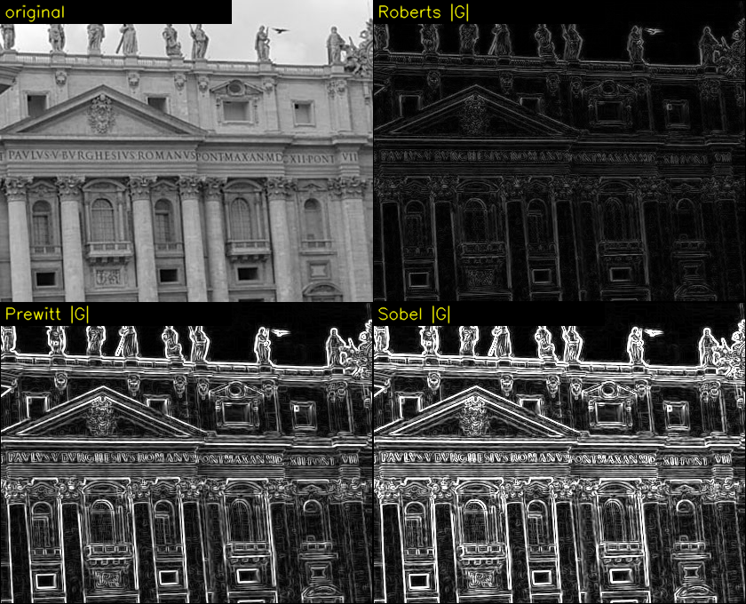
- 소벨 Gx vs Gy: 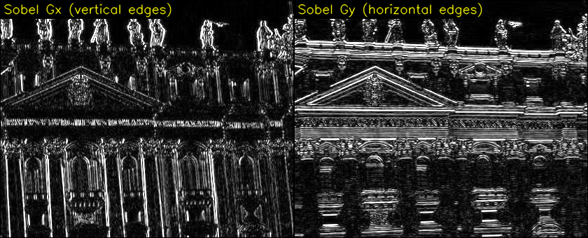

**수치로 비교하면:**

| | 에지 세기 평균 | 100 이상인 화소 | 255로 포화된 화소 |
|---|---|---|---|
| 로버츠 | 19.2 | 0.5% | 0% |
| 프리윗 | 63.4 | 22.6% | 2.3% |
| 소벨 | 82.1 | 32.8% | 6.0% |

**이미지에서 보이는 것:**

1. **로버츠는 전체적으로 어둡고 선이 가늘어요.** 반응 값이 작기 때문입니다 (최대 증폭 ×1). 기둥 테두리나 창문은 보이지만 희미해요.
2. **프리윗과 소벨은 밝고 선이 굵어요.** ×3, ×4로 증폭되고, 3줄을 합치면서 에지가 두꺼워집니다. 둘은 눈으로 거의 구별이 안 되고, 소벨이 조금 더 밝아요 (포화 6.0%).
3. **소벨 Gx(세로 에지)에는** 기둥의 세로 테두리와 창문 양옆이 또렷하게 나오고, 가로 처마는 거의 사라져요.
4. **소벨 Gy(가로 에지)에는** 처마, 글자 띠(PAVLVS V BVRGHESIVS...)의 위아래 선, 창틀 가로선이 또렷하고, 기둥 세로선은 희미해요.

3, 4번이 Step 2-2-c의 "가로로 미분하면 세로선이 걸린다"를 실제 사진으로 확인한 결과입니다.

> ⚠️ **공정한 비교를 위한 주의점**
> 프리윗과 소벨이 더 밝게 보이는 건 **증폭 배율(×3, ×4) 때문**이지, 에지를 더 잘 찾아서가 아니에요. 각각 3과 4로 나누면 진짜 에지의 밝기는 셋 다 비슷해지고, 남는 차이는 **잡음과 질감이 얼마나 덜 나오느냐**(2-4-c, 2-5-c의 측정)뿐입니다.

---

## 📋 Part 2 정리

| | 로버츠 | 프리윗 | 소벨 |
|---|---|---|---|
| 마스크 | 2×2 대각선 차분 | `[1,1,1]ᵀ × [−1,0,1]` | `[1,2,1]ᵀ × [−1,0,1]` |
| 구조 | 미분만 | 균등 평균 + 미분 | **가중 평균** + 미분 |
| 에지 증폭 | ×1 | ×3 | ×4 |
| 잡음 구별력 (에지/잡음) | 5.15 | **8.85** | 8.33 |
| 방향 오차 (평균) | — | 0.85° | **0.38°** |
| 결과 모습 | 가늘고 어두움 | 굵고 밝음 | 굵고 가장 밝음 |
| 한 줄 평가 | 빠르지만 잡음에 약함 | 잡음에 강함 | 잡음에 강하고 방향이 정확 → **표준** |

```
           Part 1의 회선 엔진
                  │
     ┌────────────┼──────────────┐
     ▼            ▼              ▼
   블러         미분          블러 + 미분 = 프리윗 / 소벨
  (합 = 1)    (합 = 0)       "잡음을 누르면서 경계를 찾는다"
```

**발견한 코드 함정:**
1. `cv2.Sobel(..., 1, 0, 3)`의 다섯 번째 자리는 `dst`라서 `ksize`가 무시됨 → `ksize=`로 명시해야 함 (17번에서 실제 문제)
2. 03번은 `np.abs + clip`(버림), 04, 05번은 `convertScaleAbs`(반올림)로 변환 방식이 다름

### ✅ Part 2 퀴즈

1. 아래 마스크는 무엇을 찾는 마스크일까요? 원소 합은? (힌트: 소벨 마스크를 돌려 보세요)
   ```
    0   1   2
   −1   0   1
   −2  −1   0
   ```
2. 소벨 Gx 결과를 `ddepth=cv2.CV_8U`로 받으면, 원본에서 **밝은 기둥의 왼쪽 테두리와 오른쪽 테두리** 중 어느 쪽만 남을까요? (힌트: 기둥 왼쪽 테두리는 왼쪽에서 오른쪽으로 갈 때 어두움 → 밝음)
3. 프리윗을 `[1,1,1,1,1]ᵀ × [−1,0,1]`(5줄 평균)로 넓히면 잡음 구별력은 이론상 몇 배가 될까요? 대신 무엇을 잃을까요?

---

다음은 **Part 3: 2차 미분, 라플라시안 (06)**입니다. "기울기의 기울기"가 무엇인지, 에지에서 0을 가로지르는 **영교차**가 무엇인지 보고, 라플라시안 마스크 `[0,1,0 / 1,−4,1 / 0,1,0]`을 직접 유도합니다. 그리고 라플라시안이 잡음에 얼마나 약한지 실험으로 확인한 뒤 Part 4(잡음 제거)로 넘어갈 거예요.

**"다음"**이라고 하시면 이어가고, 어려운 부분이 있으면 **"더 쉽게"**라고 해 주세요.


---

## Q7  <sub>2026-10-26T13:50:23.805Z</sub>

> 다음


### A7

Part 3 수치와 비교 이미지를 만들었어요. 이미지를 확인한 다음 설명을 씁니다.

# Part 3. 에지 검출 ②: 2차 미분, 라플라시안 [chap07/06.edge_laplacian.py](chap07/06.edge_laplacian.py)

이번 Part는 파일 하나라서 **Step 3-1 ~ 3-4를 한 번에** 진행합니다. 이번에도 숫자는 전부 실행해서 확인했고, 실제 이미지 결과는 그림 파일로 저장했어요.

---

## 🔁 Part 2 퀴즈 답

**1번. 이 마스크는 무엇을 찾을까요?**

```
 0   1   2
−1   0   1        원소 합 = 0 + 1 + 2 − 1 + 0 + 1 − 2 − 1 + 0 = 0  → 미분 마스크
−2  −1   0
```

소벨 Gx를 **45° 돌린** 마스크예요. 양수는 오른쪽 위(↗)에 몰려 있고 음수는 왼쪽 아래(↙)에 있어서, **왼쪽 아래 → 오른쪽 위 방향의 밝기 변화**를 잽니다. 그래디언트는 에지에 수직이니까, 이 마스크가 찾는 에지는 그 방향에 수직인 **╲ 방향 에지**입니다.

**2번. 소벨 Gx를 `CV_8U`로 받으면 기둥의 어느 쪽 테두리가 남을까?**

```
          어두움 │ 밝은 기둥 │ 어두움
                 ↑           ↑
     왼쪽 테두리: 어두움 → 밝음      오른쪽 테두리: 밝음 → 어두움
     Gx > 0 → 남음 ✅               Gx < 0 → 0으로 잘림 ❌
```

**왼쪽 테두리만** 남아요. 기둥 하나에 선이 한 줄만 나오는 거죠. Part 8에서 번호판 코드가 바로 이렇게 동작합니다.

**3번. 5줄 평균 프리윗이면?**

```
신호: ×5,  잡음: ×√5 ≈ 2.24  →  개선 = 5 / √5 = √5 ≈ 2.24배  (3줄일 때는 1.73배)
예상 에지/잡음 비율 ≈ 5.07 × 2.24 ≈ 11.3
```

잃는 것은 **세로 방향의 세밀함**이에요. 5줄을 하나로 뭉치니까 짧은 에지, 모서리, 곡선이 뭉개지고 위치가 흐려집니다. 잡음 억제와 정밀도는 **서로 맞바꾸는 관계**(트레이드오프)예요. 이 주제는 Part 4, 5에서 계속 나옵니다.

---

## Step 3-1. 2차 미분이란? "기울기의 기울기"

### 3-1-a. 🧠 자동차 비유: 위치 → 속도 → 가속도

밝기를 **자동차의 위치**라고 생각해 볼게요.

| 수학 | 자동차 | 이미지 |
|---|---|---|
| f | 위치 | 밝기 |
| f′ (1차 미분) | 속도 = 위치의 변화율 | 밝기가 얼마나 빨리 변하나 (Part 2) |
| f″ (2차 미분) | **가속도** = 속도의 변화율 | 밝기 변화가 빨라지는 중인가, 느려지는 중인가 |

**계단형 에지**는 서 있던 차가 갑자기 출발해서 조금 가다가 다시 멈추는 상황이에요.

```
출발 직전  → 가속 페달 (가속도 +)  → 최고 속도 (가속도 0)  → 브레이크 (가속도 −)  → 정지
              ▲                       ▲                       ▲
           에지 시작                 에지 중심                에지 끝
```

**핵심:** 속도가 가장 빠른 순간(= 1차 미분 최대 = 에지 중심)에 가속도는 **+에서 −로 바뀌면서 0을 지나갑니다.** 이 지점을 **영교차**(zero crossing)라고 해요.

> 📌 **1차 미분의 꼭대기 = 2차 미분의 영교차**
> Part 2에서는 "기울기가 **큰** 곳"을 찾았어요. 2차 미분에서는 "가속도가 **0을 가로지르는** 곳"을 찾습니다. 둘 다 같은 에지 중심을 가리켜요.

### 3-1-b. 📐 2차 차분 공식 유도

1차 차분을 한 번 더 차분하면 됩니다. 반 칸 위치를 써서 유도할게요.

```
f′(x + ½) ≈ f(x + 1) − f(x)          ← x와 x+1 사이의 기울기
f′(x − ½) ≈ f(x) − f(x − 1)          ← x−1과 x 사이의 기울기

f″(x) ≈ f′(x + ½) − f′(x − ½)        ← 기울기의 변화
      = [f(x + 1) − f(x)] − [f(x) − f(x − 1)]
      = f(x + 1) − 2f(x) + f(x − 1)
```

1D 마스크로 쓰면 **`[1, −2, 1]`**입니다. 원소 합은 1 − 2 + 1 = **0**이라서, 평평한 곳에서는 0이 돼요 (Part 1의 원소 합 규칙).

> 💡 **회선 레시피로 읽기:** 왼쪽 + 오른쪽 − 2 × 나 = **"이웃 평균에 비해 내가 얼마나 다른가"** × 2
> 내가 이웃보다 낮으면(골짜기) **+**, 높으면(봉우리) **−**, 이웃 평균과 같으면 **0**이에요.

### 3-1-c. 1차원 실험 ✍️ (실행값)

#### 실험 ① 계단 에지

```
x                 :    0     1     2     3     4     5
f                 :   10    10    10   100   100   100
f′ (전진, 사이 값) :      0     0    90     0     0          ← x=2와 3 사이에 90
f″ = [1, −2, 1]   :    -     0   +90   −90     0     -
                                  ↑      ↑
                                  └──┬───┘
                                  여기서 + → − (영교차) = 에지는 x=2와 3 사이
```

계산 과정:
```
x=2: f(3) − 2·f(2) + f(1) = 100 − 20 + 10  = +90   (가속: 막 올라가기 시작)
x=3: f(4) − 2·f(3) + f(2) = 100 − 200 + 10 = −90   (감속: 올라가기를 멈춤)
```

그래프로 나란히 보면:

```
f   100 |                 ●─────●─────●
        |                ╱
     10 | ●─────●─────●
        +───────────────────────────────
f′   90 |                ▲               ← 꼭대기 하나 (x = 2.5)
      0 | ──────────────╯ ╰─────────────
        +───────────────────────────────
f″  +90 |             ●                  ← 가속
      0 | ──●─────●──────╲──────●─────── ← 영교차 (x = 2.5)
    −90 |                 ●              ← 감속
          x=0   1     2     3     4     5
```

#### 실험 ② 경사 에지 (실제 사진에 가까움)

```
x                 :    0     1     2     3     4     5
f                 :   10    10    40    70   100   100
f″                :    -   +30     0     0   −30     -
                          ↑                  ↑
                     경사 시작(가속)       경사 끝(감속)
                          중간 구간(일정한 속도)은 0
```

경사가 일정한 구간에서는 속도가 일정하니까 가속도가 0이에요. 영교차는 경사 시작(+30)과 끝(−30) **사이 어딘가**, 즉 경사의 가운데에 있습니다.

### 3-1-d. 1차 미분과 2차 미분 비교

| | 1차 미분 (Part 2) | 2차 미분 (Part 3) |
|---|---|---|
| 에지 표시 | 값이 **큰** 곳 (꼭대기) | 값이 **0을 가로지르는** 곳 |
| 계단 에지 반응 | +90, +90 (같은 부호 2칸) | +90, −90 (**부호가 바뀌는 쌍**) |
| 에지 위치 | 꼭대기가 넓어서 애매함 | 영교차는 한 점이라 **정밀함** |
| 방향 정보 | 있음 (Gx, Gy) | 없음 (숫자 하나) |
| 잡음 | 약함 | **더 약함** (Step 3-4) |

---

## Step 3-2. 라플라시안 마스크 유도 📐

### 3-2-a. 2차원으로: x 방향 + y 방향

**라플라시안**(∇²f)은 x방향 2차 미분과 y방향 2차 미분의 **합**이에요.

```
∇²f = ∂²f/∂x²  +  ∂²f/∂y²
```

각각에 3-1-b의 공식을 적용하면:

```
∂²f/∂x² ≈ f(x+1, y) − 2f(x, y) + f(x−1, y)        ← 좌우
∂²f/∂y² ≈ f(x, y+1) − 2f(x, y) + f(x, y−1)        ← 위아래
────────────────────────────────────────────────
∇²f     ≈ 위 + 아래 + 왼쪽 + 오른쪽 − 4 × 중심
```

마스크로 쓰면 (06번 파일의 `data1`):

```
 x방향 [1, −2, 1]      y방향 [1, −2, 1]ᵀ        합 = 4방향 라플라시안
  0   0   0             0   1   0              0   1   0
  1  −2   1      +      0  −2   0       =      1  −4   1
  0   0   0             0   1   0              0   1   0
```

### 3-2-b. 8방향 라플라시안

대각선 이웃 4개까지 넣으면 중심이 −8이 됩니다.

```
  1   1   1                       −1  −1  −1
  1  −8   1     부호를 뒤집으면 →  −1   8  −1     ← 06번 파일의 data2
  1   1   1                       −1  −1  −1
```

⚠️ 06번 파일은 4방향은 `중심 −4`, 8방향은 `중심 +8`로 **부호가 서로 반대**예요. 결과의 +와 −가 뒤집힐 뿐이고, 화면에 띄울 때 `convertScaleAbs`로 절댓값을 취하니까 보이는 모습은 같습니다. 영교차 위치도 같아요.

### 3-2-c. 🔗 Part 1과 연결: 샤프닝 = 원본 − 라플라시안

Step 1-4-b에서 샤프닝 마스크를 "원본 + 디테일 마스크"로 쪼갰던 것 기억나세요?

```
  0 −1  0       0  0  0        0  1  0
 −1  5 −1   =   0  1  0    −   1 −4  1
  0 −1  0       0  0  0        0  1  0
 (샤프닝 mask1)   (원본)        (4방향 라플라시안)
```

그때 "디테일만 뽑는 마스크"라고 부른 게 바로 **라플라시안(의 부호 반대)**이었어요. 원본에서 라플라시안을 빼면, 경계 앞쪽(+, 가속)은 더 어두워지고 경계 뒤쪽(−, 감속)은 더 밝아집니다. 이게 Step 1-4의 언더슈트와 오버슈트였어요.

### 3-2-d. 손계산 ✍️ (5×5 시험 이미지, 실행값)

**V (세로 경계), 중심 (2,2), 4방향:**

```
      10                 위 + 아래 + 왼쪽 + 오른쪽 = 10 + 10 + 10 + 100 = 130
  10 (10) 100            − 4 × 중심              = − 40
      10                                          ─────
                                                   +90
```

| 시험 이미지 | 4방향 결과 (안쪽 3×3) | 8방향 결과 (안쪽 3×3) |
|---|---|---|
| **V** 세로 경계 | `0 +90 −90` (×3행) | `0 −270 +270` (×3행) |
| **D** 대각선 경계 | `0 +180 −180 / +180 −180 0 / −180 0 0` | `−90 −270 +270 / −270 +270 +90 / +270 +90 0` |
| **N** 잡음 한 점 | 중심 **−120**, 상하좌우 +30 | 중심 **+240**, 주변 8칸 −30 |

#### 🖼️ 관찰 ①: 에지마다 + − 쌍이 생긴다

V에서 경계 바로 왼쪽 칸은 +90, 바로 오른쪽 칸은 −90이에요. 1D 실험과 똑같이 **영교차 쌍**이 생깁니다.

#### 🖼️ 관찰 ②: 4방향은 대각선에 과민하고, 8방향은 공평하다

| | 세로 경계 반응 | 대각선 경계 반응 | 비율 |
|---|---|---|---|
| 4방향 | 90 | **180** | 대각선이 2배 |
| 8방향 | 270 | 270 | **같음** |

4방향 마스크는 상하좌우만 보는데, 대각선 경계에서는 그 4개 이웃 중 2개가 경계 건너편에 있어서 반응이 2배가 돼요. 8방향은 대각선 이웃까지 보니까 **경계 방향에 상관없이 반응이 같습니다.** 방향에 공평한 성질을 **등방성**(isotropy)이라고 해요.

#### 🖼️ 관찰 ③: ⚠️ 잡음 반응이 진짜 에지보다 크다!

4방향 기준으로 **잡음(30 차이) 반응은 −120**, **진짜 에지(90 차이) 반응은 90**이에요. 밝기 차이가 3분의 1밖에 안 되는 잡음이 오히려 **더 크게** 반응했습니다. 잡음 자리의 중심 가중치가 −4라서 4배로 증폭되기 때문이에요. Step 3-4에서 자세히 봅니다.

---

## Step 3-3. 코드 해부: [chap07/06.edge_laplacian.py](chap07/06.edge_laplacian.py)

```python
mask4 = np.array(data1, np.int16)   # 음수가 있으므로 자료형이 int8인 행렬 선언   ← 12줄
mask8 = np.array(data2, np.int16)                                                 ← 13줄
```

⚠️ **주석이 틀렸어요.** 주석에는 int8이라고 했지만 실제 코드는 `np.int16`입니다. 음수가 있어서 uint8을 못 쓰는 건 맞고, int8(−128~127)로도 −4와 8은 충분히 담을 수 있어요. 결과적으로는 문제없는 **주석 오타**입니다. `cv2.filter2D`가 정수 마스크도 받아 준다는 것도 확인했어요.

```python
dst1 = cv2.filter2D(image, cv2.CV_16S, mask4)          # 15줄
dst2 = cv2.filter2D(image, cv2.CV_16S, mask8)          # 16줄
```

**`ddepth = cv2.CV_16S`(int16)를 쓰는 이유:**

```
라플라시안 결과의 이론적 범위 (8방향, 입력 0~255):
  최대: 중심 255, 이웃 0   → 8 × 255 − 0     = +2040
  최소: 중심 0,  이웃 255 → 0 − 8 × 255     = −2040
  → uint8(0~255)은 음수도 못 담고 크기도 모자람
  → int16(−32,768 ~ 32,767)이면 넉넉함

실제 laplacian.jpg 결과 범위: 4방향 −387 ~ 294, 8방향 −742 ~ 839
```

Part 2에서는 `CV_32F`(float)를 썼죠. 여기서는 마스크와 입력이 모두 정수라 결과도 정수여서 int16으로 충분합니다. 메모리도 float32의 절반이에요.

```python
dst3 = cv2.Laplacian(image, cv2.CV_16S, 1)      # OpenCV 라플라시안 수행 함수    ← 17줄
```

### ⚠️ 실행해서 확인한 함정: Part 2의 `cv2.Sobel`과 똑같은 문제

함수 시그니처를 출력해 보면:

```
Laplacian(src, ddepth[, dst[, ksize[, scale[, delta[, borderType]]]]]) -> dst
                       ↑ 세 번째 자리는 dst
```

세 번째 위치 인자 `1`은 `ksize`가 아니라 **`dst`**로 들어가고 무시됩니다. 실험 결과:

| 호출 | `ksize=1`과 같은 결과? |
|---|---|
| `cv2.Laplacian(img, CV_16S, 1)` | ✅ 같음 |
| `cv2.Laplacian(img, CV_16S, 3)` | ✅ **같음** (무시됨) |
| `cv2.Laplacian(img, CV_16S, 5)` | ✅ **같음** (무시됨) |
| `cv2.Laplacian(img, CV_16S, 9)` | ✅ **같음** (무시됨) |

- **06번에서는** 원래 1을 의도했으니 결과가 우연히 맞아요. `dst1`(직접 만든 4방향 마스크)과 `dst3`(`cv2.Laplacian`)이 **화소 하나까지 완전히 같다**는 것도 확인했습니다. `ksize=1`일 때 OpenCV는 정확히 `[0,1,0 / 1,−4,1 / 0,1,0]`을 써요.
- **07번(Part 5)의** `cv2.Laplacian(gaus, cv2.CV_16S, 9)`는 9×9를 의도했지만 실제로는 1(3×3 4방향)로 계산됩니다.

> 📌 **규칙: OpenCV 함수에서 `ksize`는 항상 `ksize=`로 쓰세요.** 같은 실수가 08, 17번 파일에도 반복돼요.

참고로 `ksize=3`이면 OpenCV는 다른 마스크를 씁니다 (실행해서 확인):

```
  2   0   2
  0  −8   0        ← 대각선만 쓰는 특이한 모양 (가중치 2)
  2   0   2
```

```python
cv2.imshow("filter2D 4-direction", cv2.convertScaleAbs(dst1))   # 20~22줄
```

`convertScaleAbs`는 절댓값을 취하니까 +90과 −90이 **둘 다 밝게** 나와요. 그래서 에지 하나가 **두 줄(이중선)**로 보입니다. 영교차 정보(+와 −의 경계)는 절댓값을 취하는 순간 사라져요.

---

## Step 3-4. 실제 이미지 결과와 잡음 약점 🖼️

### 3-4-a. 실제 이미지 비교

[chap07/images/laplacian.jpg](chap07/images/laplacian.jpg)(400×300)는 성 베드로 광장의 분수 사진이에요. 분수 위로 **물방울이 흩날리고** 있어서 미세한 질감이 많습니다.

- 4장 비교 (원본 / |라플라시안 4| / |라플라시안 8| / 영교차): 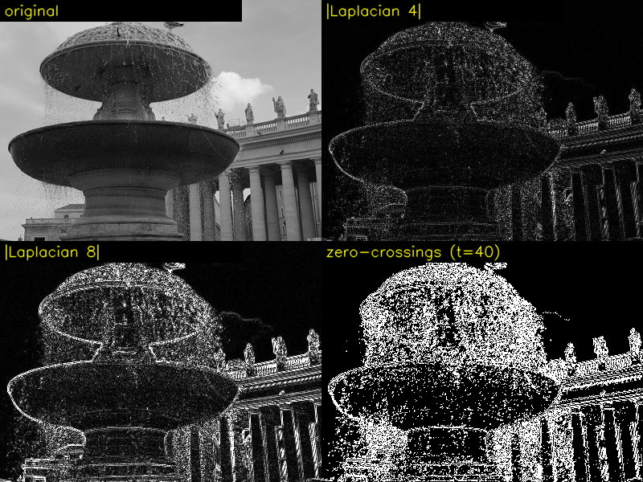

**이미지에서 보이는 것:**

1. **|라플라시안 4|는 선이 가늘고 점처럼 자글자글해요.** 분수 테두리와 기둥 윤곽도 보이지만, 그보다 **물방울 구역 전체가 하얀 점으로 덮여** 있어요. 미세한 밝기 변화에 모두 반응한 결과입니다.
2. **|라플라시안 8|은 더 밝고 강하게** 나와요 (중심 8, 증폭이 더 큼). 물방울 점도 더 진해집니다.
3. **영교차 (임계값 40)**: 책에는 없는 실험인데, 직접 코드를 짜서 "옆 화소와 부호가 바뀌고 차이가 40보다 큰 곳"을 흰색으로 표시했어요. 분수 둘레에 가는 선이 생기긴 하지만, **물방울 구역이 하얗게 뒤덮여서** 거의 쓸 수가 없습니다. 미세한 흔들림 하나하나가 전부 +와 −를 오가면서 영교차를 만들기 때문이에요.

### 3-4-b. 잡음 약점을 숫자로 확인

Part 2와 **같은 실험**(세로 경계 10 → 100, 모든 화소에 표준편차 10 잡음)을 라플라시안에도 해 봤어요.

| 연산자 | 깨끗한 에지 반응 | 평평한 곳의 잡음 반응 | **에지 / 잡음** |
|---|---|---|---|
| 소벨 (Part 2) | 360 | 43.2 | **8.33** |
| 라플라시안 8방향 | 270 | 67.9 | 3.98 |
| 라플라시안 4방향 | 90 | 35.8 | **2.51** |

라플라시안 4방향은 소벨보다 잡음 구별력이 **3배 이상 나빠요.** 수학적으로 이유를 볼게요.

```
라플라시안 4방향 마스크 가중치: 1, 1, 1, 1, −4
  잡음 증폭  = √(1² + 1² + 1² + 1² + 4²) = √20 ≈ 4.47배   ← 중심 −4가 잡음을 크게 키움
  에지 신호  = 90 (블러 성분이 전혀 없음)

소벨 Gx 마스크: 미분하기 전에 [1, 2, 1]로 블러함
  잡음 증폭  ≈ √12 ≈ 3.46배 (Gx 하나 기준)
  에지 신호  = 360 (세 줄이 같은 방향으로 쌓임)
```

**소벨은 블러와 미분을 같이 하는데, 라플라시안은 블러 없이 미분을 두 번 합니다.** 미분은 할 때마다 잡음을 키우니까, 두 번 하면 훨씬 약해져요.

### 3-4-c. 실제 이미지에 잡음을 살짝 넣으면?

원본에 표준편차 **5**인 약한 잡음(눈으로는 거의 안 보이는 수준)을 더하고 소벨과 라플라시안을 비교했어요. 비교를 공정하게 하려고 소벨은 4로 나눴습니다.

- 잡음 비교 (위: 깨끗한 원본, 아래: 잡음 σ=5): 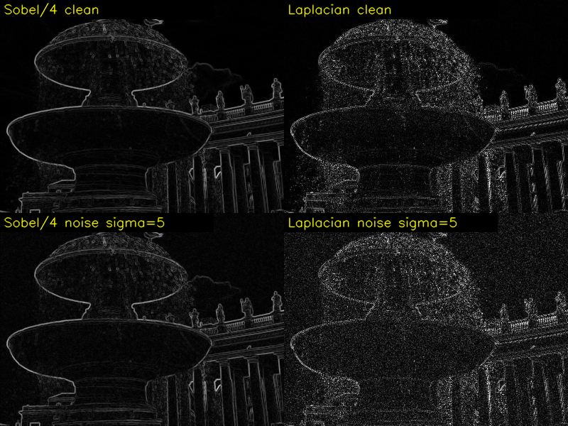

| | 깨끗할 때 평균 반응 | 잡음 넣은 뒤 평균 반응 | 증가율 |
|---|---|---|---|
| 소벨 / 4 | 13.4 | 15.6 | ×1.17 |
| 라플라시안 4방향 | 19.4 | 29.1 | **×1.50** |

이미지로 보면 차이가 더 확실해요.
- **소벨**은 잡음을 넣어도 거의 똑같아 보여요. 하늘처럼 평평한 곳이 여전히 검습니다.
- **라플라시안**은 **하늘 전체가 모래를 뿌린 것처럼 자글자글**해져요. 원래 아무것도 없던 곳에 가짜 반응이 가득합니다.

### 3-4-d. 그래서 다음 단계는? → Part 4

```
라플라시안의 장점: 영교차로 에지 위치를 정밀하게 찾음, 마스크 하나로 모든 방향을 처리
라플라시안의 약점: 잡음과 미세한 질감에 너무 민감
                         │
                         ▼
        해결책: 라플라시안을 적용하기 "전에" 이미지를 부드럽게 만들자
                         │
             ┌───────────┴──────────────┐
             ▼                          ▼
   Part 4: 어떤 블러가 좋은가?      Part 5: 가우시안 블러 + 라플라시안
   (평균, 가우시안, 미디언, ...)       = LoG (Laplacian of Gaussian)
```

소벨이 "블러 + 미분"을 한 마스크에 넣어서 잡음을 이겨 냈던 것처럼, 라플라시안도 블러와 짝지어야 쓸 만해집니다. 그 짝으로 가장 좋은 블러가 무엇인지 Part 4에서 알아볼 거예요.

---

## 💼 실무 연결: 라플라시안의 약점이 오히려 장점이 되는 곳 (AVM 카메라)

"미세한 디테일에 민감하다"는 라플라시안의 성질을 거꾸로 이용하면, **이미지가 얼마나 선명한지**를 숫자 하나로 잴 수 있어요. 방법은 단순합니다: 라플라시안 결과의 **분산**(값이 얼마나 퍼져 있나)을 구하는 거예요.

```python
sharpness = cv2.Laplacian(gray, cv2.CV_64F).var()
```

laplacian.jpg를 점점 더 흐리게 만들면서 측정한 결과:

| 이미지 상태 | 라플라시안 분산 | 원본 대비 |
|---|---|---|
| 원본 | 1182.9 | 100% |
| 가우시안 블러 3×3 | 103.0 | 8.7% |
| 가우시안 블러 5×5 | 38.9 | 3.3% |
| 가우시안 블러 9×9 | 9.1 | 0.8% |

살짝만 흐려져도(3×3) 값이 **10분의 1 이하로** 떨어져요. 선명한 이미지에는 미세한 디테일(라플라시안이 크게 반응하는 성분)이 많고, 흐린 이미지에는 거의 없기 때문입니다.

**AVM(서라운드 뷰) 업무에서 바로 쓰이는 곳:**
- **생산 라인 초점 검사**: 카메라 모듈을 조립한 뒤 테스트 차트를 찍어서, 라플라시안 분산이 기준치 아래면 초점 불량으로 판정
- **렌즈 오염, 김서림 감지**: 주행 중 카메라 영상의 선명도가 갑자기 떨어지면 렌즈에 물방울, 흙, 김이 묻었다고 경고 (실제 차량에서 "카메라를 닦아 주세요" 메시지를 띄우는 기능)
- **탑뷰 화질 비교**: 탑뷰 합성 전후, 또는 보간 방법별로 선명도가 얼마나 떨어지는지 정량 비교

> 주의: 분산 값은 장면 내용에 따라 달라져요 (질감이 많은 장면이 값도 큼). 그래서 **같은 장면끼리 비교**하거나, 고정된 테스트 차트로 측정해야 의미가 있습니다.

---

## 📋 Part 3 정리

| 개념 | 한 줄 정리 |
|---|---|
| 2차 미분 | 기울기의 기울기 = 가속도. 1D 마스크 `[1, −2, 1]` |
| 영교차 | 1차 미분이 최대인 곳에서 2차 미분은 +에서 −로 바뀜 → 에지 중심을 정밀하게 찾음 |
| 라플라시안 | x방향 + y방향 2차 미분. 4방향 `[0,1,0 / 1,−4,1 / 0,1,0]`, 8방향은 대각선 포함 |
| 등방성 | 4방향은 대각선 에지에 2배 반응하고, 8방향은 방향에 상관없이 같음 |
| 샤프닝과의 관계 | 샤프닝 mask1 = 원본 − 4방향 라플라시안 |
| 코드 | `CV_16S`로 음수 보존. 주석의 int8은 오타(실제는 int16) |
| 함정 | `cv2.Laplacian`의 세 번째 위치 인자는 `dst` → `ksize=`로 써야 함 (07번에서 실제 문제) |
| 약점 | 블러 없이 미분을 두 번 함 → 잡음 구별력이 소벨의 1/3 (2.51 vs 8.33) |
| 실무 | 라플라시안 분산 = 선명도 측정 (초점 검사, 렌즈 오염 감지) |

### ✅ Part 3 퀴즈

1. 1D 신호 `[50, 50, 50, 200, 50, 50, 50]`(가는 밝은 선 하나)에 `[1, −2, 1]`을 적용하면? 영교차는 몇 개 생기고, 이 결과를 `convertScaleAbs`로 보면 선이 몇 줄로 보일까요?
2. 라플라시안 마스크의 원소 합은 0입니다. 그럼 이미지 **전체 밝기를 +50** 올린 뒤 라플라시안을 적용하면 결과는 어떻게 될까요? 이미지에 **왼쪽에서 오른쪽으로 일정하게 밝아지는 그라데이션**(`f = 2x`)을 넣으면?
3. 라플라시안 분산으로 렌즈 오염을 감지할 때, **밤에 어두운 장면**에서는 값이 어떻게 될까요? 그래서 어떤 오판이 생길 수 있을까요?

---

다음은 **Part 4: 잡음 제거 필터 (10 평균, 12 가우시안, 11 미디언, 09 최소/최대)**입니다. 잡음 종류(가우시안 잡음 vs 소금-후추 잡음)부터 시작해서, 가우시안 공식 유도, `getGaussianMask()`의 **18×6 마스크 버그**, 미디언 필터가 에지를 지키면서 잡음을 지우는 원리까지 다뤄요. Part 4는 내용이 많아서 두세 번에 나눠 진행하겠습니다.

**"다음"**이라고 하시면 이어가고, 어려운 부분이 있으면 **"더 쉽게"**라고 해 주세요.


---

## Q8  <sub>2026-10-26T14:00:06.936Z</sub>

> 다음


### A8

# Part 4. 잡음 제거 필터: Step 4-1, 4-2

Part 4는 내용이 많아서 세 번에 나눠 진행합니다.

| 이번 | 다음 | 그다음 |
|---|---|---|
| **4-1 잡음의 종류**, **4-2 평균값 필터 (10)** | 4-3 가우시안 필터 (12) | 4-4 미디언 (11), 4-5 최소/최대 (09), 4-6 정리 |

이번에도 숫자는 전부 실행해서 확인했어요.

---

## 🔁 Part 3 퀴즈 답

**1번. 가는 밝은 선 `[50, 50, 50, 200, 50, 50, 50]`에 `[1, −2, 1]`**

```
x      :   0     1     2     3     4     5     6
f      :  50    50    50   200    50    50    50
f″     :   -     0  +150  −300  +150     0     -
                    └─영교차─┘└─영교차─┘   → 영교차 2개
|f″|   :         0   150   300   150     0     → 밝은 화소 3개
```

선형 에지(Step 2-1-b의 ③번 모양)는 **양쪽에 에지가 하나씩**, 그래서 영교차도 **2개**입니다. `convertScaleAbs`로 보면 가운데(300)가 가장 밝고 양옆(150)이 조금 덜 밝은 **3칸 두께의 선 한 줄**처럼 보여요.

**2번. 밝기 +50, 그리고 그라데이션 f = 2x**

```
+50:   (f(x+1)+50) − 2(f(x)+50) + (f(x−1)+50) = f″(x) + (50 − 100 + 50) = f″(x)  → 변화 없음
f=2x:  2(x+1) − 2·2x + 2(x−1) = 2x + 2 − 4x + 2x − 2 = 0                       → 전부 0
```

라플라시안은 **일정한 밝기 변화**(조명 그라데이션)를 완전히 무시하고, **휘어지는 곳**(곡률)에만 반응해요. 소벨은 그라데이션에도 반응합니다 (f = 2x면 Gx가 모든 곳에서 일정한 값). 이 차이가 라플라시안의 장점 중 하나예요.

**3번. 밤에 라플라시안 분산은?**
양쪽으로 다 틀릴 수 있어요.
- 어두우면 대비와 디테일이 줄어서 **값이 낮아짐** → 렌즈가 깨끗한데도 "오염됨"으로 **오경보**
- 밤에는 센서 게인을 올려서 잡음이 늘어남 → 잡음이 분산을 **부풀림** → 실제로 렌즈가 흐려졌는데도 "선명함"으로 **놓침**

그래서 실무에서는 밝기 조건별로 기준값을 다르게 두거나, 일정 시간 동안 추세를 보고 판단합니다.

---

## Step 4-1. 잡음의 종류

### 4-1-a. 잡음이란?

카메라가 측정한 값은 항상 **진짜 값 + 오차**예요.

```
측정 화소값 = 진짜 밝기 + 잡음
```

잡음이 **어떤 모양**이냐에 따라 맞는 필터가 완전히 달라져요. 그래서 필터보다 잡음부터 알아야 합니다. 이 장에서 다루는 대표 잡음은 두 가지예요.

### 4-1-b. 가우시안 잡음: "모든 화소가 조금씩 흔들림"

**모든 화소**에 작은 랜덤 값이 더해집니다. 그 랜덤 값이 **정규분포**(종 모양 분포)를 따라서 가우시안 잡음이라고 불러요.

실제 이미지(`median2.jpg`)의 하늘 부분에 표준편차 σ = 20인 잡음을 넣고 한 행을 잘라 보면:

```
x       :  200   201   202   203   204   205
원본    :  191   191   191   191   191   191     ← 균일한 하늘
잡음 후 :  206   200   194   152   155   223     ← 모든 칸이 흔들림
차이    :  +15    +9    +3   −39   −36   +32
```

σ(시그마, 표준편차)는 흔들림의 크기예요. 정규분포에서는:

```
              ▁▃▅▇█▇▅▃▁
         ────┼───┼───┼───┼────
           −2σ  −σ   0  +σ  +2σ
              └──68%──┘           ← 약 68%의 화소는 ±σ(±20) 안에서 흔들림
           └─────95%─────┘        ← 약 95%는 ±2σ(±40) 안
```

위 예에서 −39는 ±2σ 근처라 드문 편이고, 나머지는 대부분 ±20 안에 있어요.

**원인:** 센서의 열, 전자 회로 잡음. **빛이 부족할수록** 심해져요. 어두우면 신호를 증폭(게인)해야 하는데, 잡음도 같이 증폭되거든요. 밤에 찍은 폰 사진이 자글자글한 이유입니다. AVM 카메라에서는 **야간 주차장 영상**이 대표적이에요.

### 4-1-c. 소금-후추 잡음: "소수 화소가 극단값으로 튐"

**일부 화소만** 완전히 흰색(255, 소금) 또는 완전히 검은색(0, 후추)으로 바뀝니다. 나머지 화소는 **멀쩡**해요.

```
원본    :  191   191   191   191   191   191
잡음 후 :  191   191   255   191     0   191     ← 대부분 그대로, 몇 개만 극단값
```

**원인:** 센서의 죽은 화소(항상 0)나 뜨거운 화소(항상 255), 그리고 **데이터 전송 중 비트 오류**예요. AVM에서는 카메라와 ECU를 잇는 고속 직렬 링크(GMSL, FPD-Link 등)에 전기적 간섭이 생기면 이런 점이 튈 수 있습니다.

### 두 잡음 비교

| | 가우시안 잡음 | 소금-후추 잡음 |
|---|---|---|
| 영향받는 화소 | **전부** | **일부** (예: 5%) |
| 잡음 크기 | 작음 (±σ 정도) | **극단적** (0 또는 255) |
| 겉모습 | 화면 전체가 자글자글 | 흰 점, 검은 점이 뿌려짐 |
| 원인 | 센서 열, 저조도 게인 | 죽은 화소, 전송 오류 |
| 잘 맞는 필터 | 평균, **가우시안** (4-2, 4-3) | **미디언** (4-4) |

### 4-1-d. `salt_pepper_noise()` 코드 해부 ([chap07/11.filter_median.py](chap07/11.filter_median.py))

11번 파일에 소금-후추 잡음을 만드는 함수가 있어서 여기서 미리 봅니다.

```python
def salt_pepper_noise(img, n):
    h, w = img.shape[:2]
    x, y = np.random.randint(0, w, n), np.random.randint(0, h, n)   # ① 좌표 n개 뽑기
    noise = img.copy()                                              # ② 원본 복사
    for (x,y) in zip(x,y):                                          # ③ 좌표 하나씩
        noise[y, x] = 0 if np.random.rand() < 0.5 else 255          # ④ 반반 확률로 0 또는 255
    return noise
```

`n = 5`일 때 단계별로 따라가면 (값은 예시):

```
① np.random.randint(0, w, 5) → x = [ 12, 300,  77, 451,   3]   ← 0 이상 w 미만 정수 5개
   np.random.randint(0, h, 5) → y = [ 40, 199,   5, 120, 260]
③ zip(x, y) → (12,40), (300,199), (77,5), (451,120), (3,260)  ← 짝지어서 좌표 5개
④ 좌표마다 동전 던지기: rand() < 0.5 이면 0(후추), 아니면 255(소금)
```

**꼼꼼히 볼 점 세 가지:**

1. **`img.copy()`가 꼭 필요해요.** 복사 없이 `noise = img`라고 쓰면 두 이름이 **같은 배열**을 가리켜서 원본까지 망가집니다. 그러면 나중에 "원본 vs 필터 결과"를 비교할 수가 없어요.
2. **`noise[y, x]` 순서.** 📚 numpy는 `[행, 열]` = `[y, x]` 순서예요. 변수는 (x, y)로 만들었지만 넣을 때는 순서를 바꿉니다.
3. **좌표가 겹칠 수 있어요.** 랜덤으로 뽑으니까 같은 좌표가 두 번 나올 수 있습니다. 실제로 300×480 이미지에서 500개를 뽑아 보니 **서로 다른 좌표는 499개**였어요. 500개를 요청해도 실제 잡음 화소는 조금 적을 수 있다는 뜻입니다.

> 💡 **규모 감각:** 500개 ÷ 144,000화소 = 전체의 **0.35%**예요. 꽤 적은 양이라서, 아래 실험에서는 차이를 잘 보이게 하려고 **5%**(약 7,200개)로 늘렸습니다. 이렇게 비율로 만들 때는 반복문 대신 numpy 마스크를 쓰면 한 줄로 끝나요.
> ```python
> m = np.random.random(img.shape)          # 화소마다 0~1 랜덤 값
> noise[m < 0.025] = 0                     # 2.5%는 후추
> noise[m > 0.975] = 255                   # 2.5%는 소금
> ```

---

## Step 4-2. 평균값 필터: [chap07/10.filter_average.py](chap07/10.filter_average.py)

평균값 필터는 Part 1의 1/9 블러와 **같은 연산**이에요. Part 1에서는 "회선이 어떻게 동작하나"를 봤고, 여기서는 **"잡음을 얼마나 줄이고, 그 대가가 무엇인가"**를 봅니다.

### 4-2-a. 평균이 가우시안 잡음을 줄이는 원리 📐

Part 2-4-c에서 본 원리가 그대로 적용돼요. **랜덤한 값 N개를 평균 내면 흔들림이 1/√N로 줄어듭니다.**

```
k×k 평균 필터: 화소 N = k² 개를 평균
  잡음 σ  →  σ / √(k²)  =  σ / k

예) σ = 20, 3×3 평균 → 20 / 3 = 6.67
```

🧠 **비유: 시험 점수.** 한 학생의 점수는 컨디션에 따라 크게 오르내리지만, 반 전체 평균은 매번 비슷하게 나오죠. 개별 흔들림(+, −)이 평균을 내면 서로 상쇄되기 때문이에요.

**실험:** 회색(128) 화면에 σ = 20 잡음을 넣고, 평균 필터 크기를 바꿔 가며 남은 잡음을 측정했어요.

| 필터 크기 | 평균 내는 화소 수 | 남은 잡음 σ (실측) | 이론값 σ/k |
|---|---|---|---|
| 없음 | 1 | 20.00 | 20.00 |
| 3×3 | 9 | 6.60 | 6.67 |
| 5×5 | 25 | 3.97 | 4.00 |
| 7×7 | 49 | 2.82 | 2.86 |
| 9×9 | 81 | 2.18 | 2.22 |

이론과 거의 정확히 맞아요. 그런데 크기를 키울수록 **효과가 줄어드는 것**도 보이죠. 3×3에서 20 → 6.6으로 크게 줄었지만, 7×7 → 9×9는 2.82 → 2.18로 조금만 줄어요. 1/k 곡선이라서 그렇습니다.

### 4-2-b. 대가: 에지가 k칸에 걸쳐 뭉개진다

0 → 100 계단 에지 하나에 평균 필터를 적용한 결과 (실행값):

```
위치          :   5     6     7     8     9    10    11    12    13    14
원본          :   0     0     0     0     0   100   100   100   100   100
3×3 평균      :   0     0     0     0  33.3  66.7   100   100   100   100     ← 2칸 경사
5×5 평균      :   0     0     0    20    40    60    80   100   100   100     ← 4칸 경사
9×9 평균      :   0  11.1  22.2  33.3  44.4  55.6  66.7  77.8  88.9   100     ← 8칸 경사
```

필터가 k×k이면 **계단이 k−1칸짜리 경사로**가 돼요. 잡음을 많이 줄이려고 필터를 키우면 에지도 그만큼 넓게 뭉개집니다.

```
          잡음 감소 ◀━━━━━━━━━━━━━━━━━━━━▶ 에지 보존
 9×9  ████████████ (σ 2.2)          ░ (8칸 경사)
 5×5  ██████████   (σ 4.0)          ░░░ (4칸 경사)
 3×3  ███████      (σ 6.6)          ░░░░░ (2칸 경사)
      → 크기는 둘 사이에서 고르는 타협점
```

### 4-2-c. 소금-후추 잡음에는 평균이 오히려 해롭다

**5×5 시험:** 10으로 균일한 곳에 소금 하나(255)가 있을 때 3×3 평균 결과 (실행값):

```
  원본 (7×7의 가운데)           3×3 평균 결과
  10   10   10                  37   37   37
  10  255   10       ──▶        37   37   37      ← 점 1개가 37짜리 3×3 얼룩 9칸으로 번짐
  10   10   10                  37   37   37

  계산: (8 × 10 + 255) / 9 = 335 / 9 = 37.2
```

255는 37로 줄었지만 **사라지지 않았어요.** 주변 10보다 여전히 3.7배 밝고, 1칸이던 점이 **9칸짜리 회색 얼룩**이 됐습니다. 극단값 하나가 평균 전체를 끌고 가 버려요.

**실제 이미지에서 측정:** 원본과 얼마나 다른지를 평균 절대 오차(MAE, 작을수록 원본에 가까움)로 쟀어요.

| | 필터 전 | 평균 3×3 후 | 평균 5×5 후 |
|---|---|---|---|
| 가우시안 잡음 (σ=20) | 15.9 | **7.7** ✅ 절반 이하로 줄어듦 | 8.0 |
| 소금-후추 잡음 (5%) | 6.3 | **8.5** ❌ 오히려 나빠짐 | 9.2 ❌ |
| (참고) 잡음 없는 원본 | 0 | — | 6.1 |

1. **가우시안 잡음**에는 효과가 좋아요 (15.9 → 7.7). 하지만 5×5는 3×3보다 오히려 살짝 나빠졌어요 (8.0). 잡음은 더 줄었지만 **디테일 손실**이 더 커졌기 때문입니다.
2. **소금-후추 잡음**에는 필터를 쓰면 **더 나빠져요** (6.3 → 8.5). 멀쩡하던 95%의 화소까지 흐려지고, 잡음은 얼룩으로 남으니까요.
3. **잡음 없는 원본**에 5×5 평균만 해도 MAE가 6.1이에요. 블러 자체가 원본 디테일을 지우는 비용입니다.

**이미지로 확인하기** (위: 원본 / 가우시안 잡음 / 소금-후추 잡음, 아래: 각각 5×5 평균):
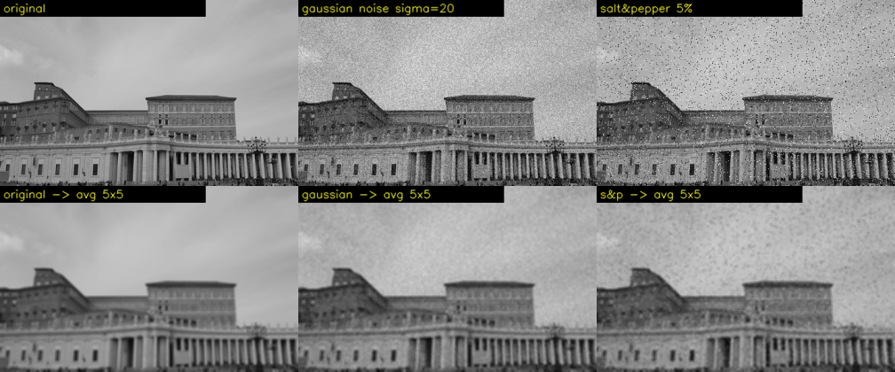

- **가우시안 잡음 → 평균**: 모래 같던 자글거림이 **얼룩덜룩한 부드러운 무늬**로 바뀌어요. 많이 나아졌지만 건물 창문과 기둥은 흐려졌습니다.
- **소금-후추 → 평균**: 날카로운 흰 점, 검은 점이 **흐릿한 회색 얼룩**으로 바뀌었을 뿐 여전히 하늘 전체에 보여요. 건물까지 흐려져서 둘 다 잃은 결과입니다.

> 📌 **평균 필터의 한계:** 이웃을 **모두 똑같이 믿고, 이상한 값도 똑같이 섞기** 때문에 생기는 문제예요. 해결 방향은 두 가지입니다.
> - 가까운 이웃을 더 믿자 → **가우시안** (다음 Step 4-3)
> - 이상한 값은 아예 빼고 판단하자 → **미디언** (Step 4-4)

### 4-2-d. 코드 해부

```python
def average_filter(image, ksize):
    rows, cols = image.shape[:2]
    dst = np.zeros((rows, cols), np.uint8)              # ← 결과를 uint8로 만듦
    center = ksize // 2                                 # 5 // 2 = 2

    for i in range(rows):                               # ← 이번에는 테두리까지 전부 순회
        for j in range(cols):
            y1, y2 = i - center, i + center + 1
            x1, x2 = j - center, j + center + 1
            if y1 < 0 or y2 > rows or x1 < 0 or x2 > cols :    # 윈도우가 밖으로 나가면
                dst[i, j] = image[i, j]                         #   원본 화소를 그대로 복사
            else:
                mask = image[y1:y2, x1:x2]
                dst[i, j] = cv2.mean(mask)[0]                   # 윈도우 평균
    return dst
```

**Part 1 `filter()`와 다른 점 세 가지:**

**① 테두리 처리가 세 번째 방식이에요.**

| 방식 | 사용하는 곳 | 테두리 결과 |
|---|---|---|
| 계산 안 함, 0으로 둠 | Part 1 `filter()` | 검은 액자 |
| 거울 패딩 | OpenCV 기본 | 추측한 값으로 블러 |
| **원본 복사** | `average_filter()` | 테두리 2픽셀만 **블러가 안 된 원본** |

실제 결과에서 첫 행을 보면 원본과 `average_filter` 결과가 `[15, 18, 22, 12, 12, 26]`으로 똑같아요.

**② 12줄의 조건을 짚고 가요.** `y2 > rows`인 이유: 슬라이싱 `y1:y2`는 y2−1행까지 쓰니까, y2 = rows까지는 괜찮고 **rows를 넘을 때만** 밖으로 나간 거예요.

**③ `cv2.mean(mask)[0]`.** Step 1-3의 `sumElems`처럼 4채널 튜플을 돌려줘서 `[0]`이 필요해요. 결과는 파이썬 float(예: 145.68)이고, uint8 칸에 넣으면서 **소수점이 버려집니다.** OpenCV는 반올림하니까, 안쪽 영역에서 두 결과를 비교하면 **71,766개 화소가 1씩 차이**가 났어요 (최대 차이 1). Step 1-3-e에서 본 버림 vs 반올림 차이와 같은 현상입니다.

### OpenCV 함수 두 개

```python
blur_img = cv2.blur(image, (5, 5), borderType=cv2.BORDER_CONSTANT)   # 23줄
box_img  = cv2.boxFilter(image, ddepth=-1, ksize=(5, 5))             # 24줄
```

| 함수 | 하는 일 | 비고 |
|---|---|---|
| `cv2.blur(src, ksize)` | k×k 평균 | `boxFilter(normalize=True)`의 줄임말 |
| `cv2.boxFilter(src, ddepth, ksize, normalize=True)` | k×k 평균 | 기본 설정에서 `blur`와 **완전히 같은 결과** (확인함) |
| `cv2.boxFilter(..., normalize=False)` | k×k **합** | 10으로 균일한 곳에 3×3 → **90** (나누지 않음) |

`normalize=False`(합)는 "주변에 흰 화소가 몇 개 있나" 세는 용도 등에 써요.

**`borderType=cv2.BORDER_CONSTANT`의 효과:** 바깥을 0(검정)으로 채우니까 테두리 윈도우에 0이 섞여서 **테두리가 어두워져요.**

```
첫 행 앞 6칸:
  원본              :  15  18  22  12  12  26
  BORDER_CONSTANT   :   8  11  13  11  12  15    ← 바깥 0이 섞여서 어두워짐
  기본 (거울 패딩)    :  19  22  23  18  21  26

첫 행 전체 평균: 원본 158.3, 거울 패딩 158.7, CONSTANT 94.9  ← 테두리 밝기가 40% 떨어짐
```

### ⚠️ 이 파일의 버그

```python
cv2.imshow("blur_img", box_img)     # 28줄  ← blur_img가 아니라 box_img를 보여줌
cv2.imshow("box_img", box_img)      # 29줄
```

Step 1-3에서 본 버그와 같은 종류예요. "blur_img" 창에도 `box_img`가 나와서 **`BORDER_CONSTANT`의 어두운 테두리를 볼 수 없습니다.** 23줄에서 일부러 테두리 옵션을 바꿔 놓고 그 결과를 보여주지 않는 거예요. 28줄을 `cv2.imshow("blur_img", blur_img)`로 고치면 테두리 차이가 보입니다.

(26, 27줄 끝의 쉼표 `cv2.imshow(...),`는 튜플을 만들 뿐 아무 영향이 없는 오타예요.)

### 4-2-e. 속도: `cv2.blur`는 필터 크기와 상관없이 빠르다

직접 짠 `average_filter`(5×5)는 340×450 이미지에 **0.148초** 걸렸어요. OpenCV와 비교하려고 2000×2000 이미지로 필터 크기를 바꿔 가며 쟀습니다.

| 필터 크기 | `cv2.blur` | `cv2.filter2D` (같은 평균 마스크) |
|---|---|---|
| 3×3 | 2.4ms | 2.9ms |
| 15×15 | 2.0ms | 40.8ms |
| 31×31 | 2.6ms | 42.3ms |
| 61×61 | 2.8ms | 43.2ms |

**`cv2.blur`는 61×61(화소 3,721개 평균)이어도 3×3과 속도가 같아요.** 비결은 **누적합(슬라이딩 합)** 트릭입니다.

```
1D, 3칸 평균, f = [10, 20, 30, 40, 50, 60]

순진한 방법: 위치마다 3개를 새로 더함
  S(1) = 10 + 20 + 30 = 60
  S(2) = 20 + 30 + 40 = 90       ← 매번 k번 덧셈

누적합 방법: 직전 합에서 "들어오는 값"을 더하고 "나가는 값"을 뺌
  S(1) = 10 + 20 + 30 = 60                (처음 한 번만 k번)
  S(2) = S(1) + 40 − 10 = 90              ← 덧셈 1번 + 뺄셈 1번
  S(3) = S(2) + 50 − 20 = 120
  S(4) = S(3) + 60 − 30 = 150
  평균: 20, 30, 40, 50
```

🧠 **창문 밖 풍경이 지나가는 기차**를 떠올리면 돼요. 한 칸 움직일 때 바뀌는 건 **새로 들어온 풍경 한 줄과 빠져나간 풍경 한 줄**뿐이니까, 그 둘만 계산하면 됩니다. 필터가 아무리 커도 화소당 연산이 일정해요.

이건 **모든 가중치가 같을 때만** 쓸 수 있는 트릭이에요. `filter2D`는 마스크 숫자가 제각각일 수 있다고 가정하니까 이 트릭을 못 씁니다. (15×15부터 시간이 약 42ms로 비슷해지는 건, OpenCV가 큰 마스크에서 계산 방식을 푸리에 변환 기반으로 바꾸기 때문이에요. chap10에서 다룹니다.)

---

## 💼 실무 연결: 평균 필터와 모아레 (AVM 탑뷰)

탑뷰를 만들 때 카메라에서 **멀리 있는 바닥은 원본 영상의 넓은 영역이 탑뷰의 작은 영역으로 압축**돼요. 이렇게 이미지를 축소할 때, 미리 블러하지 않고 화소를 듬성듬성 골라 오면 줄무늬, 체크무늬 같은 **가짜 패턴(모아레)**이 생깁니다. 촘촘한 무늬를 너무 듬성듬성 샘플링해서 생기는 **에일리어싱**이에요.

해결책은 **축소하기 전에 평균을 내는 것**입니다.
- `cv2.resize(..., interpolation=cv2.INTER_AREA)`는 축소할 때 **해당 영역의 화소를 평균**내요. 사실상 박스 필터 + 샘플링입니다.
- LUT 기반 탑뷰에서도 축소 비율이 큰 영역은 미리 블러한 영상(또는 해상도를 단계별로 줄인 영상)에서 샘플링하는 방식으로 모아레를 줄여요.

여기서도 4-2-b의 트레이드오프가 그대로 적용돼요. **블러를 세게 하면 모아레는 사라지지만 주차선이 흐려집니다.**

---

## 📋 Step 4-1, 4-2 요약

| 개념 | 한 줄 정리 |
|---|---|
| 가우시안 잡음 | **모든** 화소가 작게 흔들림 (±σ). 저조도에서 심함 |
| 소금-후추 잡음 | **일부** 화소가 0 또는 255로 튐. 죽은 화소, 전송 오류 |
| `salt_pepper_noise` | 랜덤 좌표에 반반 확률로 0/255. `copy()` 필수, 좌표는 겹칠 수 있음 |
| 평균 → 가우시안 잡음 | σ가 σ/k로 줄어듦 (실측 6.60 vs 이론 6.67) |
| 평균의 대가 | 계단 에지가 k−1칸 경사로 뭉개짐 |
| 평균 → 소금-후추 | 점이 회색 얼룩으로 번질 뿐, MAE가 오히려 나빠짐 (6.3 → 8.5) |
| 코드 | 테두리는 원본 복사 방식. `cv2.mean`은 버림이라 OpenCV와 최대 1 차이 |
| 버그 | 28줄에서 `blur_img` 대신 `box_img`를 보여줘 `BORDER_CONSTANT` 효과가 안 보임 |
| 속도 | `cv2.blur`는 누적합 덕분에 크기와 무관하게 약 2.5ms |

### ✅ 확인 질문

1. σ = 30인 가우시안 잡음을 σ = 5 이하로 줄이려면 평균 필터가 최소 몇×몇이어야 할까요? 그때 계단 에지는 몇 칸짜리 경사가 될까요?
2. 3×3 윈도우 안에 소금(255)이 **2개**, 나머지 7개가 10이면 평균은? 같은 윈도우를 **크기 순으로 정렬해서 가운데 값**을 고르면? (Step 4-4 미리 보기)
3. 누적합 트릭을 2차원 k×k 평균에 쓰려면 어떻게 하면 될까요? (힌트: 가로로 한 번, 세로로 한 번)

---

다음은 **Step 4-3: 가우시안 필터 (12.filter_gaussian.py)**입니다. 종 모양 곡선 공식을 한 단계씩 계산하고, `meshgrid`로 2D 마스크를 만드는 과정을 숫자로 출력하고, **18×6 마스크 버그**를 실제로 확인한 다음, 2D 마스크와 1D 마스크 두 번(`sepFilter2D`)이 같은 결과인 이유를 봅니다.

**"다음"**이라고 하시면 이어가고, 어려운 부분이 있으면 **"더 쉽게"**라고 해 주세요.


---

## Q9  <sub>2026-10-26T14:02:55.948Z</sub>

> 다음
>
> 다음


### A9

Gaussian 파일에서 `cv2.GaussianBlur`의 네 번째 인자가 무시되는 함정을 새로 확인했어요. 비교 이미지를 다시 만들어서 확인하겠습니다.

# Part 4 · Step 4-3. 가우시안 필터: [chap07/12.filter_gaussian.py](chap07/12.filter_gaussian.py)

이번 Step은 Part 4의 핵심이에요. 가우시안 공식을 한 단계씩 계산하고, 코드에 있는 **버그 두 개**를 실행해서 확인합니다. 하나는 계획 때 미리 찾은 18×6 마스크 버그이고, 다른 하나는 이번에 새로 찾은 `cv2.GaussianBlur` 인자 버그예요.

---

## 🔁 지난 확인 질문 답

**1번. σ = 30을 5 이하로 줄이려면?**

```
σ / k ≤ 5  →  k ≥ 30 / 5 = 6  →  홀수여야 하니까 7×7
결과: 30 / 7 ≈ 4.29 ✓
대가: 계단 에지가 k − 1 = 6칸짜리 경사로가 됨
```

(6×6도 계산상 딱 5가 되지만, 짝수 크기는 중심 화소가 없어서 쓰지 않아요. 이 Step의 버그 ①이 바로 짝수 크기 때문에 생기는 문제입니다.)

**2번. 소금 2개(255) + 10이 7개**

```
평균:  (255 × 2 + 10 × 7) / 9 = (510 + 70) / 9 = 64.4     ← 소금 2개에 끌려서 6배 밝아짐
정렬:  10  10  10  10  [10]  10  10  255  255
                       ↑ 9개 중 5번째 = 가운데 값 = 10   ← 소금을 완전히 무시
```

가운데 값을 고르는 방법이 Step 4-4의 **미디언 필터**예요. 극단값이 섞여도 결과가 흔들리지 않습니다.

**3번. 누적합을 2차원으로**

```
① 가로 방향으로 누적합 → 각 화소에 "가로 k칸의 합"
② 그 결과에 세로 방향으로 누적합 → "k×k칸의 합"
③ k²로 나누기
```

k×k 합 = (가로 k칸 합)을 세로로 k개 더한 것이니까 두 번 나눠서 할 수 있어요. 이렇게 **가로 한 번, 세로 한 번으로 쪼개는 생각**이 이번 Step의 핵심인 **분리 가능성**과 같은 아이디어입니다.

> 💡 비슷한 방법으로 **적분 영상**(`cv2.integral`)도 있어요. 모든 위치에 "왼쪽 위 구석부터 여기까지의 합"을 미리 저장해 두면, 어떤 사각형의 합이든 **값 4개를 더하고 빼서** 바로 구할 수 있습니다.

---

## 4-3-a. 아이디어: 가까운 이웃일수록 더 믿자

평균 필터는 이웃 9개(또는 25개)를 **모두 똑같이** 믿었어요. 그런데 상식적으로 바로 옆 화소가 두세 칸 떨어진 화소보다 나와 비슷할 가능성이 높겠죠.

🧠 **모닥불 비유:** 모닥불 바로 옆은 뜨겁고, 멀어질수록 미지근해지다가, 어느 거리부터는 거의 느껴지지 않아요. 가우시안 마스크는 중심이 모닥불인 **"열기 지도"**입니다. 가까운 화소는 결과에 많이 반영되고, 먼 화소는 조금만 반영돼요.

가중치를 옆에서 본 모양(1D)으로 비교하면:

```
 평균 필터 (5칸)                  가우시안 (5칸, σ=1)
 가중치                            가중치
 0.40 |                           0.40 |        █
      |                                |        █
 0.20 | █  █  █  █  █              0.24 |     █  █  █
      | █  █  █  █  █                   |     █  █  █
 0.05 | █  █  █  █  █              0.05 |  ▄  █  █  █  ▄
      +──────────────────               +──────────────────
       −2 −1  0 +1 +2                    −2 −1  0 +1 +2
 "모두 똑같이 0.2"                  "가운데 0.40, 끝은 0.05"
 끝에서 뚝 끊김 (사각형 모양)         부드럽게 줄어듦 (종 모양)
```

---

## 4-3-b. 1D 가우시안 공식을 한 단계씩 📐

```
                1              x²
G(x) = ──────────── · exp( − ──── )
         √(2π) · σ             2σ²
```

처음 보면 무섭지만, **실제로 중요한 부분은 오른쪽 `exp(−x²/2σ²)`뿐**이에요. 앞의 분수는 곧 사라집니다 (아래에서 설명).

### σ = 1, x = −2 ~ +2로 계산해 보기

| 단계 | x = −2 | x = −1 | x = 0 | x = +1 | x = +2 |
|---|---|---|---|---|---|
| ① x² | 4 | 1 | 0 | 1 | 4 |
| ② x² / (2σ²) = x² / 2 | 2 | 0.5 | 0 | 0.5 | 2 |
| ③ exp(−②) | **0.1353** | **0.6065** | **1.0000** | **0.6065** | **0.1353** |
| ④ ÷ 합계 (2.4837) | **0.0545** | **0.2442** | **0.4026** | **0.2442** | **0.0545** |

**단계별 의미:**
- ① **x²**: 중심에서 떨어진 거리의 제곱이에요. 왼쪽(−)과 오른쪽(+)을 똑같이 취급해서 좌우 대칭이 됩니다.
- ② **÷ 2σ²**: 거리를 σ 단위로 잽니다. σ가 크면 같은 거리도 "가깝다"고 판단해요.
- ③ **exp(−…)**: 0이면 1이 되고, 커질수록 빠르게 0에 가까워집니다. 중심은 1, 1칸 떨어지면 0.61, 2칸 떨어지면 0.14예요.
- ④ **정규화**: ③의 합은 0.1353 + 0.6065 + 1 + 0.6065 + 0.1353 = 2.4837이에요. 모든 값을 이걸로 나누면 **합이 1**이 됩니다. Part 1의 원소 합 규칙대로 밝기를 유지하려는 거예요.

`cv2.getGaussianKernel(5, 1)`을 실행하면 `[0.0545, 0.2442, 0.4026, 0.2442, 0.0545]`이 나와서 **손계산과 정확히 같습니다.**

> 💡 **앞의 분수 1/(√(2π)σ)가 사라지는 이유**
> 이 분수는 모든 x에 **똑같이 곱해지는 상수**예요. ④에서 합계로 나누면 분자와 분모에 똑같이 들어 있어서 약분됩니다. 그래서 실제로는 ③까지만 계산하고 정규화하면 돼요. 코드 11줄의 `ratio`도 같은 이유로 결과에 아무 영향이 없습니다.

### σ는 "얼마나 넓게 퍼지나"를 정하는 손잡이

같은 x에서 σ만 바꿔서 ③(정규화 전 값)을 계산한 결과:

| x | −3 | −2 | −1 | 0 | +1 | +2 | +3 |
|---|---|---|---|---|---|---|---|
| σ = 0.5 | 0.0000 | 0.0003 | 0.1353 | 1 | 0.1353 | 0.0003 | 0.0000 |
| σ = 1 | 0.0111 | 0.1353 | 0.6065 | 1 | 0.6065 | 0.1353 | 0.0111 |
| σ = 2 | 0.3247 | 0.6065 | 0.8825 | 1 | 0.8825 | 0.6065 | 0.3247 |

```
σ=0.5  ▁ ▁ ▂ █ ▂ ▁ ▁     거의 중심만 반영 → 약한 블러
σ=1    ▁ ▂ ▅ █ ▅ ▂ ▁     ±2칸까지 의미 있음
σ=2    ▃ ▅ ▇ █ ▇ ▅ ▃     ±3칸도 많이 반영 → 강한 블러 (마스크도 더 커야 함)
```

**마스크 크기는 얼마로 잡아야 할까요?** 가우시안 값은 이론상 끝없이 이어지지만, **±3σ** 밖은 거의 0이에요 (넓이의 99.7%가 ±3σ 안에 있음). 그래서 보통 **마스크 크기 ≈ 6σ + 1**로 잡습니다.
- σ = 1 → 7칸
- σ = 2 → 13칸

---

## 4-3-c. 2D 가우시안과 `meshgrid` 📐

### 공식: 2D = 1D × 1D

```
G(x, y) ∝ exp( −x²/(2σx²) − y²/(2σy²) )
        = exp( −x²/(2σx²) ) × exp( −y²/(2σy²) )      ← 지수법칙 eᵃ⁺ᵇ = eᵃ × eᵇ
        =       G(x)        ×       G(y)
```

**2D 가우시안은 가로 1D와 세로 1D의 곱**입니다. 이 성질이 4-3-g의 속도 비결이에요.

σx = σy이면 값이 x² + y² = r²(중심까지 거리의 제곱)에만 달려서 **동심원 모양**이 됩니다. 어느 방향으로든 공평하게 블러해요 (Part 3의 등방성).

### 코드 방식(`meshgrid`)으로 작은 마스크를 직접 만들기

`getGaussianMask()`가 하는 일을 **5×3 크기, σ = 1**로 따라가 볼게요. 출력이 작아야 보기 쉬우니까 이 크기를 골랐고, 18×6 버그도 일단 고친 버전으로 계산합니다.

**① 좌표 1D 배열 만들기**

```
x = arange(0, 5) − 5//2 = [0,1,2,3,4] − 2 = [−2, −1, 0, 1, 2]
y = arange(0, 3) − 3//2 = [0,1,2]     − 1 = [−1,  0, 1]
```

**② `np.meshgrid(x, y)`: 1D 두 개를 2D 격자 두 장으로**

```
x 격자 (각 칸의 x 좌표)          y 격자 (각 칸의 y 좌표)
 −2  −1   0   1   2              −1  −1  −1  −1  −1
 −2  −1   0   1   2               0   0   0   0   0
 −2  −1   0   1   2               1   1   1   1   1
 (x 배열을 세로로 3번 복사)        (y 배열을 가로로 5번 복사)
```

두 격자를 겹치면 칸마다 (x, y) 좌표가 생겨요. 예: 왼쪽 위 칸 = (−2, −1). 이렇게 해 두면 반복문 없이 **모든 칸을 한 번에** 계산할 수 있습니다.

**③ `v1 = x²/(2σx²)`, `v2 = y²/(2σy²)`**

```
v1                               v2
 2    0.5   0   0.5   2          0.5  0.5  0.5  0.5  0.5
 2    0.5   0   0.5   2          0    0    0    0    0
 2    0.5   0   0.5   2          0.5  0.5  0.5  0.5  0.5
```

**④ `exp(−(v1 + v2))`**

```
 0.0821  0.3679  0.6065  0.3679  0.0821
 0.1353  0.6065  1.0000  0.6065  0.1353     ← 가운데 행 = 1D 가우시안 (4-3-b의 ③)
 0.0821  0.3679  0.6065  0.3679  0.0821
```

**⑤ `ratio` 곱하기** (1/(2π) = 0.1592): 결과 합이 0.8748이에요. 1이 아닌 이유는 마스크가 가우시안의 **가운데 부분만 잘라 낸 것**이라서예요.

**⑥ `/ np.sum(mask)`: 합이 1이 되게 정규화**

```
 0.0149  0.0669  0.1103  0.0669  0.0149
 0.0246  0.1103  0.1819  0.1103  0.0246     ← 합 = 1
 0.0149  0.0669  0.1103  0.0669  0.0149
```

**검증:** `getGaussianKernel(3, 1)`(세로) × `getGaussianKernel(5, 1)`(가로)의 외적을 계산하면 **위 행렬과 소수점 넷째 자리까지 똑같아요.** 2D = 1D × 1D를 숫자로 확인한 겁니다.

> 🔗 **Part 1 퀴즈 1번의 정체**
> ```
> 1/16  2/16  1/16       [1/4]
> 2/16  4/16  2/16   =   [2/4]  ×  [1/4, 2/4, 1/4]
> 1/16  2/16  1/16       [1/4]
> ```
> `cv2.getGaussianKernel(3, 0)`이 정확히 `[0.25, 0.5, 0.25]`를 돌려줘요. 그 마스크는 **OpenCV의 3×3 가우시안 블러 그 자체**였습니다.

---

## 4-3-d. σ를 0으로 주면? 자동 계산 공식

코드 4줄과 OpenCV 함수들은 σ ≤ 0이면 크기로부터 σ를 자동으로 계산합니다.

```
σ = 0.3 × ((ksize − 1) × 0.5 − 1) + 0.8
```

| ksize | 계산 과정 | σ |
|---|---|---|
| 3 | 0.3 × (1 − 1) + 0.8 | 0.8 |
| 5 | 0.3 × (2 − 1) + 0.8 | 1.1 |
| 7 | 0.3 × (3 − 1) + 0.8 | 1.4 |
| 9 | 0.3 × (4 − 1) + 0.8 | 1.7 |
| 17 | 0.3 × (8 − 1) + 0.8 | **2.9** |

마스크 크기의 절반((ksize−1)/2)이 대략 **2.5 ~ 3σ**가 되도록 맞춘 경험식이에요. 6σ+1 규칙과 비슷한 비율입니다.

### OpenCV의 숨은 규칙: 7 이하 크기는 고정 표를 쓴다

실행해 보니 `cv2.getGaussianKernel(k, 0)`은 **k ≤ 7일 때 공식 대신 미리 정해 둔 표**를 씁니다.

| k | `getGaussianKernel(k, 0)` 결과 | 정체 |
|---|---|---|
| 3 | `[0.25, 0.5, 0.25]` | [1, 2, 1] / 4 |
| 5 | `[0.0625, 0.25, 0.375, 0.25, 0.0625]` | **[1, 4, 6, 4, 1] / 16** |
| 7 | `[0.0312, 0.1094, 0.2188, 0.2812, ...]` | [2, 7, 14, 18, 14, 7, 2] / 64 |
| 9 | `[0.0156, 0.0508, 0.1172, ...]` | 공식 (σ = 1.7) |

[1, 4, 6, 4, 1]은 **파스칼의 삼각형** 다섯째 줄이에요. 이런 이항 계수는 정수라서 계산이 빠르고, 가우시안과 거의 같은 모양입니다. 공식으로 σ = 1.1을 넣으면 `[0.0708, 0.2445, 0.3695, ...]`이 나와서 표와 약간 달라요. 이 작은 차이가 아래 4-3-f에서 "고친 img1"과 img3이 0.11만큼 다른 이유입니다.

---

## 4-3-e. 가우시안 vs 평균: 무엇이 더 좋은가?

**잡음 감소** (σ = 20 잡음, 4-2-a와 같은 실험):

| 필터 | 남은 잡음 σ |
|---|---|
| 평균 3×3 | 6.60 |
| 가우시안 σ = 1 | 5.58 |
| 가우시안 σ = 1.5 | 3.72 |

**에지 모양** (0 → 100 계단, 실행값):

```
위치            :   6     7     8     9    10    11    12    13
평균 3×3        :   0     0     0  33.3  66.7   100   100   100     ← 꺾인 직선 경사
가우시안 σ=1    :   0   0.5   5.9  30.1  69.9  94.1  99.5   100     ← 부드러운 S자
평균 5×5        :   0     0    20    40    60    80   100   100
가우시안 σ=1.5  : 0.9   4.5  15.4  36.7  63.3  84.6  95.5  99.1
```

```
 평균: 모서리가 꺾임              가우시안: 부드러운 S자
 100|        ●───●               100|          ●──●
    |      ●                        |        ●
    |    ●                          |      ●
   0|●──●                          0|●──●
```

**솔직한 결론:** 잡음과 에지 선명도만 보면 둘 중 누가 압도적으로 낫다고 하기 어려워요 (σ를 어떻게 잡느냐에 따라 달라짐). 가우시안이 표준이 된 진짜 이유는 다른 데 있습니다.

| 가우시안의 장점 | 설명 |
|---|---|
| **자연스러움** | 가중치가 끝에서 뚝 끊기지 않아서 사각형 모양의 블러 자국이 안 생김. 렌즈의 초점 흐림도 가우시안과 비슷함 |
| **등방성** | σx = σy이면 동심원 → 어느 방향으로나 공평하게 블러 (평균은 사각형이라 대각선 방향이 더 넓음) |
| **분리 가능** | 2D = 1D × 1D → 아주 빠름 (4-3-g) |
| **겹쳐도 가우시안** | σ₁ 블러 후 σ₂ 블러 = σ = √(σ₁² + σ₂²) 블러 한 번. Part 5 DoG와 이미지 피라미드의 바탕 |
| **미분과 잘 맞음** | 가우시안을 미분해도 매끄러운 모양 → 소벨, LoG, 캐니의 기반 (Part 5, 6) |

---

## 4-3-f. 코드 해부와 버그 두 개 ⚠️

```python
ksize = (17, 5)                                        # 크기는 가로x세로로 표현   ← 20줄
```

**OpenCV의 크기 순서는 (가로, 세로) = (x, y)**예요. numpy `shape`의 (행, 열) = (세로, 가로)와 **반대**입니다. (17, 5)는 가로 17칸, 세로 5칸, 즉 **옆으로 긴 마스크**예요. 가로 방향으로 더 많이 흐려집니다.

```python
gaussian_2d = getGaussianMask(ksize, 0, 0)                          # 21줄: 직접 만든 2D 마스크
gaussian_1dX = cv2.getGaussianKernel(ksize[0], 0, cv2.CV_32F)       # 22줄: 가로 1D (17칸)
gaussian_1dY = cv2.getGaussianKernel(ksize[1], 0, cv2.CV_32F)       # 23줄: 세로 1D (5칸)

gauss_img1 = cv2.filter2D(image, -1, gaussian_2d)                   # 25줄: 방법 ① 2D 마스크
gauss_img2 = cv2.GaussianBlur(image, (0,0), 10.7, 1.3)              # 26줄: 방법 ② OpenCV 함수
gauss_img3 = cv2.sepFilter2D(image, -1, gaussian_1dX, gaussian_1dY) # 27줄: 방법 ③ 1D 두 번
```

세 방법으로 같은 블러를 만들어 비교하려는 의도인데, **①과 ②에 각각 버그**가 있어요.

### 버그 ①: `arange(0, ksize+1)` → 17×5가 아니라 18×6 마스크

```python
x = np.arange(0, ksize[0]+1, 1) - ksize[0] // 2      # 8줄
y = np.arange(0, ksize[1]+1, 1) - ksize[1] // 2      # 9줄
```

`np.arange(0, n)`은 0부터 **n−1까지**, 모두 n개를 만듭니다 (슬라이싱처럼 끝을 포함하지 않음). 그런데 여기서 `+1`을 붙여서 하나가 더 생겼어요.

```
의도: arange(0, 17) − 8 = [−8, −7, ..., 0, ..., 7, 8]       → 17개, 0이 정중앙 (9번째)
실제: arange(0, 18) − 8 = [−8, −7, ..., 0, ..., 7, 8, 9]    → 18개, 오른쪽에 9가 하나 더
       y도: [−2, −1, 0, 1, 2, 3]                           → 6개, 아래에 3이 하나 더
```

실행해서 확인한 결과:

```
마스크 모양: (6, 18)   ← 의도는 (5, 17)
가장 큰 값 위치: (행 2, 열 8)
가운데 행: [0.0011 0.0027 ... 0.0476 0.0505 0.0476 ... 0.0027 0.0011 0.0004]
                                     ↑ 최댓값 (인덱스 8)                ↑ 덤으로 붙은 칸
```

**왜 문제일까요?** 짝수 크기 마스크는 **중심 화소가 없어요.** `filter2D`는 이럴 때 `(가로//2, 세로//2)` = **(9, 3)**을 중심으로 삼습니다. 그런데 가우시안의 실제 최댓값은 (8, 2)에 있어요.

```
filter2D가 생각하는 중심: (열 9, 행 3)
가우시안의 실제 중심:    (열 8, 행 2)   ← 왼쪽 위로 1칸 어긋남

→ 결과 화소가 원본보다 1칸 위, 1칸 왼쪽 화소를 중심으로 블러됨
→ 결과 이미지 전체가 오른쪽 아래로 1픽셀 밀림
```

**증명:** img1과 img3(올바른 결과)의 차이를 구하고, img3을 한 칸씩 밀어 가며 다시 비교했어요.

| img3을 민 방향 | 평균 차이 |
|---|---|
| 그대로 | 4.91 |
| **오른쪽 1, 아래 1** | **0.20** ← 거의 일치 |
| 그 밖의 방향 | 2.5 ~ 9.2 |

그리고 `+1`을 지운 **고친 버전**은 img3과의 차이가 **0.11**밖에 안 돼요 (남은 차이는 4-3-d의 표 vs 공식 차이).

**수정 방법:** 8, 9줄에서 `+1`을 지우면 됩니다.

```python
x = np.arange(0, ksize[0], 1) - ksize[0] // 2
y = np.arange(0, ksize[1], 1) - ksize[1] // 2
```

### 버그 ②: `cv2.GaussianBlur`의 네 번째 위치 인자는 `sigmaY`가 아니다

Part 2 소벨, Part 3 라플라시안과 **같은 종류의 함정**이 또 있었어요. 시그니처를 출력해 보면:

```
GaussianBlur(src, ksize, sigmaX[, dst[, sigmaY[, borderType[, hint]]]]) -> dst
                                  ↑ 네 번째는 dst
```

그래서 `cv2.GaussianBlur(image, (0,0), 10.7, 1.3)`의 **1.3은 sigmaY가 아니라 dst로 들어가서 무시됩니다.** sigmaY를 안 주면 sigmaX와 같은 값을 쓰니까 실제로는 **σx = σy = 10.7**이에요. 실험으로 확인:

| 비교 | 결과가 같나? |
|---|---|
| `GaussianBlur(img, (0,0), 10.7, 1.3)` vs `GaussianBlur(img, (0,0), 10.7)` | ✅ **같음** (1.3이 무시됨) |
| `GaussianBlur(img, (0,0), 10.7, 1.3)` vs `GaussianBlur(img, (65,65), 10.7)` | ✅ **같음** |
| `GaussianBlur(img, (0,0), 10.7, 1.3)` vs `GaussianBlur(img, (0,0), 10.7, sigmaY=1.3)` | ❌ 다름 |

ksize가 (0, 0)이면 OpenCV가 σ로부터 크기를 정하는데, 8비트 이미지는 약 **6σ + 1** = 65가 돼요. 결국 이 줄은 **65×65 원형 블러**를 하고 있었습니다. 의도한 건 옆으로 긴 블러(가로 σ 10.7, 세로 σ 1.3)였을 거예요. 올바르게 고치면 `sigmaY=1.3`(키워드)을 쓰고, 이때 실제 크기는 65×9입니다 (확인함).

> ⚠️ 고쳐도 img2는 σ = (10.7, 1.3)이라서 img1, img3(σ = 2.9, 1.1)과 **같은 필터가 아니에요.** 세 결과가 같을 거라고 기대하면 안 됩니다. img2는 "가로로 아주 강하게 흐리는" 다른 예시로 보면 돼요.

### 📌 OpenCV 위치 인자 함정 모음 (지금까지 찾은 것)

| 함수 | 시그니처 | 잘못 쓴 곳 | 무시된 값 |
|---|---|---|---|
| `cv2.Sobel` | `(src, ddepth, dx, dy, dst, ksize, ...)` | 05, 08, **17** | ksize (17번은 5를 의도) |
| `cv2.Laplacian` | `(src, ddepth, dst, ksize, ...)` | 06, **07** | ksize (07번은 9를 의도) |
| `cv2.GaussianBlur` | `(src, ksize, sigmaX, dst, sigmaY, ...)` | **12** | sigmaY (1.3을 의도) |

**공통 원인:** OpenCV 파이썬 함수는 출력 배열 `dst`를 **선택 인자 맨 앞**에 둬요. 그래서 "그다음 옵션"을 위치로 넘기면 `dst` 자리로 들어갑니다. **선택 인자는 항상 이름=값으로 쓰세요.**

### 나머지 줄

```python
titles = ['image','gauss_img1','gauss_img2','gauss_img3']   # 29줄
[cv2.imshow(t, eval(t)) for t in titles]                     # 30줄
```

`eval('gauss_img1')`은 문자열을 코드로 실행해서 **그 이름의 변수 값**을 가져와요. 창 이름과 변수 이름을 맞춰 두면 한 줄로 끝나는 트릭이지만, `eval`은 임의의 코드를 실행할 수 있어서 실무에서는 피하는 게 좋습니다. 딕셔너리를 쓰면 같은 일을 안전하게 할 수 있어요.

```python
results = {'image': image, 'gauss_img1': gauss_img1, ...}
for name, img in results.items(): cv2.imshow(name, img)
```

---

## 4-3-g. 분리 가능성 = 속도 📐

```
2D 마스크 17×5를 직접 적용: 화소마다 17 × 5 = 85번 곱셈
1D 두 번 (가로 17 → 세로 5): 화소마다 17 + 5 = 22번 곱셈   ← 약 4배 적음
```

먼저 가로로 17칸 가우시안을 하고, 그 결과에 세로로 5칸 가우시안을 하면 **2D 마스크를 한 번 쓴 것과 결과가 같아요** (4-3-c에서 2D = 1D × 1D를 확인했죠). 실제로 `sepFilter2D` 결과와 외적 2D 마스크를 `filter2D`에 넣은 결과의 차이는 **0.00**이었습니다.

2000×2000 이미지, 17×5 가우시안 속도:

| 방법 | 시간 |
|---|---|
| `filter2D` (2D 마스크) | 32.5ms |
| `sepFilter2D` (1D 두 번) | 3.4ms |
| `GaussianBlur` | **1.1ms** (내부적으로 분리 + 정수 연산 최적화) |

마스크가 클수록 차이가 커져요. 65×65면 4,225번 대 130번, **32배**입니다.

---

## 4-3-h. 실제 이미지 결과 🖼️

6장 비교 (위: 원본 / img1 코드 그대로(18×6 버그) / img1 고친 버전, 아래: img2 코드 그대로(sigmaY 무시) / img2 고친 버전 / img3):
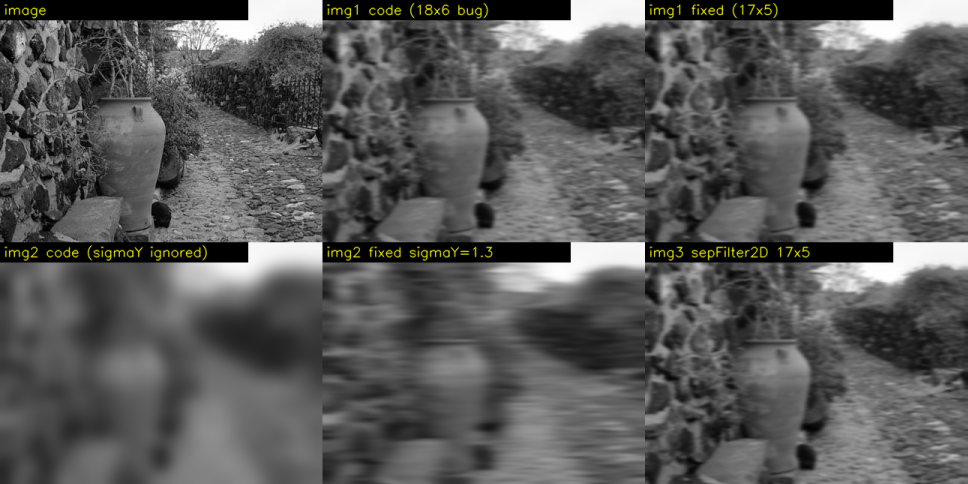

[chap07/images/smoothing.jpg](chap07/images/smoothing.jpg)는 돌담 골목과 항아리 사진이에요.

1. **img1 (버그)와 img1 (고침), img3**: 셋 다 **가로로 살짝 더 흐린** 블러예요 (17×5). 버그 버전은 1픽셀 밀려 있지만 눈으로는 구별하기 어렵습니다. 그래서 이런 버그는 **숫자로 비교해야** 찾을 수 있어요.
2. **img2 (코드 그대로)**: 65×65 원형 블러라서 **형체만 남을 정도로 뭉개져요.** 돌담, 항아리, 나무가 모두 덩어리로만 보입니다.
3. **img2 (고친 버전)**: 가로로만 강하게 흐려져서 **옆으로 빠르게 움직이며 찍은 사진(모션 블러)**처럼 보여요. 세로 구조(항아리 윤곽의 위아래)는 어느 정도 남아 있습니다. 26줄의 원래 의도가 이 결과였을 거예요.

---

## 💼 실무 연결 (AVM)

- **캐니 전처리**: 주차선 검출에서 에지를 찾기 전에 가우시안 블러로 아스팔트 질감과 센서 잡음을 누릅니다. 08번 캐니 코드의 첫 줄도 `GaussianBlur`예요 (Part 6).
- **가우시안 피라미드**: 블러 → 절반 축소를 반복한 영상 묶음(`cv2.pyrDown`)이에요. 탑뷰에서 멀리 있는 바닥처럼 많이 축소되는 영역은 적당히 작은 단계의 영상에서 샘플링해서 **모아레를 줄입니다** (GPU 텍스처의 밉맵과 같은 원리). 4-2의 박스 필터보다 가우시안이 자연스러운 결과를 내요.
- **방향별 σ**: 12번처럼 σx ≠ σy로 주면 한 방향으로만 블러할 수 있어요. 탑뷰 LUT에서 영역마다 가로, 세로 축소 비율이 다를 때 방향별 블러 강도를 다르게 줄 수 있습니다.

---

## 📋 Step 4-3 요약

| 개념 | 한 줄 정리 |
|---|---|
| 아이디어 | 가까운 이웃일수록 더 믿는 가중 평균 (모닥불 열기 지도) |
| 1D 공식 | exp(−x²/2σ²) 계산 → 합이 1이 되게 정규화. 앞의 상수는 약분되어 사라짐 |
| σ | 퍼짐 정도. 마스크 크기 ≈ 6σ + 1 |
| 2D | G(x, y) = G(x) × G(y). `meshgrid`로 좌표 격자를 만들어 한 번에 계산 |
| 자동 σ | 0.3 × ((k − 1) × 0.5 − 1) + 0.8. OpenCV는 k ≤ 7이면 이항 계수 표 사용 |
| 평균과 비교 | 잡음 감소는 비슷하고, 진짜 장점은 자연스러움, 등방성, 분리 가능성 |
| 버그 ① | `arange(0, k+1)` → 18×6 짝수 마스크 → 이미지가 1픽셀 밀림 (차이 4.91 → 밀면 0.20) |
| 버그 ② | `GaussianBlur(img, (0,0), 10.7, 1.3)`의 1.3은 dst로 들어감 → 65×65 원형 블러 |
| 속도 | 1D 두 번 = 2D 한 번. 85번 → 22번 곱셈, 32.5ms → 3.4ms |

### ✅ 확인 질문

1. σ = 3인 가우시안에는 마스크 크기를 대략 얼마로 잡아야 할까요? 그 크기에서 2D 마스크와 분리 방식의 곱셈 횟수는 각각 몇 번일까요?
2. σ = 3 블러를 한 다음 σ = 4 블러를 한 번 더 하면, σ가 얼마인 블러 한 번과 같을까요?
3. 4방향 라플라시안 `[0,1,0 / 1,−4,1 / 0,1,0]`은 분리 가능할까요? (힌트: 1D 두 개의 외적으로 만들 수 있나? Step 3-2-a의 유도를 떠올려 보세요.)

---

다음은 **Step 4-4 미디언 필터 (11), 4-5 최소/최대 필터 (09), 4-6 Part 4 정리**입니다. 정렬해서 가운데 값을 고르는 방법이 왜 소금-후추 잡음을 거의 완벽하게 지우면서 에지는 그대로 두는지 숫자로 보여 드리고, 최소/최대 필터가 Part 7 모폴로지로 어떻게 이어지는지도 봅니다.

**"다음"**이라고 하시면 이어가고, 어려운 부분이 있으면 **"더 쉽게"**라고 해 주세요.


---

## Q10  <sub>2026-10-26T14:06:58.697Z</sub>

> 다음
>
> 다음
>
> 다음
>
> 다음
>
> 다음


### A10

# Part 4 · Step 4-4 ~ 4-6. 미디언 필터, 최소/최대 필터, Part 4 정리

이번에는 **비선형 필터**를 다룹니다. 지금까지 본 필터(평균, 가우시안, 소벨, 라플라시안)는 전부 "곱하고 더하는" 회선이었어요. 이번 필터들은 곱하지 않고 **줄을 세워서 순서로 고릅니다.** 이번에도 숫자는 전부 실행해서 확인했어요.

---

## 🔁 지난 확인 질문 답

**1번. σ = 3이면?**

```
크기 ≈ 6σ + 1 = 19  →  19×19
2D 마스크:  19 × 19 = 361번 곱셈
분리 방식:  19 + 19 =  38번 곱셈   (약 9.5배 적음)
```

**2번. σ = 3 블러 후 σ = 4 블러는?**

```
σ = √(3² + 4²) = √(9 + 16) = √25 = 5
```

블러를 두 번 하면 σ가 더해지는 게 아니라 **σ²이 더해집니다.** (3 + 4 = 7이 아니라 5!) Step 4-2-a에서 잡음이 √N으로 줄었던 것과 같은 "제곱의 합" 원리예요. Part 5의 DoG에서 다시 씁니다.

**3번. 4방향 라플라시안은 분리 가능할까?**
**하나의 외적으로는 안 돼요.** 이 마스크의 행렬 랭크(rank)를 구해 보면 **2**예요 (1D 두 개의 외적은 항상 랭크 1). 대신 Step 3-2-a에서 유도한 대로 **분리 가능한 마스크 두 개의 합**이에요.

```
  0  1  0       0  0  0       0  1  0
  1 −4  1   =   1 −2  1   +   0 −2  0
  0  1  0       0  0  0       0  1  0
              (가로 [1,−2,1])  (세로 [1,−2,1]ᵀ)
```

그래서 가로 2차 미분과 세로 2차 미분을 따로 구해서 더하면 빠르게 계산할 수 있어요.

---

## Step 4-4. 미디언 필터: [chap07/11.filter_median.py](chap07/11.filter_median.py)

### 4-4-a. 아이디어: 다수결 같은 "가운데 값"

윈도우 안 화소들을 **크기 순으로 줄 세우고 가운데 값**을 고릅니다. 수학 계산 없이 줄만 세우면 끝이에요.

🧠 **비유: 반 평균 키 vs 반 중간 키.** 우리 반 30명 평균 키가 172cm인데, 농구 선수 출신 전학생(220cm) 한 명이 오면 평균이 173.5cm로 올라가요. 하지만 키 순서로 줄 세웠을 때 **가운데 서 있는 사람의 키**는 거의 그대로입니다. 극단적인 한 명은 줄의 맨 끝에 설 뿐, 가운데까지 영향을 주지 못해요.

### 4-4-b. 손계산 ✍️: 소금 개수를 늘려 가며 실험

3×3 윈도우(9칸)에 255(소금)가 k개, 나머지는 10일 때 (실행값):

| 소금 개수 k | 정렬 결과 (가운데 = 5번째) | 평균 | **미디언** |
|---|---|---|---|
| 0 | 10 10 10 10 **10** 10 10 10 10 | 10.0 | **10** |
| 1 | 10 10 10 10 **10** 10 10 10 255 | 37.2 | **10** |
| 2 | 10 10 10 10 **10** 10 10 255 255 | 64.4 | **10** |
| 3 | 10 10 10 10 **10** 10 255 255 255 | 91.7 | **10** |
| 4 | 10 10 10 10 **10** 255 255 255 255 | 118.9 | **10** |
| 5 | 10 10 10 10 **255** 255 255 255 255 | 146.1 | **255** ❌ |

- **평균**은 소금이 하나만 들어와도 37로 흔들리고, 개수에 비례해서 계속 올라가요.
- **미디언**은 소금이 **4개(절반 미만)**까지는 정확히 10을 지킵니다. 5개 이상, 즉 절반을 넘으면 그때 처음 무너져요.

> 📌 **미디언의 버티는 힘:** 윈도우 n칸 중 이상값이 **(n−1)/2개 이하**면 결과가 흔들리지 않아요. 3×3이면 4개, 5×5면 12개까지 버팁니다. 이런 성질을 **강건하다**(robust)고 해요.

### 4-4-c. 놀라운 점: 에지가 그대로 남는다

Part 1의 세로 경계(10 | 100)에 3×3 미디언과 평균을 비교하면 (실행값):

```
원본 i=2 행 :   10    10    10   100   100
             (중심 j=1, 2, 3만 비교)

중심 (2,2):  윈도우 = [10 10 100] × 3줄  →  정렬: 10 10 10 10 10 10 100 100 100
                                                       ↑ 가운데 = 10
중심 (2,3):  윈도우 = [10 100 100] × 3줄 →  정렬: 10 10 10 100 100 100 100 100 100
                                                       ↑ 가운데 = 100

미디언 결과 :    10    10   100        ← 원본과 똑같음! 계단 그대로
평균 결과   :    10    40    70        ← 경사로로 뭉개짐
```

**미디언은 출력값으로 반드시 윈도우 안에 실제로 있는 값을 고릅니다.** 10과 100 사이의 40, 70 같은 "섞인 값"을 만들지 않아요. 그래서 경계 양쪽 중 **다수 쪽 값**을 그대로 가져오고, 계단이 무너지지 않습니다.

```
          잡음 제거                   에지 보존
평균      ✅ (가우시안 잡음)             ❌ 뭉갬
미디언    ✅ (소금-후추 잡음, 탁월)       ✅ 그대로 유지
```

### 4-4-d. 대가: 가는 선과 모서리가 사라진다

미디언이 만능은 아니에요. **다수결이라서 소수파 구조는 잡음과 함께 지워집니다.**

**1픽셀 두께의 밝은 선** (10 배경에 200 세로선, 실행값):

```
원본 행    :   10    10    10   200    10    10    10
미디언 3×3 :    -    10    10    10    10    10     -     ← 선이 완전히 사라짐!
평균 3×3   :   10    10    73    73    73    10    10     ← 흐려졌지만 남아 있음
```

선 위의 화소에서 3×3 윈도우를 보면 200은 **3개**(세로로 한 줄)뿐이고 10이 6개예요. 다수결에서 지니까 10이 됩니다.

**모서리** (오른쪽 아래 100 사각형):

```
원본                        미디언 3×3
 10  10  10  10  10  10      10  10  10  10  10  10
 10  10  10  10  10  10      10  10  10  10  10  10
 10  10 100 100 100 100      10  10 [10] 100 100 100    ← 모서리 화소 하나가 깎임
 10  10 100 100 100 100      10  10 100 100 100 100
```

모서리 화소 (2,2)의 윈도우에는 100이 4개, 10이 5개라서 10이 이겨요. **직각 모서리가 둥글게 깎입니다.**

> AVM 관점에서 보면, 멀리 있는 **가는 주차선**(탑뷰에서 1~2픽셀 두께)은 미디언 필터에 지워질 수 있어요. 필터 크기를 **지키고 싶은 가장 가는 구조보다 작게** 골라야 합니다.

### 4-4-e. 실제 이미지 실험: 잡음 양에 따라

`median2.jpg`에 소금-후추 잡음 비율을 바꿔 가며 원본과의 평균 절대 오차(MAE, 작을수록 좋음)를 측정했어요.

| 소금-후추 비율 | 잡음 상태 그대로 | 평균 3×3 | **미디언 3×3** | 미디언 5×5 |
|---|---|---|---|---|
| 0.35% (11번 파일 기본값 500개) | **0.44** | 4.30 | 2.70 | 4.48 |
| 5% | 6.31 | 8.51 | **2.84** | 4.56 |
| 20% | 25.57 | 18.45 | **3.76** | 4.94 |
| 40% | 50.52 | 27.79 | 9.14 | **5.77** |
| (참고) 잡음 없는 원본 | 0 | 3.95 | 2.70 | — |

**관찰:**

1. **5~20% 잡음에서 미디언 3×3이 압도적**이에요. 20% 잡음(화소 5개 중 1개가 망가짐)에서도 오차가 25.57 → 3.76으로 줄어요. 평균은 18.45에 그칩니다.
2. **40% 잡음에서는 3×3이 버티지 못하고(9.14) 5×5가 이겨요(5.77).** 3×3 윈도우 9칸 중 절반 가까이가 잡음이라 다수결이 자주 무너지기 때문이에요. 5×5는 25칸이라 12개까지 버팁니다. **잡음이 많을수록 윈도우를 키워야** 해요.
3. ⚠️ **잡음이 아주 적을 때(0.35%)는 필터를 안 쓰는 게 더 나아요** (0.44 vs 2.70). 망가진 화소는 0.35%뿐인데, 미디언은 멀쩡한 99.65%까지 전부 처리하면서 가는 디테일을 깎으니까요. 잡음 없는 원본에 미디언을 써도 오차가 2.70이에요. 이 오차가 "필터 자체의 비용"입니다.
   - 해결책: 극단값(0, 255)이거나 주변과 너무 다른 화소만 **골라서** 미디언 값으로 바꾸는 방식이 있어요 (스위칭 미디언, 적응형 미디언).

**가우시안 잡음(σ = 20)에는?**

| | 잡음 상태 | 평균 3×3 | 가우시안 3×3 | 미디언 3×3 |
|---|---|---|---|---|
| MAE | 15.94 | 7.67 | **7.48** | 8.42 |
| 평평한 곳에 남은 잡음 σ | 20 | **6.72** | — | 8.21 |

가우시안 잡음에는 미디언이 평균, 가우시안보다 **조금 못해요.** 모든 화소가 조금씩 흔들리는 잡음에는 "이상한 값을 무시"하는 장점이 쓸모가 없고, 평균처럼 모두 섞어서 상쇄시키는 쪽이 더 효율적이거든요.

> 📌 **잡음과 필터 짝꿍:** 소금-후추 → 미디언 / 가우시안 잡음 → 가우시안(평균) 블러

**이미지로 확인하기** (원본 / 소금-후추 5% / 평균 3×3 / 미디언 3×3):
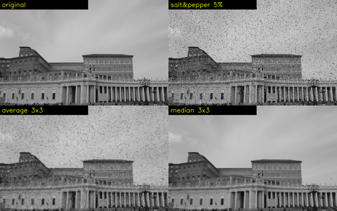

- **평균 3×3**: 흰 점, 검은 점이 **회색 얼룩**으로 바뀌었을 뿐, 하늘 전체에 여전히 보여요. 건물도 흐려졌습니다.
- **미디언 3×3**: 하늘의 점이 **거의 완벽하게 사라졌고**, 건물 창문과 기둥 윤곽도 선명하게 남아 있어요. 원본과 나란히 놓아도 차이를 찾기 어렵습니다.

### 4-4-f. 코드 해부

```python
def median_filter(image, ksize):
    rows, cols = image.shape[:2]
    dst = np.zeros((rows, cols), np.uint8)
    center = ksize // 2
    for i in range(center, rows - center):              # 테두리는 건너뜀 → 0으로 남음
        for j in range(center, cols - center):
            y1, y2 = i - center, i + center + 1
            x1, x2 = j - center, j + center + 1
            mask = image[y1:y2, x1:x2].flatten()                     # ① 3×3 → 9개 1차원
            sort_mask = cv2.sort(mask, cv2.SORT_EVERY_COLUMN).flat   # ② 정렬
            dst[i, j] = sort_mask[mask.size//2]                      # ③ 가운데 값
    return dst
```

소금 하나가 있는 윈도우로 한 줄씩 따라가면 (실행값):

```
① image[y1:y2, x1:x2]          .flatten()
   10  10  10            →     [ 10  10  10  10 255  10  10  10  10]    shape (9,)
   10 255  10
   10  10  10

② cv2.sort(mask, cv2.SORT_EVERY_COLUMN)
   OpenCV는 1차원 배열 (9,)을 "9행 1열" 행렬로 봄 → shape (9, 1)
   SORT_EVERY_COLUMN = 각 열을 위에서 아래로 정렬 → 열이 하나뿐이니 9개 전체가 정렬됨
   → [[10] [10] [10] [10] [10] [10] [10] [10] [255]]
   .flat → (9, 1)을 1차원처럼 순서대로 꺼낼 수 있게 함

③ mask.size // 2 = 9 // 2 = 4  →  sort_mask[4] = 5번째 값 = 10
```

**`SORT_EVERY_COLUMN`이 왜 필요할까요?** `cv2.sort`는 원래 행렬을 **행별로 또는 열별로** 정렬하는 함수예요. 1차원 배열이 열 하나짜리 행렬로 바뀌니까, "열 방향으로 정렬"을 골라야 9개가 한 줄로 정렬됩니다. 만약 `SORT_EVERY_ROW`를 쓰면 원소가 하나뿐인 행 9개를 각각 정렬해서 **아무것도 바뀌지 않아요.**

> 💡 numpy로 쓰면 훨씬 간단해요.
> ```python
> dst[i, j] = np.median(image[y1:y2, x1:x2])
> ```

**OpenCV와 비교 (소금-후추 5% 이미지):**

| | 직접 짠 `median_filter` | `cv2.medianBlur(noise, 3)` |
|---|---|---|
| 시간 | 0.237초 | 0.00003초 (**약 8,000배** 빠름) |
| 안쪽 결과 | **완전히 같음** (확인함) | |
| 테두리 첫 행 | `[0, 0, 0, 0]` (검은 액자) | `[161, 161, 162, 163]` (테두리 복제 패딩) |

`cv2.medianBlur`의 주의점: `ksize`는 **3 이상의 홀수**여야 하고, 5보다 크면 **uint8 이미지만** 받습니다 (내부적으로 히스토그램을 이용한 빠른 알고리즘을 쓰기 때문이에요).

> 11번 파일은 실행할 때마다 잡음 위치가 바뀌어요 (`np.random`에 시드를 고정하지 않음). 결과를 재현하거나 비교하려면 맨 위에 `np.random.seed(0)`을 넣으면 됩니다.

---

## Step 4-5. 최소/최대 필터: [chap07/09.filter_minmax.py](chap07/09.filter_minmax.py)

### 4-5-a. 줄의 맨 앞과 맨 뒤

미디언이 줄의 **가운데**를 골랐다면, 최소 필터는 **맨 앞**(가장 작은 값), 최대 필터는 **맨 뒤**(가장 큰 값)를 고릅니다.

```
윈도우 정렬:  [ 10   10   10   10   10   10   10   10  255 ]
               ↑                    ↑                   ↑
            최소 필터            미디언              최대 필터
             → 10                 → 10               → 255
```

이 셋을 묶어서 **순위 필터**(rank filter)라고 해요. 정렬했을 때 몇 번째를 고르느냐만 다릅니다.

### 4-5-b. 1차원 실험 ✍️ (3칸 윈도우, 실행값)

신호에 **넓은 밝은 덩어리**(200이 3칸), **밝은 점 하나**(200), **어두운 점 하나**(0)를 넣었어요.

```
위치    :   0    1    2    3    4    5    6    7    8    9   10   11   12
원본    :  10   10  200  200  200   10   10  200   10   10    0   10   10
                    └─ 밝은 덩어리 ─┘          ↑ 밝은 점      ↑ 어두운 점

최소    :  10   10   10  200   10   10   10   10   10    0    0    0   10
최대    :  10  200  200  200  200  200  200  200  200   10   10   10   10
```

**최소 필터** (이웃 중 가장 어두운 값):
- 밝은 덩어리는 양쪽 끝이 깎여서 3칸 → **1칸**으로 줄었어요.
- **밝은 점(7번)은 사라졌어요.**
- 어두운 점(10번)은 1칸 → **3칸으로 커졌어요.**
- 🧠 "어두운 쪽이 영토를 넓힌다"

**최대 필터** (이웃 중 가장 밝은 값):
- 밝은 덩어리는 3칸 → **5칸**으로 커졌어요.
- 밝은 점도 1칸 → 3칸으로 커져서, 덩어리와 점 사이(5, 6번)가 **이어져 버렸어요.**
- **어두운 점(10번)은 사라졌어요.**
- 🧠 "밝은 쪽이 영토를 넓힌다"

### 4-5-c. 실제 이미지 🖼️

[chap07/images/min_max.jpg](chap07/images/min_max.jpg)는 "Theotokaki Art gallery" 간판과 흰 문이 있는 벽 사진이에요.

이미지 (원본 / 최소 3×3 / 최대 3×3):
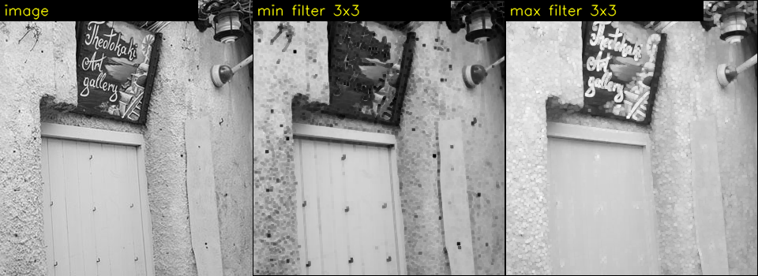

| | 평균 밝기 | 보이는 변화 |
|---|---|---|
| 원본 | 166.6 | 흰 문의 작은 못 자국, 벽의 작은 구멍들 |
| **최소** | 149.5 (어두워짐) | 못 자국과 벽 구멍이 **3×3 검은 네모로 커짐**. 간판의 흰 글씨가 **가늘어짐** |
| **최대** | 183.3 (밝아짐) | 못 자국과 구멍이 **사라짐**. 간판의 흰 글씨가 **두꺼워짐** |

### 4-5-d. 코드 해부

```python
dst[i, j] = cv2.minMaxLoc(mask)[mode]               # 14줄
```

`cv2.minMaxLoc`은 4가지를 한 번에 돌려줘요. 실행 결과:

```
mask = [[10, 10, 10], [10, 255, 10], [10, 0, 10]]
cv2.minMaxLoc(mask) → (0.0, 255.0, (1, 2), (1, 1))
                        ↑      ↑       ↑       ↑
                     [0]최솟값 [1]최댓값 [2]최솟값 위치 [3]최댓값 위치
```

`mode = 0`이면 최솟값, `mode = 1`이면 최댓값이 나와요.

⚠️ **위치는 (x, y) 순서**예요. 0은 행 2, 열 1에 있는데 결과는 `(1, 2)`입니다. numpy의 `[행, 열]`과 반대예요. OpenCV 함수가 좌표를 돌려줄 때는 거의 항상 (x, y) 순서라는 걸 기억해 두세요.

⚠️ **주석 복사-붙여넣기 실수:**

```python
minfilter_img = minmax_filter(image, 3, 0)    # 3x3 마스크 최솟값 필터링
maxfilter_img = minmax_filter(image, 3, 1)    # 3x3 마스크 최솟값 필터링   ← "최댓값"이어야 함
```

### 4-5-e. 🔗 Part 7 미리 보기: 최소 → 최대를 이어 붙이면?

4-5-b의 신호에 **두 필터를 순서대로** 적용해 봤어요 (실행값).

```
원본       :  10   10  200  200  200   10   10  200   10   10    0   10   10

최소 → 최대 :  10   10  200  200  200   10   10   10   10   10    0   10   10
              ✅ 덩어리 3칸 그대로 복원     ✅ 밝은 점 제거     (어두운 점은 그대로)

최대 → 최소 :  10   10  200  200  200  200  200  200   10   10   10   10   10
              (덩어리 유지)  ⚠️ 덩어리와 점 사이 틈이 메워짐      ✅ 어두운 점 제거
```

- **최소 → 최대**: 최소 필터가 작은 밝은 점을 지우고 덩어리를 깎아요. 그다음 최대 필터가 **살아남은 덩어리를 원래 크기로 되돌립니다.** 지워진 점은 되돌아올 게 없으니 그대로 사라져요. 결과적으로 **"윈도우보다 작은 밝은 것만 지우는"** 필터가 됩니다.
- **최대 → 최소**: 반대로 **"윈도우보다 작은 어두운 것(점, 틈)만 메우는"** 필터가 돼요.

이 두 조합이 Part 7의 **열림**(opening)과 **닫힘**(closing)이에요. 그리고 최소 필터는 `cv2.erode`(**침식**)와, 최대 필터는 `cv2.dilate`(**팽창**)와 **안쪽 영역 결과가 완전히 같다**는 것도 확인했습니다. 모폴로지는 이 순위 필터들을 흑백(이진) 영상에 쓴 것이에요.

---

## Step 4-6. Part 4 정리

### 필터 비교표

| 필터 | 종류 | 계산 | 가우시안 잡음 | 소금-후추 잡음 | 에지 | 가는 선 | OpenCV 함수 |
|---|---|---|---|---|---|---|---|
| 평균 | 선형 (회선) | 모두 똑같이 평균 | ✅ 좋음 | ❌ 얼룩이 됨 | 뭉갬 | 흐려지지만 남음 | `cv2.blur` |
| 가우시안 | 선형 (회선) | 가까울수록 큰 가중치 | ✅ **최고** | ❌ 얼룩이 됨 | 부드럽게 뭉갬 | 흐려지지만 남음 | `cv2.GaussianBlur` |
| 미디언 | 비선형 (순위) | 정렬 후 가운데 | 보통 | ✅ **최고** | ✅ **보존** | ❌ 지워짐 | `cv2.medianBlur` |
| 최소 | 비선형 (순위) | 정렬 후 맨 앞 | — | 소금 제거, 후추 확대 | 어두운 쪽이 넓어짐 | 밝은 선 지워짐 | `cv2.erode` |
| 최대 | 비선형 (순위) | 정렬 후 맨 뒤 | — | 후추 제거, 소금 확대 | 밝은 쪽이 넓어짐 | 어두운 선 지워짐 | `cv2.dilate` |

### 선형 vs 비선형

```
선형 필터 (회선)                          비선형 필터 (순위)
──────────────────                       ──────────────────
결과 = Σ 가중치 × 화소                    결과 = 정렬해서 k번째
섞인 값을 새로 만들어 냄 (40, 70...)        윈도우에 실제로 있는 값만 고름
극단값 하나에 결과 전체가 끌려감             극단값은 줄 끝에 설 뿐 (강건함)
분리 가능, 누적합 등으로 매우 빠름           정렬이 필요해서 상대적으로 느림
수학적으로 다루기 쉬움 (미분과 결합 → 소벨, LoG)  미분과 결합하기 어려움
```

### 이번 Part에서 찾은 코드 문제

| 파일 | 문제 |
|---|---|
| 10 | 28줄에서 `blur_img` 대신 `box_img` 표시 → `BORDER_CONSTANT` 효과가 안 보임 |
| 12 | `arange(0, k+1)` → 18×6 마스크 → 1픽셀 밀림 |
| 12 | `GaussianBlur(img, (0,0), 10.7, 1.3)` → 1.3은 dst로 들어감 → 65×65 원형 블러 |
| 11 | 시드가 고정되지 않아 매번 잡음 위치가 다름 (버그라기보다 재현성 문제) |
| 09 | 21줄 주석 "최솟값"은 "최댓값"의 오타 |

### ✅ Part 4 퀴즈

1. 주행 중인 AVM 카메라 영상에서 **전송 오류로 흰 점, 검은 점이 1% 정도** 생기고, 동시에 **야간이라 화면 전체가 자글자글**합니다. 어떤 필터를 **어떤 순서로** 쓰면 좋을까요? 순서를 반대로 하면 어떤 문제가 생길까요?
2. 5×5 미디언 필터는 윈도우 25칸 중 이상값이 몇 개까지일 때 버틸 수 있나요? 그럼 **두께 2픽셀**인 밝은 선은 5×5 미디언을 통과하면 살아남을까요?
3. 흰 바탕에 **검은 글씨**가 있는 문서 사진에서 글씨 획이 끊어져 있어요. 끊어진 틈을 메우려면 최소 → 최대와 최대 → 최소 중 어느 쪽을 써야 할까요? (주의: 이번에는 글씨가 **어두운** 쪽입니다.)

---

다음은 **Part 5: LoG와 DoG (07.edge_DOG.py)**입니다. Part 3의 라플라시안과 Part 4의 가우시안을 합치면 잡음에 강한 2차 미분 에지 검출기가 돼요. "멕시칸 햇" 모양의 마스크를 숫자로 만들어 보고, DoG가 LoG와 거의 같은 이유를 Step 4-3의 σ² 원리로 설명합니다. 07번 코드에 있는 **uint8 빼기 함정(10 − 20 = 246)**과 **`cv2.Laplacian`의 ksize 9가 무시되는 문제**도 실제로 확인할 거예요.

**"다음"**이라고 하시면 이어가고, 어려운 부분이 있으면 **"더 쉽게"**라고 해 주세요.


---

## Q11  <sub>2026-10-26T14:11:05.306Z</sub>

> 다음


### A11

계산과 그림이 모두 준비됐어요. Part 5 설명을 정리합니다.

# Part 5. LoG와 DoG: [chap07/07.edge_DOG.py](chap07/07.edge_DOG.py)

Part 3의 라플라시안은 에지 위치를 정밀하게 찾지만 잡음에 너무 약했어요. Part 4의 가우시안은 잡음을 잘 누르죠. 이번 Part에서는 **둘을 합칩니다.** 파일이 하나라서 Step 5-1 ~ 5-4를 한 번에 진행하고, 이번에도 숫자는 전부 실행해서 확인했어요.

---

## 🔁 Part 4 퀴즈 답

**1번. 전송 오류(소금-후추 1%) + 야간 잡음(가우시안)이 섞이면?**

**이론적으로는 미디언 → 가우시안 순서**가 맞아요. 순서를 반대로 하면 이런 일이 생깁니다 (소금 한 점에 가우시안 3×3 → 미디언 3×3, 실행값).

```
가우시안 먼저 (소금 255가 번짐)        그다음 미디언
 10  10  10  10  10                    10  25  10
 10  25  41  25  10                    25  41  25      ← 41짜리 얼룩이 남음
 10  41  71  41  10       ──▶          10  25  10
 10  25  41  25  10
 10  10  10  10  10
```

가우시안이 소금 하나를 **9칸짜리 얼룩**으로 퍼뜨리면, 그 얼룩은 더 이상 "튀는 소수파"가 아니라서 미디언이 지우지 못해요. 미디언을 먼저 쓰면 소금은 **완전히** 사라집니다.

다만 정직하게 말하면, 실제 이미지(1% + σ 15)로 측정했을 때는 두 순서의 MAE가 **6.39 vs 6.38로 거의 같았어요.** 소금이 적고 블러가 약하면 차이가 작습니다. 그래도 원리상 **"극단값부터 제거하고, 그다음 전체를 부드럽게"**가 안전한 순서예요.

**2번. 5×5 미디언과 두께 2픽셀 선**

```
버틸 수 있는 이상값: (25 − 1) / 2 = 12개
두께 2픽셀 선 위의 윈도우: 선 화소 = 2열 × 5행 = 10개, 배경 = 15개
→ 다수결에서 배경이 이김 → 선이 사라짐 ❌
```

5×5에서 살아남으려면 선이 **3픽셀 이상**(3 × 5 = 15개, 과반수)이어야 해요.

**3번. 검은 글씨의 끊어진 틈 메우기**

끊어진 틈은 어두운 획 사이의 **작은 밝은 영역**이에요. 4-5-e에서 "**최소 → 최대** = 작은 밝은 것만 지운다"고 했죠. 그래서 **최소 → 최대**가 정답입니다. 최소 필터가 어두운 획을 넓혀서 틈을 메우고, 최대 필터가 넓어진 획을 원래 두께로 되돌려요. (이번에는 물체가 어두운 쪽이라 4-5-e와 반대로 생각해야 해요. Part 7에서 정확한 이름을 붙입니다.)

---

## Step 5-1. LoG: 가우시안 + 라플라시안

### 5-1-a. 아이디어

```
Part 3의 문제: 라플라시안은 미세한 흔들림(잡음)마다 + − 영교차를 만듦
해결:          먼저 가우시안으로 흔들림을 누르고 → 그다음 라플라시안

LoG(f) = ∇²( G * f )        "f를 가우시안으로 블러(*)한 것에 라플라시안(∇²)을 적용"
       = (∇²G) * f           ← 순서를 바꿔도 같음
```

**두 번째 줄이 핵심이에요.** 회선은 결합법칙이 성립해서, 블러하고 미분하는 대신 **가우시안 마스크를 먼저 미분해서 만든 마스크 하나**로 한 번에 처리할 수 있습니다. 그 마스크가 **LoG**(Laplacian of Gaussian)예요.

🧠 **비유: 흔들리는 손으로 그린 지도에서 절벽 찾기.** 손떨림 때문에 지도 곳곳에 작은 굴곡이 있으면, 굴곡 하나하나가 다 절벽처럼 보여요. 그래서 먼저 지도를 **부드럽게 다듬고**(가우시안) 나서 **휘어지는 곳**(라플라시안)을 찾는 겁니다.

### 5-1-b. 1D LoG 마스크를 직접 계산하기 📐

가우시안 exp(−x²/2σ²)를 x로 두 번 미분하면 (정규화 상수는 Step 4-3-b처럼 생략):

```
d²/dx² exp(−x²/2σ²) = ( x²/σ⁴ − 1/σ² ) · exp(−x²/2σ²)
```

σ = 1, x = −4 ~ +4로 계산하면 (실행값):

| x | −4 | −3 | −2 | −1 | 0 | +1 | +2 | +3 | +4 |
|---|---|---|---|---|---|---|---|---|---|
| G(x) = exp(−x²/2) | 0.000 | 0.011 | 0.135 | 0.607 | 1 | 0.607 | 0.135 | 0.011 | 0.000 |
| x² − 1 | 15 | 8 | 3 | 0 | −1 | 0 | 3 | 8 | 15 |
| **LoG = (x² − 1)·G** | 0.005 | 0.089 | **0.406** | **0** | **−1** | **0** | **0.406** | 0.089 | 0.005 |

```
 LoG(x)
 +0.4 |           ●                       ●
      |
    0 |──●──●────────●───────────────●────────●──●──
      |              ↑ x = −σ         ↑ x = +σ   (값이 0이 되는 곳)
 −1.0 |                      ●
        −4  −3  −2  −1    0   +1  +2  +3  +4
        "가운데가 깊게 파이고, 양옆이 살짝 솟은 모양"
```

**모양 읽기:**
- **x = 0**: 가장 깊은 음수 (−1)
- **x = ±σ** (여기서는 ±1): 정확히 0
- **|x| > σ**: 양수 고리가 생겼다가 서서히 0으로

이걸 뒤집으면(부호 반대) 챙 넓은 모자처럼 생겨서 **멕시칸 햇**(sombrero)이라고 불러요.

### 5-1-c. 2D LoG 마스크 (7×7, σ = 1)

2D 공식은 x² 대신 r² = x² + y²(중심까지 거리의 제곱)을 씁니다.

```
LoG(x, y) ∝ ( x² + y² − 2σ² ) / σ⁴ · exp( −(x² + y²) / 2σ² )
```

실행해서 7×7을 만들고 합이 정확히 0이 되도록 보정한 결과:

```
 0.003  0.018  0.055  0.079  0.055  0.018  0.003
 0.018  0.111  0.247  0.272  0.247  0.111  0.018
 0.055  0.247  0.001 −0.605  0.001  0.247  0.055
 0.079  0.272 −0.605 −1.999 −0.605  0.272  0.079     ← 가운데 깊은 구덩이
 0.055  0.247  0.001 −0.605  0.001  0.247  0.055
 0.018  0.111  0.247  0.272  0.247  0.111  0.018     ← 바깥 양수 고리
 0.003  0.018  0.055  0.079  0.055  0.018  0.003
```

위에서 보면 **가운데가 음수인 구덩이를 양수 고리가 둘러싼** 동심원 모양이에요. 원소 합 = 0이라 평평한 곳은 0이 됩니다 (Part 1 규칙).

> 🔗 **Part 3 라플라시안과 비교**
> ```
> Part 3 라플라시안:       LoG:
>   0   1   0              (위 7×7)
>   1  −4   1              → 가운데 음수 + 주변 양수라는 구조는 같음
>   0   1   0              → 하지만 "주변"이 1칸이 아니라 σ에 비례해 넓게 퍼지고,
>                            가중치가 가우시안처럼 부드럽게 줄어듦
> ```
> LoG는 **라플라시안을 σ 크기로 부드럽게 펼친 것**이에요.

### 5-1-d. 효과: 잡음 구별력이 얼마나 좋아졌나?

Part 2, 3과 **같은 실험**(세로 경계 10 → 100, 표준편차 10 잡음)입니다.

| 연산자 | 에지 반응 | 잡음 반응 | **에지 / 잡음** |
|---|---|---|---|
| 라플라시안 4방향 (Part 3) | 90 | 35.8 | 2.51 |
| 소벨 (Part 2) | 360 | 43.2 | 8.33 |
| **LoG σ = 1.0** | 16.9 | 2.63 | **6.42** |
| **LoG σ = 1.7** (07번 코드의 9×9) | 7.19 | 0.587 | **12.25** |
| **LoG σ = 2.5** | 3.44 | 0.195 | **17.60** |

- σ = 1.7만 돼도 라플라시안보다 **약 5배**, 소벨보다도 좋아졌어요.
- σ를 키울수록 더 좋아지지만, **에지 반응 자체가 작아집니다** (90 → 7.19 → 3.44). 이 값을 그대로 화면에 띄우면 거의 까맣게 보여요. 아래 5-3에서 실제로 확인합니다.
- σ를 키우면 잃는 것도 있어요. Part 4와 같은 트레이드오프로, **가는 디테일과 가까이 붙은 에지들이 뭉개져서** 사라집니다.

### 5-1-e. σ = "어떤 크기의 구조를 볼 것인가"

LoG의 σ는 일종의 **돋보기 배율**이에요.
- 작은 σ: 벽돌 하나하나의 테두리, 글자 획 같은 **잔디테일**까지 반응
- 큰 σ: 잔디테일은 블러에 묻히고, 문짝이나 간판 같은 **큰 물체의 윤곽**만 반응

또 LoG는 **반지름 ≈ √2·σ인 둥근 점(blob)**에 가장 강하게 반응해요. 그래서 σ를 여러 개 바꿔 가며 반응을 비교하면 "이 위치에 이 크기의 점이 있다"를 알 수 있습니다. 이게 **SIFT** 같은 특징점 검출기의 기본 아이디어예요 (아래 💼 참고).

---

## Step 5-2. DoG: 블러 두 장의 차이로 LoG 흉내 내기

### 5-2-a. 아이디어

```
DoG(f) = G(σ₁) * f  −  G(σ₂) * f       (σ₁ < σ₂)
        = 약하게 블러한 영상 − 강하게 블러한 영상
```

라플라시안을 계산할 필요 없이 **블러 두 장을 빼기만** 하면 됩니다. 가우시안 블러는 분리 가능해서 아주 빠르니까(Step 4-3-g) DoG도 빨라요.

### 5-2-b. 왜 LoG와 비슷할까? 직관 3가지

**① Part 1 샤프닝의 "디테일"과 같은 구조**

Step 1-4에서 `디테일 = 원본 − 블러`라고 했어요. DoG는 원본 대신 **살짝 블러한 영상**에서 빼는 거예요.

```
원본 − 블러         = 디테일 (잡음까지 다 포함)       ← 라플라시안과 비슷
약한 블러 − 강한 블러 = 잡음은 빼고 남은 중간 크기 디테일  ← LoG와 비슷
```

**② 주파수(크기) 관점: 대역 통과**

```
                      아주 잔 것(잡음)   중간 크기(에지)   아주 큰 것(전체 밝기)
약한 블러 (σ₁)         ✗ 지워짐           ✓ 남음            ✓ 남음
강한 블러 (σ₂)         ✗ 지워짐           ✗ 지워짐          ✓ 남음
──────────────────────────────────────────────────────────────────────
차이 (DoG)            ✗                  ✓ 남음            ✗ (서로 빼서 없어짐)
```

**두 블러 사이에 끼인 크기의 구조만** 남아요. 잡음처럼 너무 작은 것은 둘 다 지웠고, 전체 밝기처럼 너무 큰 것은 둘 다 남겨서 빼면 0이 됩니다. 정해진 크기 대역만 통과시킨다고 해서 **대역 통과 필터**라고 불러요.

**③ 📐 수학: "블러를 조금 더 하면 얼마나 변하나" = 라플라시안**

가우시안 블러는 **열이 퍼지는 것**(확산)과 같은 수학을 따릅니다. 열 확산 방정식에 따르면:

```
∂G/∂σ = σ · ∇²G         "σ를 아주 조금 늘렸을 때 변하는 양 = σ × 라플라시안"

그래서  G(σ₂) − G(σ₁)  ≈  (σ₂ − σ₁) · σ · ∇²G       (차분으로 미분을 근사, Part 2 아이디어)
즉      DoG = G(σ₁) − G(σ₂)  ≈  −(σ₂ − σ₁) · σ · LoG
```

🧠 **뜨거운 쇠막대 비유:** 막대의 온도 분포가 시간에 따라 퍼질 때, **뾰족하게 뜨거운 곳**(봉우리)은 빠르게 식고 **움푹 차가운 곳**(골짜기)은 빠르게 데워져요. 평평하거나 일정하게 기울어진 곳은 거의 변하지 않습니다. 이 "얼마나 휘었나"가 바로 라플라시안이에요. 블러를 조금 더 했을 때의 **변화량**(= DoG)이 라플라시안에 비례하는 이유입니다.

(부호가 반대인 건 상관없어요. 화면에 띄울 때 절댓값을 취하고, 영교차 위치도 똑같거든요.)

### 5-2-c. 얼마나 비슷한가? 측정 결과

1D로 촘촘하게 샘플링해서, DoG 곡선과 가장 닮은 LoG를 찾아 **모양 유사도**(상관계수 절댓값, 1이면 완전히 같은 모양)를 쟀어요.

| σ₁ / σ₂ | 비율 k | 가장 닮은 LoG의 σ | **유사도** |
|---|---|---|---|
| 1.0 / 1.6 | 1.6 | 1.25 | **0.9993** |
| 0.8 / 1.7 (07번 코드) | 2.1 | 1.14 | 0.9960 |
| 1.0 / 3.0 | 3.0 | 1.63 | 0.9855 |

- **비율 1.6**일 때 거의 완벽하게 같아요 (0.9993). 이게 Marr와 Hildreth가 1980년에 제안한 값입니다.
- 비율이 커질수록 조금씩 달라지지만, 07번 코드의 비율 2.1도 0.996으로 충분히 비슷해요.
- 닮은 LoG의 σ는 대략 **√(σ₁ × σ₂)**(기하평균)예요: √(1 × 1.6) = 1.26 ≈ 1.25 ✓

---

## Step 5-3. 코드 해부와 함정 3개 ⚠️

```python
gaus = cv2.GaussianBlur(image, (9,9), 0, 0)          # 6줄
dst1 = cv2.Laplacian(gaus, cv2.CV_16S, 9)            # 7줄
gaus1 = cv2.GaussianBlur(image, (3, 3), 0)           # 9줄   σ 자동 = 0.8
gaus2 = cv2.GaussianBlur(image, (9, 9), 0)           # 10줄  σ 자동 = 1.7
dst2 = gaus1 - gaus2                                  # 11줄
cv2.imshow("dst1 - LoG", dst1.astype("uint8"))       # 14줄
cv2.imshow("dst2 - DoG", dst2)                        # 15줄
```

**6줄**의 네 번째 `0`도 Step 4-3-f처럼 `dst` 자리로 들어가요. 하지만 sigmaY를 안 주면 sigmaX(= 0, 자동 계산)를 그대로 쓰니까 결과가 같아서 **해롭지 않습니다** (같은 결과인지 확인함). 9×9이므로 σ = 1.7이에요.

### 함정 ①: `cv2.Laplacian(gaus, cv2.CV_16S, 9)`의 9는 무시된다 (Part 3 복습)

Part 3에서 예고한 그 문제예요. 세 번째 위치 인자는 `dst`라서 실제로는 **`ksize=1`**(3×3 4방향 라플라시안)로 계산됩니다. `ksize=1`과 결과가 **완전히 같다**는 걸 확인했어요.

그런데 재밌는 건, **진짜로 `ksize=9`를 주면 오히려 망가진다는 점**이에요.

```
ksize=1 (코드가 실제로 하는 것) 결과 범위: −28 ~ 35
ksize=9 (주석 의도대로)        결과 범위: −32,768 ~ 32,767   ← int16 한계에 꽉 참 (포화)
```

9×9 라플라시안은 가중치가 매우 커서 int16 범위를 넘어 버려요. 이미 가우시안으로 블러했으니 **라플라시안은 작은 크기(ksize=1)가 맞습니다.** 결과적으로 코드는 우연히 올바르게 동작하고 있어요. 그래도 의도를 분명히 하려면 `ksize=1`이라고 써야 합니다.

### 함정 ②: `dst1.astype("uint8")`: 음수가 밝은 값으로 뒤집힘

LoG 결과는 int16이고 **41.9%가 음수**예요. 이걸 `astype("uint8")`로 바꾸면 Step 1-3-e에서 본 "한 바퀴 돌기"가 일어납니다. 실제 한 행 12칸 (100행, 150~161열):

```
LoG 값 (int16)     :   −7   −6   −1    7   12   10    3    0   −2   −4   −7   −7
astype("uint8")    :  249  250  255    7   12   10    3    0  254  252  249  249   ← 음수가 거의 흰색으로!
convertScaleAbs    :    7    6    1    7   12   10    3    0    2    4    7    7   ← 올바른 크기
```

−1은 255(가장 밝음), −7은 249가 돼요. **"거의 0"인 작은 음수가 가장 밝게** 표시되니까, 화면이 의미 없는 흰 무늬로 뒤덮입니다.

### 함정 ③: `gaus1 - gaus2`: uint8 빼기에서 음수가 한 바퀴 돎

계획 단계에서 "10 − 20 = 246"이라고 예고했던 함정이에요. `gaus1`과 `gaus2`는 둘 다 uint8이라서, numpy 뺄셈 결과도 uint8이고 **음수가 256을 더한 값으로 바뀝니다.**

같은 12칸 (실행값):

```
gaus1 (σ 0.8)    :  112  120  122   98   75   88  122  142  143  144  159  177
gaus2 (σ 1.7)    :  112  110  105  100  100  108  122  136  148  156  159  155
───────────────────────────────────────────────────────────────────────────
진짜 차이 (int16) :    0   10   17   −2  −25  −20    0    6   −5  −12    0   22
uint8 빼기 (코드) :    0   10   17  254  231  236    0    6  251  244    0   22   ← 음수 → 큰 양수
cv2.subtract     :    0   10   17    0    0    0    0    6    0    0    0   22   ← 음수 → 0 (포화)
```

| 빼기 방법 | 음수 처리 | 결과 |
|---|---|---|
| numpy `a - b` (uint8) | +256 (한 바퀴 돎) | ❌ 화소의 **37.7%**가 엉뚱하게 밝아짐 |
| `cv2.subtract(a, b)` | 0으로 자름 | ⚠️ 깨지지는 않지만 DoG의 **음수 쪽 절반을 잃음** |
| `a.astype(np.int16) - b` | 음수 보존 | ✅ 진짜 DoG (범위 −87 ~ 82) |

> 📌 **uint8 산술 규칙 (총정리)**
> - numpy `+`, `−`: 범위를 넘으면 **한 바퀴 돎** (200 + 100 = 44, 10 − 20 = 246)
> - OpenCV `cv2.add`, `cv2.subtract`: 범위를 넘으면 **0 또는 255에서 자름** (포화)
> - 결과가 음수일 수 있으면(미분, DoG): **먼저 int16이나 float32로 바꾼 다음** 빼기

### 고친 코드

```python
gaus = cv2.GaussianBlur(image, (9, 9), 0)
dst1 = cv2.Laplacian(gaus, cv2.CV_16S, ksize=1)                       # 의도를 명확히

gaus1 = cv2.GaussianBlur(image, (3, 3), 0)
gaus2 = cv2.GaussianBlur(image, (9, 9), 0)
dst2 = gaus1.astype(np.int16) - gaus2.astype(np.int16)                # 음수 보존

cv2.imshow("dst1 - LoG", cv2.convertScaleAbs(dst1, alpha=4))          # 절댓값, 4배 확대
cv2.imshow("dst2 - DoG", cv2.convertScaleAbs(dst2, alpha=4))
```

`alpha=4`는 `convertScaleAbs`의 배율 옵션이에요 (|x × 4|). LoG와 DoG 값은 작아서(최대 35, 87) 그대로 보면 너무 어두워요 (5-1-d에서 본 "에지 반응이 작아지는" 현상).

---

## Step 5-4. 실제 이미지 결과와 영교차 🖼️

[chap07/images/dog.jpg](chap07/images/dog.jpg)는 Part 4의 `min_max.jpg`와 같은 장면(간판 + 흰 문 + 벽)이에요. (파일 이름의 dog는 강아지가 아니라 **DoG**입니다 😄)

9장 비교 이미지:
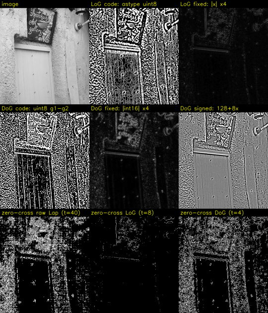

| 위치 | 내용 | 보이는 모습 |
|---|---|---|
| 1행 1 | 원본 | |
| 1행 2 | **LoG 코드 그대로** (`astype`) | 화면 전체가 **흰 지렁이 무늬**로 뒤덮임. 벽, 문 구분이 거의 안 됨 (함정 ②) |
| 1행 3 | LoG 고침 (\|x\| × 4) | 검은 바탕에 문틀, 간판 테두리, 글씨가 **가는 선**으로 나옴. 벽 질감은 약하게만 |
| 2행 1 | **DoG 코드 그대로** (uint8 빼기) | 하얀 점, 선이 마구 섞인 **잡음 같은 화면** (함정 ③) |
| 2행 2 | DoG 고침 (\|int16\| × 4) | LoG 고친 것과 비슷하게 테두리가 나옴. σ₁이 작아서(0.8) 벽 질감이 조금 더 보임 |
| 2행 3 | DoG 부호 유지 (128 + 8×값) | **회색 바탕에 양각 조각처럼** 보임. 에지 한쪽은 밝고(+) 반대쪽은 어두움(−) |
| 3행 1 | 영교차: **블러 없는** 라플라시안 | 벽 전체가 하얀 점으로 뒤덮임 (Part 3에서 본 문제) |
| 3행 2 | 영교차: **LoG** | 문틀, 간판, 램프 윤곽이 **깔끔한 1픽셀 선**으로 나옴. 벽은 거의 비어 있음 ✅ |
| 3행 3 | 영교차: DoG | LoG와 비슷한데 σ가 작은 만큼 벽 질감도 조금 더 잡힘 |

**3행 비교가 이번 Part의 결론이에요.** 같은 영교차 방법인데, 가우시안으로 먼저 다듬었더니(LoG) Part 3의 자글자글한 결과가 **물체 윤곽만 남는 선 그림**으로 바뀌었어요.

> 💡 **2행 3열(부호 유지)을 보는 법**
> 밝은 쪽과 어두운 쪽이 나란히 붙어 있는 곳이 영교차, 즉 에지예요. 에지 양쪽이 **반대 부호**를 갖는 2차 미분의 특징(Step 3-1)을 눈으로 볼 수 있는 표현입니다. 절댓값(1행 3열)으로는 이 정보가 사라져요.

이 방법(LoG + 영교차)을 **Marr-Hildreth 에지 검출기**(1980)라고 해요. 다음 Part의 캐니(1986)가 나오기 전까지 대표적인 에지 검출기였습니다. 장점은 닫힌 윤곽선을 잘 만든다는 것이고, 약점은 약한 에지에서도 영교차가 생겨서 **임계값 정하기가 까다롭다**는 거예요. 캐니는 이 약점을 "두 개의 임계값"으로 해결합니다.

---

## 💼 실무 연결 (AVM)

- **특징점 검출 (SIFT)**: 가우시안 블러를 σ, 1.6σ, 1.6²σ, ...로 쌓은 뒤 이웃끼리 빼서 **DoG 피라미드**를 만들고, 위치와 크기 모두에서 극값인 점을 특징점으로 씁니다. 카메라 사이 **정합**(스티칭할 때 겹치는 영역 맞추기), 캘리브레이션 검증, 차량 이동량 추정 등에 쓰이는 기술의 출발점이에요. 5-2-c의 1.6이 SIFT에도 그대로 나옵니다.
- **선 폭에 맞춘 대역 통과**: 주차선은 탑뷰에서 대략 일정한 폭(예: 15cm → 몇 픽셀)을 가져요. DoG의 σ를 그 폭에 맞추면 **그 폭의 밝은 선에 가장 강하게 반응**하고, 아스팔트 질감(더 작음)이나 조명 그라데이션(더 큼)은 억제됩니다. 단순 이진화보다 그림자와 조명 변화에 강한 주차선 강조 방법이에요.
- **uint8 함정은 실무 단골 버그**: 영상 두 장을 빼는 코드(배경 차분, 프레임 차분, 캘리브레이션 전후 비교)에서 `a - b`를 uint8로 하는 실수가 정말 흔합니다. 이번에 본 함정 ③을 꼭 기억해 두세요.

---

## 📋 Part 5 정리

| 개념 | 한 줄 정리 |
|---|---|
| LoG | 가우시안 블러 + 라플라시안을 마스크 하나로. 결합법칙 ∇²(G*f) = (∇²G)*f |
| 모양 | 가운데 음수 구덩이 + 양수 고리 (멕시칸 햇). x = ±σ에서 0 |
| 효과 | 에지/잡음 비율 2.51(라플라시안) → 12.25(LoG σ = 1.7) |
| σ | 볼 구조의 크기. 크면 잡음에 강하지만 디테일을 잃고 반응도 작아짐 |
| DoG | 약한 블러 − 강한 블러. 대역 통과. 열 확산 때문에 ≈ LoG |
| 최적 비율 | σ₂/σ₁ = 1.6에서 유사도 0.9993 |
| 함정 ① | `Laplacian(gaus, CV_16S, 9)`의 9는 dst → 실제로는 ksize=1 (그게 오히려 맞음) |
| 함정 ② | int16 LoG를 `astype("uint8")` → −1이 255로 |
| 함정 ③ | uint8 `gaus1 − gaus2` → 37.7% 화소가 한 바퀴 돎. int16으로 바꾼 뒤 빼야 함 |
| 영교차 | LoG + 영교차 = Marr-Hildreth 에지 검출기. 깔끔한 1픽셀 윤곽선 |

### ✅ Part 5 퀴즈

1. DoG를 σ₁ = 2, σ₂ = 3.2로 만들면 비율은? 이 DoG는 대략 σ가 몇인 LoG와 비슷할까요?
2. `cv2.subtract(gaus1, gaus2)`로 DoG를 만들면 에지의 어느 쪽 절반이 사라질까요? (힌트: gaus1이 gaus2보다 큰 곳은 에지의 밝은 쪽일까, 어두운 쪽일까?)
3. 한 변이 약 6픽셀인 정사각형 점(예: 문의 못 자국)을 가장 강하게 잡으려면 LoG의 σ를 대략 얼마로 하면 될까요? (5-1-e의 √2·σ 규칙 사용)

---

다음은 **Part 6: 캐니 에지 (08, 13)**입니다. chap07에서 가장 어려운 Part예요. 4단계 파이프라인(가우시안 → 소벨 크기와 방향 → 비최대 억제 → 이력 임계값)을 하나씩 나눠서, 특히 `first = [3, 0, 1, 2]` 인덱스 트릭과 재귀 `trace()` 추적 순서를 작은 격자로 한 칸씩 따라갑니다. Part 6은 두세 번에 나눠 진행할게요.

**"다음"**이라고 하시면 이어가고, 어려운 부분이 있으면 **"더 쉽게"**라고 해 주세요.


---

## Q12  <sub>2026-10-27T11:17:01.422Z</sub>

> 다음


### A12

캐니 앞부분(블러, 그래디언트 크기와 방향)의 계산과 그림이 끝났어요. 이번 답변에서는 Step 6-1 ~ 6-4를 설명합니다.

# Part 6. 캐니 에지 — Step 6-1 ~ 6-4: [chap07/08.edge_canny.py](chap07/08.edge_canny.py)

chap07에서 가장 어려운 Part라서 세 번에 나눠 진행합니다.

| 이번 | 다음 | 그다음 |
|---|---|---|
| **6-1 좋은 에지의 조건**, **6-2 전체 흐름**, **6-3 ① 블러**, **6-4 ② 크기와 방향** | 6-5 ③ 비최대 억제 | 6-6 ④ 이력 임계값, 6-7 OpenCV와 비교, 6-8 컬러 캐니 (13) |

이번에도 숫자는 전부 실행해서 확인했어요. 그리고 이번 범위에서 **코드 문제를 두 개** 새로 찾았습니다 (6-3, 6-4).

---

## 🔁 Part 5 퀴즈 답

**1번. σ₁ = 2, σ₂ = 3.2**

```
비율 = 3.2 / 2 = 1.6   ← 유사도가 가장 좋은 비율
비슷한 LoG의 σ ≈ √(σ₁ × σ₂) = √(2 × 3.2) = √6.4 ≈ 2.53
```

**2번. `cv2.subtract(gaus1, gaus2)`에서 사라지는 쪽**

`gaus1`(약한 블러)이 `gaus2`(강한 블러)보다 큰 곳만 남아요. 경계 근처에서 강한 블러는 반대편 값을 더 많이 섞어 오니까:

```
         어두운 쪽 │ 밝은 쪽
gaus1 :    10  12 │ 98 100     (경계가 비교적 선명함)
gaus2 :    25  35 │ 75  85     (밝은 값이 어두운 쪽으로, 어두운 값이 밝은 쪽으로 더 많이 섞임)
차이  :   −15 −23 │+23 +15
                 ↑
        음수 → 0으로 잘림     양수 → 남음
```

**에지의 어두운 쪽 절반이 사라지고 밝은 쪽만 남습니다.**

**3번. 한 변 약 6픽셀인 점**

반지름 ≈ 3이니까 `√2 · σ = 3` → σ ≈ 3 / 1.41 ≈ **2.1**

---

## Step 6-1. 좋은 에지 검출기의 조건

### 6-1-a. 지금까지의 문제점 정리

Part 2 ~ 5에서 만든 에지 지도를 실제로 쓰려고 하면 문제가 세 가지 있었어요.

| 문제 | 어디서 봤나 | 예시 |
|---|---|---|
| **에지가 두꺼움** | Part 2 소벨 결과 | 경계 하나가 3 ~ 5픽셀 두께의 띠로 나옴 |
| **잡음과 질감도 에지로 잡힘** | Part 3 라플라시안 | 벽 질감, 물방울이 모두 하얀 점 |
| **"어디부터 에지냐"를 정하기 어려움** | Part 5 영교차 | 임계값을 낮추면 잡음, 높이면 끊어진 선 |

### 6-1-b. 캐니의 세 가지 조건 (John Canny, 1986)

캐니는 에지 검출기가 갖춰야 할 조건을 이렇게 정리했어요.

| 조건 | 뜻 | 위 문제 중 해결하는 것 |
|---|---|---|
| ① **잘 찾기** | 진짜 에지는 놓치지 말고, 가짜 에지(잡음)는 잡지 말 것 | 잡음과 질감 |
| ② **정확한 위치** | 찾은 에지가 실제 경계 위치에 놓일 것 | 두꺼운 띠 |
| ③ **한 에지에 한 응답** | 경계 하나에 선은 한 줄만 나올 것 | 두꺼운 띠, 이중선 |

🧠 **비유: 산맥 지도를 그리는 측량사.** 좋은 측량사는 ① 진짜 능선은 빠짐없이 그리고 작은 돌무더기는 능선으로 착각하지 않으며, ② 능선을 정확한 위치에 그리고, ③ 능선 하나를 선 한 줄로 그립니다. 경사가 급한 지역을 통째로 칠해 놓으면 능선 지도가 아니에요.

---

## Step 6-2. 캐니의 4단계 파이프라인

```
 원본 이미지
     │
     ▼
 ① 가우시안 블러 ─────────── "잡음부터 누른다"              조건 ①
     │                       (Part 4)
     ▼
 ② 소벨 → 크기 |G|, 방향 θ ── "어디가 얼마나 가파르고,       (Part 2)
     │                         어느 쪽으로 가파른가"
     ▼
 ③ 비최대 억제 (NMS) ──────── "능선 꼭대기 한 줄만 남긴다"     조건 ②③
     │                       두꺼운 띠 → 1픽셀 선
     ▼
 ④ 이력 임계값 ─────────────── "확실한 에지에서 출발해          조건 ①
     │                         이어진 약한 에지까지 따라간다"
     ▼
 최종 에지 (0 또는 255인 1픽셀 선)
```

08번 코드의 해당 줄:

| 단계 | 줄 | 코드 |
|---|---|---|
| ① 블러 | 64 | `gaus_img = cv2.GaussianBlur(image, (5, 5), 0.3)` |
| ② 크기 | 65 ~ 68 | `Gx`, `Gy` = 소벨, `sobel = np.fabs(Gx) + np.fabs(Gy)` |
| ② 방향 | 69 ~ 70 | `directs = cv2.phase(Gx, Gy) / (np.pi / 4)` → `astype(int) % 4` |
| ③ NMS | 71 | `max_sobel = nonmax_suppression(sobel, directs)` |
| ④ 이력 임계값 | 72 | `hysteresis_th(max_sobel, 100, 150)` |
| 비교 | 73 | `canny2 = cv2.Canny(image, 100, 150)` |

**실습 이미지** [chap07/images/canny.jpg](chap07/images/canny.jpg)(320×360)는 하늘을 배경으로 한 **말 탄 기마상**과 돌 받침대예요. 매끈한 하늘과 복잡한 동상 윤곽이 대비되어 에지 검출을 시험하기 좋은 사진입니다.

---

## Step 6-3. ① 가우시안 블러 (64줄)

### 6-3-a. 왜 맨 앞에서 블러할까?

Part 2 ~ 5에서 계속 확인했듯이 **미분은 잡음을 키웁니다.** 캐니는 ②에서 소벨(미분)을 쓰니까, 그 전에 잡음을 눌러 둬야 조건 ①을 지킬 수 있어요. Part 5의 LoG와 같은 발상입니다.

### 6-3-b. ⚠️ 코드 문제: σ = 0.3은 사실상 블러가 아니다

```python
gaus_img = cv2.GaussianBlur(image, (5, 5), 0.3)      # 64줄
```

시그니처 `GaussianBlur(src, ksize, sigmaX, ...)`에서 세 번째 인자는 **sigmaX가 맞아요** (Part 4의 위치 인자 함정은 아님). 문제는 **σ = 0.3이라는 값 자체**입니다. 5칸 마스크 가중치를 직접 출력해 보면:

```
σ = 0.3 :  [0.0000  0.0038  0.9923  0.0038  0.0000]   ← 가운데 99.2%, 사실상 원본 그대로
σ = 1.0 :  [0.0545  0.2442  0.4026  0.2442  0.0545]   ← 이웃을 제대로 섞음 (비교용)
```

Step 4-3-b의 공식으로 이유를 확인하면:

```
x = ±1에서:  exp(−1² / (2 × 0.3²)) = exp(−1 / 0.18) = exp(−5.56) ≈ 0.0039
```

σ = 0.3이면 **1칸 떨어진 이웃도 0.4%밖에 반영되지 않아요.** 실제 이미지에 적용해서 원본과 비교한 결과:

| | 바뀐 화소 비율 | 평균 변화량 | 최대 변화량 |
|---|---|---|---|
| σ = 0.3 (코드) | **1.16%** | **0.012** | 3 |
| σ = 1.0 (비교) | — | 3.155 | — |

**사실상 블러를 하지 않은 것**과 같아요. 5×5 크기를 줬지만 σ가 너무 작아서 바깥 칸들은 전부 0입니다.

**왜 이렇게 썼을까요?** 추측이지만 `cv2.Canny`는 내부에 가우시안 블러 단계가 **없고** 소벨만 써요. 그래서 비교를 공정하게 하려고 블러를 거의 안 했을 가능성이 있습니다. 하지만 원래 캐니 알고리즘을 따르려면 σ = 1 ~ 1.5 정도가 일반적이에요.

```python
gaus_img = cv2.GaussianBlur(image, (5, 5), 1.0)     # 캐니 원래 의도에 맞는 블러
```

> 📌 **`cv2.Canny`를 쓸 때는 블러를 직접 해야 해요.** 13번(컬러 캐니)이 `cv2.Canny` 앞에 `GaussianBlur((5,5), 0)`(σ 자동 = 1.1)을 넣은 이유가 이거예요. `cv2.Canny`가 하는 스무딩은 소벨 마스크 안의 `[1, 2, 1]`뿐입니다 (Step 2-5).

---

## Step 6-4. ② 그래디언트 크기와 방향 (65 ~ 70줄)

이 단계는 Part 2-2-c에서 배운 그래디언트를 **캐니에 맞게 가공**하는 과정이에요.

### 6-4-a. 소벨로 Gx, Gy 구하기 (65 ~ 66줄)

```python
Gx = cv2.Sobel(np.float32(gaus_img), cv2.CV_32F, 1, 0, 3)  # x방향 마스크
Gy = cv2.Sobel(np.float32(gaus_img), cv2.CV_32F, 0, 1, 3)  # y방향 마스크
```

Part 2에서 본 그대로예요. 다섯 번째 `3`은 Part 2-5-d에서 찾은 것처럼 **`dst` 자리로 들어가 무시되지만**, 기본값도 ksize = 3이라 결과는 같습니다. `CV_32F`는 음수를 보존하려는 거예요. ②에서 방향을 구하려면 부호가 꼭 필요합니다.

### 6-4-b. 크기: L1 근사 (67 ~ 68줄)

```python
#sobel = cv2.magnitude(Gx, Gy)            # 두 행렬 벡터 크기       ← 주석 처리됨
sobel = np.fabs(Gx) + np.fabs(Gy)         # 두 행렬 절댓값 덧셈     ← 실제 사용
```

| 방식 | 식 | 이름 |
|---|---|---|
| 주석 처리된 줄 | √(Gx² + Gy²) | L2 노름 (정확한 크기) |
| 실제 사용 | \|Gx\| + \|Gy\| | L1 노름 (근사) |

Part 2-2-c에서 봤듯이 L1은 대각선에서 최대 1.41배 과대평가해요. 이 이미지에서 강한 에지(> 100)만 모아 비교하면 **평균 1.27배** 컸습니다.

**왜 굳이 L1을 썼을까요?** `cv2.Canny(image, 100, 150)`의 기본값이 `L2gradient=False`, 즉 **L1을 쓰기 때문**이에요. 임계값 100, 150을 똑같이 쓰려면 크기를 계산하는 방식도 같아야 비교가 공정합니다. 좋은 선택이에요.

**실제 크기 값 (한 행 잘라 보기, 180행, x = 100 ~ 129):** 하늘(223)에서 동상(53 ~ 105)으로 넘어가는 구간이에요.

```
원본 :  223 223 223 ... 223 222 220 224 233 246 181  53  89  99  95 105  97  87 ...
|G|  :    6   4   4 ...   4   6  20  58  28 116 460 880 464 170 152 100  80  78 ...
                                          └────────────────────┘
                              100을 넘는 칸이 7개 (116, 460, 880, 464, 170, 152, 100)
                              진짜 경계는 하나인데 7칸짜리 띠
```

이게 6-1-a의 "**에지가 두꺼움**" 문제예요. 가장 큰 880이 **능선 꼭대기**이고, 나머지는 산비탈입니다. 다음 Step의 비최대 억제가 꼭대기 880만 남기고 나머지를 지워요.

### 6-4-c. 방향: 360°를 4개 구간으로 (69 ~ 70줄) 📐

```python
directs = cv2.phase(Gx, Gy) / (np.pi / 4)        # 69줄
directs = directs.astype(int) % 4                # 70줄
```

**왜 방향이 필요할까요?** 다음 Step의 비최대 억제는 "내가 **그래디언트 방향으로** 양옆 이웃보다 큰가?"를 봅니다. 그런데 3×3 격자에서 이웃은 8개뿐이라, 방향도 이웃이 있는 방향 몇 개로 **어림(양자화)**해야 해요.

한 단계씩 따라가 볼게요.

```
① cv2.phase(Gx, Gy)       → 0 ~ 2π 라디안 (0° ~ 360°)       (Part 2-2-c)
② ÷ (π/4)                 → 0 ~ 8         (45°를 1로 보는 단위)
③ .astype(int)            → 0, 1, 2, ..., 7  (소수점 버림)
④ % 4                     → 0, 1, 2, 3
```

**④ `% 4`를 하는 이유:** 그래디언트가 30°든 210°(정반대)든 **에지 선의 방향은 같아요.** 비최대 억제는 어차피 **양쪽** 이웃을 모두 보니까, 반대 방향을 같은 구간으로 묶어도 됩니다.

```
③ 결과:  0   1   2   3   4   5   6   7
④ 결과:  0   1   2   3   0   1   2   3
         └───────────────┘ └───────────────┘
         0°~180°            180°~360° (반대 방향 → 같은 번호)
```

**구간 번호와 비교할 이웃** (코드 15 ~ 22줄 주석, 그래디언트 방향 기준):

| 번호 | 의미하는 그래디언트 방향 | 비교할 이웃 (3×3) | 이 방향의 에지 선 |
|---|---|---|---|
| 0 | 0° (→) | 왼쪽, 오른쪽 | 세로선 │ |
| 1 | 45° (↘) | 왼쪽 위, 오른쪽 아래 | ╱ |
| 2 | 90° (↓) | 위, 아래 | 가로선 ─ |
| 3 | 135° (↙) | 오른쪽 위, 왼쪽 아래 | ╲ |

(이미지는 y축이 아래를 향해서 90°가 ↓예요. Part 2-2-c 참고.)

### 6-4-d. ⚠️ 코드 문제: 반올림이 아니라 버림이라 22.5° 어긋남

각 번호는 **그 각도 근처**를 대표해야 해요. 예를 들어 0번(0°)은 −22.5° ~ +22.5°, 1번(45°)은 22.5° ~ 67.5°를 맡아야 합니다. 그런데 70줄의 `astype(int)`는 **버림**이라서 실제 구간이 반 칸(22.5°) 밀려 있어요.

```
                   0°        45°        90°        135°       180°
올바른 구간 (반올림): ├──0──┼────1────┼────2────┼────3────┼──0──┤
                  −22.5°  22.5°     67.5°     112.5°    157.5°

코드 구간 (버림):   ├─────0─────┼─────1─────┼─────2─────┼─────3─────┤
                   0°         45°         90°        135°       180°
```

**실제 값으로 확인하기** (각 (Gx, Gy)를 코드와 똑같이 계산):

| (Gx, Gy) | 실제 각도 | phase ÷ (π/4) | 코드 (버림) | 올바름 (반올림) | 문제 |
|---|---|---|---|---|---|
| (360, 0) | 0.00° | 0.00000 | 0 | 0 | |
| (100, 80) | 38.66° | 0.85906 | **0** (→) | 1 (↘) | 거의 대각선인데 가로로 비교 |
| **(270, 270)** | **44.99°** | **0.99979** | **0** (→) | 1 (↘) | **정확한 45° 대각선이 0번으로!** |
| (80, 100) | 51.34° | 1.14094 | 1 | 1 | |
| (20, 100) | 78.69° | 1.74866 | **1** (↘) | 2 (↓) | 거의 수직인데 대각선으로 비교 |
| (0, 360) | 90.00° | 2.00000 | 2 | 2 | |
| (100, −10) | 354.29° | 7.87312 | **3** (↙) | 0 (→) | **거의 수평인데 135° 대각선으로!** |

**가장 놀라운 줄은 (270, 270)이에요.** Part 2의 대각선 경계 예제가 정확히 이 값이었죠. 수학적으로는 정확히 45°라서 1이 나와야 하는데:
1. Part 2-2-c에서 봤듯이 `cv2.phase`는 근사 계산이라 0.7854가 아니라 **0.7852**를 돌려줘요 (44.99°).
2. ÷ (π/4) = 0.99979, 1보다 아주 조금 작아요.
3. 버림 → **0**

반올림했다면 0.99979 + 0.5 → 1이 됐을 거예요. **버림 + 근사 오차**가 겹쳐서 정확한 대각선이 수평으로 분류되는 겁니다.

**실제 이미지에서 얼마나 자주 틀릴까요?** 강한 에지(|G| > 100) 화소 중 버림과 반올림의 구간 번호가 다른 비율:

```
44.9%   ← 강한 에지 화소의 거의 절반이 "엉뚱한 이웃"과 비교됨
```

랜덤한 각도면 정확히 절반이 반 칸 밀린 쪽에 걸리니까 약 50%가 나오는 게 당연해요.

**고치는 방법:** 22.5°(= π/8)를 더한 다음 버리면 반올림이 됩니다.

```python
directs = (cv2.phase(Gx, Gy) + np.pi / 8) / (np.pi / 4)     # +22.5° 해서
directs = directs.astype(int) % 4                            # 버림 = 반올림 효과
```

### 6-4-e. 🖼️ 그림으로 보기

6장 비교 (위: 원본 / |Gx| + |Gy| / |G| > 100 그냥 자르기, 아래: 방향 구간 코드 버전 / 반올림 버전 / 두 버전이 다른 곳):
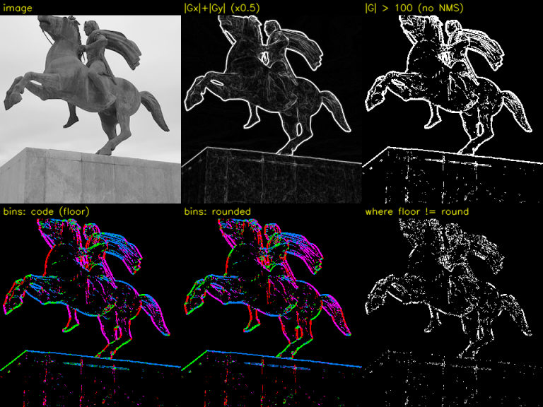

방향 색: 🔴 0번(→, 세로선) / 🟢 1번(↘) / 🔵 2번(↓, 가로선) / 🟣 3번(↙). |G| ≤ 100인 곳은 검은색이에요.

1. **|Gx| + |Gy|**: 동상 윤곽이 하얗게 빛나는데, 선이 **두툼**해요. 하늘은 거의 검고, 받침대 돌 이음매도 약하게 보입니다.
2. **|G| > 100 그냥 자르기**: 비최대 억제 없이 임계값만 적용한 결과예요. 윤곽이 **굵은 붓으로 칠한 것처럼 뭉툭**합니다. 6-4-b의 "7칸짜리 띠"가 이미지 전체에서 일어난 모습이에요. 이걸 보면 왜 ③ 단계가 필요한지 알 수 있습니다.
3. **방향 구간 (두 버전)**: 같은 윤곽선을 따라가며 색이 바뀌어요. 말의 다리처럼 곧게 선 부분은 대부분 🔴, 말 등이나 받침대 윗면처럼 누운 부분은 🔵 쪽이 많습니다.
4. **두 버전이 다른 곳**: 윤곽선 **거의 전체에 하얀 점이 흩어져** 있어요 (44.9%). 특정 부분만이 아니라 에지 곳곳에서 비교 방향이 어긋난다는 뜻입니다.

---

## 📋 Step 6-1 ~ 6-4 요약

| 개념 | 한 줄 정리 |
|---|---|
| 캐니 3조건 | ① 잘 찾기 ② 정확한 위치 ③ 한 에지에 한 응답 |
| 4단계 | 블러 → 크기와 방향 → 비최대 억제 → 이력 임계값 |
| ① 블러 | 미분 전에 잡음을 누름. **코드의 σ = 0.3은 가운데 가중치 99.2%라 사실상 블러 없음** |
| `cv2.Canny` | 내부에 가우시안 블러가 없음 → 직접 블러해야 함 (13번처럼) |
| ② 크기 | L1(\|Gx\| + \|Gy\|) 사용. `cv2.Canny` 기본값(`L2gradient=False`)과 맞추려는 선택 |
| 두꺼운 에지 | 경계 하나가 7칸짜리 띠 (116 … 880 … 100) → ③이 필요한 이유 |
| ② 방향 | phase ÷ 45° → 정수 → % 4. 반대 방향은 같은 에지라서 4개 구간 |
| **방향 버그** | 버림 때문에 구간이 22.5° 밀림. 정확한 45° 대각선(270, 270)이 0번으로. 강한 에지의 44.9%가 어긋남 |
| 수정 | `(phase + π/8) / (π/4)`로 반올림 |

### ✅ 확인 질문

1. Gx = −50, Gy = 120일 때 각도는 약 몇 도이고, 코드(버림) 구간 번호와 올바른(반올림) 구간 번호는 각각 무엇일까요? (힌트: atan2(120, −50) ≈ 112.6°)
2. 6-4-b의 크기 값 `… 116 460 880 464 170 152 100 …`에서, 그래디언트 방향이 0번(→)이라고 할 때 "왼쪽 이웃과 오른쪽 이웃보다 모두 큰" 값은 무엇인가요? 그 값만 남기면 에지 두께는 몇 픽셀이 될까요?
3. 블러 σ를 0.3에서 2.0으로 키우면, 6-4-b의 880(꼭대기 값)과 띠의 두께는 각각 어떻게 변할까요? (Part 4-2-b의 "에지가 경사로가 된다"를 떠올려 보세요.)

---

다음은 **Step 6-5: ③ 비최대 억제(NMS)**입니다. `values = sobel[i-1:i+2, j-1:j+2].flatten()`의 0 ~ 8 인덱스 그림, `first = [3, 0, 1, 2]`와 `values[id]`, `values[8 - id]`의 **대칭 트릭**을 해독하고, 작은 격자에서 NMS 전후를 한 칸씩 비교해요. 그리고 `v1 < sobel[i, j] > v2`의 **엄격한 부등호** 때문에 완벽한 계단 에지가 통째로 사라지는 함정도 실험으로 보여드릴게요.

**"다음"**이라고 하시면 이어가고, 어려운 부분이 있으면 **"더 쉽게"**라고 해 주세요.


---

## Q13  <sub>2026-10-27T12:22:00.020Z</sub>

> 다음


### A13

# Part 6. 캐니 에지 — Step 6-5: ③ 비최대 억제 (NMS)

대상은 [chap07/08.edge_canny.py:3-35](chap07/08.edge_canny.py#L3-L35)예요. 이번에도 숫자는 전부 실행해서 확인했어요.

이번 Step에서 다루는 것은 세 가지예요.
- **동점 함정**(새로 찾은 코드 문제): 부등호가 엄격해서 생겨요.
- **방향 버그의 실제 피해**: 지난번 6-4-d의 버림 문제가 NMS 결과를 얼마나 바꾸는지 측정했어요.
- **비교용 함수의 한계**: `nonmax_suppression1`이 왜 점선을 만드는지 봐요.

---

## 🔁 지난 퀴즈 답

**1번. Gx = −50, Gy = 120**

```
cv2.phase → 112.62°
코드 (버림):    112.62 ÷ 45          = 2.503  → 2번 (↓, 위·아래 비교)
반올림:        (112.62 + 22.5) ÷ 45 = 3.003  → 3번 (↙, 오른쪽 위·왼쪽 아래 비교)
```

반올림 기준 정답은 **3번**이에요. 다만 112.62°는 구간 경계(112.5°)를 0.12° 넘었을 뿐이에요. 90°와 135°의 거의 한가운데라서, 어느 쪽으로 비교해도 실제 방향과 약 22.5° 어긋나요. 이것이 **4방향 어림의 근본 한계**이고, 6-5-f에서 다시 다룹니다.

**2번. 0번(→)으로 좌우 비교할 때**

```
값      :  116  460  880  464  170  152  100
왼쪽 이웃 :   28  116  460  880  464  170  152
오른쪽 이웃:  460  880  464  170  152  100   80
둘 다 큼?   ✗    ✗    ✓    ✗    ✗    ✗    ✗
```

**880 하나만 남고 두께는 1픽셀**이 돼요. 이게 바로 이번 Step의 주제입니다.

**3번. σ를 0.3에서 2.0으로 키우면** (같은 180행, x = 110 ~ 127을 실제로 계산)

```
σ = 0.3 :   4   4   6  20  58  28 116 460 880 464 170 152 100  80  78  42  28  18
σ = 2.0 :  54  76 102 134 172 216 260 284 276 226 146  68  38  28  24  18  12  10
```

- **꼭대기 높이:** 880에서 **284**로 약 1/3이 됐어요. 계단이 완만한 경사로로 바뀌어서 기울기가 작아진 거예요.
- **100을 넘는 칸:** 7칸에서 **9칸**으로 늘었어요. 산이 낮고 펑퍼짐해졌어요.
- **꼭대기 위치:** 118열에서 117열로 한 칸 이동했어요. 블러를 세게 하면 잡음에는 강해지지만(조건 ①) 위치 정확도(조건 ②)를 조금 잃어요. 캐니 3조건 사이의 **트레이드오프**예요.
- **NMS 이후:** 여전히 꼭대기 한 칸만 남으니 선 두께는 1픽셀 그대로예요. 대신 크기 값이 전체적으로 작아졌으니 **임계값 100/150도 함께 낮춰야** 해요. 블러 σ와 임계값은 한 세트로 조정하는 값입니다.

---

## Step 6-5. ③ 비최대 억제 (Non-Maximum Suppression)

### 6-5-a. 아이디어: 능선 꼭대기만 남기기

이름을 그대로 풀면 "최대가 **아닌**(Non-Maximum) 것을 **억제**(Suppression)한다", 즉 **0으로 만든다**는 뜻이에요.

6-4-b에서 본 180행 단면을 막대로 세우면 이렇게 생겼어요.

```
열 116 │███                       116   비탈 → 지움
열 117 │███████████               460   비탈 → 지움
열 118 │██████████████████████    880   ★ 꼭대기 → 남김
열 119 │████████████              464   비탈 → 지움
열 120 │████                      170   비탈 → 지움
열 121 │████                      152   비탈 → 지움
열 122 │███                       100   비탈 → 지움 (작은 혹이지만 꼭대기는 아님)
```

규칙은 한 줄이에요.

> **"그래디언트 방향으로 양옆에 있는 이웃 두 개보다 크면 남기고, 아니면 0."**

### 6-5-b. 왜 꼭 "그래디언트 방향" 이웃이어야 할까? 실제 3×3 창으로 보기

위 880 화소, 즉 (행 180, 열 118)을 중심으로 한 실제 3×3 창이에요.

```
            열117  열118  열119
  행179  │  938    702    122  │
  행180  │  460   [880]   464  │
  행181  │   68    702    770  │

  Gx = −592, Gy = 288  →  각도 154° (대부분 ←, 약간 ↓)
```

**938 → 880 → 770이 대각선으로 이어져 있어요.** 이 셋은 말 앞다리 **윤곽선 하나 위에 나란히 놓인 화소**예요. 그래디언트는 이 선을 **가로지르는** 방향(154°)을 가리켜요.

```
            열117  열118  열119
  행179  │ (938)   702  ·122· │     ( ) = 같은 에지 선 위의 이웃 (선을 "따라가는" 방향)
  행180  │  460   [880]   464  │     · · = 에지를 "가로지르는" 이웃 (그래디언트 방향, 구간 3)
  행181  │ ·68·    702  (770) │
```

네 방향 중 어느 쪽으로 비교하느냐에 따라 880의 운명이 갈려요.

| 구간 | 비교하는 두 이웃 | 값 | 880이 둘보다 큰가? | 결과 |
|---|---|---|---|---|
| 0 (→) | 왼쪽, 오른쪽 | 460, 464 | ✓ | 남김 |
| 1 (↘) | 왼쪽 위, 오른쪽 아래 | **938**, 770 | ✗ (938이 더 큼) | **지움 ❌** |
| 2 (↓) | 위, 아래 | 702, 702 | ✓ | 남김 |
| **3 (↙) ← 실제 구간** | 오른쪽 위, 왼쪽 아래 | 122, 68 | ✓ | **남김 ✅** |

154°는 버림으로도 반올림으로도 3번이라, 이 화소는 운 좋게 맞는 경우예요.

**1번 줄이 핵심이에요.** 938은 비탈이 아니라 **같은 선의 옆 화소**예요. 선을 따라가며 비교하면 에지 화소끼리 키를 재다가 서로를 지우고, 선이 **점선으로 끊겨요.**

🧠 **비유: 지붕 용마루 찾기.** 용마루(지붕 꼭대기 줄)를 찾으려면 **지붕 경사를 따라 위아래로**(가로지르는 방향) 봐야 해요. 용마루를 **따라 옆으로** 보면 용마루 기와끼리 높이를 비교하게 되고, 조금이라도 낮은 기와는 "꼭대기가 아니다"라며 빠져서 용마루가 군데군데 끊겨요.

### 6-5-c. 코드 해독: `first = [3, 0, 1, 2]` 트릭 (9 ~ 12줄)

```python
values = sobel[i-1:i+2, j-1:j+2].flatten()    #  9줄: 3×3 창을 1차원 9칸으로 폄
first = [3, 0, 1, 2]                          # 10줄
id = first[direct[i, j]]                      # 11줄: 방향 구간 → 한쪽 이웃 번호
v1, v2 = values[id], values[8-id]             # 12줄: 반대쪽 이웃 번호는 8 − id
```

**① flatten 번호표**

> 📚 **복습 (numpy):** `flatten()`은 2차원 배열을 **행 우선 순서**(첫 행 왼쪽→오른쪽, 그다음 행…)로 1차원으로 펴고, **복사본**을 돌려줘요.

```
 3×3 창 (행, 열)                              flatten 번호
 (i-1,j-1)  (i-1,j)  (i-1,j+1)                 0   1   2
 (i,  j-1)  (i,  j)  (i,  j+1)        →        3  [4]  5
 (i+1,j-1)  (i+1,j)  (i+1,j+1)                 6   7   8

 번호 = 4 + 3·(행 이동) + (열 이동)       예) 오른쪽 위: 4 + 3·(−1) + (+1) = 2
```

**② 정반대 칸끼리는 번호 합이 항상 8**

```
 0 ↔ 8   (↖ ↘)     0 + 8 = 8
 1 ↔ 7   (↑ ↓)     1 + 7 = 8
 2 ↔ 6   (↗ ↙)     2 + 6 = 8
 3 ↔ 5   (← →)     3 + 5 = 8
```

**왜 그럴까요?** 가운데를 기준으로 정반대 칸은 행 이동과 열 이동의 **부호가 둘 다 뒤집혀요.**

```
한쪽:   4 + 3·dr + dc
반대쪽: 4 − 3·dr − dc
합   :  8
```

그래서 **한쪽 번호 `id`만 알면 반대쪽은 `8 − id`**예요. 방향마다 두 칸을 따로 적을 필요가 없어요.

**③ `first`는 "방향 구간 → 한쪽 이웃 번호" 변환표**

| direct (구간) | id = first[direct] | v1 = values[id] | v2 = values[8 − id] | 주석 if문(15 ~ 22줄)과 대조 |
|---|---|---|---|---|
| 0 (0°, →) | **3** | 왼쪽 (i, j−1) | 5: 오른쪽 (i, j+1) | ✓ 같음 |
| 1 (45°, ↘) | **0** | 왼쪽 위 (i−1, j−1) | 8: 오른쪽 아래 (i+1, j+1) | ✓ 같음 |
| 2 (90°, ↓) | **1** | 위 (i−1, j) | 7: 아래 (i+1, j) | ✓ 같음 |
| 3 (135°, ↙) | **2** | 오른쪽 위 (i−1, j+1) | 6: 왼쪽 아래 (i+1, j−1) | ✓ v1·v2 순서만 반대 |

구간이 45°씩 커질 때 한쪽 이웃 번호는 **3 → 0 → 1 → 2**로, 가운데를 **시계 방향으로 한 칸씩** 돌아요.

```
  0 ──→ 1 ──→ 2        구간 0: 3 (왼쪽)
  ↑                     구간 1: 0 (왼쪽 위)
  3    [4]    5         구간 2: 1 (위)
                        구간 3: 2 (오른쪽 위)
  6     7     8
```

이미지 좌표는 y축이 아래를 향해서, 각도가 커지면 화면에서는 시계 방향으로 돌아요(Part 2-2-c). 그 회전이 그대로 번호표에 나타난 거예요.

**④ 실제 값 대입 (6-5-b의 창)**

```
values = [938, 702, 122, 460, 880, 464,  68, 702, 770]
번호   :   0    1    2    3    4    5    6    7    8

direct[180, 118] = 3
id = first[3]       = 2
v1 = values[2]      = 122     (오른쪽 위)
v2 = values[8 − 2]  = values[6] = 68    (왼쪽 아래)
```

**⑤ 판정 (24줄)**

```python
dst[i, j] = sobel[i, j] if (v1 < sobel[i , j] > v2) else 0
```

> 📚 **파이썬 문법:** `a < b > c`는 **연쇄 비교**예요. `a < b and b > c`와 같고, "b가 a보다도 크고 c보다도 크다"는 뜻이에요.

```
122 < 880 > 68   →   True and True   →   dst[180, 118] = 880  (남김)
```

📌 **결과를 `sobel`이 아니라 새 배열 `dst`에 쓰는 이유:** Part 1의 회선 레시피와 같아요. 같은 배열에 0을 써 넣으면, 다음 화소가 **이미 지워진 값**과 비교하게 돼서 결과가 순회 순서에 따라 달라져요. "읽기는 원본에서, 쓰기는 새 배열에" 원칙입니다. 테두리(0행, 마지막 행 등)는 반복문이 건너뛰니 0으로 남아요.

### 6-5-d. 작은 격자로 NMS 전후 비교 (실제 데이터, 행 177 ~ 184, 열 112 ~ 120)

말 앞다리 윤곽이 가로로 누웠다가 아래로 휘어지는 부분이에요.

**NMS 전 (|Gx| + |Gy|)**

```
열 →   112  113  114  115  116  117  118  119  120
행177  832  826  670  334   94  154  146   98   94
행178  258  534  814  874  814  510  194   94   44
행179   42   22  168  432  770  938  702  122  158
행180    6   20   58   28  116  460  880  464  170
행181    6   10    8   22   86   68  702  770  132
행182    4    2    0    0   30   26  462  904  244
행183    4    4    0    0   10   56  300  942  508
행184    2    4    0    0    4   62  182  830  690
```

100을 넘는 칸이 **37개**이고, 띠 두께가 3 ~ 7칸이에요.

**NMS 후 (코드 그대로 실행, `·` = 0)**

```
열 →   112  113  114  115  116  117  118  119  120
행177  832  826    ·    ·    ·    ·    ·    ·   94
행178    ·    ·  814  874  814    ·  194    ·    ·
행179    ·    ·    ·    ·    ·  938    ·    ·    ·
행180    ·    ·    ·    ·    ·    ·  880    ·    ·
행181    ·    ·    ·    ·    ·    ·  702  770    ·
행182    ·    ·    ·    ·    ·    ·    ·  904    ·
행183    ·    4    ·    ·    ·    ·    ·  942    ·
행184    ·    4    ·    ·    ·    ·    ·  830  690
```

100을 넘는 칸이 **14개**로 줄었어요. 모양만 점으로 찍어 보면 이래요.

```
열 →   112 113 114 115 116 117 118 119 120
행177   ●   ●   ·   ·   ·   ·   ·   ·   ·
행178   ·   ·   ●   ●   ●   ·   ○   ·   ·      ● = 남은 강한 값 (> 100)
행179   ·   ·   ·   ·   ·   ●   ·   ·   ·      ○ = 194, 곁가지
행180   ·   ·   ·   ·   ·   ·   ●   ·   ·
행181   ·   ·   ·   ·   ·   ·   ●   ●   ·
행182   ·   ·   ·   ·   ·   ·   ·   ●   ·
행183   ·   ·   ·   ·   ·   ·   ·   ●   ·
행184   ·   ·   ·   ·   ·   ·   ·   ●   ●
```

3 ~ 7칸 두께의 띠가 **8방향으로 이어진 가는 선 하나**가 됐어요. 관찰할 점은 세 가지예요.

1. **누운 부분(177 ~ 178행)**은 주로 위·아래 비교로, **선 부분(181 ~ 184행)**은 대각선 비교로 꼭대기를 골랐어요.
2. **○ 194 (178, 118)**은 **방향 버그가 남긴 군더더기**예요.
   - 각도가 73°라서 반올림하면 2번(위·아래)이 돼요. 위·아래 비교라면 아래쪽 702보다 작아서 지워졌어야 해요.
   - 버림 때문에 1번(대각선)으로 분류됐고, 대각선 이웃 154와 122보다는 커서 살아남았어요.
3. **181행의 702와 770처럼 2칸 두께인 곳**도 있어요. 곡선을 3×3 격자 위에 그리면 생기는 계단 현상이라, 6-5-f의 "정답지"도 이 둘을 모두 남겨요. NMS가 항상 완벽한 1픽셀을 보장하지는 않아요.

**NMS는 임계값을 쓰지 않아요.** 오직 "주변보다 높은 봉우리인가"만 봐요. 그래서 평평한 하늘의 4 ~ 6짜리 잡음 혹(위 격자의 `4`, `94`)도 봉우리면 살아남아요.
- 이미지 전체에서 NMS 후 0이 아닌 화소: **31,665개**
- 그중 100 이하: **25,772개**

이것들을 치우는 건 다음 Step ④(이력 임계값)의 일이에요.

> 📌 **③ NMS = 얇게 만들기 (thinning)**, **④ 이력 임계값 = 고르기 (selection)**. 역할이 나뉘어 있어요.

### 6-5-e. ⚠️ 코드 문제 ①: 부등호가 엄격해서 완벽한 계단 에지가 통째로 사라짐

24줄의 `v1 < s > v2`는 **양쪽 모두 엄격하게(<)** 비교해요. 이웃과 값이 **같으면** 탈락이에요. 완벽한 계단 영상으로 실험해 볼게요.

```
원본 한 행 :     0    0    0    0  255  255  255  255
           열0    1    2    3    4    5    6    7
|Gx|+|Gy|  :     0    0    0 1020 1020    0    0    0
                           └──────────┘
                   경계를 사이에 둔 두 칸이 똑같이 1020
```

**왜 똑같을까요?**
- 소벨 Gx는 "오른쪽 − 왼쪽"을 **2칸 간격**으로 봐요(Part 2의 중앙 차분).
- 열 3: (1 + 2 + 1) × (f[4] − f[2]) = 4 × 255 = 1020
- 열 4: 4 × (f[5] − f[3]) = 4 × 255 = 1020

1칸짜리 계단에 대해 **쌍둥이 봉우리**가 생기는 거예요. 코드의 판정을 따라가면:

```
열 3:  v1 = 0,    v2 = 1020   →   0 < 1020 > 1020 ?   →  1020 > 1020 거짓  →  0
열 4:  v1 = 1020, v2 = 0      →   1020 < 1020 > 0 ?   →  1020 < 1020 거짓  →  0
```

**둘 다 지워져요.** 쌍둥이가 서로 "내가 더 크지 않네"라며 동시에 물러나는 셈이에요.

40×40 계단 영상 전체로 확인한 결과:

| 방식 | 남은 에지 화소 |
|---|---|
| **코드 NMS (24줄)** | **0개** ← 에지가 하나도 없음 |
| `cv2.Canny(step, 100, 150)` | 40개 (세로 한 줄) |

`cv2.Canny`의 실제 출력(7×8 계단):

```
0 0 0 255 0 0 0 0      ← 7행 모두 똑같이 열 3만 255
```

OpenCV는 **한쪽은 `>`, 다른 쪽은 `>=`**로 비교해서 동점이면 한쪽만 살려요. 소스에서 좌우·상하 비교는 `m > 왼쪽(위) && m >= 오른쪽(아래)` 형태예요.
- 열 3: 1020 > 0 그리고 1020 >= 1020 → **남김**
- 열 4: 1020 > 1020 거짓 → 지움

그래서 정확히 한 줄만 나오고, 어두운 쪽(열 3)이 선택됐어요. 계단을 뒤집거나(255 → 0) 가로 방향으로 돌려도 똑같이 한 줄이 나오는 것까지 확인했어요.

**고치는 법:**

```python
s = sobel[i, j]
dst[i, j] = s if (s > v1 and s >= v2) else 0      # 동점이면 한쪽만 살림
```

**실제 사진에서는 얼마나 생길까요?** 이 기마상 사진에서 동점 때문에 사라진 강한 에지는 **30화소**뿐이에요. 잡음 덕분에 정확히 같은 값이 나오기 어렵기 때문이에요. 하지만 **합성 영상**(검은 바탕에 흰 사각형, 렌더링한 체커보드 등)에서는 **100% 발생**해요.

### 6-5-f. ⚠️ 방향 버그(6-4-d)가 NMS 결과에 끼치는 실제 영향

6-4-d에서 "강한 에지의 44.9%가 엉뚱한 이웃과 비교된다"고 했죠. 그게 결과를 얼마나 망가뜨리는지 측정하려면 **정답지**가 필요해요.

**정답지 = 보간 NMS.** 4방향으로 어림하지 않고, **실제 그래디언트 방향(예: 154°)으로 정확히 1픽셀 떨어진 지점**의 값을 읽어서 비교해요. 그 지점은 보통 화소 사이에 걸치니까, 주변 네 화소를 거리 비율로 섞어서 읽어요. 이 방법을 양선형 보간이라고 하고, chap08의 [03.scaling_bilinear.py](chap08/03.scaling_bilinear.py)에서 배울 거예요.

| 버전 | 남은 화소 (> 100) | 정밀도 | 재현율 | 조각 수 |
|---|---|---|---|---|
| **보간 NMS (정답지)** | 6,039 | — | — | 668 |
| **코드: 버림 + 엄격 부등호** | 5,893 | 91.5% | **89.3%** | **780** |
| 수정: 반올림 + (`>`, `>=`) | 6,280 | 91.5% | 95.1% | 692 |
| 3×3 최대 (`nonmax_suppression1`) | 1,617 | 100% | 26.8% | 1,571 |

용어 풀이:
- **정밀도** = 내가 남긴 화소 중 정답지도 남긴 비율 → "헛것을 얼마나 안 남겼나"
- **재현율** = 정답지가 남긴 화소 중 내가 찾아낸 비율 → "진짜를 얼마나 안 놓쳤나"
- **조각 수** = 8방향으로 이어진 덩어리 개수 → 많을수록 선이 자주 끊김

결과 해석:
1. **정밀도는 같아요 (91.5%).** 코드가 헛것을 더 많이 남기지는 않아요.
2. **재현율이 달라요.** 코드는 진짜 능선의 **10.7%를 놓치고**, 수정본은 4.9%만 놓쳐요.
3. **조각 수가 780 대 692예요.** 코드 쪽 선이 약 90군데 더 끊겨 있어요. 다음 Step의 추적(`trace`)은 끊긴 틈을 건너지 못하니, 이 차이는 **최종 에지가 짧아지는 것**으로 이어져요.
4. 동점 수정의 효과는 이 사진에서 30화소뿐이에요. 차이의 대부분은 **방향 반올림**에서 와요.
5. **수정본도 완벽하지 않아요.** 정밀도 91.5%의 나머지는 퀴즈 1번(112.6°)처럼 4방향 사이에 끼인 각도에서 생겨요. `cv2.Canny`도 4방향을 쓰지만 경계를 tan 22.5°로 잡아 **반올림이 올바르게** 되어 있어요(소스의 상수 `TG22 = 13573` = tan 22.5° × 2¹⁵).

### 6-5-g. 비교용 함수 `nonmax_suppression1` (27 ~ 35줄): 3×3 전체 최대

```python
values = sobel[i-1:i+2, j-1:j+2].flat
max = np.max(values)
dst[i, j] = sobel[i, j] if sobel[i , j] >= max else 0
```

**방향을 안 쓰고**, 8개 이웃 **전부**보다 크거나 같아야 남겨요. 즉 6-5-b 표의 1번 줄 실수(선을 따라 비교)를 **모든 방향에서** 저지르는 셈이에요. 6-5-b의 880도 같은 선 위의 938 때문에 지워져요.

- 결과: **1,617화소**만 남아요. 정밀도는 **100%**예요. 8방향 전부보다 크면 그래디언트 방향 두 이웃보다도 당연히 크니까, 남긴 건 전부 진짜 꼭대기예요.
- 하지만 **재현율은 26.8%**로, 진짜 능선의 73%를 버려요.
- **조각이 1,571개**로, 남은 화소 수와 거의 같아요. 화소 하나하나가 따로 떨어진 **점선**이라는 뜻이에요.

08 코드에서 이 함수는 **정의만 되어 있고 호출되지 않아요** (71줄은 `nonmax_suppression` 사용). "방향 정보가 왜 필요한가"를 보여 주는 비교용이에요.

> 🔧 **작은 코드 메모 (동작에는 영향 없음):** 11줄의 `id`와 33줄의 `max`는 파이썬 **내장 함수 이름을 가려요.** 함수 안에서 나중에 `max(...)`를 쓰려고 하면 에러가 나니, `idx`, `vmax` 같은 이름이 안전해요.

### 6-5-h. 🖼️ 그림으로 보기

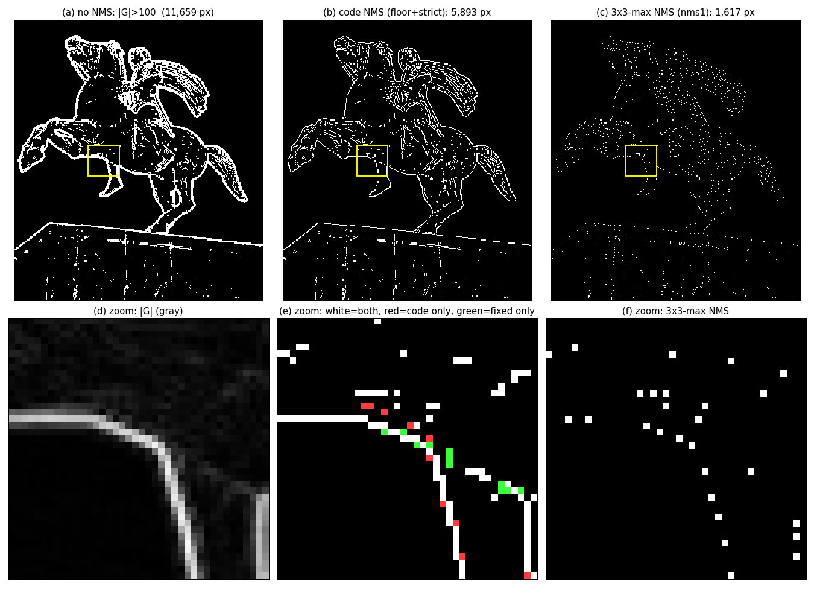

위 줄은 이미지 전체, 아래 줄은 노란 상자 부분(말 앞다리, 행 160 ~ 200, 열 95 ~ 135)을 확대한 거예요.

1. **(a) NMS 없이 > 100 (11,659화소):** 말과 기수의 윤곽이 **굵은 매직펜**으로 그린 것처럼 뭉툭해요.
2. **(b) 코드 NMS (5,893화소):** 같은 윤곽이 **가는 펜 선**이 됐어요. 말갈기와 꼬리의 결, 받침대 윗면 모서리가 한 줄로 또렷해요. 받침대 돌 이음매와 하늘의 잡음 일부는 ④가 정리할 몫이에요.
3. **(c) 3×3 최대 (1,617화소):** 윤곽 자리에 **스프레이로 뿌린 듯한 점**만 남았어요. 형체는 알아보지만 선이 아니에요.
4. **(d) 확대한 |G|:** 회색 띠가 3 ~ 5칸 두께로 휘어져 내려가요.
5. **(e) 확대 비교:** 흰색은 코드와 수정본이 둘 다 남긴 곳, 빨강은 코드만, 초록은 수정본만 남긴 곳이에요. 휘어지는 곳의 계단 모서리에 빨강과 초록이 **섞여** 있어요. 한 화소씩 보면 어느 쪽이 항상 낫다고 말하기 어렵고, 6-5-f 같은 **전체 통계로 봐야 차이가 드러나요.**
6. **(f) 확대 3×3 최대:** 윤곽선 자리에 점이 듬성듬성 찍혀 있어요.

### 6-5-i. 🚗 AVM 연결

- **주차선 폭 측정**
  - 흰 페인트 선에는 에지가 **두 개**(왼쪽 경계, 오른쪽 경계) 있어요.
  - NMS로 각 경계가 1픽셀 선이 돼야 두 선 사이 거리 = 페인트 폭(픽셀)을 잴 수 있어요.
  - 탑뷰에서 1픽셀이 몇 cm인지 알면 실제 폭을 검증할 수 있어요. NMS 없이 7칸짜리 띠면 측정값이 몇 픽셀씩 흔들려요.
  - 반대로 선이 소벨 폭(약 3칸)보다 좁게 찍히면 두 능선이 하나로 합쳐져요. 멀리 있는 선이나 어안 가장자리처럼 **압축된 선**에서 생겨요.
- **어안 영상과 방향 버그:** 직선 주차선도 어안에서는 휘어져 보여서, 선을 따라 **방향이 연속적으로 바뀌어요.** 모든 각도가 다 등장하니 6-5-f의 방향 버그가 화면 전체에 영향을 줘요.
- **단위 테스트의 함정:** 검은 바탕에 흰 직사각형으로 주차선 검출 테스트를 만들면, 6-5-e의 동점 함정 때문에 이 구현은 **에지를 0개** 돌려줘요. 테스트가 실패해도 원인이 "알고리즘"이 아니라 "부등호 한 글자"일 수 있어요.

---

## 📋 Step 6-5 요약

| 개념 | 한 줄 정리 |
|---|---|
| NMS | 그래디언트 방향 양옆 두 이웃보다 크면 남기고 아니면 0 → 띠가 1픽셀 선으로 |
| 왜 그래디언트 방향? | 선을 **따라** 비교하면 같은 선 화소끼리 지워서 점선이 됨 (880 vs 938) |
| flatten 번호 | 0 ~ 8, 가운데 4, 정반대 칸은 번호 합이 8 → `values[id]`, `values[8 − id]` |
| `first = [3, 0, 1, 2]` | 방향 구간 → 한쪽 이웃 번호 (왼쪽 → 왼쪽 위 → 위 → 오른쪽 위, 시계 방향) |
| 새 배열 `dst` | 지운 값과 다시 비교하지 않도록 (Part 1 회선 원칙) |
| NMS는 임계값 없음 | 하늘 잡음 혹도 남음 (31,665개 중 25,772개 ≤ 100) → ④가 정리 |
| **동점 함정** | `v1 < s > v2`라 쌍둥이 봉우리가 둘 다 사라짐. 계단 영상에서 에지 0개. `s > v1 and s >= v2`로 수정 |
| **방향 버그 피해** | 재현율 89.3% vs 95.1%, 조각 780 vs 692 → 선이 더 자주 끊김 |
| `nonmax_suppression1` | 3×3 전체 최대 → 정밀도 100%, 재현율 26.8%, 점선 (호출되지 않는 비교용) |

### ✅ 확인 질문

1. 다음 3×3 창에서 `direct = 0`일 때 `id`, `v1`, `v2`는 무엇인가요? 그리고 **코드(24줄)**와 **수정본(`s > v1 and s >= v2`)**의 결과는 각각 무엇일까요?
   ```
    10   50   90
    20  100  100
    30   60   95
   ```
2. `first`를 `[5, 8, 7, 6]`으로 바꾸면 코드(24줄)의 결과가 달라질까요? 수정본(`>`와 `>=`)에서는요?
3. 6-5-d 격자에서 NMS 후에도 남은 **194, 94, 4**는 다음 단계(low = 100, high = 150)에서 각각 어떻게 될까요? 힌트: 이 세 값이 low, high와 비교해 어디에 있는지부터 보세요.

---

다음은 **Step 6-6: ④ 이력 임계값 (37 ~ 56줄)**이에요. 내용은 이래요.
- 두 임계값으로 화소를 **강한 / 약한 / 버림** 세 부류로 나누는 이유를 봐요.
- 재귀 `trace()`가 8방향으로 퍼지는 순서를 작은 격자에서 **호출 하나하나** 따라가요.
- 코드의 위험 요소 두 가지를 확인해요.
  - 전역 변수 `pos_ck`, `canny`를 쓰는 문제
  - 긴 에지에서 **재귀 깊이 한계**에 걸리는 문제
- 이어서 6-7에서는 직접 만든 캐니와 `cv2.Canny` 결과를 나란히 비교해요.

**"다음"**이라고 하시면 이어가고, 어려운 부분이 있으면 **"더 쉽게"**라고 해 주세요. 이번에도 파일은 수정하지 않았어요.


---

## Q14  <sub>2026-10-27T12:52:20.135Z</sub>

> 다음


### A14

계산은 다 끝났어요(재귀 깊이 한계 테스트까지 확인). 마지막으로 이력 임계값 비교 그림을 만들고 설명을 쓸게요.

# Part 6. 캐니 에지 — Step 6-6: ④ 이력 임계값 (Hysteresis Thresholding)

대상은 [chap07/08.edge_canny.py:37-56](chap07/08.edge_canny.py#L37-L56)예요. 숫자는 이번에도 전부 실행해서 확인했어요.

이번 Step에서는 코드 문제를 **두 개** 더 다뤄요.
- **재귀 깊이 한계:** 긴 에지에서 프로그램이 죽어요.
- **전역 변수:** 두 번째 호출의 결과가 틀려요.

또 하나 재미있는 걸 발견했어요. 앞 Step의 버그들이 이 재귀 버그를 **가리고** 있었어요.

---

## 🔁 지난 퀴즈 답

**1번.** `direct = 0`이면 `id = first[0] = 3`이에요.

```
values = [10, 50, 90, 20, 100, 100, 30, 60, 95]
v1 = values[3] = 20,   v2 = values[5] = 100

코드 (24줄):  20 < 100 > 100 ?   → 100 > 100 거짓 → 0 (지워짐)
수정본     :  100 > 20 and 100 >= 100 → 참   → 100 (남음)
```

6-5-e의 **동점 함정**이 그대로 나타난 예예요.

**2번.** `first = [5, 8, 7, 6]`이면 v1과 v2만 **서로 바뀌고 비교하는 쌍은 그대로**예요(5↔3, 8↔0, 7↔1, 6↔2).
- **코드(24줄):** `v1 < s > v2`는 좌우 대칭이라 결과가 **완전히 같아요.**
- **수정본:** `s > v1 and s >= v2`는 비대칭이라 **동점일 때 살아남는 쪽이 뒤집혀요.** 계단 영상에서 원래는 어두운 쪽(열 3)이 남았는데, 바꾸면 밝은 쪽(열 4)이 남아요.

**3번.** 실제로 끝까지 실행해서 확인했어요.

| 값 | low(100), high(150)와 비교 | 최종 결과 |
|---|---|---|
| 194 (178, 118) | > 150 → **강한 에지** | **255로 남음.** 방향 버그가 만든 곁가지가 최종 결과까지 살아남았어요 |
| 94 (177, 120) | ≤ 100 | 0 |
| 4 (183, 113) | ≤ 100 | 0 |

---

## Step 6-6. ④ 이력 임계값

### 6-6-a. 임계값 하나로는 왜 안 될까?

NMS가 끝난 지도에는 진짜 에지, 약한 진짜 에지, 잡음 봉우리가 섞여 있어요. 여기서 **임계값 하나**로 고르면 딜레마가 생겨요.

예시로, 윤곽선 하나를 **따라가며** 읽은 값과 근처의 잡음 점을 생각해 볼게요(설명용 가상 값).

```
선을 따라 읽은 값 :  420  380  160  130  120  140  170  390  450       근처 잡음 점: 120
                              └── 그림자로 약해진 구간 ──┘

> 150 하나만      :   ●    ●    ●    ·    ·    ·    ●    ●    ●       잡음: ·
                                    ↑ 선이 끊김 ❌                       잡음 제거 ✅

> 100 하나만      :   ●    ●    ●    ●    ●    ●    ●    ●    ●       잡음: ● ❌
                       선은 이어짐 ✅                                      잡음도 남음
```

- **높은 임계값:** 깨끗하지만 **끊겨요.**
- **낮은 임계값:** 이어지지만 **지저분해요.**

**실제 기마상 사진**(NMS 후)에서 측정한 값이에요.

| 방식 | 남은 화소 | 조각 수 | 2화소 이하 자투리 |
|---|---|---|---|
| > 150 하나만 | 3,906 | 390 | 239 |
| > 100 하나만 | 5,893 | 780 | 448 |
| **이력 임계값 100 / 150** | **4,921** | **278** | **61** |

**이력 임계값의 조각 수(278)가 > 150 하나만 쓴 경우(390)보다도 적어요.** 화소는 더 많은데 조각은 더 적다는 건, 약한 화소가 강한 선 사이의 **틈을 메워서 이어 붙였다**는 뜻이에요. 동시에 따로 떨어진 잡음 점은 버렸어요.

### 6-6-b. 세 부류로 나누기

```
 NMS 후 크기 m
 0 ──────────────────── 100 ───────────────────── 150 ─────────────────────→
      ✗ 버림 (m ≤ 100)    │   약한 에지 (100 < m ≤ 150)  │    강한 에지 (m > 150)
      무조건 0            │   강한 에지와 이어지면 남김    │    무조건 남김 (출발점)
                          │                             │
              40줄: max_sobel[i, j] > low     56줄: max_sobel[i, j] > high
```

- 두 비교 모두 **엄격한 `>`**예요. 그래서 정확히 100인 화소는 **버림**, 정확히 150인 화소는 **약한 에지**(출발점이 못 됨)예요.
- 약한 에지는 강한 에지와 **직접** 붙어 있지 않아도 돼요. **약한 에지끼리 사슬로 이어져 강한 에지에 닿기만 하면** 남아요.
- 기마상 사진에서 약한 화소 **1,987개** 중 **1,015개(51%)가 살아남고 972개가 버려졌어요.**

🧠 **비유 1: 불씨와 마른 풀**
- **강한 에지 = 불씨:** 혼자서도 타요.
- **약한 에지 = 마른 풀:** 스스로는 불이 안 붙지만, 불씨와 **이어져 있으면** 불이 번져서 타요.
- **버림 = 젖은 땅:** 불이 건너가지 못해요.

결과적으로 불씨에서 마른 풀을 타고 번진 곳만 타고, 불씨와 떨어진 마른 풀 무더기는 끝까지 안 타요.

🧠 **비유 2: "이력(Hysteresis)"이라는 이름**
에어컨 온도 조절기는 **26°에 켜지고 24°에 꺼져요.** 켜는 기준과 끄는 기준이 다르면, 25° 근처에서 켰다 껐다를 반복하는 깜빡임이 없어요. 이처럼 **과거 상태(이력)에 따라 기준이 달라지는 것**을 히스테리시스라고 해요.
- **에지에 "올라타는" 기준:** 높음 (150, 확실해야 시작)
- **에지에 "머무는" 기준:** 낮음 (100, 일단 올라탔으면 조금 약해져도 계속)

> 📌 **임계값 비율:** 캐니 원 논문은 **high : low = 2 : 1 ~ 3 : 1**을 권해요. 08번 코드는 150 : 100 = 1.5 : 1이고, 13번 코드는 `th, th*2`로 2 : 1을 써요.

### 6-6-c. 코드 구조

```python
def hysteresis_th(max_sobel, low, high):                # 52줄
    rows, cols = max_sobel.shape[:2]
    for i in range(1, rows - 1):                         # 행 우선으로 훑으며
        for j in range(1, cols - 1):
            if max_sobel[i, j] > high:  trace(max_sobel, i, j, low)  # 강한 화소에서 추적 시작
```

```python
def trace(max_sobel, i, j, low):                         # 37줄
    h, w = max_sobel.shape
    if (0 <= i < h and 0 <= j < w) == False: return      # 39줄: 이미지 밖이면 돌아감
    if pos_ck[i, j] == 0 and max_sobel[i, j] > low:      # 40줄: 처음 오는 곳이고, 버림 대상이 아니면
        pos_ck[i, j] = 255                               # 41줄: 방문 표시
        canny[i, j] = 255                                # 42줄: 결과에 에지로 기록
        trace(max_sobel, i - 1, j - 1, low)              # 43~50줄: 8방향으로 자기 자신을 다시 호출
        ...
```

**8방향 호출 순서(43 ~ 50줄)**는 **왼쪽 열 → 가운데 열 → 오른쪽 열** 순이고, 각 열 안에서는 위에서 아래로 가요.

```
 ①  ④  ⑥        ① (i-1, j-1)   ④ (i-1, j)    ⑥ (i-1, j+1)
 ②  [ ] ⑦        ② (i,   j-1)                 ⑦ (i,   j+1)
 ③  ⑤  ⑧        ③ (i+1, j-1)   ⑤ (i+1, j)    ⑧ (i+1, j+1)
```

> 📚 **재귀(recursion):** 함수가 **자기 자신을 다시 부르는 것**이에요. `trace`는 이웃이 에지면 그 이웃에서 또 `trace`를 불러요. 미로에서 갈림길이 나오면 **첫 번째 길로 끝까지 들어갔다가, 막히면 되돌아와 다음 길로** 가는 방식이에요. 이것을 **깊이 우선 탐색(DFS)**이라고 해요. 되돌아올 자리를 기억하려고 파이썬은 호출할 때마다 **호출 스택**에 한 층씩 쌓아요.

**`pos_ck`(방문 표시)가 왜 꼭 필요할까요?** 이웃한 A와 B가 둘 다 에지라고 해 볼게요. A가 B를 부르면 B도 8방향을 보다가 A를 다시 불러요. 방문 표시가 없으면 A → B → A → B …가 **끝없이** 이어져요.

### 6-6-d. 작은 격자로 `trace`를 한 칸씩 따라가기

low = 100, high = 150인 5×8 격자예요. 이미 NMS를 거친 값이라고 가정해요.

```
         열0  열1  열2  열3  열4  열5  열6  열7
 행0       0    0    0    0    0    0    0    0
 행1       0  120    0    0    0    0    0    0
 행2       0    0  200    0    0    0    0    0
 행3       0    0    0  160  120   95  130  110
 행4       0    0    0    0    0    0    0    0
```

**분류**(강 = 강한 에지, 약 = 약한 에지, ✗ = 버림, · = 0):

```
         열0  열1  열2  열3  열4  열5  열6  열7
 행1       ·    약    ·    ·    ·    ·    ·    ·
 행2       ·    ·    강    ·    ·    ·    ·    ·
 행3       ·    ·    ·    강    약    ✗    약    약
```

**`hysteresis_th`의 스캔:** 행 1 → 행 2 순으로 훑다가 **(2, 2) = 200 > 150**을 처음 발견하고 `trace(2, 2)`를 시작해요.

아래 로그는 실제 코드를 그대로 돌려서 기록한 호출 순서예요(✅ = 표시함, ✗ = 0이거나 ≤ low, ↩ = 이미 방문).

```
깊이1  trace(2,2)  200 > 100, 미방문 → ✅ 표시
│
├ 깊이2  ① trace(1,1)  120 > 100, 미방문 → ✅ 표시          ← 왼쪽 위부터 보니까 제일 먼저 감
│   ├ 깊이3  (0,0)✗ (1,0)✗ (2,0)✗ (0,1)✗ (2,1)✗ (0,2)✗ (1,2)✗
│   └ 깊이3  (2,2) ↩ 이미 방문 → 돌아감
│   (1,1)의 8방향 끝 → (2,2)로 복귀
│
├ 깊이2  ② (2,1)✗  ③ (3,1)✗  ④ (1,2)✗  ⑤ (3,2)✗  ⑥ (1,3)✗  ⑦ (2,3)✗
│
└ 깊이2  ⑧ trace(3,3)  160 > 100, 미방문 → ✅ 표시
    ├ 깊이3  (2,2)↩ (3,2)✗ (4,2)✗ (2,3)✗ (4,3)✗ (2,4)✗
    ├ 깊이3  trace(3,4)  120 > 100, 미방문 → ✅ 표시
    │   ├ 깊이4  (2,3)✗ (3,3)↩ (4,3)✗ (2,4)✗ (4,4)✗ (2,5)✗
    │   ├ 깊이4  trace(3,5)  95 ≤ 100 → ✗  ★ 여기서 막힘!
    │   └ 깊이4  (4,5)✗
    └ 깊이3  (4,4)✗

[스캔 계속]  (3,3) = 160 > 150 → trace(3,3) → ↩ 이미 방문 → 즉시 돌아감
```

- **호출 횟수:** 총 **34번**이에요. 표시한 화소 4개 × 8방향 = 32번, 시작 호출 1번, 두 번째 스캔 호출 1번.
- **최대 깊이:** 4.

**최종 결과:**

```
         열0  열1  열2  열3  열4  열5  열6  열7
 행1       ·  255    ·    ·    ·    ·    ·    ·
 행2       ·    ·  255    ·    ·    ·    ·    ·
 행3       ·    ·    ·  255  255    ·    ·    ·
```

관찰할 점은 네 가지예요.
1. **(1, 1) = 120과 (3, 4) = 120:** 약한 에지지만 강한 에지와 이어져서 **남았어요.**
2. **(3, 6) = 130과 (3, 7) = 110:** 약한 에지끼리 서로 붙어 있지만, 95라는 **"젖은 땅" 한 칸** 때문에 불이 건너가지 못해서 **버려졌어요.** 95가 105였다면 이 둘까지 모두 255가 됐을 거예요. **화소 하나가 가지 전체의 운명을 결정해요.**
3. **(3, 3) = 160:** 강한 에지라서 스캔이 시작점으로 또 부르지만, `pos_ck` 덕분에 **즉시 돌아와요.** 같은 영역을 두 번 칠하지 않아요.
4. **0인 화소도 매번 호출해요.** 표시한 화소마다 8번씩 부르기 때문이에요. 기마상 사진에서는 4,921화소를 표시하는 데 `trace`가 **43,274번** 불렸어요(화소당 약 8.8번).

### 6-6-e. ⚠️ 코드 문제 ②: 긴 에지에서 재귀 깊이 한계로 프로그램이 죽음

파이썬은 재귀를 **기본 1000층**까지만 허용해요(이 PC의 Python 3.12.9에서 `sys.getrecursionlimit()` = 1000 확인). 그런데 `trace`는 **선을 따라 한 칸 갈 때마다 한 층씩** 쌓여요.

```
trace(행, 0)                    ← 이 호출은 아래가 전부 끝나야 끝남
 └ trace(행, 1)
    └ trace(행, 2)
       └ trace(행, 3)
          └ ...
             └ trace(행, 997)   ← 1000층 근처에서 RecursionError 💥
```

앞 화소의 `trace`는 **선의 나머지 전체를 다 돌고 나서야** 끝나요. 그래서 이어진 선이 길면 그 길이만큼 층이 쌓여요.

**실험 결과** (원본 `trace`와 `hysteresis_th`를 그대로 사용):

| 입력 | 결과 |
|---|---|
| 기마상 사진 (360×320) | 최대 깊이 **435층** → 통과. 한계의 43.5%라 **운이 좋았던 것** |
| 일직선 990화소 | 통과 |
| 일직선 1000화소 | **RecursionError**, 998화소만 표시하고 중단 |
| 800×1280 영상의 주차선 (에지 1,204화소, 잡음 없음) | **RecursionError** |
| 같은 영상, `sys.setrecursionlimit(5000)` | 통과 |

결과가 조금 틀리는 정도가 아니라 **예외가 나서 프로그램이 멈춰요.**

**🔍 버그가 버그를 가린다:** 같은 주차선 영상에 약한 잡음(σ = 3)을 넣으면 이렇게 돼요.

| 단계 | 결과 |
|---|---|
| 코드의 NMS (버림 + 엄격 부등호) | 선이 **218조각**으로 끊김 (가장 긴 조각 68화소) → 재귀가 깊어지지 않아 에러 **없음** |
| 6-4·6-5 수정본 NMS (반올림 + `>=`) | 선이 **1조각** 2,428화소로 이어짐 → **RecursionError 발생** |

앞의 버그들이 선을 잘게 끊어 놓은 덕분에 재귀 버그가 드러나지 않았던 거예요. **앞 버그를 고치는 순간 이 버그가 터져요.** (이 실험의 나머지 이야기는 6-7에서 이어갈게요.)

**고치는 법 세 가지** (뒤의 두 가지는 원본 결과와 **화소 하나까지 똑같은지** 확인했어요):

**(1) 한계 올리기** — 임시방편

```python
import sys
sys.setrecursionlimit(10000)
```

여전히 "충분히 긴 선"이 오면 다시 터져요. 또 Python 3.11 이전 버전에서 한계를 지나치게 높이면 예외 대신 **파이썬 프로세스 자체가 죽을 수** 있어요.

**(2) 명시적 스택** — OpenCV 내부 방식, 0.018초

```python
def hysteresis_stack(ms, low, high):
    h, w = ms.shape
    out = np.zeros((h, w), np.uint8)
    stack = [(i, j) for i, j in zip(*np.where(ms > high))]   # 강한 화소 전부를 시작점으로
    for i, j in stack: out[i, j] = 255
    while stack:
        i, j = stack.pop()                                   # 하나 꺼내서
        for di in (-1, 0, 1):
            for dj in (-1, 0, 1):
                y, x = i + di, j + dj
                if 0 <= y < h and 0 <= x < w and out[y, x] == 0 and ms[y, x] > low:
                    out[y, x] = 255
                    stack.append((y, x))                     # 할 일 목록에 추가
    return out
```

"나중에 가 볼 곳"을 함수 호출 대신 **리스트에 직접 쌓아요.** 리스트는 메모리가 허락하는 만큼 커질 수 있으니 깊이 한계가 없어요.

**(3) 연결 요소** — 가장 짧고 빠름, 0.0015초 (재귀 원본 0.044초의 약 30배)

```python
def hysteresis_cc(ms, low, high):
    n, lab = cv2.connectedComponents((ms > low).astype(np.uint8), connectivity=8)
    keep = np.unique(lab[ms > high])           # 강한 화소가 속한 덩어리 번호들
    keep = keep[keep > 0]                      # 0번(배경) 제외
    return np.where(np.isin(lab, keep), 255, 0).astype(np.uint8)
```

이력 임계값을 한 문장으로 바꿔 말하면 이래요.

> **"low를 넘는 화소들의 8연결 덩어리 중, 강한 화소를 하나라도 품은 덩어리만 남긴다."**

`cv2.connectedComponents`가 덩어리마다 번호를 붙여 주니까, 강한 화소가 있는 번호만 고르면 끝이에요.

### 6-6-f. ⚠️ 코드 문제 ③: 전역 변수 `pos_ck`, `canny`

`trace`는 함수 바깥(60 ~ 61줄)에서 만든 `pos_ck`와 `canny`를 **몰래** 읽고 써요.

```python
pos_ck = np.zeros(image.shape[:2], np.uint8)   # 60줄
canny = np.zeros(image.shape[:2], np.uint8)    # 61줄
```

**문제 ①: 다시 호출하면 결과가 틀려요.** 실제로 실험해 봤어요.

```python
hysteresis_th(max_sobel, 100, 150)    # canny: 4,921화소 ✅
hysteresis_th(max_sobel, 200, 300)    # 기대: 2,733화소   실제: 4,921화소 그대로 ❌
```

첫 호출에서 이미 모든 에지 화소에 "방문함" 표시가 찍혀서, 두 번째 호출의 `trace`는 전부 즉시 돌아와요. 13번처럼 **트랙바로 임계값을 바꾸는 프로그램**에 이 함수를 쓰면 화면이 **전혀 바뀌지 않아요.**

**문제 ②: 다른 파일에서 가져다 쓸 수 없어요.** `from ... import hysteresis_th`만으로는 동작하지 않고, 호출하는 쪽에서 `pos_ck`와 `canny`라는 이름의 전역 변수를 따로 만들어 줘야 해요.

**덤: 두 배열은 항상 똑같아요.** 41 ~ 42줄에서 언제나 함께 255가 되고, 다른 곳에서는 쓰지 않아요. 그러니 `canny` 자체를 방문 표시로 써도 돼요. 6-6-e의 (2), (3) 수정본은 결과를 **반환**하니 두 문제가 모두 사라져요.

### 6-6-g. 🖼️ 그림으로 보기

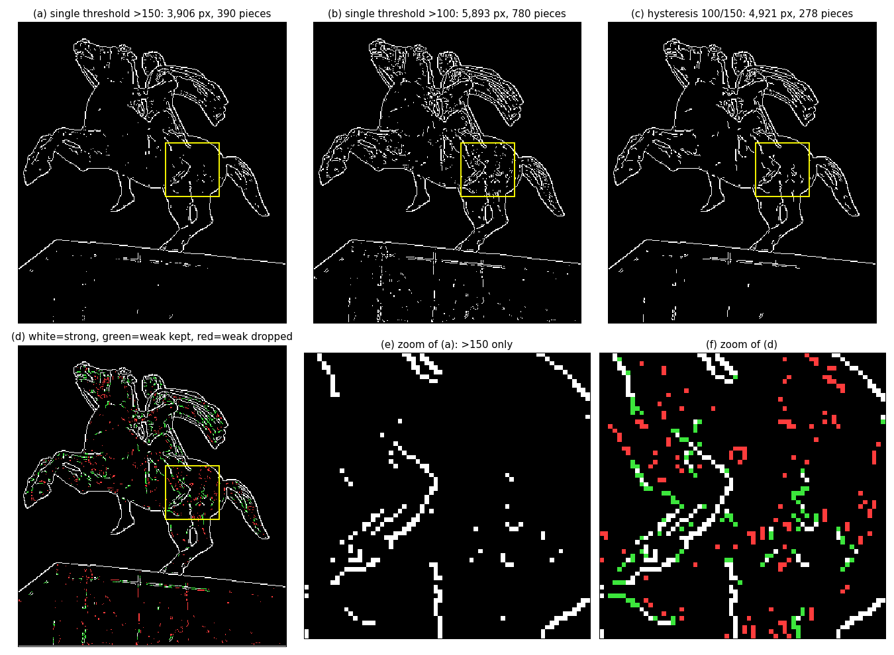

1. **(a) > 150 하나만:** 윤곽은 깔끔한데, 말 몸통 안쪽 근육선과 받침대 이음매가 **짧게 토막** 나 있어요.
2. **(b) > 100 하나만:** 말 몸통과 받침대 돌 표면에 **잔점과 잔선이 우글우글**해요.
3. **(c) 이력 임계값:** (a)처럼 깔끔하면서 선이 조금씩 더 길어요. 받침대 잡음은 (b)보다 훨씬 적어요.
4. **(d) 색으로 구분:** 흰색 = 강한 에지, 초록 = 살아남은 약한 에지, 빨강 = 버려진 약한 에지.
   - **초록**은 거의 다 흰 선의 **끝에 꼬리처럼 붙어서** 선을 연장해요.
   - **빨강**은 받침대와 말 배 쪽에 **외딴 점**으로 흩어져 있어요.
5. **(e) → (f) 확대:** 말 엉덩이·몸통 부분(행 144 ~ 208, 열 176 ~ 240)이에요.
   - (e)의 짧은 흰 토막들이 (f)에서는 초록으로 이어져 길어져요.
   - 가운데의 빨간 점 무리는 어느 흰 선과도 닿지 않아 버려져요.
   - 이 상자 안에서 약한 화소 253개 중 110개가 살아남고 143개가 버려졌어요.

### 6-6-h. 🚗 AVM 연결

- **닳은 주차선:** 페인트가 벗겨지거나 그림자가 걸친 구간은 약한 에지가 돼요. 양 끝의 선명한 구간(강한 에지)과 이어져 있으니 이력 임계값이 **선 전체를 살려요.** 아스팔트 자갈 질감의 외딴 점은 버려져요.
- **같은 원리, 다른 곳:** 주차선 **추적 상태**에도 히스테리시스를 써요. 예를 들어 신뢰도 0.7을 넘어야 "검출", 0.4 아래로 떨어져야 "놓침"으로 바꾸면, 화면의 주차 가이드가 **깜빡거리지 않아요.** 에어컨 온도 조절기와 같은 발상이에요.
- **재귀 금지:** 탑뷰의 주차선은 수백 ~ 천 픽셀이 넘게 이어져서 6-6-e의 한계에 바로 걸려요. 양산 차량 ECU는 스택 메모리가 작아서 재귀가 더 위험하고, 자동차 코딩 표준 **MISRA C:2012 Rule 17.2**는 재귀를 아예 **금지**해요("함수는 직접이든 간접이든 자기 자신을 호출하면 안 된다"). 실무에서는 6-6-e의 (2) 스택 방식이나 (3) 연결 요소 방식을 써요.

---

## 📋 Step 6-6 요약

| 개념 | 한 줄 정리 |
|---|---|
| 임계값 하나의 딜레마 | 높으면 끊기고(390조각), 낮으면 잡음(780조각) |
| 이력 임계값 | 강한 에지(> high)에서 출발해, 이어진 약한 에지(> low)까지만 번짐 → 278조각 |
| 세 부류 | ≤ 100 버림 / 100 ~ 150 약함(연결되면 남음) / > 150 강함(무조건 남음) |
| 이름의 뜻 | 올라타는 기준(high)과 머무는 기준(low)이 다름 (에어컨 26° 켜짐, 24° 꺼짐) |
| `trace` | 8방향 재귀 DFS. 순서: 왼쪽 열 → 가운데 열 → 오른쪽 열, 각 열은 위 → 아래 |
| `pos_ck` | 방문 표시. 없으면 이웃끼리 무한 호출 |
| 화소 하나의 힘 | 95 한 칸이 약한 가지 전체(130, 110)를 끊음 |
| **재귀 깊이 한계** | 1000층. 일직선 1000화소에서 RecursionError. 기마상은 435층이라 운 좋게 통과 |
| 버그가 버그를 가림 | NMS 버그가 선을 218조각으로 끊어 재귀 버그를 숨김. NMS를 고치면 에러 발생 |
| **전역 변수** | 두 번째 호출(200/300)이 기대 2,733 대신 4,921 → 트랙바에서 쓸 수 없음 |
| 대안 | 명시적 스택(OpenCV 방식) 또는 `connectedComponents` (4줄, 약 30배 빠름, 결과 동일) |

### ✅ 확인 질문

1. low = 100, high = 150일 때, 아래 격자에서 최종적으로 255가 되는 화소는 무엇인가요? 그리고 `trace`가 **두 번째, 세 번째, 네 번째로** 표시하는 화소는 무엇일까요? (힌트: 6-6-c의 ① ~ ⑧ 순서)
   ```
          열0 열1 열2 열3 열4 열5
   행0     0   0   0   0   0   0
   행1     0  90 160 140   0   0
   행2     0   0   0 110   0   0
   행3     0 130   0   0 155   0
   행4     0   0   0   0   0   0
   ```
2. 40줄에서 `pos_ck[i, j] == 0 and` 부분을 지우면 무슨 일이 일어날까요? 위 격자로 생각해 보세요.
3. high는 150으로 두고 low만 100에서 **50**으로 내리면, 기마상 사진의 결과 화소 수와 조각 수는 각각 늘까요, 줄까요? 이유도 같이 생각해 보세요. (다음 시간에 실제 숫자로 확인해요.)

---

다음은 **Step 6-7: 직접 만든 캐니 vs `cv2.Canny`**예요.
- 08번 결과(`canny`)와 `canny2`를 화소 단위로 비교해요.
- 차이가 어디서 오는지 하나씩 분해해요: 블러 σ, 방향 버림, 동점, 경계 처리.
- 버그를 하나씩 고칠 때마다 `cv2.Canny`에 얼마나 가까워지는지 측정해요. 주차선 영상에서는 두 버그를 고친 버전이 `cv2.Canny`와 **화소 하나까지 똑같아지는 것**을 이미 확인했어요.
- 이어서 **6-8**에서 13번 컬러 캐니(트랙바, `cv2.copyTo`)로 Part 6을 마무리해요.

**"다음"**이라고 하시면 이어가고, 어려운 부분이 있으면 **"더 쉽게"**라고 해 주세요. 이번에도 파일은 수정하지 않았어요.


---

## Q15  <sub>2026-10-27T13:05:26.313Z</sub>

> 다음


### A15

# Part 6. 캐니 에지 — Step 6-7: 직접 만든 캐니 vs `cv2.Canny`

[chap07/08.edge_canny.py:71-77](chap07/08.edge_canny.py#L71-L77)의 `canny`(직접 구현)와 `canny2`(`cv2.Canny`)를 화소 단위로 비교했어요(OpenCV 4.12.0). 숫자는 전부 실행해서 확인했습니다.

이번 Step의 결론부터 말하면 이래요.

> **08번 코드의 버그 세 군데를 고치고 테두리 규칙 하나를 맞추면, `cv2.Canny`와 화소 하나까지 똑같아져요.** 교과서 알고리즘의 뼈대는 맞았고, 차이는 전부 세부 구현에서 와요.

---

## 🔁 지난 퀴즈 답

**1번.** 실제 코드에 기록 장치를 달아서 표시 순서를 확인했어요.

```
         열0 열1 열2 열3 열4 열5
 행1      0  90 160 140   0   0
 행2      0   0   0 110   0   0
 행3      0 130   0   0 155   0

스캔: (1,2)=160 > 150 발견 → trace 시작
 1번째 ✅ (1,2)=160
   ① (0,1)✗  ② (1,1)=90 ✗ (강한 에지 바로 옆이지만 ≤ low)  ③~⑥ 0 ✗
   ⑦ (1,3)
 2번째 ✅ (1,3)=140    ← ② (1,2)는 ↩ 이미 방문
   ⑤ (2,3)
 3번째 ✅ (2,3)=110    ← ① (1,2)↩, ④ (1,3)↩
   ⑧ (3,4)
 4번째 ✅ (3,4)=155
스캔 계속: (3,4)=155 > 150 → ↩ 이미 방문 → 즉시 복귀
```

**최종 255는 160, 140, 110, 155**예요.
- **90:** 강한 에지 바로 옆이지만 ≤ low라서 버려져요.
- **130:** 약한 에지인데 혼자 떨어져 있어서 버려져요.
- **155:** 강한 에지지만, 스캔이 도착하기 전에 `trace`가 먼저 표시했어요.

**2번.** (1,2)는 ⑦번으로 (1,3)을 부르고, (1,3)은 ②번으로 다시 (1,2)를 불러요. 방문 표시가 없으니 둘이 **끝없이 서로를 불러서** 곧바로 RecursionError가 나요(실행해서 확인).

**3번.** low만 100에서 50으로 내렸을 때의 실측값이에요.

| low | 화소 수 | 조각 수 |
|---|---|---|
| 100 | 4,921 | 278 |
| 50 | **6,650 (증가)** | **220 (감소)** |

화소는 늘고 조각은 줄었어요. 이유는 이래요.
- 조각이 하나 생기려면 **강한 화소가 꼭 있어야** 해요. 그런데 강한 화소 집합(> 150)은 그대로예요.
- low를 내리면 기존 조각에 약한 화소가 **더 붙거나**, 떨어져 있던 조각끼리 **합쳐질** 뿐이에요. 새 조각은 생길 수 없어요.
- 대가도 있어요. 강한 선에 붙어 있던 질감 가지까지 따라 들어와서 결과가 지저분해져요.

---

## Step 6-7. 직접 만든 캐니 vs `cv2.Canny`

### 6-7-a. 첫 비교: 얼마나 다른가

| | 08 코드 (`canny`) | `cv2.Canny` (`canny2`) |
|---|---|---|
| 에지 화소 | 4,921 | 5,331 |
| 조각 수 | 278 | 223 |
| 2화소 이하 자투리 | 61 | 29 |

```
둘 다 에지     : 4,578
코드에만 있음  :   343   (빨강)
OpenCV에만 있음:   753   (초록)
───────────────────────
다른 화소 합계 : 1,096   ← 에지의 약 20%
```

20%면 꽤 커 보이죠. 그런데 **1픽셀 오차를 허용**하면 이야기가 달라져요.
- 코드 에지의 **98.6%**는 OpenCV 에지에서 1픽셀 안에 있어요.
- OpenCV 에지의 **98.0%**도 코드 에지에서 1픽셀 안에 있어요.

즉 차이의 대부분은 **선이 한 칸 옆으로 비켜났거나 군데군데 구멍이 난 것**이에요. 완전히 다른 곳을 에지로 잡은 게 아니에요. OpenCV에만 있는 화소(753)가 코드에만 있는 화소(343)의 두 배라는 점은, 6-5-f에서 본 것처럼 **코드가 더 많이 놓친다**는 뜻이에요.

### 6-7-b. 차이 분해: 하나씩 고치며 OpenCV에 다가가기

실험 방법은 이래요. 08 코드에서 출발해서, 한 번에 **한 가지만** 바꾸고 `cv2.Canny`와 다른 화소 수를 세요.

| 단계 | 바꾼 것 | 에지 화소 | `cv2.Canny`와 다른 화소 |
|---|---|---|---|
| v0 | 08 코드 그대로 | 4,921 | **1,096** |
| v1 | 블러(σ = 0.3) 제거 | 4,919 | 1,090 |
| v2 | + 방향을 **반올림** (6-4-d) | 5,320 | **13** |
| v3 | + **동점 처리** (6-5-e) | 5,329 | 4 |
| v3b | + 방향 경계를 정수 tan 22.5°로 판정 | 5,328 | 3 |
| v4 | + **테두리 규칙** | 5,331 | **0 ✅ 완전 일치** |

막대로 그리면 한 단계가 압도적이에요.

```
다른 화소 수
v0 (원본)        ██████████████████████████████████████████████ 1,096
v1 (블러 제거)    █████████████████████████████████████████████▉ 1,090
v2 (+반올림)      ▌ 13                          ← 여기서 98%가 사라짐
v3 (+동점)        ▏ 4
v3b (+정수 판정)  ▏ 3
v4 (+테두리)        0
```

단계별로 하나씩 해석해 볼게요.

**① 블러 제거 (v1): 6화소만 바뀜.** 6-3에서 말한 "σ = 0.3은 사실상 블러가 아니다"가 다시 확인됐어요. `cv2.Canny`에는 블러 단계가 아예 없으니, 이 차이는 원래 거의 없어야 정상이에요.

**② 방향 반올림 (v2): 1,090 → 13.** **차이의 약 98%가 이 버그 하나에서** 나와요. 70줄의 `astype(int)`가 버림이라 비교 방향이 22.5° 밀린 문제였죠.

**③ 동점 처리 (v3): 13 → 4.** 사진에서는 정확히 같은 값이 드물어서 9화소뿐이에요. 하지만 합성 영상에서는 이 문제가 전부를 좌우해요(6-5-e, 그리고 아래 6-7-c).

**④ 정수 판정 (v3b): 4 → 3.** `cv2.phase`의 근사 오차 때문에 구간 경계 바로 위 화소 1개가 다른 구간으로 갔어요. OpenCV는 각도를 아예 계산하지 않고 **정수 비교**로 구간을 정해요.

```python
# cv2.Canny 내부의 방향 판정 (OpenCV canny.cpp의 논리를 파이썬으로 옮긴 것)
x = abs(dx)
y = abs(dy) << 15                    # 2^15배 해서 정수로 계산
TG22 = 13573                         # tan(22.5°) × 2^15 = 0.41421 × 32768
if   y < x * TG22:                   # |dy/dx| < tan 22.5°  → 거의 수평 그래디언트
    좌우 비교:  m > 왼쪽  and m >= 오른쪽
elif y > x * TG22 + (x << 16):       # |dy/dx| > tan 67.5° (= tan 22.5° + 2) → 거의 수직
    상하 비교:  m > 위    and m >= 아래
else:                                # 그 사이 → 대각선
    대각선 비교: m > 양쪽 둘 다      # dx, dy 부호가 같으면 ↖↘, 다르면 ↗↙
```

`atan`도 나눗셈도 없이 곱셈과 비교만 써요. 그래서 **빠르고, 근사 오차도 없어요.** 비교 규칙을 보면 좌우와 상하에서는 **한쪽만 `>=`**라서 동점이면 한쪽만 살아요. 6-5-e에서 계단 영상으로 확인한 바로 그 규칙이에요.

**⑤ 테두리 (v4): 3 → 0.** 남은 3화소는 전부 **이미지 맨 가장자리**에 있었어요. 차이는 두 가지예요.

| | 08 코드 | `cv2.Canny` 내부 |
|---|---|---|
| 소벨의 테두리 처리 | `BORDER_REFLECT_101` (기본값, Part 1) | **`BORDER_REPLICATE`** |
| NMS 대상 | 테두리 1줄 제외 (`range(1, rows-1)`) | 테두리 화소도 검사 (바깥은 0으로 취급) |

`cv2.Canny(dx, dy, ...)`에 `BORDER_REPLICATE`로 계산한 소벨을 넣으면 `cv2.Canny(image, ...)`와 **완전히 같고**, 기본 테두리로 계산하면 2화소가 달라요. 이 실험으로 내부 테두리 방식을 확인했어요.

**⑥ 이력 임계값은 차이 없음.** 재귀든 스택이든 연결 요소든, 같은 지도에 적용하면 결과가 같아요(6-6-e에서 확인). OpenCV도 강한 에지는 `m > high`, 약한 에지는 `m > low`, 8방향 연결로 판정해서 08 코드와 규칙이 같아요.

> 📌 **정리: `cv2.Canny` = 08 코드 − 블러 + 방향 반올림 + 동점 처리 + 정수 판정 + REPLICATE 테두리.** 다르게 말하면, Part 6에서 찾은 버그들이 **차이의 전부**였어요.

### 6-7-c. 왜 방향 버그가 그렇게 치명적일까: 수평·수직선의 저주

6-6-e에서 예고한 주차선 실험의 나머지 이야기예요. 핵심은 **구간 경계가 어디에 놓였느냐**예요.

```
버림(코드)의 구간 경계:     0°      45°      90°      135°     180°
                          ↑                 ↑
                  수직선의 그래디언트   수평선의 그래디언트
                  → 경계 바로 위!       → 경계 바로 위!

반올림의 구간 경계:          22.5°    67.5°    112.5°   157.5°
                          → 0°, 90°에서 22.5°씩 떨어져 있음 (안전)
```

사람이 만든 장면(건물, 도로, 주차선)에서 **가장 흔한 에지는 수평선과 수직선**이에요. 그런데 버림 방식은 구간 경계를 **하필 정확히 그 방향들 위에** 놓아요. 그러면 잡음이 ±1°만 흔들어도 89.9°는 1번 구간(대각선 비교), 90.1°는 2번 구간(상하 비교)으로 **동전 던지기처럼** 갈려요.

**실험 조건:** 800×1280 영상에 폭 15픽셀, 길이 1,200픽셀의 흰 수평 주차선을 그리고, 약한 잡음(σ = 3)을 넣었어요.

윗변 에지 화소들의 방향 구간 분포:

```
버림   : 1번 1,082개 / 2번 1,238개   ← 반반으로 갈림 (무작위)
반올림 : 2번 2,320개                 ← 전부 올바르게 "상하 비교"
```

NMS 방식별로 이력 임계값까지 적용한 최종 결과예요.

| NMS 방식 | 조각 수 | 가장 긴 조각 |
|---|---|---|
| **08 코드 (버림 + 엄격 부등호)** | **218** | **68화소** |
| 반올림 + 엄격 부등호 | 110 | 100화소 |
| 버림 + 동점 처리 | 150 | 118화소 |
| **반올림 + 동점 처리** | **1** | **2,428화소** |
| `cv2.Canny` | 1 | 2,428화소 (**화소 하나까지 동일**) |

- 08 코드는 쭉 뻗은 주차선 하나를 **218조각**으로 부숴요.
- **버그 하나만 고치면 부족해요.** 반올림만 고치면 110조각, 동점만 고치면 150조각이에요. 흐린 사각형 경계는 좌우 대칭이라 정수 크기가 **동점**이 되는 경우가 잦기 때문이에요.
- **둘 다 고쳐야** 한 줄로 이어져요.

기마상 사진에서는 "1,096화소 차이" 정도로 보였던 버그가, 수평·수직선이 주인공인 영상에서는 **선을 산산조각** 내요.

### 6-7-d. 속도: 1,300배

| 영상 크기 | 08 코드 | `cv2.Canny` | 배수 |
|---|---|---|---|
| 360×320 (기마상) | 0.137초 (그중 NMS 0.127초) | **0.105ms** | 약 1,300배 |
| 1280×800 (AVM 카메라 해상도) | NMS만 **1.18초** | **1.00ms** | 1,000배 이상 |

08 코드의 이력 임계값은 원래 재귀 버전(0.044초)이에요. 여기서는 연결 요소 버전으로 쟀으니, 원본 그대로면 더 느려요.

**왜 이렇게 차이 날까요?** Part 1에서 본 "파이썬 반복문 vs OpenCV" 차이와 같은 이유예요.
1. **화소마다 파이썬 해석 비용이 들어요.** 08 코드는 화소마다 슬라이싱, `flatten`, 리스트 인덱싱, 비교를 파이썬이 하나하나 해석해요.
2. **OpenCV는 C++ 정수 연산을 SIMD로** 처리해요. 한 명령으로 여러 화소를 동시에 다뤄요.
3. **행 단위로 여러 스레드에 나눠** 처리해요. 이 PC는 `cv2.getNumThreads()` = 12예요.

### 6-7-e. `cv2.Canny` 사용법과 함정

```python
cv2.Canny(image, threshold1, threshold2[, edges[, apertureSize[, L2gradient]]])
cv2.Canny(dx, dy, threshold1, threshold2[, edges[, L2gradient]])     # 그래디언트를 직접 넣는 버전
```

| 항목 | 내용 | 확인 결과 |
|---|---|---|
| `threshold1`, `threshold2` | low, high. **순서를 바꿔 넣어도 OpenCV가 알아서 정렬해요** | `Canny(img, 150, 100)` = `Canny(img, 100, 150)` ✓ |
| ⚠️ 4번째 위치 인자 | **`edges`(출력 배열) 자리**예요. apertureSize가 아니에요 | 아래 참고 |
| `apertureSize` | 소벨 크기 3, 5, 7. 클수록 크기 값이 커져서 임계값을 다시 맞춰야 해요 | — |
| `L2gradient` | 기본값 `False` = L1(\|dx\| + \|dy\|). `True`면 √(dx² + dy²) | 같은 100/150에서 L2는 4,181화소 (L1은 5,331) |
| 블러 | **내장 블러 없음.** 필요하면 직접 해야 해요 | 6-3 참고 |
| 반환값 | 에지 0/255만 돌려줘요. **방향이나 크기는 안 줘요** | — |

**⚠️ Part 2부터 따라온 위치 인자 함정이 여기도 있어요.**

```python
cv2.Canny(img, 100, 200, 5)                  # 5가 edges 자리로 들어감 → 무시됨
cv2.Canny(img, 100, 200, apertureSize=5)     # 이렇게 써야 5×5 소벨
```

실행해 보면 `cv2.Canny(img, 100, 200, 5)`는 **기본값(3×3)과 결과가 똑같고**, `apertureSize=5`와는 달라요. 그리고 13번 코드에 바로 이 줄이 있어요. `cv2.Canny(edge, th, th*2, 5)`. 다음 Step에서 자세히 볼게요.

**`cv2.Canny(dx, dy, ...)` 버전이 유용한 경우:**
- 그래디언트 **방향도 필요할 때**가 있어요(예: 주차선의 기울기). 이때 소벨을 한 번만 계산해서 방향 계산과 캐니에 **같이 쓸 수 있어요.**
- 샤르(Scharr) 같은 **다른 미분 필터**를 쓰고 싶을 때도 써요.
- 조건: `dx`, `dy`는 **`CV_16S`(int16)**여야 해요. `cv2.Canny(image)`와 똑같은 결과가 필요하면 `borderType=cv2.BORDER_REPLICATE`로 계산하세요(위에서 확인).

```python
dx = cv2.Sobel(img, cv2.CV_16S, 1, 0, ksize=3, borderType=cv2.BORDER_REPLICATE)
dy = cv2.Sobel(img, cv2.CV_16S, 0, 1, ksize=3, borderType=cv2.BORDER_REPLICATE)
edges = cv2.Canny(dx, dy, 100, 150)                     # cv2.Canny(img, 100, 150)과 동일
angle = cv2.phase(dx.astype(np.float32), dy.astype(np.float32), angleInDegrees=True)  # 방향도 함께
```

### 6-7-f. 🖼️ 그림으로 보기

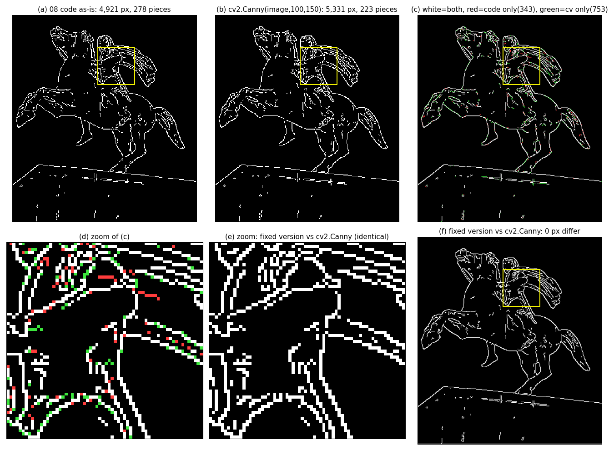

1. **(a) 08 코드와 (b) `cv2.Canny`:** 멀리서 보면 거의 같아 보여요. 자세히 보면 (b)가 기수의 망토 주름과 말 꼬리 결에서 **선이 조금 더 길고 덜 끊겨** 있어요(조각 278 vs 223).
2. **(c) 차이 지도:** 흰색 = 둘 다, 빨강 = 코드만(343), 초록 = OpenCV만(753)이에요. 빨강과 초록이 특정 부분에 몰려 있지 않고 **윤곽선 전체에 흩어져** 있어요. 방향 버그가 화면 어디서나 일어난다는 뜻이에요.
3. **(d) 확대 (기수 상체와 망토, 행 56 ~ 120, 열 148 ~ 212):**
   - 대각선으로 흐르는 망토 주름을 따라 **초록 점이 코드 선의 구멍을 메우는** 모습이 많아요.
   - 빨강은 주로 초록 바로 옆에 붙어 있어요. 같은 선이 **한 칸 비켜 간** 경우라서, 앞에서 본 "1픽셀 안에 98%"와 맞아요.
4. **(e), (f) 수정본(v4) vs `cv2.Canny`:** 확대해도, 전체를 봐도 **빨강과 초록이 하나도 없이 전부 흰색**이에요. 다른 화소 0개.

### 6-7-g. 🚗 AVM 연결

- **탑뷰는 이 버그의 최악 조건이에요.** 차가 주차 칸과 나란히 서 있으면 탑뷰의 주차선은 거의 **정확히 수평·수직**이 돼요. 6-7-c처럼 구간 경계 바로 위에 놓이니, 08 코드라면 선이 수백 조각으로 깨져요.
- **실시간 예산:** 30fps면 프레임당 33ms이고, 카메라 4대 1280×800이면 `cv2.Canny`만으로 약 4ms예요(대당 1ms 실측 기준). 08 코드는 NMS 하나에 대당 1.18초라 **불가능**해요. 학습용 구현은 원리를 이해하는 데 쓰고, 제품 코드에는 `cv2.Canny`를 쓰세요.
- **외부 코드 검증 습관:** 책이나 블로그의 구현을 가져오면 먼저 **OpenCV와 화소 단위로 비교하는 테스트**부터 만드세요. 이번처럼 "대충 비슷해 보이는데 20%가 다른" 상황을 바로 잡아내요. 예: `assert np.array_equal(my_canny(img), cv2.Canny(img, lo, hi))`.
- **방향이 필요할 때:** 주차선 각도 추정처럼 방향이 필요하면 `cv2.Canny(dx, dy, ...)`로 소벨을 한 번만 계산해서 재사용하세요.

---

## 📋 Step 6-7 요약

| 개념 | 한 줄 정리 |
|---|---|
| 첫 비교 | 4,921 vs 5,331화소, 1,096화소 다름. 그러나 1픽셀 허용하면 98% 일치 |
| 차이의 98% | **방향 버림 버그** 하나 (1,090 → 13) |
| 나머지 | 동점 9, `cv2.phase` 근사 1, 테두리 3 → 모두 고치면 **0 (완전 일치)** |
| 블러 | 6화소 차이뿐. σ = 0.3은 블러가 아니고, `cv2.Canny`엔 블러가 없음 |
| OpenCV 방향 판정 | 각도 대신 정수 비교 (`TG22 = 13573`) → 빠르고 근사 오차 없음 |
| OpenCV 테두리 | 소벨에 `BORDER_REPLICATE`, 테두리 화소도 검사 |
| 수평·수직선의 저주 | 버림은 구간 경계를 0°·90° 위에 둠 → 주차선 1개가 218조각. 두 버그를 다 고쳐야 1조각 |
| 속도 | 약 1,300배 (1280×800에서 1.18초 vs 1.00ms) |
| ⚠️ 4번째 위치 인자 | `edges` 자리. `Canny(img, a, b, 5)`의 5는 무시됨 → `apertureSize=5`로 |
| `Canny(dx, dy, ...)` | 소벨을 직접 넣는 버전. int16 + REPLICATE면 완전 동일 |

### ✅ 확인 질문

1. `cv2.Canny(img, 100, 150, L2gradient=True)`는 4,181화소로, L1(5,331화소)보다 적어요. L2로 바꾸면서 결과를 L1과 비슷하게 맞추려면 임계값을 **어느 쪽으로, 대략 얼마로** 바꿔야 할까요? (힌트: 6-4-b에서 강한 에지의 L1/L2 비율이 평균 1.27이었어요.)
2. 버림 방식에서 구간 경계가 0°, 45°, 90°, 135°에 놓이는 게 왜 하필 **수평·수직선**에 치명적인지, 그리고 반올림으로 바꾸면 **어떤 각도의 에지**가 새로 "경계 위"에 놓이게 되는지 설명해 보세요.
3. 13번 코드는 `cv2.Canny(edge, th, th*2, 5)`를 써요. 작성자가 의도한 소벨 크기는 몇이고, 실제로 적용되는 크기는 몇일까요? 의도대로 5×5가 적용된다면 같은 `th`에서 에지가 더 많아질까요, 적어질까요?

---

다음은 **Step 6-8: 13번 컬러 캐니** ([chap07/13.edge_color_canny.py](chap07/13.edge_color_canny.py))로 Part 6을 마무리해요.
- 트랙바 콜백이 어떻게 동작하는지 봐요.
- `GaussianBlur((5, 5), 0)`의 자동 σ를 계산해요.
- `cv2.Canny(edge, th, th*2, 5)`의 **5가 정말 무시되는지**와, 의도대로 고치면 어떻게 달라지는지 실험해요.
- `cv2.copyTo(image, mask=edge)`로 **에지 자리에만 원본 색을 칠하는** 원리와 `hconcat`을 봐요.
- 마지막으로 Part 6 전체를 정리해요.

**"다음"**이라고 하시면 이어가고, 어려운 부분이 있으면 **"더 쉽게"**라고 해 주세요. 이번에도 파일은 수정하지 않았어요.


---

## Q16  <sub>2026-10-27T13:14:42.733Z</sub>

> 다음


### A16

# Part 6. 캐니 에지 — Step 6-8: 13번 컬러 캐니 + Part 6 정리

이번 대상은 [chap07/13.edge_color_canny.py](chap07/13.edge_color_canny.py)(20줄)이에요. 숫자는 모두 실행해서 확인했어요.

이번 Step의 핵심은 세 가지예요.
- **`cv2.Canny(edge, th, th*2, 5)`의 5는 정말 무시돼요.** 그런데 그 덕분에 트랙바가 쓸모 있어요. 의도대로 5가 적용됐다면 슬라이더가 거의 무용지물이 돼요.
- 이름은 "컬러 캐니"지만 **에지는 회색조 영상에서 찾아요.** 색은 화면에 보여 줄 때만 써요.
- `cv2.Canny`에 컬러 영상을 **그대로** 넣으면 진짜 컬러 에지를 찾아요(내부 규칙을 실험으로 확인).

---

## 🔁 지난 퀴즈 답

**1번. L2로 바꾸면 임계값은 낮춰야 해요.** L2(√(dx² + dy²))는 L1(|dx| + |dy|)보다 항상 작거나 같아요. 강한 에지에서 L1/L2가 평균 1.27이었으니 임계값도 1.27로 나눠요.

```
low  : 100 / 1.27 ≈ 79
high : 150 / 1.27 ≈ 118

cv2.Canny(img, 79, 118, L2gradient=True) → 5,401화소   (L1 100/150은 5,331화소, 거의 비슷)
```

**2번. 경계가 어디에 놓이느냐의 문제예요.**
- **버림:** 경계가 0°, 45°, 90°, 135°에 있어요. 가장 흔한 수평선과 수직선의 그래디언트 방향이 **정확히 경계 위**에 놓여요. 89.9°는 1번 구간(대각선 비교, **45° 틀림**), 90.1°는 2번 구간(상하 비교, 정확)으로 갈려서 잡음이 동전 던지기를 해요.
- **반올림:** 경계가 22.5°, 67.5°, 112.5°, 157.5°로 옮겨가요. 이제 이 각도의 에지가 경계 위에 놓이지만 두 가지 이유로 덜 해로워요.
  1. 인공 구조물에서 드문 방향이에요.
  2. 22.5°는 0°와 45° 비교의 딱 중간이라, 어느 쪽으로 가도 **똑같이 22.5°만** 틀려요.

  정리하면 최악의 비교 오차가 45°에서 22.5°로 반으로 줄어요.

**3번. 의도는 5×5인데 실제로는 3×3이에요.** 5×5 소벨은 크기 값이 약 12 ~ 14배 커서, 같은 `th`에서 에지가 **훨씬 많아져요**(th = 50일 때 12.3%에서 25.4%로). 아래 6-8-d에서 자세히 볼게요.

---

## Step 6-8. 13번 컬러 캐니

### 6-8-a. 프로그램 전체 흐름

```
[시작]
 11줄  imread("color_edge.jpg") ──→ image (352×400×3, 나비와 노란 꽃)
 15줄  cvtColor(BGR → GRAY)      ──→ gray  (352×400)
 16~17 imshow(hconcat[image, image])   ← 창 "color edge"를 먼저 만들어 둠 (트랙바를 붙일 자리)
 18줄  createTrackbar("Canny th", "color edge", 50, 150, onTrackbar)   ← 콜백 등록만 하고 호출은 안 함
 19줄  onTrackbar(50)                   ← 첫 화면을 그리려고 직접 한 번 호출
 20줄  waitKey(0) ── 슬라이더가 움직일 때마다 ──→ onTrackbar(새 값) 자동 호출
                                               │
        ┌──────────────────────────────────────┘
        ▼
 onTrackbar(th):                                                        (3 ~ 9줄)
   gray ─GaussianBlur 5×5→ 흐린 gray ─Canny(th, 2·th)→ edge (0/255)
   copyTo(image, mask=edge) ──→ color_edge (에지 자리만 원본 색, 나머지 검정)
   hconcat([image, color_edge]) ──→ 352×800 한 장 → imshow
```

### 6-8-b. 트랙바와 콜백 (18 ~ 20줄)

> 📚 **복습 (chap04 트랙바):** `cv2.createTrackbar(이름, 창이름, 초깃값, 최댓값, 콜백)`. 최솟값은 0이에요. 슬라이더 위치가 바뀔 때마다 OpenCV가 **`콜백(새 위치)`**를 불러 줘요.

꼭 알아야 할 점은 네 가지예요.

1. **창이 먼저 있어야 해요.** 트랙바는 창에 붙어요. 그래서 16 ~ 17줄에서 원본 두 장을 붙인 임시 화면을 먼저 띄워요.
2. **등록할 때는 콜백이 불리지 않아요.** 그래서 19줄에서 `onTrackbar(th)`를 직접 한 번 불러 첫 결과를 그려요. 이 줄이 없으면 슬라이더를 건드리기 전까지 원본 두 장만 보여요.
3. **콜백은 `waitKey` 안에서 불려요.** `waitKey(0)`은 키 입력을 기다리는 동안 창 이벤트(슬라이더 이동 등)를 처리해요. 이때 콜백이 실행돼요.
4. **전역 변수는 읽기만 해요.** 콜백은 바깥의 `gray`와 `image`를 **읽기만** 해요. 08번의 `trace`처럼 전역을 **써서** 결과가 누적되는 문제는 없어요.

**슬라이더 값과 결과**(5×5 블러 후, 실측):

| th (low) | high = 2·th | 에지 화소 비율 |
|---|---|---|
| 0 | 0 | 27.1% |
| 10 | 20 | 25.0% |
| 25 | 50 | 19.1% |
| **50 (초깃값)** | **100** | **12.3%** |
| 75 | 150 | 8.1% |
| 100 | 200 | 5.3% |
| 150 (최대) | 300 | 2.4% |

`th*2`는 6-6-b에서 본 **high : low = 2 : 1** 권장 비율이에요. 슬라이더 하나로 두 임계값을 비율을 유지하며 함께 움직이는 좋은 설계예요.

콜백 본문(블러 + 캐니 + copyTo + hconcat)은 **0.71ms**밖에 안 걸려요. 슬라이더를 드래그해도 화면이 즉시 따라와요. 08번 직접 구현(0.137초)이었다면 드래그할 때마다 버벅였을 거예요.

### 6-8-c. 블러: `GaussianBlur(gray, (5, 5), 0)` (4줄)

σ = 0이면 OpenCV가 σ를 **자동**으로 정해요(Part 4).

```
σ = 0.3 × ((ksize − 1) × 0.5 − 1) + 0.8
  = 0.3 × ((5 − 1) × 0.5 − 1) + 0.8
  = 0.3 × (2 − 1) + 0.8
  = 1.1
```

ksize ≤ 7이고 σ ≤ 0이면, OpenCV는 공식 대신 **이항 계수 표**를 써요(Part 4). 커널을 출력해 보면:

```
GaussianBlur((5,5), 0) 실제 커널 : [0.0625  0.25    0.375   0.25    0.0625]  = [1 4 6 4 1] / 16
진짜 σ = 1.1 가우시안            : [0.0708  0.2445  0.3695  0.2445  0.0708]   ← 거의 같음
(비교) 08번의 σ = 0.3            : [0.0000  0.0038  0.9923  0.0038  0.0000]   ← 사실상 블러 없음
```

> 📚 **복습 (Part 4):** [1 4 6 4 1]은 파스칼 삼각형의 다섯 번째 줄이에요. 합이 16이라 16으로 나누면 밝기가 보존돼요.

13번은 `cv2.Canny` 앞에서 **제대로 블러를 해요.** 6-3에서 말한 "`cv2.Canny`에는 블러가 없으니 직접 해야 한다"를 올바르게 실천한 코드예요.

> 🔧 **사소한 메모:** 4 ~ 5줄은 `edge`라는 이름을 처음엔 "흐린 영상"으로, 다음엔 "에지 지도"로 **재사용**해요. 동작에는 문제가 없지만 읽을 때 헷갈려요. `blur`와 `edge`로 나누는 게 좋아요. `gray`는 변하지 않으니 블러를 콜백 **밖에서** 한 번만 해 둬도 돼요.

### 6-8-d. ⚠️ `cv2.Canny(edge, th, th*2, 5)`의 5 (5줄)

6-7-e에서 예고한 함정이에요.

```python
cv2.Canny(image, threshold1, threshold2[, edges[, apertureSize[, L2gradient]]])
#                                          ↑ 4번째 위치 = edges (출력 배열 자리)
```

`5`는 `edges` 자리로 들어가 **무시돼요.** 소벨 크기는 기본값 3 그대로예요. th = 0, 10, 25, 50, 75, 100, 150 **모두에서** `Canny(blur, th, 2th, 5)`와 `Canny(blur, th, 2th)`의 결과가 **화소 하나까지 같았어요.**

**작성자 의도대로 5×5가 적용됐다면?** 먼저 5×5 소벨 마스크를 만들어 볼게요(Part 2-5의 분리 구조, [1 4 6 4 1]ᵀ × [−1 −2 0 2 1]).

```
 −1  −2   0   2   1
 −4  −8   0   8   4
 −6 −12   0  12   6       행 가중치 합 = 1 + 4 + 6 + 4 + 1 = 16
 −4  −8   0   8   4       (3×3은 1 + 2 + 1 = 4)
 −1  −2   0   2   1
```

0 → 255 계단에 대한 응답을 실제로 계산하면:

```
3×3 :      0     0     0  1,020  1,020     0     0
5×5 :      0     0  4,080 12,240 12,240 4,080     0      ← 꼭대기가 12배, 폭도 넓음

꼭대기 = 16 × (2 + 1) × 255 = 12,240     (3×3: 4 × 1 × 255 = 1,020)
```

실제 나비 사진의 강한 에지에서는 5×5 / 3×3 비율의 중앙값이 **14.3배**였어요. 크기 값이 열 배 넘게 커지니, 같은 슬라이더 범위(0 ~ 150)가 갑자기 **"아주 낮은 임계값"**이 돼요.

| th | 실제 동작 (3×3) | 의도대로 (5×5) |
|---|---|---|
| 0 | 27.1% | 25.6% |
| 50 | **12.3%** | **25.4%** |
| 100 | 5.3% | 24.7% |
| 150 | **2.4%** | **23.5%** |

- **3×3(실제):** 슬라이더를 끝까지 밀면 27%에서 2.4%로 **11배** 변해요. 조절이 잘 돼요.
- **5×5(의도):** 끝까지 밀어도 25.6%에서 23.5%로 **거의 그대로**예요. 화면은 그림 (e)처럼 질감으로 뒤덮여요.

**결론: 버그가 오히려 트랙바를 살렸어요.** 5×5를 정말 쓰고 싶다면 키워드 인자로 넘기고 **임계값도 12 ~ 14배** 키워야 해요.

```python
edge = cv2.Canny(blur, th * 13, th * 26, apertureSize=5)   # 슬라이더 0~150을 5×5 크기 단위로 환산
```

### 6-8-e. `cv2.copyTo(image, mask=edge)`: 에지 자리에만 원본 색 (7줄)

규칙은 한 줄이에요. **마스크가 0이 아닌 곳은 원본을 복사하고, 0인 곳은 검정(0)으로 둬요.** 결과 배열을 새로 만들 때 OpenCV가 0으로 채운 다음 복사하기 때문이에요.

실제 화소로 따라가 볼게요.

```
위치          image (B, G, R)     edge (마스크)    →  color_edge
(179, 197)    [ 71,  75,  40]      255              →  [ 71,  75,  40]   복사 ✅
(0, 0)        [ 96, 111,  79]        0              →  [  0,   0,   0]   검정
```

- **마스크는 1채널인데 영상은 3채널이에요.** 마스크 한 칸이 B, G, R **세 채널을 한꺼번에** 결정해요.
- 마스크 값은 255가 아니어도 돼요. **0이 아니기만 하면** 복사해요. 0/1 마스크(`edge // 255`)로 바꿔도 결과가 같았어요(Part 7에서 0/255와 0/1이 다시 문제가 되니 기억해 두세요).
- 아래 세 줄은 결과가 모두 같아요(확인함).

```python
color_edge = cv2.copyTo(image, mask=edge)
color_edge = cv2.bitwise_and(image, image, mask=edge)        # 📚 복습: 마스크 연산
color_edge = np.where(edge[..., None] > 0, image, 0).astype(np.uint8)
```

### 6-8-f. `cv2.hconcat([image, color_edge])` (8줄)

여러 영상을 **가로로 이어 붙여요.** 세로로는 `cv2.vconcat`, numpy로는 `np.hstack`이에요.

```
image (352×400×3)  +  color_edge (352×400×3)  →  dst (352×800×3)
┌──────────────┐┌──────────────┐
│   원본        ││ 에지 자리만 색 │
└──────────────┘└──────────────┘
```

**조건: 높이와 타입(채널 수)이 같아야 해요.** `cv2.hconcat([image, edge])`처럼 3채널과 1채널을 붙이면 **Assertion 에러**가 나요(확인함). 에지 지도를 나란히 보이려면 먼저 3채널로 바꿔야 해요.

```python
cv2.hconcat([image, cv2.cvtColor(edge, cv2.COLOR_GRAY2BGR)])
```

### 6-8-g. "컬러 캐니"의 정체, 그리고 진짜 컬러 에지

13번은 에지를 **회색조(`gray`)에서** 찾고, 색은 **보여 줄 때만** 써요. 그런데 회색조 변환은 정보를 잃어요.

> 📚 **복습:** gray = 0.299·R + 0.587·G + 0.114·B. 색이 달라도 이 가중합이 같으면 같은 회색이 돼요.

**실험: 밝기가 같은 빨강과 초록**

```
왼쪽 BGR (50, 50, 200) 빨강           │  오른쪽 BGR (50, 127, 50) 초록
gray = 0.299·200 + 0.587·50 + 0.114·50 │  gray = 0.299·50 + 0.587·127 + 0.114·50
     = 59.8 + 29.35 + 5.7 = 95         │       = 14.95 + 74.55 + 5.7 = 95

회색조 영상: 95 95 95 │ 95 95 95   → 차이 0 → gray Canny 에지 0화소 ❌
```

사람 눈에는 선명한 빨강·초록 경계인데, 회색조에서는 **완전히 사라져요.**

**`cv2.Canny`에 컬러 영상을 그대로 넣으면?** 같은 영상에서 **60화소**, 즉 경계 세로 한 줄 전체를 찾아요. 내부 규칙은 이래요.

```
화소마다:
  B, G, R 채널 각각 소벨 → (dx_B, dy_B), (dx_G, dy_G), (dx_R, dy_R)
  |dx| + |dy| 가 가장 큰 채널 하나를 골라 그 채널의 dx, dy를 사용
  → 이후 NMS, 이력 임계값은 회색조와 똑같이
```

이 규칙을 직접 구현해서 `cv2.Canny(dx, dy, ...)`에 넣었더니 `cv2.Canny(컬러 영상)`과 **화소 하나까지 같았어요.** 나비 사진의 강한 에지에서 이긴 채널의 비율은 B 52.6%, R 34.2%, G 13.2%였어요.

**나비 사진에서의 비교 (th = 50/100):**

| | 에지 화소 |
|---|---|
| 회색조 캐니 (13번 방식) | 17,260 |
| 컬러(BGR) 캐니 | 21,265 |
| 컬러에서만 찾은 에지 | 6,969 |

컬러에서만 찾은 에지는 주로 **잎사귀 안쪽**(잎맥, 겹친 잎의 경계)에 있어요. 밝기는 비슷하고 색만 조금 다른 곳이에요. 단, 컬러 캐니가 무조건 낫지는 않아요. 질감 에지도 함께 늘어나니 **목적에 따라** 골라야 해요.

### 6-8-h. 🖼️ 그림으로 보기

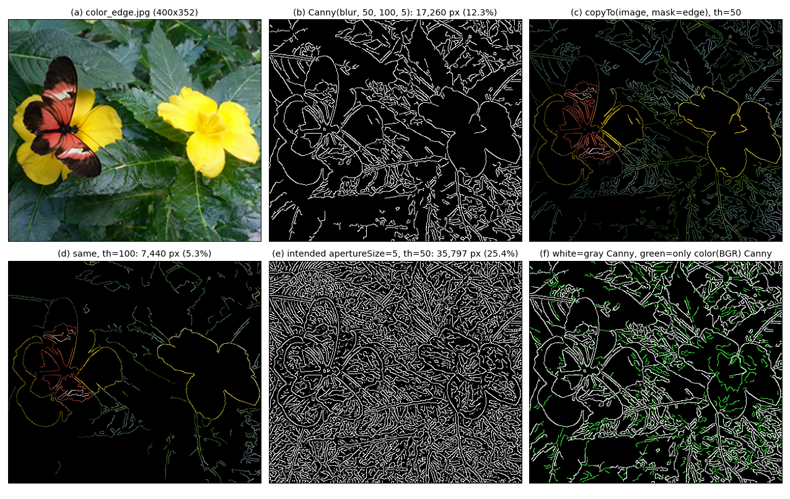

1. **(a) 원본:** 빨강·검정 날개에 흰 띠가 있는 나비가 노란 꽃 위에 앉아 있고, 오른쪽에 노란 꽃이 하나 더 있어요. 배경은 짙은 초록 잎이에요.
2. **(b) 13번의 에지 (th = 50, 12.3%):** 나비 날개 윤곽, 꽃잎 테두리, 잎사귀 가장자리와 잎맥이 하얀 선으로 나와요.
3. **(c) 13번 화면의 오른쪽 절반 (`copyTo`):** 검은 바탕 위에 **선만 원래 색으로** 빛나요. 날개 테두리는 붉은 선, 꽃잎은 노란 선, 잎은 초록 선이에요. 네온사인으로 그린 그림 같아요.
4. **(d) th = 100 (5.3%):** 잎맥 대부분이 사라지고 나비와 꽃의 **큰 윤곽**만 남아요. 슬라이더를 올리면 이렇게 돼요.
5. **(e) 의도대로 5×5를 적용한 경우 (th = 50, 25.4%):** 화면 전체가 **질감 선으로 뒤덮여** 나비와 꽃이 묻혀요. 6-8-d의 "버그가 트랙바를 살렸다"를 눈으로 확인할 수 있어요.
6. **(f) 회색조 vs 컬러 캐니:** 흰색 = 회색조 에지, 초록 = 컬러에서만 찾은 에지예요. 초록이 **잎사귀 영역에 집중**되어 있고, 나비와 꽃 윤곽에는 거의 없어요. 나비와 꽃은 이미 밝기 차이가 커서 회색조로도 충분히 잡혀요.

### 6-8-i. 🚗 AVM 연결

- **디버그 화면의 기본형:** "에지(또는 검출 결과)를 원본 색 위에 표시 + `hconcat`으로 나란히"는 실무 디버그 뷰의 기본이에요. 검출된 에지가 정말 주차선 위에 있는지, 그림자 경계에 속은 건 아닌지 한눈에 확인할 수 있어요. 카메라 4대 화면을 `hconcat`과 `vconcat`으로 2×2로 묶는 것도 같은 방식이에요.
- **튜닝 도구:** 13번의 트랙바는 [projects/cvkit/tuner.py](projects/cvkit/tuner.py)의 최소 버전이에요. tuner.py 첫머리 설명처럼, 녹화해 둔 AVM 영상에서 임계값을 슬라이더로 맞추고 저장한 값을 config로 옮겨 고정하는 흐름이에요. 이때 6-8-d의 교훈이 중요해요. **소벨 크기를 바꾸면 임계값 단위가 12 ~ 14배 바뀌어서 튜닝한 값을 그대로 쓸 수 없어요.**
- **색만 다른 선:** 밝기가 아스팔트와 비슷한 **색 있는 선**(예: 파란 장애인 주차 구역 선, 오래된 노란 선)은 회색조 캐니에서 약하거나 사라질 수 있어요. 컬러 캐니를 쓰거나, 노랑에 민감한 채널(HSV의 S, Lab의 b 등)을 따로 보는 방법이 있어요.

---

## 📋 Step 6-8 요약

| 개념 | 한 줄 정리 |
|---|---|
| 트랙바 | 창을 먼저 만들고 → 등록(호출 안 됨) → 첫 호출은 직접. 콜백은 `waitKey` 안에서 불림 |
| `th, th*2` | high : low = 2 : 1을 유지하며 슬라이더 하나로 조절 |
| `GaussianBlur((5,5), 0)` | 자동 σ = 1.1, 실제로는 이항 표 [1 4 6 4 1]/16 |
| ⚠️ `Canny(..., 5)` | 5는 `edges` 자리라 무시됨 → 3×3. 의도대로 5×5면 크기 12 ~ 14배라 슬라이더가 무용지물 |
| `copyTo(mask=)` | 마스크가 0이 아닌 곳만 복사, 나머지는 0. 1채널 마스크로 3채널을 한꺼번에 처리 |
| `hconcat` | 높이와 채널 수가 같아야 함. 1채널은 `GRAY2BGR`로 바꿔서 |
| 컬러 캐니의 정체 | 13번은 회색조 에지 + 색은 표시용. 밝기가 같은 색 경계는 놓침 |
| `cv2.Canny(컬러)` | 화소마다 크기가 가장 큰 채널의 dx, dy를 사용 → 색 경계도 검출 |

---

## 🏁 Part 6 전체 정리: 캐니 에지

### 한 장 요약

```
 원본 ─① 블러─→ ─② 소벨: 크기 |Gx|+|Gy|, 방향 4구간─→ ─③ NMS: 능선 꼭대기만─→ ─④ 이력 임계값: 불씨에서 번지기─→ 에지
        잡음 누름     "얼마나, 어느 쪽으로 가파른가"       두꺼운 띠 → 1픽셀 선          강한 에지와 이어진 약한 에지만
        (조건 ①)                                           (조건 ②③)                    (조건 ①)
```

### 찾은 코드 문제 총정리

| # | 위치 | 문제 | 측정한 영향 | 고치는 법 |
|---|---|---|---|---|
| 1 | 08번 64줄 | σ = 0.3 블러는 사실상 블러가 아님 | 바뀐 화소 1.16%, 최종 차이 6화소 | σ = 1 ~ 1.5 |
| 2 | 08번 70줄 | 방향 **버림** → 구간이 22.5° 밀림 | `cv2.Canny`와의 차이의 **98%**. 주차선 1개가 218조각 | `(phase + π/8) / (π/4)` |
| 3 | 08번 24줄 | NMS 엄격 부등호 → **동점이면 둘 다 사라짐** | 완벽한 계단 영상에서 에지 0개 | `s > v1 and s >= v2` |
| 4 | 08번 37 ~ 50줄 | 재귀 깊이 한계 | 1000화소 직선에서 RecursionError | 명시적 스택 또는 `connectedComponents` |
| 5 | 08번 60 ~ 61줄 | 전역 변수 `pos_ck`, `canny` | 두 번째 호출 결과가 틀림 (2,733 대신 4,921) | 결과를 반환하는 함수로 |
| 6 | 08번 65 ~ 66줄 | 소벨 5번째 인자 3 → `dst` 자리 | 기본값도 3이라 우연히 무해 | `ksize=3` |
| 7 | 13번 5줄 | 캐니 4번째 인자 5 → `edges` 자리 | 5×5 의도가 무시됨 (오히려 트랙바엔 유리) | `apertureSize=5` + 임계값 ×13 |
| — | 08번 11·33줄 | `id`, `max`가 내장 함수 이름을 가림 | 동작 영향 없음 | `idx`, `vmax` |

1 ~ 3번을 고치고 테두리 규칙(`BORDER_REPLICATE` + 테두리 화소 검사)을 맞추면 **`cv2.Canny`와 완전히 같아요**(6-7-b).

### OpenCV 위치 인자 함정 누적표 (Part 2 ~ 6)

| 함수 | 위치 인자 순서 | 함정 | 등장한 곳 |
|---|---|---|---|
| `cv2.Sobel` | src, ddepth, dx, dy, **dst**, ksize | 5번째 숫자는 dst | 05, 08, 17 |
| `cv2.Laplacian` | src, ddepth, **dst**, ksize | 3번째 숫자는 dst | 06, 07 |
| `cv2.GaussianBlur` | src, ksize, sigmaX, **dst**, sigmaY | 4번째 숫자는 dst | 12 |
| `cv2.Canny` | image, th1, th2, **edges**, apertureSize | 4번째 숫자는 edges | 13 |

> 📌 **교훈:** OpenCV 파이썬 함수는 출력 배열 자리가 **선택 인자의 맨 앞**에 끼어 있어요. 숫자 옵션은 **항상 키워드로** 쓰세요.

### ✅ 확인 질문

1. 13번의 슬라이더 범위(0 ~ 150)는 그대로 두고 `apertureSize=5`를 **제대로** 쓰고 싶어요. 슬라이더 값 `th`를 `cv2.Canny`에 넘길 때 어떻게 바꾸면 될까요? 그리고 왜 그 정도로 바꿔야 할까요?
2. 빨강 BGR (50, 50, 200) 옆에 회색 BGR (v, v, v)를 놓아요. **회색조 캐니가 경계를 못 찾는** v는 얼마일까요? 그때 **컬러 캐니**는 경계를 찾을까요? 채널별 차이로 설명해 보세요.
3. Part 6에서 찾은 버그 중 **(가) 결과를 눈에 띄게 바꾼 것**, **(나) 특정 조건에서만 터지는 것**, **(다) 우연히 무해했던 것**을 하나씩 골라 보세요. 여러분이 실무 코드 리뷰어라면 어느 것을 가장 먼저 고치라고 하겠어요?

---

다음은 **Part 7: 모폴로지** ([14](chap07/14.erode.py), [15](chap07/15.dilate.py), [16](chap07/16.morphology.py))예요.
- 이진 영상의 **침식(erosion)과 팽창(dilation)**을 직접 구현한 코드와 `cv2.erode`, `cv2.dilate`를 비교해요.
- Part 4의 **최소·최대 필터가 사실 침식·팽창과 같다**는 연결 고리를 이어가요.
- **열림(opening)과 닫힘(closing)**이 잡음 점과 구멍을 어떻게 다르게 처리하는지 봐요.
- 0/255 영상과 0/1 마스크를 섞을 때 생기는 함정을 작은 격자로 한 칸씩 따라가요.

**"다음"**이라고 하시면 이어가고, 어려운 부분이 있으면 **"더 쉽게"**라고 해 주세요. 이번에도 파일은 수정하지 않았어요.


---

## Q17  <sub>2026-10-27T13:55:52.149Z</sub>

> 다음


### A17

모폴로지 실험 수치는 다 나왔어요. 그림만 확인하고 Part 7 첫 설명을 쓸게요.

# Part 7. 모폴로지 — Step 7-1 ~ 7-4: 구조 요소, 침식, 팽창, 그리고 최소·최대 필터

이번 대상은 [chap07/14.erode.py](chap07/14.erode.py)와 [chap07/15.dilate.py](chap07/15.dilate.py)예요. 지난번 예고에서 16번 파일명을 잘못 적었는데, 실제 파일은 [chap07/16.close_open.py](chap07/16.close_open.py)예요. 숫자는 이번에도 전부 실행해서 확인했어요.

Part 7은 두 번에 나눠 진행할게요.

| 이번 | 다음 |
|---|---|
| **7-1** 이진 영상과 구조 요소, **7-2** 침식 (14), **7-3** 팽창 (15), **7-4** 최소·최대 필터와의 관계, 쌍대성 | 7-5 열림·닫힘 (16), 7-6 함정 정리, 7-7 AVM 연결과 Part 7 정리 |

이번 범위에서 새로 찾은 문제는 두 가지예요.
- 직접 구현한 침식·팽창이 **255가 홀수라서 우연히 동작**하는 코드예요.
- 직접 구현한 팽창은 **테두리 한 줄이 항상 0**이에요.

---

## 🔁 Part 6 마지막 퀴즈 답

**1번.** `apertureSize=5`는 크기 값이 약 12 ~ 14배 커지니, 임계값도 같은 비율로 키워요.

```python
edge = cv2.Canny(blur, th * 13, th * 26, apertureSize=5)
```

| th | 3×3 (원래 동작) | 5×5 + 임계값 ×13 |
|---|---|---|
| 50 | 12.3% | 12.2% |
| 100 | 5.3% | 5.6% |
| 150 | 2.4% | 2.7% |

슬라이더의 감도가 거의 똑같이 돌아왔어요. 왜 13배일까요? 계단 에지에서는 16 × 3 / 4 = 12배, 실제 사진의 중앙값은 14.3배였어요. 그 사이 값이에요.

**2번. v = 95**예요. 빨강 (50, 50, 200)의 회색값이 95라서, 회색 (95, 95, 95)를 옆에 두면 회색조에서는 경계가 사라져요(회색조 캐니 0화소). 그런데 **컬러 캐니는 찾아요**(40행 영상에서 40화소, 즉 세로 한 줄 전체). 채널별 차이를 보면 이래요.

```
        빨강  회색   차이
B :      50   95  →  45
G :      50   95  →  45
R :     200   95  → 105   ← 가장 큰 채널(R)이 이김 → 에지
```

**3번.**
- **(가) 결과를 눈에 띄게 바꾼 것:** 방향 버림. `cv2.Canny`와의 차이의 98%를 차지했어요.
- **(나) 특정 조건에서만 터지는 것:** 재귀 깊이(긴 에지), 동점(합성 영상), 전역 변수(두 번째 호출).
- **(다) 우연히 무해했던 것:** 소벨 5번째 인자 3(기본값과 같음), 캐니 4번째 인자 5(오히려 도움).

리뷰어라면 **방향 버그를 1순위**로 고치라고 하겠어요. 크래시는 요란해서 금방 발견되지만, 이 버그는 **조용히 틀린 결과**를 내서 OpenCV와 비교하기 전까지 아무도 몰라요. (다)는 지금은 무해해도 **시한폭탄**이에요. 나중에 누가 `3`을 `5`로 바꾸면 아무 일도 일어나지 않으니까요. 키워드 인자 습관으로 막아야 해요.

---

## Step 7-1. 이진 영상과 구조 요소

### 7-1-a. 모폴로지란?

**모폴로지(morphology, 형태학)**는 원래 생물의 **모양**을 연구하는 학문 이름이에요. 영상 처리에서는 **물체의 모양을 깎거나 불리는 연산**을 말해요.

이진 영상에서는 이렇게 약속해요.
- **255 = 물체(전경)**
- **0 = 배경**

### 7-1-b. 실습 영상: [chap07/images/morph.jpg](chap07/images/morph.jpg)

430×300 크기이고, 어두운 잡음 배경 위에 흰 글자 **"CWNU / MIPS Lab"**이 쓰여 있어요. 14 ~ 16번 모두 먼저 이렇게 이진화해요.

```python
th_img = cv2.threshold(image, 128, 255, cv2.THRESH_BINARY)[1]   # 128보다 크면 255, 아니면 0
```

> 📚 **복습:** `cv2.threshold`는 `(사용된 임계값, 결과 영상)` 튜플을 돌려줘요. 그래서 `[1]`로 영상만 꺼내요.

이진화 결과를 세어 보면 잡음이 두 종류 섞여 있어요.

| 항목 | 값 | 의미 |
|---|---|---|
| 물체 화소 | 21,018 (16.3%) | |
| 물체 조각 수 | **1,758개** | 글자는 11개뿐인데! |
| └ 4화소 이하 조각 | **1,747개** | 배경의 **흰 소금 점** (1화소짜리만 1,634개) |
| 배경 구멍(물체 속 검은 영역) | **274개** | |
| └ 4화소 이하 구멍 | **271개** | 글자 속의 **검은 후추 점** |
| └ 큰 구멍 3개 | 1,007 / 458 / 237화소 | P, b, a의 **진짜 속 구멍** |

**목표는 두 가지예요.** ① 배경의 흰 점을 지우고 ② 글자 속 검은 점을 메우되, **글자 모양은 지키는 것**(P, a, b의 진짜 구멍은 남겨야 해요). Part 7 전체가 이 목표를 향해 가요.

### 7-1-c. 구조 요소 (Structuring Element)

코드의 `mask`가 **구조 요소(SE)**예요. 14 ~ 16번은 모두 **3×3 십자**를 써요.

```
십자 (MORPH_CROSS)      사각 (MORPH_RECT)
  0 1 0                   1 1 1
  1 1 1                   1 1 1
  0 1 0                   1 1 1
```

코드의 십자 마스크는 `cv2.getStructuringElement(cv2.MORPH_CROSS, (3, 3))`와 똑같아요(확인함).

**회선 마스크와의 차이:**

| | 회선 마스크 (Part 1 ~ 5) | 구조 요소 (Part 7) |
|---|---|---|
| 칸의 값 | **곱할 가중치** (−1, 2, 0.111…) | **볼 곳(1) / 무시할 곳(0)** |
| 계산 | 곱해서 **더하기** | 전부 / 하나라도 **물체인가** 묻기 |

🧠 **비유: 도장.** 구조 요소는 **도장의 모양**이에요. 도장의 중심을 화소마다 찍어 보면서 질문을 던져요.
- **침식:** "도장이 **완전히 물체 안에** 들어가나?" (맞춤 검사, fit)
- **팽창:** "도장이 물체에 **조금이라도 걸치나?**" (닿음 검사, hit)

---

## Step 7-2. 침식 (Erosion, 14번)

### 7-2-a. 정의

> **SE의 1인 칸이 전부 물체(255)면 255, 하나라도 배경이면 0.**

집합으로 쓰면 이래요(A = 물체 화소 집합, B = 구조 요소, B_z = B를 위치 z로 옮긴 것).

```
A ⊖ B = { z | B_z ⊆ A }     "B를 z에 놓았을 때 A 안에 완전히 들어가는 z들"
```

🧠 **비유: 바람에 깎이는 모래성.** 가장자리부터 **한 겹씩 벗겨져요.** 작은 모래 알갱이(소금 점)는 통째로 날아가요.

### 7-2-b. 작은 격자로 한 칸씩

7×9 격자예요(■ = 255, · = 0). 5×5 블록 가운데에 **후추 구멍** 하나 (3, 3), 오른쪽에 **소금 점** 하나 (2, 7)이 있어요.

```
       열0 1 2 3 4 5 6 7 8
 행0    ·  · · · · · · · ·
 행1    ·  ■ ■ ■ ■ ■ · · ·
 행2    ·  ■ ■ ■ ■ ■ · ■ ·     ← (2,7) 소금 점
 행3    ·  ■ ■ · ■ ■ · · ·     ← (3,3) 후추 구멍
 행4    ·  ■ ■ ■ ■ ■ · · ·
 행5    ·  ■ ■ ■ ■ ■ · · ·
 행6    ·  · · · · · · · ·
```

화소 네 개를 실제 코드 그대로 계산해 볼게요. 각 화소에서 3×3 영역(`roi`)을 꺼내 십자와 비교해요.

**(2, 2): 블록 안쪽, 대각선 아래가 구멍**

```
roi              십자           temp = roi & 십자
255 255 255      0 1 0          0 1 0
255 255 255  &   1 1 1    =     1 1 1      cnt = 5 = mcnt → 255 ✅
255 255   0      0 1 0          0 1 0
                                    ↑ (3,3) 구멍은 십자의 0 자리라서 무시됨
```

**(2, 3): 바로 아래가 구멍**

```
255 255 255      0 1 0          0 1 0
255 255 255  &   1 1 1    =     1 1 1      cnt = 4 ≠ 5 → 0 ❌
255   0 255      0 1 0          0 0 0      ← 아래 칸이 구멍
```

**(2, 7): 소금 점**

```
  0   0   0      0 1 0          0 0 0
  0 255   0  &   1 1 1    =     0 1 0      cnt = 1 → 0 (소금 점 사라짐)
  0   0   0      0 1 0          0 0 0
```

**(3, 3): 구멍 자신**

```
255 255 255      0 1 0          0 1 0
255   0 255  &   1 1 1    =     1 0 1      cnt = 4 (가운데가 0) → 0
255 255 255      0 1 0          0 1 0
```

**전체 결과** (직접 구현과 `cv2.erode` 모두 같음):

```
       열0 1 2 3 4 5 6 7 8
 행1    ·  · · · · · · · ·
 행2    ·  · ■ · ■ · · · ·
 행3    ·  · · · · · · · ·
 행4    ·  · ■ · ■ · · · ·
 행5    ·  · · · · · · · ·
```

**결과 해석:**
1. **소금 점은 사라졌어요.** 침식의 첫 번째 쓰임새예요.
2. 구멍이 없었다면 5×5 블록(25화소)은 3×3(9화소)으로 **한 겹** 깎였을 거예요.
3. 그런데 후추 구멍 하나가 **자기 상하좌우 4칸까지 함께 죽여서** 모서리 4화소만 남았어요. **침식은 구멍을 키워요.** 후추 잡음에는 오히려 해로워요.

### 7-2-c. 코드 해독 (3 ~ 17줄)

```python
def erode(img, mask=None):
    dst = np.zeros(img.shape, np.uint8)                       # 4줄: 새 배열 (Part 1 원칙)
    if mask is None: mask = np.ones((3, 3), np.uint8)         # 5줄: 기본 SE = 3×3 사각
    ycenter, xcenter = np.divmod(mask.shape[:2], 2)[0]        # 6줄: 중심 좌표

    mcnt = cv2.countNonZero(mask)                             # 8줄: SE의 1 개수 (십자면 5)
    for i in range(ycenter, img.shape[0] - ycenter):          # 9~10줄: 테두리 제외 순회
        for j in range(xcenter, img.shape[1] - xcenter):
            ...
            roi = img[y1:y2, x1:x2]                           # 13줄: 3×3 영역
            temp = cv2.bitwise_and(roi, mask)                 # 14줄: ★ 비트 AND 트릭
            cnt  = cv2.countNonZero(temp)                     # 15줄: 일치한 칸 수
            dst[i, j] = 255 if (cnt == mcnt) else 0           # 16줄: 전부 일치해야 255
```

**6줄의 `np.divmod`:** 몫과 나머지를 **한꺼번에** 구해요.

```
np.divmod((3, 3), 2)  →  (array([1, 1]),  array([1, 1]))
                           └── 몫 ──┘      └ 나머지 ┘
                     [0] → 몫만 → ycenter = 1, xcenter = 1

3×5 SE라면: np.divmod((3, 5), 2)[0] → [1, 2]
```

`mask.shape[0] // 2, mask.shape[1] // 2`와 같은 뜻이에요.

**14줄의 비트 AND 트릭:** 이진 영상은 0/255, SE는 0/1이에요. 둘을 **비트 단위로** AND하면:

```
255 = 1111 1111₂
  1 = 0000 0001₂
 AND= 0000 0001₂ = 1      → "물체이고 SE가 보는 칸" = 1

  0 & 1   = 0             → 배경이면 0
255 & 0   = 0             → SE가 안 보는 칸은 무조건 0
```

`temp`는 **SE가 보는 칸 중 물체인 곳만 1**인 지도가 돼요. `countNonZero`가 그 개수를 세고, `mcnt`(5)와 같으면 "전부 물체"예요.

### 7-2-d. ⚠️ 코드 문제 ①: 255가 "홀수라서" 동작하는 코드

비트 AND로 보는 건 사실 **맨 끝 비트 하나**, 즉 **홀수냐 짝수냐**뿐이에요. 255가 우연히 홀수라서 동작하는 거예요.

```
255 & 1 = 1   (1111 1111₂, 홀수) → 물체로 인식 ✅
128 & 1 = 0   (1000 0000₂, 짝수) → 배경으로 인식 ❌
254 & 1 = 0   (짝수)              → 배경으로 인식 ❌
129 & 1 = 1   (홀수)              → 물체로 인식
```

**실험 ① 이진화 값을 128로 하면** (`cv2.threshold(image, 128, 128, ...)`, 흔히 하는 실수예요):

| 함수 | 결과 |
|---|---|
| 직접 구현 `erode` | 255인 화소 **0개** (전부 검정) |
| 직접 구현 `dilate` | 255인 화소 **0개** (전부 검정) |
| `cv2.erode` | 0이 아닌 화소 15,074개 (정상) |

128은 짝수라서 **모든 물체가 배경으로 보인** 거예요.

**실험 ② 이진화를 깜빡하고 회색조 영상을 그대로 넣으면:** 직접 구현 `dilate`의 결과가 **90.1%가 흰색**이에요. 화소값이 홀수인 곳(원본의 40.4%)이 이웃에 하나라도 있으면 255가 되니까, 의미 없는 결과예요.

**고치는 법:** 비트 연산 대신 **조건으로** 물어봐요.

```python
fg = roi[mask > 0] > 0                    # SE가 보는 칸들이 물체인가 (True/False)
dst[i, j] = 255 if fg.all() else 0        # 침식: 전부
dst[i, j] = 255 if fg.any() else 0        # 팽창: 하나라도
```

물론 실무에서는 `cv2.erode`를 쓰면 돼요. 0/255와 0/1이 섞이는 문제는 다음 시간에 7-6에서 한 번 더 정리할게요.

### 7-2-e. `cv2.erode`와 비교 (29줄)

```python
dst2 = cv2.erode(th_img, mask)    # cv2.erode(src, kernel[, dst[, anchor[, iterations[, borderType[, borderValue]]]]])
```

| 비교 | 결과 |
|---|---|
| 화소 차이 | **0개** (테두리 포함 완전히 같음) |
| 시간 | 직접 구현 **0.374초** vs `cv2.erode` **0.020ms** (약 18,000배) |

**테두리는 우연히 같았어요.**
- 직접 구현은 테두리를 건너뛰어서 항상 0이에요.
- `cv2.erode`는 이미지 바깥을 **"최댓값(255)"으로 취급**해서, 바깥 때문에 깎이지는 않아요. 전부 255인 영상을 침식해도 테두리까지 255로 남아요(확인함).
- morph.jpg의 테두리 화소는 잡음 때문에 어차피 다 깎여서 결과가 같아졌을 뿐이에요. 물체가 테두리에 닿는 영상이라면 달라져요.

### 7-2-f. 실제 영상 결과

| | 이진 영상 | 침식 후 |
|---|---|---|
| 물체 화소 | 21,018 | 15,074 (−28%) |
| 물체 조각 | 1,758 | **48** |
| 4화소 이하 조각 (소금) | 1,747 | **13** |
| 4화소 이하 구멍 (후추) | 271 | **0** ← 사라진 게 아니라 **커져서** 4화소를 넘음 |

---

## Step 7-3. 팽창 (Dilation, 15번)

### 7-3-a. 정의

> **SE의 1인 칸 중 하나라도 물체(255)면 255.**

```
A ⊕ B = { z | (B̂)_z ∩ A ≠ ∅ }     "B를 z에 놓았을 때 A와 한 칸이라도 겹치는 z들"
                                     (B̂ = B를 뒤집은 것. 십자는 대칭이라 B와 같음)
```

🧠 **비유: 종이에 번지는 잉크.** 물체가 **한 겹 부풀어요.** 작은 구멍은 번진 잉크에 메워져요.

### 7-3-b. 작은 격자 (같은 7×9 입력)

**`cv2.dilate` 결과:**

```
       열0 1 2 3 4 5 6 7 8
 행0    ·  ■ ■ ■ ■ ■ · · ·
 행1    ■  ■ ■ ■ ■ ■ ■ ■ ·
 행2    ■  ■ ■ ■ ■ ■ ■ ■ ■     ← 소금 점이 십자로 커져 블록과 붙음
 행3    ■  ■ ■ ■ ■ ■ ■ ■ ·     ← (3,3) 구멍이 메워짐
 행4    ■  ■ ■ ■ ■ ■ ■ · ·
 행5    ■  ■ ■ ■ ■ ■ ■ · ·
 행6    ·  ■ ■ ■ ■ ■ · · ·
```

**결과 해석:**
1. **(3, 3) 구멍이 메워졌어요.** 팽창의 쓰임새예요.
2. **소금 점은 십자 모양 5화소로 커졌고**, 블록과 **붙어 버렸어요.** 팽창은 가까운 물체끼리 합쳐요.
3. 5×5 블록이 7×7로 커지되 **네 모서리는 비어 있어요**(0행 0열 등). 십자 SE는 대각선으로 번지지 않아서 모서리가 둥글게(마름모꼴로) 깎여요.

**직접 구현 `dilate`의 결과:**

```
       열0 1 2 3 4 5 6 7 8
 행0    ·  · · · · · · · ·     ← 테두리 한 줄이 전부 0
 행1    ·  ■ ■ ■ ■ ■ ■ ■ ·
 행2    ·  ■ ■ ■ ■ ■ ■ ■ ·
 행3    ·  ■ ■ ■ ■ ■ ■ ■ ·
 행4    ·  ■ ■ ■ ■ ■ ■ · ·
 행5    ·  ■ ■ ■ ■ ■ ■ · ·
 행6    ·  · · · · · · · ·
```

### 7-3-c. ⚠️ 코드 문제 ②: 직접 구현한 팽창은 테두리가 항상 0

반복문이 `range(ycenter, rows - ycenter)`로 **테두리를 건너뛰고**, `dst`는 0으로 시작해요. 그래서 0행, 마지막 행, 0열, 마지막 열은 **절대 255가 될 수 없어요.**
- 침식은 "테두리는 깎아도 된다"는 해석이 가능해서 덜 아파요.
- 팽창은 **불려야 할 곳을 0으로 두는** 거라 명백히 틀려요.
- morph.jpg에서 `cv2.dilate`와 **84화소**가 달랐고, **84개 전부 테두리**였어요. 안쪽은 완전히 같아요.

`cv2.dilate`는 이미지 바깥을 **"최솟값(0)"으로 취급**해서 바깥 때문에 부풀지 않으면서도 테두리 화소를 정상 계산해요.

> 🔧 **사소한 메모:** 15번의 `def dilate(img, mask)`는 기본값이 없는데 5줄에서 `if mask is None`을 검사해요. 14번처럼 `mask=None`으로 맞추는 게 자연스러워요.

### 7-3-d. 실제 영상 결과

| | 이진 영상 | 팽창 후 (십자) | 참고: 팽창 (사각) |
|---|---|---|---|
| 물체 화소 | 21,018 | 31,524 (+50%) | 39,100 |
| 구멍 수 | 274 | **88** | — |
| 4화소 이하 구멍 (후추) | 271 | **85** | — |
| 물체 조각 | 1,758 | 1,220 | — |

후추 구멍의 약 3분의 2가 메워졌어요. 하지만 **소금 점 1,700여 개도 전부 십자로 커져서** 배경이 지저분해졌어요(조각 수가 별로 안 줄어든 이유예요).

**사각 SE**는 대각선으로도 번져서 십자보다 많이 불려요(39,100 vs 31,524). 침식도 사각이 더 많이 깎아요(13,243 vs 15,074).

### 7-3-e. 🖼️ 그림으로 보기

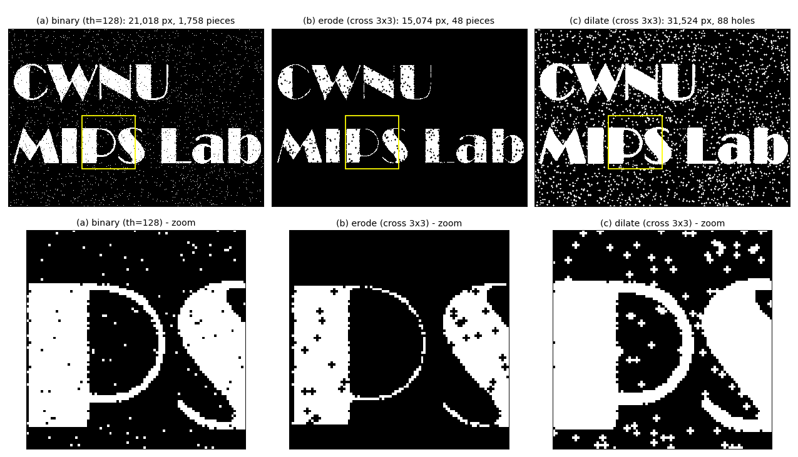

위 줄은 전체, 아래 줄은 노란 상자(**"P"와 "S" 일부**, 행 146 ~ 236, 열 124 ~ 214)를 확대한 거예요.

1. **(a) 이진 영상:** 글자 속에 검은 후추 점, 배경과 P의 속 구멍 안에 흰 소금 점이 흩어져 있어요.
2. **(b) 침식:**
   - 배경의 소금 점은 **깨끗이 사라졌어요.**
   - 대신 P 기둥 속의 후추 점이 **검은 "+" 모양으로 커졌어요**(7-2-b의 "구멍이 이웃을 죽인다").
   - P의 둥근 고리와 S의 가는 꼬리는 **더 가늘어져서** 끊어질락 말락 해요.
3. **(c) 팽창:**
   - P 기둥 속 후추 점이 **메워져 꽉 찬 흰색**이 됐어요.
   - 대신 배경과 P 속 구멍 안의 소금 점이 **흰 "+" 모양으로 커져서** 화면 전체에 별처럼 흩뿌려졌어요.

**침식은 소금을 잡고 후추를 키우고, 팽창은 후추를 잡고 소금을 키워요.** 둘 다 혼자서는 목표(7-1-b)를 못 이뤄요. 그래서 다음 시간의 **열림·닫힘**이 필요해요.

---

## Step 7-4. 침식 = 최소 필터, 팽창 = 최대 필터

### 7-4-a. 이진 영상에서 보면

| | 규칙 | 0/255 값으로 바꿔 말하면 |
|---|---|---|
| 침식 | SE 안이 **전부** 255여야 255 | SE 안의 **최솟값** |
| 팽창 | SE 안에 **하나라도** 255면 255 | SE 안의 **최댓값** |

"전부 255"는 "가장 작은 값도 255"와 같고, "하나라도 255"는 "가장 큰 값이 255"와 같아요. 즉 **침식은 최소 필터, 팽창은 최대 필터**예요.

> 📚 **복습 (Part 4, 09번):** 최소 필터는 밝은 영역을 줄이고 작은 흰 점을 지웠고, 최대 필터는 밝은 영역을 넓히고 작은 검은 점을 지웠어요. 그때 "최소→최대 = 열림, 최대→최소 = 닫힘"이라고 미리 말했는데, 바로 이 관계예요.

### 7-4-b. 회색조에서도 성립 (실험)

`cv2.erode`와 `cv2.dilate`는 **회색조 영상에도** 쓸 수 있고, 그때 정의가 바로 최소·최대예요. 직접 만든 슬라이딩 최소·최대와 비교해서 확인했어요.

| 비교 (테두리 제외) | 결과 |
|---|---|
| `cv2.erode(gray, 3×3 사각)` vs 3×3 슬라이딩 **최솟값** | 완전히 같음 ✅ |
| `cv2.dilate(gray, 3×3 사각)` vs 3×3 슬라이딩 **최댓값** | 완전히 같음 ✅ |
| `cv2.erode(gray, 십자)` vs **십자 모양 안의** 최솟값 | 완전히 같음 ✅ |

14 ~ 15번의 직접 구현(비트 AND)은 **이진 영상 전용**이고(7-2-d), OpenCV 버전은 회색조까지 일반화된 거예요.

### 7-4-c. 쌍대성: 물체를 깎는 것 = 배경을 불리는 것

```
erode(f)  = 255 − dilate(255 − f)
dilate(f) = 255 − erode(255 − f)        (대칭 SE일 때)
```

이진 영상과 회색조 영상 **모두에서** 화소 하나까지 성립했어요(확인함).

🧠 **비유: 바둑판.** 흑돌 영역을 한 겹 깎는 것은 백돌 영역을 한 겹 넓히는 것과 같아요. 같은 경계선을 어느 쪽에서 보느냐의 차이예요.

이 관계 덕분에 "흰 글자 속 **검은** 점 메우기"와 "검은 배경 속 **흰** 점 지우기"가 **같은 문제의 앞뒷면**이 돼요. 다음 시간의 열림과 닫힘도 서로 쌍대예요.

### 7-4-d. 🚗 AVM 미리보기

차선·주차선 마스크(밝기나 색으로 이진화한 것)에 그대로 적용해 보면:
- **침식:** 아스팔트 반사 점 같은 작은 흰 잡음은 지워요. 하지만 멀리 있어 **2 ~ 3픽셀 폭으로 찍힌 선은 통째로 사라질 수** 있어요(3×3 십자로 침식하면 폭이 2픽셀 줄어요).
- **팽창:** 닳아서 끊긴 선의 틈은 메워요. 하지만 반사 점도 같이 키워요.

그래서 실무에서는 둘을 **순서대로 묶어서** 써요. 다음 시간에 다룰 열림과 닫힘이에요.

---

## 📋 Step 7-1 ~ 7-4 요약

| 개념 | 한 줄 정리 |
|---|---|
| 모폴로지 | 이진 영상(255 = 물체)의 모양을 깎거나 불리는 연산 |
| 구조 요소 | 곱할 가중치가 아니라 "볼 곳" 모양. 십자 = `getStructuringElement(MORPH_CROSS, (3,3))` |
| 침식 | SE가 **전부** 물체 안 → 255. 소금 점 제거, 대신 후추 구멍 확대, 가는 선 위험 |
| 팽창 | SE가 **하나라도** 물체에 닿음 → 255. 후추 구멍 메움, 대신 소금 점 확대, 물체끼리 붙음 |
| 비트 AND 트릭 | 0/255 & 0/1 → 끝 비트만 봄 → **255가 홀수라 우연히 동작**. maxval 128이면 전부 0 |
| 테두리 | 직접 구현 팽창은 테두리가 항상 0 (84화소 차이). `cv2`는 바깥을 무시하도록 처리 |
| 속도 | 직접 구현 0.374초 vs `cv2.erode` 0.020ms (약 18,000배) |
| 최소·최대 | 침식 = 최소 필터, 팽창 = 최대 필터 (회색조에서도 성립, 실험 확인) |
| 쌍대성 | erode(f) = 255 − dilate(255 − f) |

### ✅ 확인 질문

1. 7×7 검은 바탕 한가운데 **3×3 흰 정사각형**이 있어요.
   - (가) 십자 SE로 침식하면 몇 화소가 남을까요? 사각 SE로 침식하면요?
   - (나) 각 결과를 **같은 SE로 다시 팽창**하면 어떤 모양이 될까요? 원래 정사각형으로 돌아올까요?
   - (힌트: 다음 시간의 "열림"이 바로 이 연산이에요.)
2. 14번 코드에서 이진화 `maxval`을 255 대신 **127**로 바꾸면 직접 구현 `erode`가 제대로 동작할까요? **200**이라면요? 비트로 설명해 보세요.
3. 쌍대성을 이용해서, "흰 글자 속의 검은 후추 점을 메우는 일"을 **침식 함수만으로** 하는 방법을 생각해 보세요.

---

다음은 **Step 7-5 ~ 7-7: 열림과 닫힘** ([chap07/16.close_open.py](chap07/16.close_open.py))이에요.
- **열림(침식 → 팽창)**이 소금을, **닫힘(팽창 → 침식)**이 후추를 어떻게 지우는지 봐요. 둘 다 글자 크기는 거의 그대로 지켜요.
- morph.jpg에서 "소금과 후추를 **둘 다** 지우려면 어떤 순서로 묶어야 하나"를 실험해요.
- 열림·닫힘의 수학적 성질(두 번 해도 같음, 원본과의 포함 관계)을 확인해요.
- `cv2.morphologyEx(th_img, cv2.MORPH_CLOSE, mask, 1)`의 **1이 또 위치 인자 함정**인지 확인해요.
- 마지막으로 AVM 활용과 Part 7 정리로 마무리해요.

**"다음"**이라고 하시면 이어가고, 어려운 부분이 있으면 **"더 쉽게"**라고 해 주세요. 이번에도 파일은 수정하지 않았어요.


---

## Q18  <sub>2026-10-27T14:03:17.269Z</sub>

> 다음


### A18

# Part 7. 모폴로지 — Step 7-5 ~ 7-7: 열림, 닫힘, 함정, AVM

이번 대상은 [chap07/16.close_open.py](chap07/16.close_open.py)예요. 숫자는 전부 실행해서 확인했어요.

이번 Step에서 정리할 것은 다섯 가지예요.
- 7-1-b의 목표("소금과 후추를 둘 다 지우고 글자는 지키기")를 **어떤 순서로 묶어야** 이루는지 실험해요.
- 비교 삼아 Part 4의 **3×3 미디언 필터**도 돌려 봤는데, 이 영상에서는 미디언이 가장 깔끔했어요. 그런데도 모폴로지를 쓰는 이유를 정리해요.
- `cv2.morphologyEx`의 위치 인자 함정, `iterations`의 진짜 의미, 0/255와 0/1을 섞을 때의 함정을 봐요.
- `cv2`의 닫힘이 이미지 **가장자리에서** 물체를 키우는 현상을 새로 찾았어요.

---

## 🔁 지난 퀴즈 답

**1번. 3×3 정사각형 물체**

| SE | (가) 침식 | (나) 다시 팽창 (= 열림) |
|---|---|---|
| 십자 | 가운데 **1화소** | **+ 모양 5화소** (네 모서리가 사라짐) |
| 사각 | 가운데 **1화소** | **3×3 정사각형 9화소** (원래대로 복원) |

```
원본           십자로 열림      사각으로 열림
· · · · ·      · · · · ·        · · · · ·
· ■ ■ ■ ·      · · ■ · ·        · ■ ■ ■ ·
· ■ ■ ■ ·      · ■ ■ ■ ·        · ■ ■ ■ ·
· ■ ■ ■ ·      · · ■ · ·        · ■ ■ ■ ·
· · · · ·      · · · · ·        · · · · ·
```

침식에서 둘 다 1화소가 됐는데, **같은 SE로 다시 불리면** 그 SE 모양이 돼요. 그래서 열림은 **"물체 안에 SE를 넣어 칠할 수 있는 영역"**만 남겨요. 사각 SE는 정사각형 모서리까지 들어가지만, 십자는 모서리에 닿지 못해요.

**2번.**
- **127** = 0111 1111₂ → 홀수 → 끝 비트가 1이라 **제대로 동작**해요(15,074화소, 정상 결과와 같음).
- **200** = 1100 1000₂ → 짝수 → 끝 비트가 0이라 **전부 배경으로 보여 0화소**예요.

maxval이 홀수인지 짝수인지가 결과를 가르는, 말이 안 되는 상황이에요.

**3번.** 쌍대성 `dilate(f) = 255 − erode(255 − f)`를 써요.

```
① 반전:   흰 글자 속 검은 후추  →  검은 글자 속 흰 소금
② 침식:   흰 소금 점 제거 (7-2-b에서 본 침식의 특기)
③ 다시 반전: 후추가 메워진 흰 글자
```

침식 함수만으로 팽창을 한 셈이에요.

---

## Step 7-5. 열림(Opening)과 닫힘(Closing)

### 7-5-a. 정의와 직관

```
열림:  A ∘ B = (A ⊖ B) ⊕ B      침식 → 팽창
닫힘:  A • B = (A ⊕ B) ⊖ B      팽창 → 침식
```

**왜 이 순서가 마법처럼 동작할까요?** 핵심은 "**한번 사라진 것은 되살아나지 못한다**"예요.

**열림 (침식 → 팽창):**
- 침식이 작은 것(소금 점, 가는 털)을 **완전히 없애요.**
- 팽창이 살아남은 물체를 **원래 크기로 되돌려요.**
- 없어진 소금 점은 **불릴 씨앗이 없으니** 돌아오지 않아요.

**닫힘 (팽창 → 침식):**
- 팽창이 작은 구멍과 좁은 틈을 **완전히 메워요.**
- 침식이 바깥 윤곽을 **원래 크기로 되돌려요.**
- 메워진 구멍은 **깎아 낼 빈 곳이 남지 않았으니** 다시 열리지 않아요.

🧠 **비유: 붓으로 칠하기.**
- **열림** = 물체 **안쪽**에서 SE 모양 붓을 굴려 칠할 수 있는 곳만 남겨요. 붓이 들어가지 못하는 작은 점, 가는 털, 뾰족한 모서리는 사라져요.
- **닫힘** = **배경** 쪽에서 붓을 굴려요. 붓이 들어가지 못하는 작은 구멍과 좁은 틈은 물체로 메워져요.

### 7-5-b. 작은 격자: 열림

5×5 블록, 소금 점 (2, 8), 2×2 잡음 덩어리가 있는 격자예요.

```
입력                          침식 (십자)                    열림 (십자)                    열림 (사각)
· · · · · · · · · · · ·       · · · · · · · · · · · ·       · · · · · · · · · · · ·       · · · · · · · · · · · ·
· ■ ■ ■ ■ ■ · · · · · ·       · · · · · · · · · · · ·       · · ■ ■ ■ · · · · · · ·       · ■ ■ ■ ■ ■ · · · · · ·
· ■ ■ ■ ■ ■ · · ■ · · ·       · · ■ ■ ■ · · · · · · ·       · ■ ■ ■ ■ ■ · · · · · ·       · ■ ■ ■ ■ ■ · · · · · ·
· ■ ■ ■ ■ ■ · · · · · ·       · · ■ ■ ■ · · · · · · ·       · ■ ■ ■ ■ ■ · · · · · ·       · ■ ■ ■ ■ ■ · · · · · ·
· ■ ■ ■ ■ ■ · · · ■ ■ ·       · · ■ ■ ■ · · · · · · ·       · ■ ■ ■ ■ ■ · · · · · ·       · ■ ■ ■ ■ ■ · · · · · ·
· ■ ■ ■ ■ ■ · · · ■ ■ ·       · · · · · · · · · · · ·       · · ■ ■ ■ · · · · · · ·       · ■ ■ ■ ■ ■ · · · · · ·
· · · · · · · · · · · ·       · · · · · · · · · · · ·       · · · · · · · · · · · ·       · · · · · · · · · · · ·
```

1. **침식:** 소금 점과 2×2 덩어리가 **완전히 사라지고**, 블록은 3×3으로 줄어요.
2. **팽창:** 3×3이 다시 커져요. 소금 점과 2×2는 씨앗이 없어서 **돌아오지 않아요.**
3. **SE에 따라 블록 결과가 달라요.** 십자로 열면 블록의 **네 모서리가 깎이고**(퀴즈 1번과 같은 이유), 사각으로 열면 5×5가 **그대로 복원돼요.**

### 7-5-c. 작은 격자: 닫힘

1픽셀 틈으로 끊긴 두꺼운 선(닳은 주차선 같은 것)이고, 왼쪽 토막에 후추 구멍 (3, 4)가 있어요.

```
입력                               팽창 (십자)
· · · · · · · · · · · · · · ·      · · · · · · · · · · · · · · ·
· · · · · · · · · · · · · · ·      · · ■ ■ ■ ■ ■ · ■ ■ ■ ■ ■ · ·
· · ■ ■ ■ ■ ■ · ■ ■ ■ ■ ■ · ·      · ■ ■ ■ ■ ■ ■ ■ ■ ■ ■ ■ ■ ■ ·
· · ■ ■ · ■ ■ · ■ ■ ■ ■ ■ · ·      · ■ ■ ■ ■ ■ ■ ■ ■ ■ ■ ■ ■ ■ ·
· · ■ ■ ■ ■ ■ · ■ ■ ■ ■ ■ · ·      · ■ ■ ■ ■ ■ ■ ■ ■ ■ ■ ■ ■ ■ ·
· · · · · · · · · · · · · · ·      · · ■ ■ ■ ■ ■ · ■ ■ ■ ■ ■ · ·
                ↑ 틈 (열 7)                        ↑ (1,7)은 비어 있음 (십자는 대각선으로 안 번짐)

닫힘 (십자)                        닫힘 (사각)
· · · · · · · · · · · · · · ·      · · · · · · · · · · · · · · ·
· · · · · · · · · · · · · · ·      · · · · · · · · · · · · · · ·
· · ■ ■ ■ ■ ■ · ■ ■ ■ ■ ■ · ·      · · ■ ■ ■ ■ ■ ■ ■ ■ ■ ■ ■ · ·
· · ■ ■ ■ ■ ■ ■ ■ ■ ■ ■ ■ · ·      · · ■ ■ ■ ■ ■ ■ ■ ■ ■ ■ ■ · ·
· · ■ ■ ■ ■ ■ · ■ ■ ■ ■ ■ · ·      · · ■ ■ ■ ■ ■ ■ ■ ■ ■ ■ ■ · ·
· · · · · · · · · · · · · · ·      · · · · · · · · · · · · · · ·
```

1. **후추 구멍 (3, 4)는 둘 다 메웠어요.**
2. **틈을 메우는 방식은 SE 모양에 따라 달라요.**
   - **십자:** 가운데 줄 (3, 7)만 이어져요. 팽창 단계에서 (1, 7)이 비어 있었기 때문이에요. 그래서 침식할 때 (2, 7)의 십자 위쪽 칸이 0이 되어 (2, 7)이 다시 깎여요. (4, 7)도 같은 이유예요.
   - **사각:** 대각선으로도 번지니까 틈 전체가 메워져서 **한 덩어리 3×11 선**이 돼요.
3. **바깥 윤곽은 두 경우 모두 원래 크기 그대로예요.** 닫힘은 구멍과 틈만 채우고 물체를 키우지 않아요.

### 7-5-d. 16번 코드 (4 ~ 25줄)

```python
from Common.filters import erode, dilate      # 2줄: 14·15번과 같은 비트 AND 방식의 구현

def opening(img, mask):                       # 4줄: 열림 = 침식 → 팽창
    tmp = erode(img, mask)
    dst = dilate(tmp, mask)
    return dst

def closing(img, mask):                       # 9줄: 닫힘 = 팽창 → 침식
    tmp = dilate(img, mask)
    dst = erode(tmp, mask)
    return dst

dst3 = cv2.morphologyEx(th_img, cv2.MORPH_OPEN, mask)       # 24줄
dst4 = cv2.morphologyEx(th_img, cv2.MORPH_CLOSE, mask, 1)   # 25줄 ← 7-6-①에서 다시 봐요
```

| 비교 | 결과 |
|---|---|
| 직접 구현 열림 vs `cv2` | **0화소** 차이 |
| 직접 구현 닫힘 vs `cv2` | **45화소** 차이. **전부 테두리 2픽셀 안**(정확히 테두리 위가 20화소) |
| 시간 (열림 + 닫힘) | 직접 구현 **1.262초** vs `cv2` **0.072ms** |

닫힘의 차이는 7-3-c의 문제, 즉 **직접 구현 팽창의 테두리가 항상 0**이라서 생겨요. 팽창이 먼저인 닫힘에서만 드러나요.

### 7-5-e. 실제 영상: 어떤 조합이 목표를 이룰까?

목표(7-1-b)는 **조각 11개(글자 수), 구멍 3개(P, a, b의 속 구멍)**예요. 전부 3×3이고, 따로 적지 않은 건 십자 SE예요.

| 방법 | 물체 화소 | 조각 (목표 11) | 소금 ≤ 4px | 구멍 (목표 3) | 후추 ≤ 4px | P / b / a 구멍 |
|---|---|---|---|---|---|---|
| 이진 영상 | 21,018 | 1,758 | 1,747 | 274 | 271 | 1007 / 458 / 237 |
| 열림 | 18,897 | 15 | **0** ✅ | 247 | 244 ❌ | 1024 / 470 / 238 |
| 닫힘 | 21,511 | 1,708 | 1,695 ❌ | **3** ✅ | **0** ✅ | 998 / 451 / 235 |
| 열림 → 닫힘 | 19,199 | 15 | 0 | 3 | 0 | 1022 / 466 / 237 |
| **닫힘 → 열림** | **19,552** | **12** | 0 | **3** | 0 | 1012 / 458 / 236 |
| 열림 → 닫힘 (사각) | 18,765 | 25 | 0 | **1** ❌ | 0 | (P, b 구멍 사라짐) |
| 닫힘 → 열림 (사각) | 19,629 | 25 | 0 | **1** ❌ | 0 | (P, b 구멍 사라짐) |
| *(비교) 미디언 3×3* | 19,378 | **11** 🏆 | 0 | **3** 🏆 | 0 | 1017 / 465 / 240 |
| *(비교) 미디언 5×5* | 19,258 | 13 | 0 | 1 ❌ | 0 | — |

하나씩 읽어 볼게요.

**① 열림만, 닫힘만은 반쪽짜리예요.** 열림은 소금을 **전부** 지웠지만 후추는 244개가 남았어요. 닫힘은 후추를 **전부** 메웠지만 소금은 1,695개가 남았어요. 7-3-e의 "침식과 팽창은 혼자서 반쪽"이 그대로 이어지는 거예요.

**② 순서가 중요해요. 이 영상에서는 닫힘 → 열림이 더 나아요.**
- **열림 → 닫힘:** 열림의 침식 단계가 후추 구멍을 키워서 **가는 획을 먼저 끊어 버려요.** 63, 41, 28, 16화소짜리 파편이 생겨서 조각이 15개예요.
- **닫힘 → 열림:** 닫힘이 후추를 메워 **획을 먼저 튼튼하게** 만들어요. 그 뒤의 침식은 소금만 지우고 획은 덜 다쳐서 조각이 12개예요(63화소 파편 하나만 남음).
- 반대로 소금 점이 **뭉쳐 있는** 영상이라면 닫힘이 소금끼리 붙여 덩어리로 만들어서, 열림이 못 지울 수 있어요. **어느 잡음이 더 해로운지 보고 순서를 정하세요.**

**③ 사각 SE는 이 글꼴에 너무 세요.** 대각선까지 깎으니 P와 b의 고리처럼 **가는 획이 끊겨서** 구멍이 바깥 배경과 이어졌어요(구멍 3개 → 1개). 글자가 둘로 쪼개지기도 했어요(조각 25개, 500화소 이상 덩어리 12개). **SE 크기와 모양은 지켜야 할 가장 가는 획보다 작아야** 해요.

**④ 이 영상의 1등은 미디언 3×3이에요.** 정확히 조각 11개, 구멍 3개예요.
- 이진 영상에서 3×3 미디언은 **9칸 중 5칸 이상이 흰색이면 흰색**인 다수결이에요.
- Part 4에서 "소금·후추 잡음에는 미디언"이라고 배운 그대로예요.

**그럼 모폴로지는 왜 쓸까요?** 미디언은 **대칭**(소금과 후추를 똑같이 다룸)이고 **모양을 고를 수 없어요.** 모폴로지는 그게 돼요.
- **한쪽만:** 소금만 지우기(열림), 구멍만 메우기(닫힘)가 가능해요. 예를 들어 "글자 속 구멍은 메우되 바깥 잡음은 그대로 둬도 된다"면 닫힘만 하면 돼요.
- **모양 선택:** SE의 모양과 크기로 **무엇을 지울지** 정해요. 1×15 가로 막대 SE로 열면 "가로 길이 15픽셀 이상인 가로 구조"만 남아요.
- **크기 보장:** 열림 결과는 항상 원본보다 작거나 같고, 닫힘 결과는 항상 크거나 같아요(아래 7-5-f). 미디언에는 이런 보장이 없어요.

### 7-5-f. 수학적 성질 (실험으로 확인)

| 성질 | 식 | morph.jpg 확인 |
|---|---|---|
| **멱등성** | open(open(f)) = open(f), close(close(f)) = close(f) | ✅ 둘 다 화소 하나까지 같음 |
| **포함 관계** | open(f) ⊆ f ⊆ close(f) | ✅ |
| **쌍대성** | open(f) = 255 − close(255 − f) | ✅ |

**멱등성의 뜻:** 열림을 **두 번 해도 더 지워지지 않아요.** 붓이 들어갈 수 있는 영역은 이미 다 칠했으니까요. 더 큰 잡음을 지우려면 **SE를 키워야** 해요. 반복은 소용없어요. 단, `iterations` 인자는 반복이 **아니에요**(7-6-② 참고).

**포함 관계의 뜻:** 열림은 **지우기만** 하고 새로 칠하지 않아요. 닫힘은 **채우기만** 하고 지우지 않아요. 결과를 예측하기 쉬워요.

### 7-5-g. 덤: `morphologyEx`의 다른 연산들

| 상수 | 정의 | morph.jpg 결과 | 쓰임 |
|---|---|---|---|
| `MORPH_GRADIENT` | 팽창 − 침식 | 글자 **윤곽선** (정의대로임을 확인) | 미분 없이 최소·최대로 만든 **에지 검출** (Part 2와 비교해 보세요) |
| `MORPH_TOPHAT` | f − 열림 | 2,121화소 | **열림이 버린 것**: 소금 점과 깎인 가는 부분 |
| `MORPH_BLACKHAT` | 닫힘 − f | 493화소 | **닫힘이 채운 것**: 후추 구멍 |

탑햇(top-hat)은 "배경보다 밝은 **작은** 것"만 뽑아내요. 조명이 고르지 않은 영상에서 작은 밝은 물체(글자, 점)를 찾을 때 자주 써요.

### 7-5-h. 🖼️ 그림으로 보기

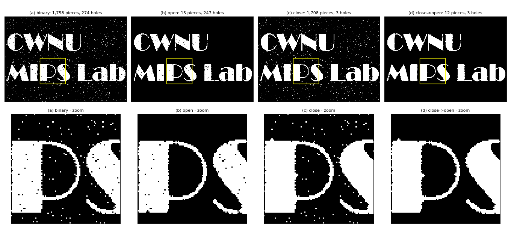

위 줄은 전체, 아래 줄은 P와 S 부분을 확대한 거예요.

1. **(a) 이진 영상:** 배경에 흰 소금 점, 글자 속에 검은 후추 점이 있어요.
2. **(b) 열림:** **배경이 깨끗한 검정**이 됐어요. 하지만 P 기둥 속의 검은 후추 점은 그대로 남아 있어요.
3. **(c) 닫힘:** P 기둥이 **꽉 찬 흰색**이 됐어요. 하지만 배경과 P 속 구멍 안의 흰 소금 점은 그대로예요.
4. **(d) 닫힘 → 열림:** **배경도 깨끗하고 기둥도 꽉 찼어요.** P의 둥근 고리와 S의 가는 꼬리도 끊어지지 않고 이어져 있어요. 7-1-b의 목표를 달성한 모습이에요.

---

## Step 7-6. 모폴로지 함정 정리

### ① `morphologyEx`의 4번째 위치 인자 (25줄)

```python
cv2.morphologyEx(src, op, kernel[, dst[, anchor[, iterations[, borderType[, borderValue]]]]])
#                                  ↑ 4번째 = dst

dst4 = cv2.morphologyEx(th_img, cv2.MORPH_CLOSE, mask, 1)   # 1은 dst 자리 → 무시됨
```

작성자는 아마 `iterations=1`을 쓰려 했을 텐데, `1`은 출력 배열 자리로 들어가 무시돼요. 기본값도 `iterations=1`이라 결과가 **우연히 같아요**(확인함). Part 6 정리의 누적표에 한 줄을 추가할게요.

| 함수 | 위치 인자 순서 | 함정 | 등장한 곳 |
|---|---|---|---|
| `cv2.Sobel` | src, ddepth, dx, dy, **dst**, ksize | 5번째 숫자는 dst | 05, 08, 17 |
| `cv2.Laplacian` | src, ddepth, **dst**, ksize | 3번째 숫자는 dst | 06, 07 |
| `cv2.GaussianBlur` | src, ksize, sigmaX, **dst**, sigmaY | 4번째 숫자는 dst | 12 |
| `cv2.Canny` | image, th1, th2, **edges**, apertureSize | 4번째 숫자는 edges | 13 |
| **`cv2.morphologyEx`** | src, op, kernel, **dst**, anchor, iterations | 4번째 숫자는 dst | **16** |

### ② `iterations`는 "열림을 여러 번"이 아니에요

```python
cv2.morphologyEx(th, cv2.MORPH_OPEN, cross, iterations=2)
```

이건 **침식, 침식, 팽창, 팽창** 순서예요("열림, 열림"이 아님). 화소 하나까지 같음을 확인했어요.
- **열림을 두 번** 하면 멱등성 때문에 열림 한 번과 같아요(18,897화소).
- **`iterations=2`**는 더 많이 지워요(17,081화소).

또 십자로 `iterations=2` 침식하는 것은 **5×5 마름모 SE로 한 번** 침식하는 것과 같아요(확인함).

```
십자 3×3 를 두 번      =     5×5 마름모 한 번
                              · · ■ · ·
                              · ■ ■ ■ ·
                              ■ ■ ■ ■ ■
                              · ■ ■ ■ ·
                              · · ■ · ·
```

즉 **`iterations`는 SE를 키우는 효과**예요. Part 8의 17번 코드가 5×17 SE로 `iterations=3` 닫힘을 하는데, 실제로는 훨씬 큰 SE를 쓰는 셈이에요.

### ③ 0/255와 0/1을 섞을 때

7-2-d의 홀짝 함정에 이어, **마스크끼리 섞을 때도** 문제가 생겨요.

```python
m255 = th                                   # OpenCV 스타일: 0 / 255
m01  = (opened > 0).astype(np.uint8)        # numpy·딥러닝 스타일: 0 / 1
mix  = cv2.bitwise_and(m255, m01)           # 결과 값: {0, 1}   ← 255가 아님!

(mix == 255).sum()   →  0          ❌ "아무것도 없네?"
(mix > 0).sum()      →  18,897     ✅
cv2.imshow(mix)      →  거의 새까맣게 보임 (1은 아주 어두운 회색)
```

**규칙 두 가지:**
1. 마스크는 만들자마자 **한 가지 형식으로 정규화**해요. 예: `mask = (m > 0).astype(np.uint8) * 255`
2. 검사할 때는 **`> 0`**을 쓰고 `== 255`는 쓰지 않아요.

### ④ 가장자리 효과 두 가지

**(가) 직접 구현:** 팽창의 테두리가 항상 0이에요. 그래서 닫힘에서 45화소가 달랐어요(7-5-d).

**(나) `cv2`의 닫힘도 가장자리에서 이상해요(새로 찾음).** `cv2.erode`는 이미지 바깥을 "255"로 취급해요(7-2-e). 그래서 **가장자리에서 1픽셀 떨어진 물체**를 닫으면, 팽창이 가장자리까지 번진 부분을 침식이 깎지 못해서 물체가 **가장자리까지 늘어나요.**

```
입력 (5×6)          cv2 닫힘 (십자)
· · · · · ·         · · ■ ■ · ·      ← 원래 없던 화소
· ■ ■ ■ ■ ·         · ■ ■ ■ ■ ·
· ■ ■ ■ ■ ·         ■ ■ ■ ■ ■ ■      ← 양쪽 가장자리까지 늘어남
· ■ ■ ■ ■ ·         · ■ ■ ■ ■ ·
· · · · · ·         · · ■ ■ · ·      ← 원래 없던 화소
```

닫힘이 원본보다 커지는 건 포함 관계상 허용되지만(f ⊆ close(f)), 바깥이 0인 무한 평면이라고 보면 원본 그대로여야 하는 경우예요. **고치는 법**은 SE 반지름만큼 0으로 덧대고 연산한 뒤 잘라내는 거예요. 이렇게 하면 원본과 정확히 같아지는 것을 확인했어요.

```python
pad = cv2.copyMakeBorder(img, 1, 1, 1, 1, cv2.BORDER_CONSTANT, value=0)
out = cv2.morphologyEx(pad, cv2.MORPH_CLOSE, cross)[1:-1, 1:-1]
```

morph.jpg에서는 가장자리에 붙은 물체가 없어서 이 효과가 0화소였어요. 하지만 **ROI를 잘라낸 영상**처럼 물체가 가장자리에 걸치는 경우에는 생길 수 있어요.

### ⑤ SE 모양의 영향

| SE | 장점 | 단점 |
|---|---|---|
| 십자 | 가는 획을 덜 다침 | 모서리를 둥글게 깎음 (7-5-b), 틈을 가운데만 이음 (7-5-c) |
| 사각 | 직사각형 복원, 틈을 꽉 메움 | 가는 획을 끊음 (morph.jpg에서 구멍 3 → 1) |
| 막대 (1×N, N×1) | **방향을 골라** 남기거나 이음 | 다른 방향 구조는 사라짐 |

---

## Step 7-7. 🚗 AVM 연결

- **주차선 마스크 정리:** 밝기나 색으로 이진화한 탑뷰 주차선 마스크에 **닫힘 → 열림**을 적용해요. 닫힘이 닳은 페인트의 구멍과 끊긴 틈을 메우고, 열림이 아스팔트 반사 점과 자갈 질감을 지워요. 순서를 정하는 원리는 7-5-e의 ②와 같아요.
- **SE 크기 = 실제 크기:** 탑뷰는 픽셀과 실제 거리가 비례하니까 SE 크기를 **cm 단위로** 정할 수 있어요. 예를 들어 1px = 2cm라고 가정하면, 3×3 열림은 대략 폭 6cm 미만의 얇은 잡음을 지워요. 폭 15cm인 주차선은 지키면서 반사 점은 지우는 크기를 계산으로 고를 수 있어요.
- **방향성 SE:** 차량과 나란한 주차선을 이을 때는 **선 방향의 막대 SE**(예: 1×15)로 닫으면, 선을 따라서만 틈을 메우고 옆 선과는 붙지 않아요. Part 8의 17번이 번호판 글자를 하나로 묶으려고 **가로로 긴 5×17 SE**를 쓰는 것도 같은 발상이에요. 단, 점선 차선에 쓰면 점선끼리 이어 붙어 실선이 될 수 있으니 SE 길이는 점선 간격보다 짧게 잡아야 해요.
- **딥러닝 분할 마스크와 섞을 때:** 주차 공간이나 주행 가능 영역 같은 분할 네트워크 출력은 보통 **0/1(또는 클래스 번호)**이고, OpenCV 이진화는 **0/255**예요. 7-6-③의 함정이 실무에서 가장 흔히 터지는 곳이에요. 후처리 순서는 보통 이래요: 닫힘(구멍 메우기) → 열림(섬 제거) → `connectedComponents`로 가장 큰 덩어리만 남기기.
- **자차·카메라 하우징 마스크:** 탑뷰 가장자리나 ROI 경계에 걸친 마스크를 닫으면 7-6-④(나)처럼 가장자리로 번질 수 있어요. 덧대고 자르는 습관을 들이세요.

---

## 🏁 Part 7 정리: 모폴로지

| 개념 | 한 줄 정리 |
|---|---|
| 구조 요소 | 곱할 가중치가 아니라 "볼 곳" 모양 (십자, 사각, 타원, 막대) |
| 침식 / 팽창 | 전부 물체면 255 / 하나라도 물체면 255 = **최소 / 최대 필터** |
| 쌍대성 | erode(f) = 255 − dilate(255 − f), open(f) = 255 − close(255 − f) |
| 열림 | 침식 → 팽창. **소금, 가는 털, 뾰족한 모서리 제거.** 결과 ⊆ 원본 |
| 닫힘 | 팽창 → 침식. **후추, 작은 구멍, 좁은 틈 메움.** 원본 ⊆ 결과 |
| 순서 | morph.jpg에서는 닫힘 → 열림이 더 나음 (12조각 vs 15조각). 더 해로운 잡음을 보고 결정 |
| 미디언과 비교 | 소금·후추가 섞인 경우엔 3×3 미디언이 최고(11조각, 3구멍). 모폴로지는 **한쪽만, 모양 선택, 크기 보장** |
| 멱등성 | 열림, 닫힘은 두 번 해도 같음 → 더 지우려면 SE를 키움 |
| `iterations` | 반복이 아니라 침식 k번 → 팽창 k번 = **SE를 키우는 효과** |
| 기타 연산 | 그래디언트 = 윤곽, 탑햇 = 열림이 버린 것, 블랙햇 = 닫힘이 채운 것 |

**찾은 코드 문제:**

| # | 위치 | 문제 | 영향 |
|---|---|---|---|
| 1 | 14·15번, `Common/filters.py` | 비트 AND가 **끝 비트(홀짝)만** 봄 | maxval이 128이나 200이면 결과 전부 0, 회색조 입력이면 엉터리 |
| 2 | 15번, `filters.dilate` | 테두리가 항상 0 | 팽창 84화소, 닫힘 45화소 차이 (전부 테두리 근처) |
| 3 | 16번 25줄 | `morphologyEx(..., 1)`의 1 → dst | 기본값과 같아 우연히 무해 |
| 4 | `cv2` 자체 동작 | 닫힘이 가장자리 1px 안쪽 물체를 가장자리로 늘림 | 덧대고 자르기로 해결 |
| — | 15번 3줄 | `mask` 기본값 없이 `None` 검사 | 사소함 |

### ✅ 확인 질문

1. 주차선 탑뷰 마스크에 **1×9 가로 막대 SE**(가로 9칸, 세로 1칸)로 **열림**을 하면 무엇이 남고 무엇이 사라질까요? 세로 주차선은 어떻게 될까요?
2. 흰 글자 속에 **3×3 크기(9화소)의 검은 구멍**이 있어요. 3×3 **십자** SE로 닫으면 구멍이 다 메워질까요? 어떤 모양으로 남을까요? (힌트: 7-5-a의 붓 비유를 **배경 쪽**에서 생각해 보세요. 이번 Part의 첫 퀴즈와 쌍대예요.)
3. `cv2.morphologyEx(f, cv2.MORPH_OPEN, cross, iterations=3)`과 열림을 세 번 반복한 `open(open(open(f)))` 중 어느 쪽이 더 많이 지울까요? 이유는요?

---

다음은 **Part 8: 번호판 검출** ([chap07/17.detect_plate.py](chap07/17.detect_plate.py))이에요. chap07에서 배운 것을 전부 조합하는 실전 예제예요.
- **블러 → 소벨(세로 에지) → 이진화 → 5×17 닫힘 `iterations=3` → 윤곽선 → 가로세로 비율 검사** 파이프라인을 단계별 중간 영상으로 따라가요.
- 계획 단계에서 이미 본 문제를 실험으로 확인해요.
  - `cv2.Sobel(gray, cv2.CV_8U, 1, 0, 5)`의 **5가 무시**되는 문제 (위치 인자 함정의 마지막 등장)
  - **`CV_8U`가 음수를 잘라** 밝아지는 쪽 에지만 남기는 문제
- 마지막으로 AVM의 **주차 칸·주차선 후보 검출**과 어떻게 같은 구조인지 연결해요.

**"다음"**이라고 하시면 이어가고, 어려운 부분이 있으면 **"더 쉽게"**라고 해 주세요. 이번에도 파일은 수정하지 않았어요.


---

## Q19  <sub>2026-10-28T12:14:03.942Z</sub>

> 다음


### A19

17번 코드와 그 후속인 chap12의 후보 검출 함수까지 확인했어요. 이제 19장 전체에 후보 검출을 돌려서 번호판이 잡히는지 눈으로 검증할게요.

# Part 8. 번호판 후보 검출 — [chap07/17.detect_plate.py](chap07/17.detect_plate.py) + chap07 마무리

chap07의 마지막 Part예요. 숫자는 전부 실행해서 확인했어요(19장 모두 처리).

먼저 지난번 예고를 하나 바로잡을게요. 17번 코드는 **20줄의 닫힘 연산에서 끝나요.** "윤곽선 → 가로세로 비율 검사"는 17번이 아니라 이 파이프라인의 다음 편인 [chap12/header/plate_preprocess.py](chap12/header/plate_preprocess.py)의 `find_candidates`에 있어요. 이번에는 그 함수를 **가져와서** 17번 결과에 붙여 성능을 측정했어요(파일은 수정하지 않았어요).

이번 Part의 핵심은 세 가지예요.
- **위치 인자 함정의 마지막 등장**이에요. 그리고 이번에도 13번처럼 **버그가 프로그램을 살렸어요.** 의도대로 5×5 소벨이 적용되면 번호판을 **0/19장** 찾아요.
- `CV_8U`가 음수를 버리는 건 Part 2 기준으로는 잘못이에요. 그런데 이 작업에서는 **양쪽 에지를 다 쓰면 오히려 더 못 찾아요**(14장 → 11장). 고치기 전에 측정해야 하는 이유예요.
- chap12의 후보 필터까지 붙이면 **19장 중 14장**에서 번호판을 찾아요. 놓친 5장의 원인도 둘로 나눠 분석했어요.

---

## 🔁 Part 7 퀴즈 답

**1번. 1×9 가로 막대 SE로 열림**

"가로로 9칸짜리 막대가 들어갈 수 있는 곳만 남는다"예요.

| 구조 | 결과 (실험) |
|---|---|
| 가로선 (두께 1px, 길이 50) | **50/50 화소 남음.** 두께가 1px이어도 가로로 길면 살아남음 |
| 세로선, 폭 7px | **0/210 화소.** 가로로 막대가 안 들어감 → 전부 사라짐 |
| 세로선, 폭 12px | **360/360 화소 남음.** 폭이 9px 이상이면 막대가 가로로 들어감 |

그래서 세로 주차선이 남을지는 **탑뷰 해상도에 달려 있어요.** 예를 들어 폭 15cm 선이 2cm/px이면 7.5px라서 사라지고, 1cm/px이면 15px라서 남아요. 가로 막대 열림은 사실상 **"가로 방향 길이 필터"**예요.

**2번. 3×3 구멍을 십자로 닫으면 구멍이 + 모양(5화소)으로 남아요.**

```
원래 구멍(검정 = ■)    닫힘 후 남은 구멍
· · · · · · ·          · · · · · · ·
· · · · · · ·          · · · · · · ·
· · ■ ■ ■ · ·          · · · ■ · · ·
· · ■ ■ ■ · ·    →     · · ■ ■ ■ · ·
· · ■ ■ ■ · ·          · · · ■ · · ·
· · · · · · ·          · · · · · · ·
```

배경 쪽에서 십자 붓이 구멍 안에 들어갈 수 있으니 + 모양만큼은 구멍으로 남아요. 붓이 닿지 못하는 네 모서리만 메워져요. 지난번 "정사각형을 십자로 열면 + 모양"과 정확히 **쌍대**예요.

**3번. `iterations=3`이 훨씬 많이 지워요.**

| 방법 | 남은 화소 |
|---|---|
| `morphologyEx(OPEN, iterations=3)` | **16,059** |
| `open(open(open(f)))` | 18,897 (= 열림 한 번, 멱등성) |

`iterations=3`은 침식 3번 → 팽창 3번이라 SE를 7×7 마름모로 키운 것과 같아요.

---

## Step 8-1. 전체 그림: chap07을 한 줄로 꿰기

```
컬러 → 회색조 → ① 평균 블러 5×5 → ② 소벨 x방향 → ③ 이진화 >120 → ④ 닫힘 5×17 ×3 → ⑤ [chap12] 윤곽선 + 비율·넓이 검사
         (chap06)    (Part 4)         (Part 2)        (chap06)          (Part 7)              (chap12 미리보기)
                                                                       ↑ 17번은 여기까지
```

**핵심 아이디어: "글자는 세로획이 빽빽한 가로 띠"**
- 번호판 글자(숫자, 한글)에는 **세로 획**이 많고, 그 획들이 **가로로 촘촘히** 늘어서 있어요. 그래서 x방향 미분(세로 에지)이 **좁은 가로 띠 안에 빽빽하게** 모여요.
- 반면 차체의 범퍼, 그릴 살, 보닛 선은 대부분 **가로선**이라 x방향 미분에 약하게 반응해요.
- 그래서 세로 에지만 뽑고 **가로로 긴 SE로 닫으면**, 글자들의 에지가 하나로 뭉쳐 **번호판 모양의 흰 덩어리**가 돼요.

---

## Step 8-2. 프로그램 구조 (3 ~ 13줄)

```python
while True:
    no = int(input("차량 영상 번호( 0:종료 ) : "))      # 4줄: 콘솔에서 번호 입력
    if no == 0: break;                                   # 5줄: 0이면 종료 (세미콜론은 무해)
    fname = "images/test_car/{0:02d}.jpg".format(no)     # 7줄: 5 → "05.jpg" (두 자리, 앞을 0으로 채움)
    image = cv2.imread(fname, cv2.IMREAD_COLOR)
    if image is None: ... continue                       # 9~11줄: 파일이 없으면 다시 입력
    mask = np.ones((5, 17), np.uint8)                    # 13줄: 5×17 사각 SE
```

- **입력이 숫자가 아니면** `int("abc")`에서 `ValueError`가 나서 프로그램이 끝나요.
- `test_car` 폴더에는 01 ~ 07, 09 ~ 20번, **19장**이 있어요. **08번은 없어서** "08번 영상 파일이 없습니다"가 떠요.
- **10.jpg와 20.jpg는 화소 하나까지 같은 파일**이에요(확인함). 실제로 서로 다른 사진은 18장이에요.
- 실행 위치는 `chap07` 폴더여야 상대 경로가 맞아요. `.vscode/launch.json`의 `cwd=${fileDirname}`이 이걸 해 줘요.

---

## Step 8-3. ① 평균 블러 5×5 (15줄)

```python
gray = cv2.blur(gray, (5, 5))
```

> 📚 **복습 (Part 4):** `cv2.blur`는 평균 필터예요. 5×5 안의 25칸을 똑같이 1/25씩 섞어요.

미분 전에 블러하는 이유는 캐니 ① 단계(6-3)와 같아요. **미분은 잡음을 키우니까 먼저 누르는 거예요.** 여기서는 잡음뿐 아니라 나무, 아스팔트, 건물 같은 **잔 질감**도 함께 누르는 효과가 커요.

---

## Step 8-4. ② 소벨 (16줄): 함정 두 개

```python
gray = cv2.Sobel(gray, cv2.CV_8U, 1, 0, 5)     # x방향 미분 (세로 에지)
```

### 8-4-a. ⚠️ 5는 또 `dst` 자리예요 (위치 인자 함정의 마지막 등장)

`cv2.Sobel(src, ddepth, dx, dy, dst, ksize)`이니까 5는 dst로 들어가 무시되고, **ksize는 기본값 3**이에요.

| 비교 | 결과 |
|---|---|
| 코드 결과 vs `ksize=3` | **완전히 같음** |
| 코드 결과 vs `ksize=5` | 다름 |

**의도대로 5×5가 적용됐다면?** 6-8-d에서 본 것처럼 크기 값이 12 ~ 14배 커져요. 임계값 120이 너무 낮아지니 거의 모든 곳이 흰색이 되고, 닫힘이 그걸 커다란 덩어리로 뭉쳐요. 19장 전체로 실험했어요.

```
의도대로 ksize=5 적용  →  번호판 검출 0 / 19장  ❌
코드 그대로 (ksize=3)  →  번호판 검출 14 / 19장  ✅
```

13번 컬러 캐니와 **똑같은 패턴**이에요. 임계값 120은 3×3 소벨에 맞춰 손으로 튜닝된 값이라, 무시된 5 덕분에 프로그램이 동작해요.

### 8-4-b. ⚠️ `CV_8U`는 음수를 0으로 잘라요

> 📚 **복습 (Part 1 ~ 2):** 미분 결과는 음수가 나올 수 있어요. 그래서 Part 2에서는 `CV_16S`나 `CV_32F`로 받은 뒤 절댓값을 썼어요.

`CV_8U`로 받으면 OpenCV가 **포화(saturate)** 처리를 해요. 0 미만은 0, 255 초과는 255가 돼요. 실제로 `CV_8U` 결과는 `clip(CV_16S 결과, 0, 255)`와 **화소 하나까지 같았어요.**

13.jpg(검은 쏘나타)에서 번호판 가운데 줄(y = 309, x = 224 ~ 261)을 실제로 잘라 보면 이래요.

```
x      : 224 ... 233  234  235  236 ... 240  241  242  243  244  245  246  247  248  249  250  251  252  253  254  255  256  257
원본   : 139 ... 208  163   93   76 ...  75   56   43   12   18   86  174  234  233  212  186  116   37   11   55  146  221  233
                         └ 획 ┘          └───── 어두운 획 ─────┘                         └ 획 ┘
Gx(부호): ... −162 −172 −125  −47 ... −104 −172 −107   41  156  236  254  182   30 −154 −282 −280 −162   −1  150  259  245
CV_8U  : ...    0    0    0    0 ...    0    0    0   41  156  236  254  182   30    0    0    0    0    0  150  255  245
>120   :        ·    ·    ·    · ...    ·    ·    ·    ·    ■    ■    ■    ■    ·    ·    ·    ·    ·    ·    ■    ■    ■
```

**읽는 법:**
- 흰 번호판 위의 **검은 획 하나**를 왼쪽에서 오른쪽으로 지나가면 밝음 → 어두움(**음수** 골짜기) → 밝음(**양수** 봉우리)이 나와요.
- `CV_8U`는 음수 골짜기를 **0으로 버리고** 양수 봉우리만 남겨요. 즉 **검은 획의 오른쪽 가장자리만** 남아요.
- 13.jpg 전체에서 **41.6%**의 화소가 음수라서 버려졌어요. 120을 넘는 화소도 양쪽을 다 쓰면 5,355개인데 `CV_8U`에서는 2,736개로 **약 절반**이에요. 255로 포화된 화소도 330개 있었어요.

**그럼 버그일까요? 19장으로 측정해 봤어요.**

| 소벨 처리 | 번호판 검출 | 거짓 후보 |
|---|---|---|
| **코드 그대로 (`CV_8U`, 한쪽만)** | **14 / 19** | 16 |
| 양쪽 모두 (`convertScaleAbs(CV_16S)`) | 11 / 19 | 19 |

**양쪽을 다 쓰면 오히려 나빠졌어요.** 이유는 이래요.
- 번호판에는 획이 충분히 많아서, **획마다 에지 하나**(오른쪽)만 있어도 닫힘으로 충분히 뭉쳐져요.
- 양쪽을 다 쓰면 번호판 주변의 그릴, 전조등, 차체 테두리 에지도 **두 배**가 돼요. 이것들이 번호판 덩어리와 **붙어 버려서** 모양 검사를 통과하지 못해요(02, 11, 19번이 새로 놓쳐졌어요).

> 📌 **교훈:** Part 2 기준으로 `CV_8U`는 "틀린" 코드예요. 일반적인 에지 검출이라면 반드시 고쳐야 해요. 하지만 **이 작업, 이 임계값, 이 SE 조합**에서는 결과가 더 좋아요. 코드를 "고치기" 전에 **측정할 테스트 세트**부터 있어야 하는 이유예요. 그리고 "왜 한쪽만 써도 되는지"를 이해하고 쓰는 것과 우연히 동작하는 것은 다른 문제예요. 의도라면 주석이나 `np.clip`으로 **명시**해 두세요.

---

## Step 8-5. ③ 이진화 (19줄)

```python
_, th_img = cv2.threshold(gray, 120, 255, cv2.THRESH_BINARY)    # 미분값 > 120 → 255
```

밝기가 아니라 **미분값(에지 세기)**을 이진화해요. 120은 고정값이라 조명과 대비에 민감해요. 어두운 지하 주차장이나 역광에서는 같은 번호판도 에지 세기가 약해져 놓칠 수 있어요. 그래서 실무에서는 오츠(Otsu) 같은 자동 임계값이나 영상별 정규화를 함께 고려해요.

---

## Step 8-6. ④ 닫힘 5×17, `iterations=3` (20줄)

```python
morph = cv2.morphologyEx(th_img, cv2.MORPH_CLOSE, mask, iterations=3)
```

### 8-6-a. 실제로는 13×49 SE 한 번

7-6-②에서 본 대로 `iterations=3`은 "팽창 3번 → 침식 3번"이에요. 사각 SE를 k번 팽창하면 SE가 그만큼 커지니까:

```
a×b 사각형을 k번  =  (k·(a−1) + 1) × (k·(b−1) + 1) 사각형 한 번

5×17, 3번  →  (3·4 + 1) × (3·16 + 1)  =  13 × 49
```

`close(5×17, iterations=3)`과 `close(13×49)`가 **화소 하나까지 같았어요**(팽창만 따로 비교해도 같음).

**왜 가로로 길까요?** 글자와 글자 사이, 한글 글자의 획과 획 사이에 **가로 간격**이 있어요. 가로 49칸이 이 간격을 넘어 글자들을 한 덩어리로 이어 줘요. 세로 13칸은 획 위아래의 작은 끊김을 메워요.

### 8-6-b. 반복 횟수에 따른 변화 (13.jpg)

| `iterations` | 윤곽선 수 | 흰 영역 비율 | 19장 검출 |
|---|---|---|---|
| 1 (실제 5×17) | 50 | 2.0% | **4 / 19** (글자가 다 안 이어짐) |
| 2 (실제 9×33) | 31 | 3.1% | — |
| **3 (실제 13×49)** | 27 | 4.1% | **14 / 19** |

> 🔧 **사소한 메모:** 24줄의 창 제목이 `"opening"`인데 실제 연산은 **닫힘**이에요.

---

## Step 8-7. ⑤ [chap12 미리보기] 후보 고르기, 그리고 성능 측정

### 8-7-a. `find_candidates` (chap12/header/plate_preprocess.py)

```python
def find_candidates(image):
    contours = cv2.findContours(image, cv2.RETR_EXTERNAL, cv2.CHAIN_APPROX_SIMPLE)[0]   # 바깥 윤곽선만
    rects = [cv2.minAreaRect(c) for c in contours]          # 각 덩어리를 감싸는 최소 회전 사각형
    return [r for r in rects if verify_aspect_size(r[1])]   # 크기·비율 검사 통과한 것만

def verify_aspect_size(size):
    w, h = size
    aspect = 긴 변 / 짧은 변
    return 3000 < w*h < 12000 and 2.0 < aspect < 6.5         # 넓이(픽셀²), 가로세로 비율
```

비율 범위 2.0 ~ 6.5는 국내 번호판 실물 비율을 포함하도록 잡은 거예요. 긴 번호판 520×110mm는 약 4.7, 예전 짧은 번호판 335×155mm는 약 2.2예요.

### 8-7-b. 19장 결과

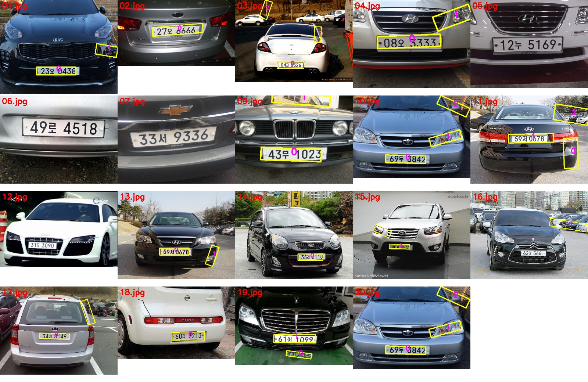

노란 상자가 후보이고, 분홍 숫자는 후보 번호예요.

```
번호판 찾음 : 14 / 19장   (01 02 03 04 09 10 11 13 14 15 17 18 19 20)
놓침       :  5 / 19장   (05 06 07 12 16)
후보 총 30개 = 번호판 14 + 거짓 16 (전조등 모서리, 후미등 옆, 배경 건물·차량 등)
```

**놓친 5장의 원인을 하나씩 확인했어요.** 번호판 자리에 있는 덩어리를 찾아 크기를 쟀어요.

| 사진 | 번호판 덩어리 | 넓이 | 비율 | 원인 |
|---|---|---|---|---|
| 05 | 68 × 362 | **24,698** | 5.32 | **너무 큼** (> 12,000). 번호판이 화면을 꽉 채운 근접 사진 |
| 06 | 283 × 59 | **16,762** | 4.79 | **너무 큼** |
| 07 | 58 × 332 | **19,557** | 5.65 | **너무 큼** |
| 12 | 575 × 177 | 101,927 | 3.25 | 검은 그릴과 LED 전조등에 **붙어 버림** |
| 16 | 288 × 181 | 52,151 | **1.59** | 그릴 무늬에 **붙어 버림**. 비율도 탈락 |

- **05 ~ 07:** 비율은 완벽한데 **넓이를 픽셀 절댓값**으로 검사해서 떨어졌어요. 같은 번호판도 카메라와의 거리에 따라 크기가 달라지니까요.
- **12, 16:** 13×49짜리 강한 닫힘이 번호판을 주변 구조물과 **이어 붙였어요.**

### 8-7-c. 설정을 바꿔 가며 측정

| 실험 | 검출 | 거짓 후보 | 놓친 사진 |
|---|---|---|---|
| **A. 코드 그대로** | **14** | 16 | 05 06 07 12 16 |
| B. 소벨 양쪽 극성 | 11 | 19 | + 02 11 19 |
| C. 의도대로 `ksize=5` | **0** | 2 | 전부 |
| D. 넓이를 **영상 대비 비율**(0.5 ~ 15%)로 | **17** | **38** | 12 16 |
| E. chap12의 5×13 SE | 15 | 23 | 05 06 07 12 |
| F. `iterations=1` | 4 | 15 | 15장 |
| G. D + B | 14 | 44 | 06 11 12 16 19 |

1. **넓이를 상대값으로(D):** 근접 사진 3장을 되찾았어요(17/19). 하지만 거짓 후보가 16개에서 38개로 늘었어요. **찾는 비율과 헛것 사이의 맞교환**이에요.
2. **SE를 줄이면(E):** 16번을 되찾았지만 거짓이 늘었어요. chap12가 5×13을 쓰는 것도 이 균형을 다시 잡은 결과로 보여요.
3. **그래서 실제 시스템은 두 단계로 가요.** ① 후보를 넉넉히 뽑고(높은 재현율) ② 각 후보를 따로 검증해요(높은 정밀도). chap12는 바로 이 ②단계로 색상 검사와 SVM 분류를 붙여요. Part 6-6의 이력 임계값("강한 것에서 출발해 약한 것까지")과 비슷한 철학이에요.

### 8-7-d. 🖼️ 중간 단계 그림 (13.jpg)

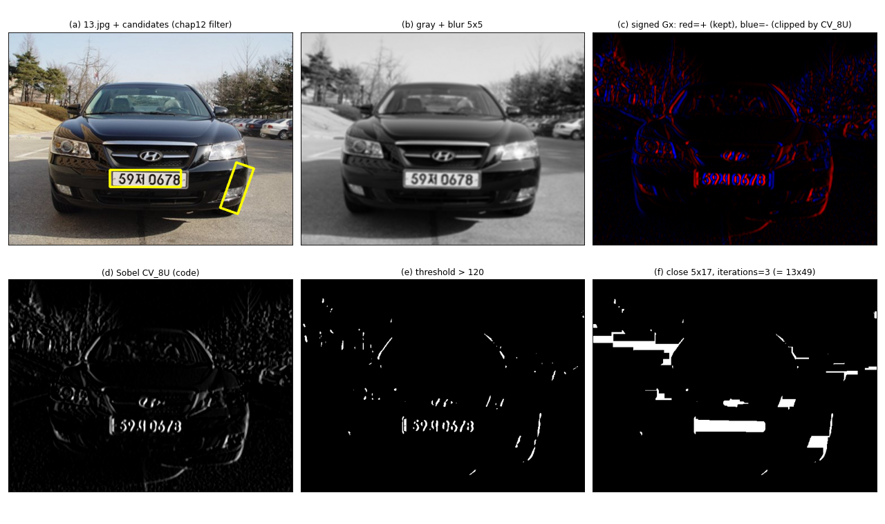

1. **(a) 결과:** 번호판 "59저 0678"에 노란 상자, 오른쪽 범퍼 모서리에 거짓 후보 하나가 있어요.
2. **(b) 블러:** 나무와 아스팔트의 잔 질감이 뭉개졌어요.
3. **(c) 부호 있는 Gx:** 빨강은 양수(남는 쪽), 파랑은 음수(`CV_8U`가 버리는 쪽)예요. 번호판 글자마다 **파랑-빨강 쌍**이 촘촘히 붙어 있어요. 반면 차체는 대부분 어둡고 약해요.
4. **(d) `CV_8U` 소벨:** 파랑이 사라지고, 번호판 글자가 **밝은 세로 줄무늬**로 도드라져요.
5. **(e) > 120:** 번호판 글자 줄무늬와 차체 윤곽 일부, 나무 몇 점만 남아요.
6. **(f) 닫힘 13×49:** 번호판이 **꽉 찬 흰 직사각형** 하나가 됐어요. 그 밖에 왼쪽 배경 건물, 범퍼 모서리 같은 덩어리들도 생겨서 ⑤단계의 비율·넓이 검사가 필요해요.

---

## Step 8-8. 🚗 AVM 연결: 주차선·주차 칸 검출은 같은 뼈대예요

```
번호판 : 블러 → x방향 미분 → 이진화 → 가로 막대 닫힘     → 윤곽선 → 비율·넓이 검사 → 분류기 검증
주차선 : 탑뷰 → 선 방향 미분 → 이진화 → 선 방향 막대 닫힘 → 윤곽선 → 폭·길이·각도 검사 → 추적·검증
```

- **탑뷰에서는 절대 크기 검사가 오히려 강점이에요.** 번호판에서는 넓이를 픽셀로 고정해서 근접 사진을 놓쳤죠(05 ~ 07). 보정된 탑뷰는 **픽셀 = 실제 cm**라서 "선 폭 10 ~ 20cm", "주차 칸 폭 약 2.5m(국내 일반형)" 같은 **물리 단위 조건**을 그대로 쓸 수 있어요.
- **부호는 버리지 말고 써요.** 어두운 아스팔트 위의 흰 주차선을 가로지르면 **왼쪽 경계는 +Gx, 오른쪽 경계는 −Gx**가 나와요. "+에지 다음에 선 폭만큼 떨어져 −에지가 오는 쌍"을 찾는 건 고전적이고 강력한 차선·주차선 검출법이에요. 번호판에서는 `CV_8U`로 한쪽을 버려도 괜찮았지만, 주차선에서는 **부호 자체가 정보**예요. Part 2에서 `CV_16S`나 `CV_32F`를 쓰라고 한 이유가 여기서 다시 살아나요.
- **두 단계 설계:** 후보 생성(재현율)과 검증(정밀도)을 나누는 구조는 AVM 주차 보조에서도 그대로예요. 프레임 사이 추적이 검증 역할을 하고, 7-7의 히스테리시스처럼 "검출 시작"과 "유지" 기준을 다르게 둬요.
- **튜닝 값의 출처를 기록하세요.** 120, 5×17, 3회, 3000 ~ 12000은 모두 이 19장에 맞춰진 값이에요. 이 값들을 config로 빼고 측정 세트와 함께 관리하는 것이 [projects/cvkit/tuner.py](projects/cvkit/tuner.py)가 하려는 일이에요.

---

## 🏁 chap07 전체 정리

### Part별 한 장 요약

| Part | 주제 | 핵심 한 줄 | 파일 |
|---|---|---|---|
| 1 | 회선 | 마스크를 겹쳐 곱해서 더해 **새 배열**에 쓴다. 합이 1이면 밝기 유지, 0이면 디테일만 | 01, 02 |
| 2 | 1차 미분 | 이웃 차이 = 기울기. 소벨 = 스무딩 [1 2 1] × 차분 [−1 0 1] | 03 ~ 05 |
| 3 | 2차 미분 | 라플라시안은 방향 무관, 영교차. 잡음에 매우 약함 | 06 |
| 4 | 잡음 제거 | 평균(가우시안 잡음), 가우시안(σ와 분리), 미디언(소금·후추), 최소·최대 | 09 ~ 12 |
| 5 | LoG / DoG | 먼저 흐리고 미분 = 한 번에. DoG ≈ LoG (비율 1.6) | 07 |
| 6 | 캐니 | 블러 → 크기·방향 → NMS → 이력 임계값. 3조건을 만족 | 08, 13 |
| 7 | 모폴로지 | 침식·팽창 = 최소·최대. 열림은 소금을, 닫힘은 후추를 지움 | 14 ~ 16 |
| 8 | 번호판 후보 | 세로 에지 + 가로 막대 닫힘 + 모양 검사 = 전부 조합 | 17 |

### OpenCV 위치 인자 함정 최종표

| 함수 | 4·5번째 위치의 정체 | 등장 | 결과 |
|---|---|---|---|
| `Sobel(src, ddepth, dx, dy, dst, ksize)` | 5번째 = dst | 05, 08, **17** | 3은 우연히 무해. **17번의 5는 무시돼서 오히려 동작** |
| `Laplacian(src, ddepth, dst, ksize)` | 3번째 = dst | 06, 07 | 07의 9가 무시됨 |
| `GaussianBlur(src, ksize, sigmaX, dst, sigmaY)` | 4번째 = dst | 12 | sigmaY 1.3이 무시됨 |
| `Canny(img, t1, t2, edges, apertureSize)` | 4번째 = edges | 13 | 5가 무시돼서 오히려 동작 |
| `morphologyEx(src, op, kernel, dst, ...)` | 4번째 = dst | 16 | 1은 기본값과 같아 무해 |

> 📌 **chap07의 가장 큰 실무 교훈:** 숫자 옵션은 **항상 키워드로** 쓰세요. 그리고 "고쳤더니 더 나빠지는" 경우(13, 17)가 있으니, **측정할 테스트 세트**를 먼저 두고 고치세요.

### ✅ 확인 질문

1. 예전 **녹색 번호판**(어두운 바탕에 **흰 글자**)이라면 `CV_8U` 소벨은 글자 획의 **어느 쪽 가장자리**를 남길까요? 그래도 검출은 될까요?
2. chap12는 `np.ones((5, 13))`에 `iterations=3`을 써요. **실제 SE 크기**는 얼마일까요?
3. 06.jpg의 번호판 덩어리는 넓이가 16,762라서 탈락했어요. 처리 전에 영상을 **가로세로 절반으로 줄이면** 넓이 검사는 통과할까요? 대신 블러와 SE 입장에서는 무엇이 달라질까요?

---

chap07이 모두 끝났어요. 수고 많으셨어요! 🎉

- 지난 장처럼 이번 세션을 `study-notes/chap07/`로 정리할까요? 이번엔 Part 하나가 여러 답변으로 나뉘어 있어서, 정리 전에 [study-notes/tools/extract_session.py](study-notes/tools/extract_session.py)가 같은 Part의 블록들을 **순서대로 이어 붙이도록** 먼저 손봐야 해요.
- 어떤 Part든 다시 보고 싶으면 **"Part N 더 쉽게"**라고 하시면 HTML 시각화로 설명할게요.

이번에도 저장소 파일은 수정하지 않았어요.


---

## Q20  <sub>2026-10-28T12:20:16.045Z</sub>

> 지금 보니까 너가 Part6 설명 이전의 세션을 compact 시켜놔서 내가 못읽네? 
> 너가 compact 시켜놓은 세션을 원문 그대로 복원해서 마크다운으로 저장좀 해놔줘. 나 못읽었어 ㅠㅜ


---

## Q21  <sub>2026-10-28T12:21:38.721Z</sub>

> 지금 보니까 너가 Part6 설명 이전의 세션을 compact 시켜놔서 내가 못읽네? 
> 너가 compact 시켜놓은 세션을 원문 그대로 복원해서 마크다운으로 저장좀 해놔줘. 나 못읽었어 ㅠㅜ


---

## Q22  <sub>2026-10-28T12:22:50.346Z</sub>

> 세션 정리


---

## Q23  <sub>2026-10-28T12:23:27.243Z</sub>

> 이번 세션을 study-notes/chap07/로 정리
